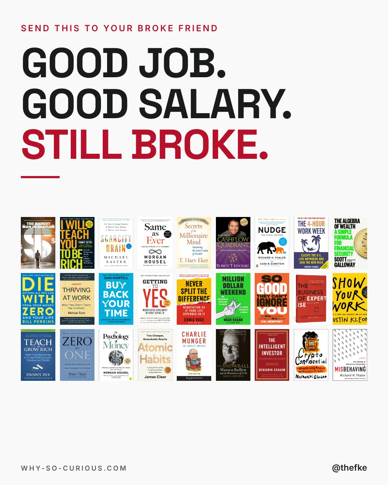
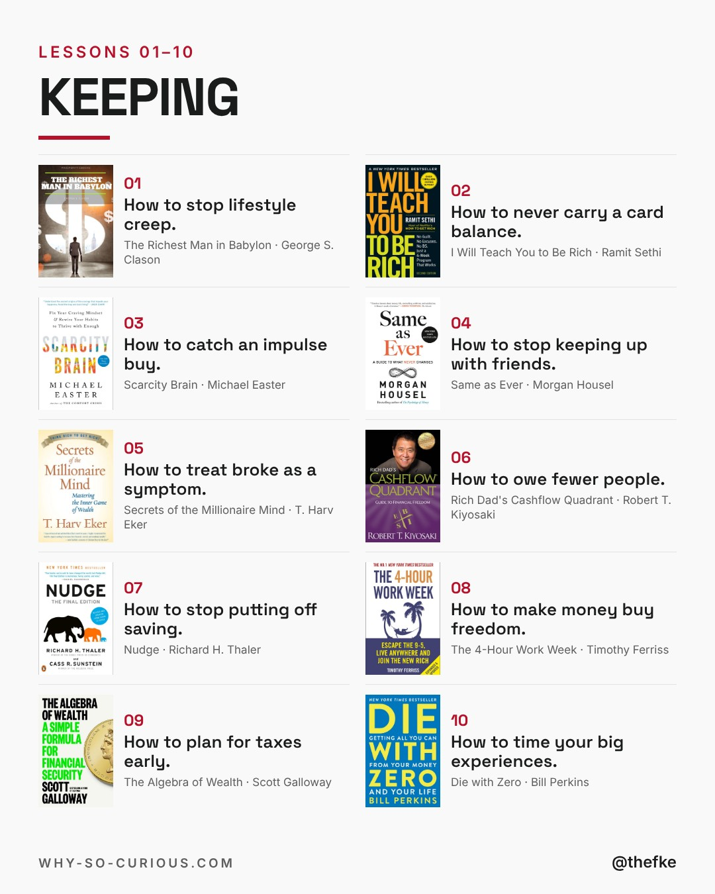
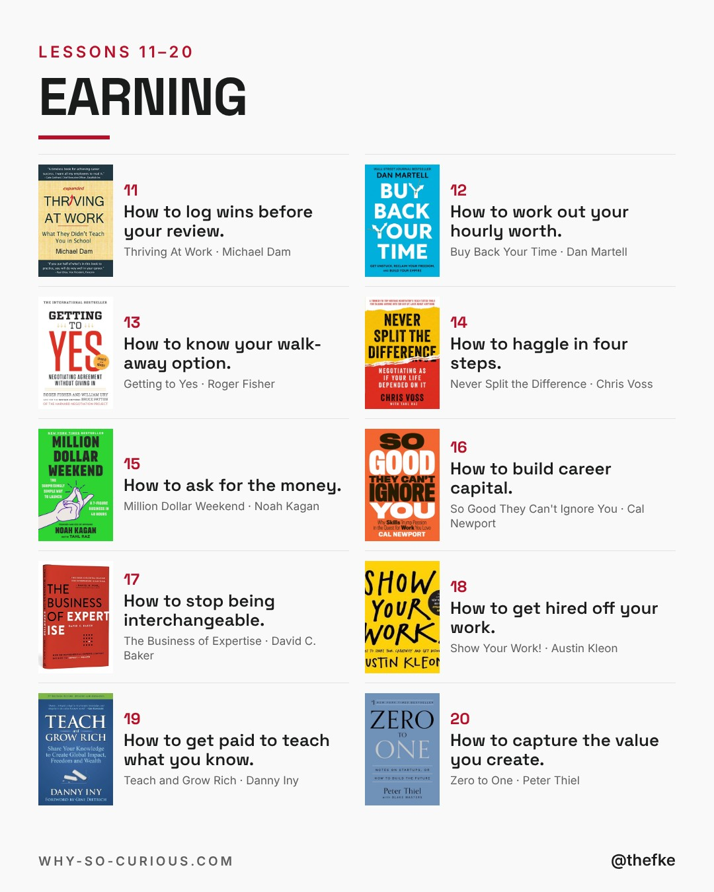
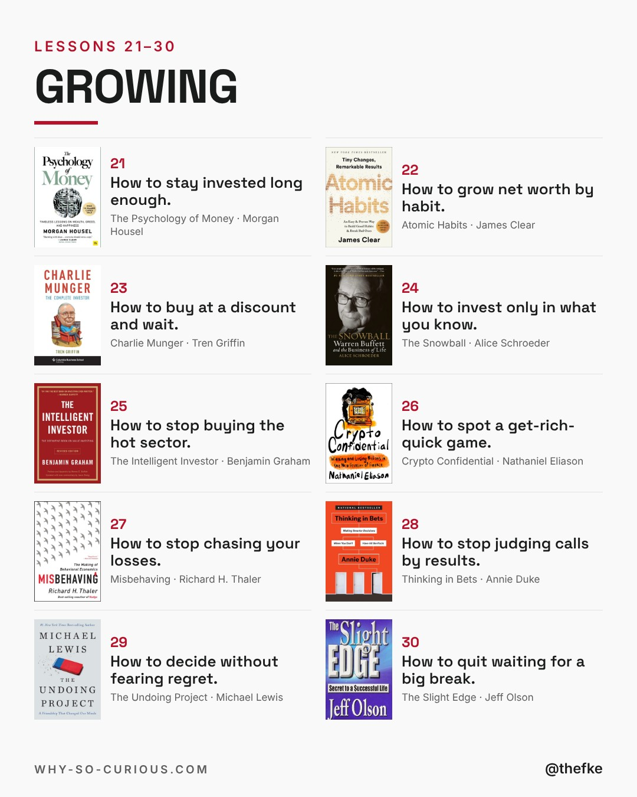
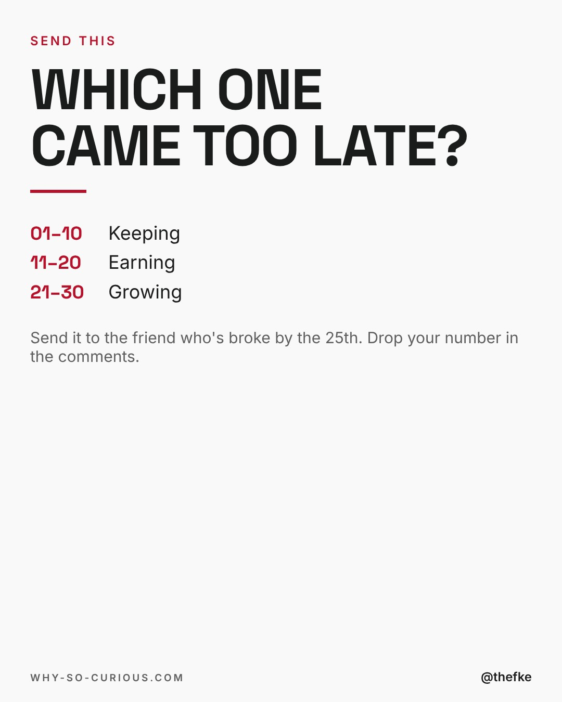

# Mo 02.11. · Money School Never Taught You

Karussell, 5 Slides. Beim Hochladen 4:5 wählen.

## Caption

```
Got the raise. Still broke by the 25th.
Rent, loan, card bill. Then nothing.

School taught you algebra.
Nobody taught you lifestyle creep.

30 money lessons. One book for each.

Morgan Housel puts it plainly:
"Wealth is just the accumulated leftovers after you spend what you take in."

Send this to the friend who's broke by the 25th.
Which one do you wish you knew at 22?

#books #bookstagram #bookrecommendations #reading #thefke #booklover #whysocurious
```

## Slides






