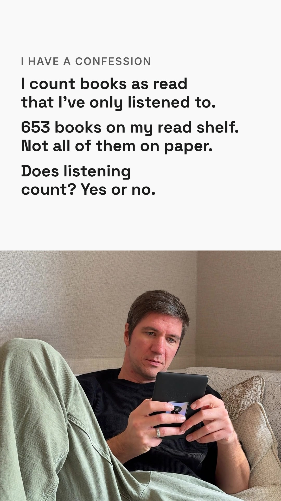

# Mo 09.11. · I have a confession

Reel, 9:16, 11 Sekunden, ohne Ton. Abend-Slot 19 bis 20 Uhr MEZ, Format aus dem Hotel-Dreh (IMG_3001, Florentin, 28.10.). Test, weil Reels auf @thefke seit 10.10. pausiert sind.
Oben tippt sich der Text ein, unten liest Thomas auf dem Sofa. Sound in Edits by Instagram setzen. Als Titelbild `reel_cover.jpg` wählen (fertiger Text).

Quelle: `content-factory/content/posts/2026-10-29-bookstagram-gestaendnis-hoerbuch.md`, Remotion-Komposition `NotizOben` im Repo `content-factory`. 653 = gelesene Bücher in books.json am 01.11.2026.

## Caption

```
I have a confession.
I count books as read that I've only listened to. 🎧

653 books on my read shelf.
Not all of them on paper.

Some people call that cheating.
I say the book doesn't care how it got into my head.

Does listening count?
Yes or no. 👇

#bookstagram #audiobooks #nonfiction #readingcommunity
```

## Reel


