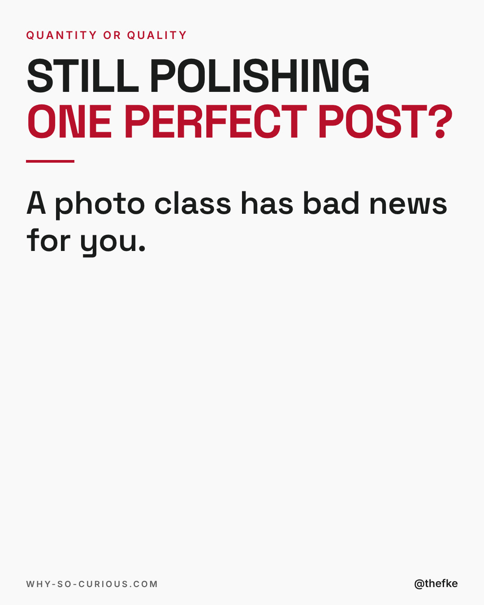
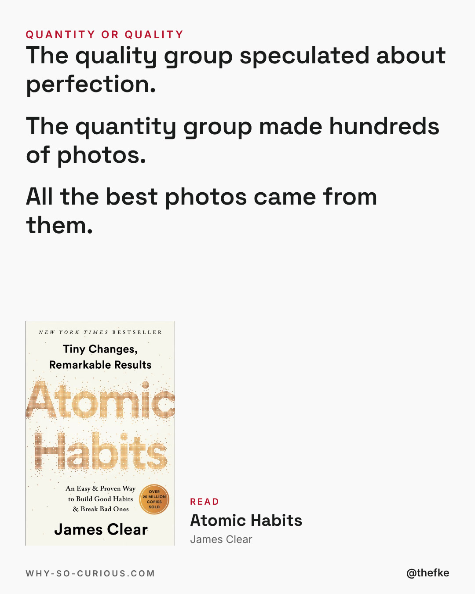
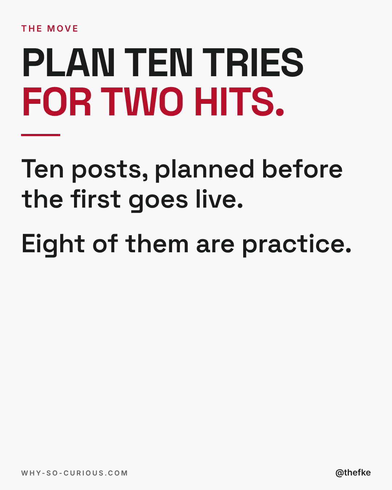
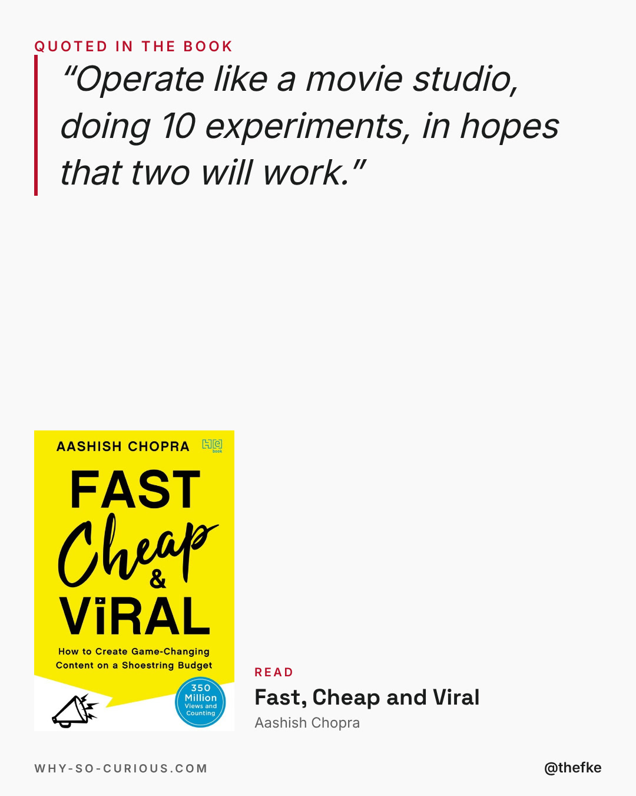
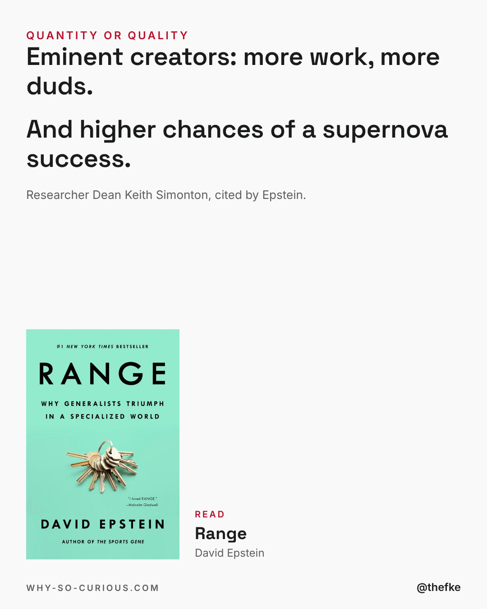
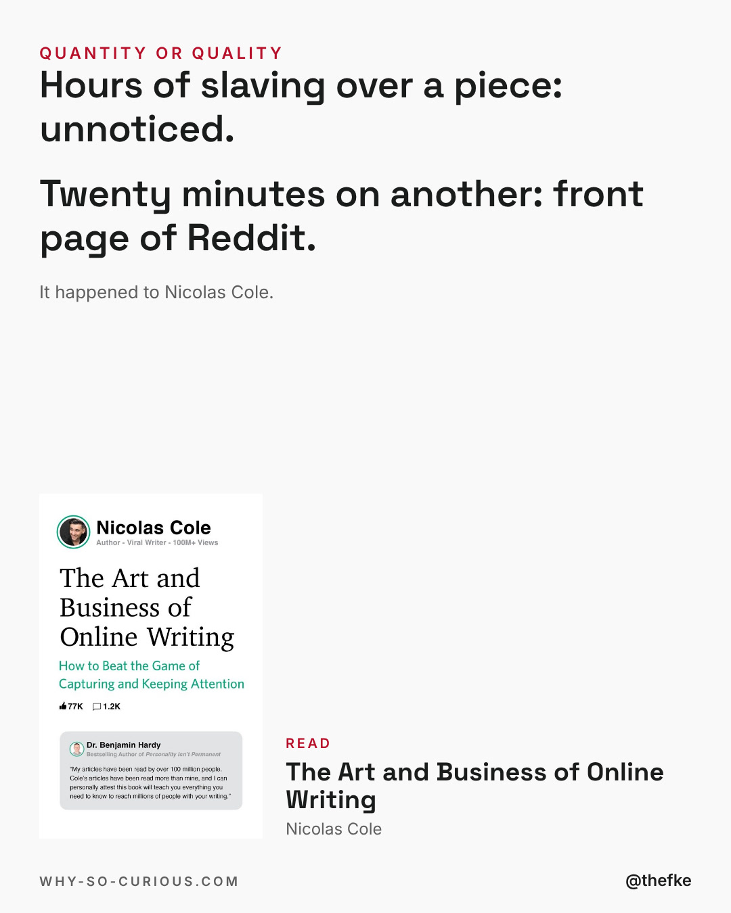
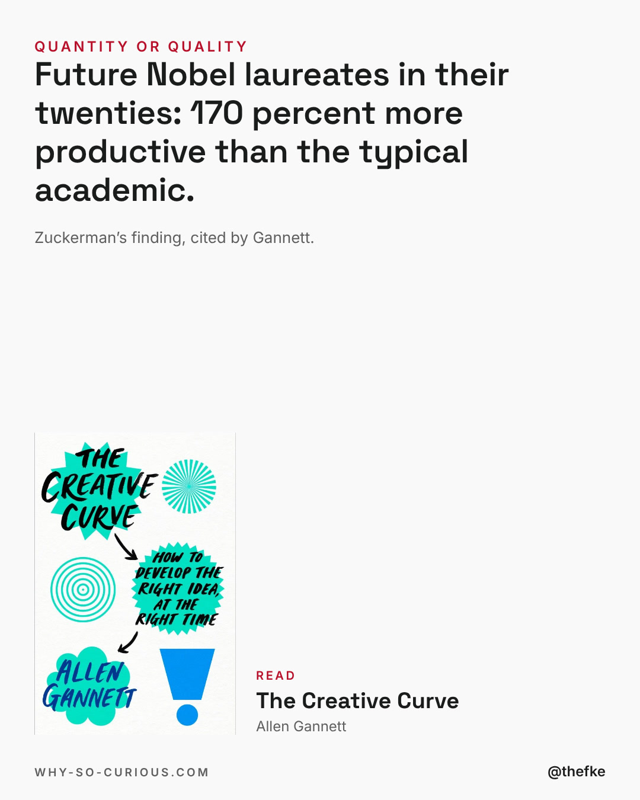
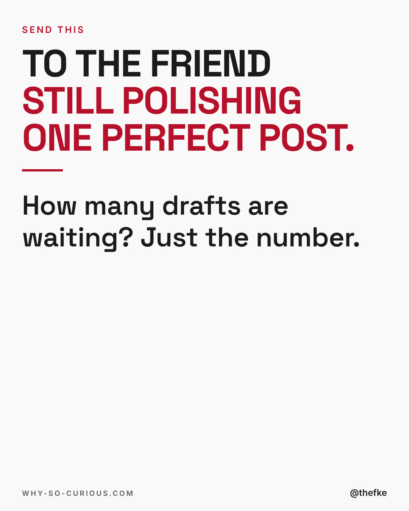

# Mi 18.11. · Still polishing one perfect post?

Karussell, 8 Slides. Beim Hochladen 4:5 wählen.

Abend-Slot 19 bis 20 Uhr MEZ, Format-Test Story-Karussell: Text-Slides statt Bücherraster, mittwochs bis 23.12. Mo und Fr bleiben für die Formate aus dem Hotel-Dreh.

Quelle: `thomas-hefke-os/knowledge/06-content/posts/`, gebaut mit `wsc-web/tools/social/story.mjs`.

## Caption

```
A photo class. Two groups.
One speculated about perfection.
One made hundreds of photos.
All the best photos came from the hundreds. 📸

The move:
Plan ten tries for two hits.
Ten posts, planned before the first goes live.
Eight of them are practice.

The photo class is from Atomic Habits by James Clear.
Four more books in the slides point the same way.

One catch, from Clear himself:
“When you can do it ‘good enough’ on autopilot, you stop thinking about how to do it better.”

Send this to the friend still polishing one perfect post.

How many drafts are waiting in your folder?
Just the number. 👇

Books from this post: link in bio.
```

## Slides









