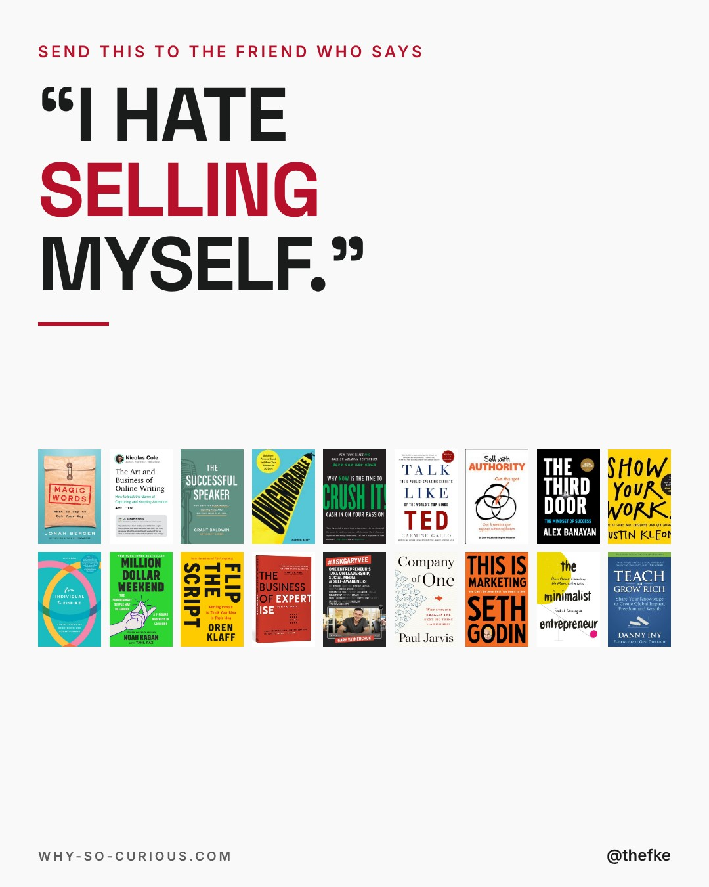
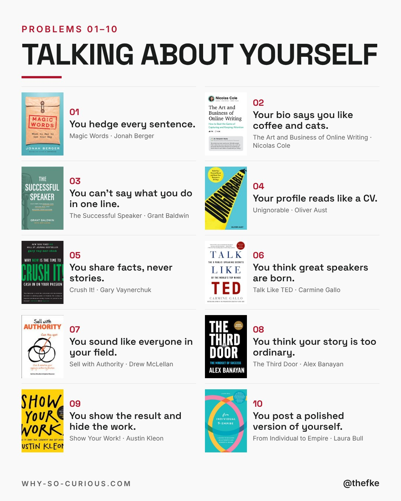
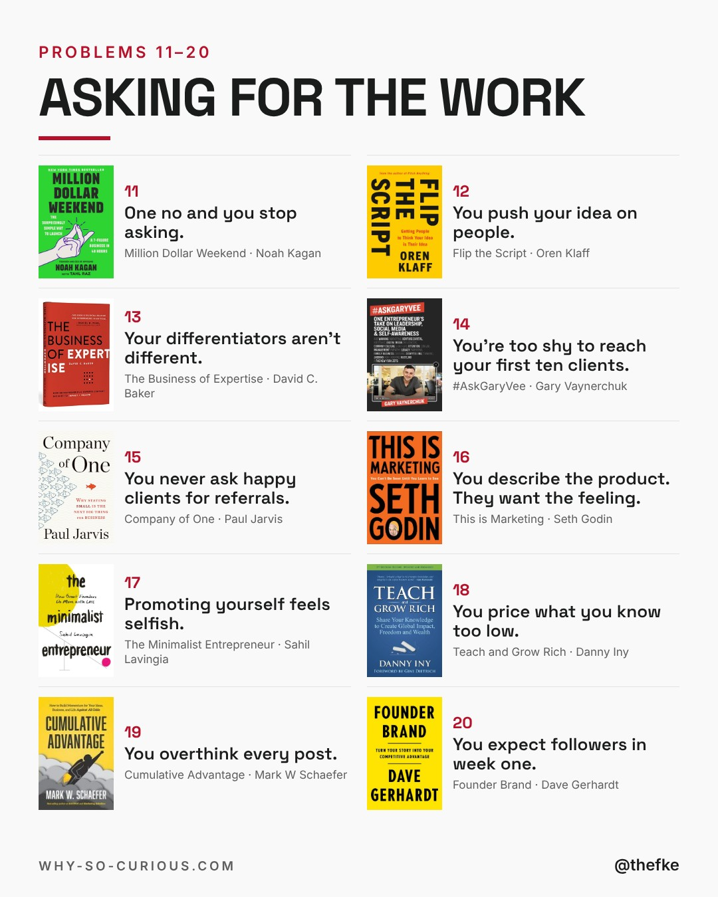
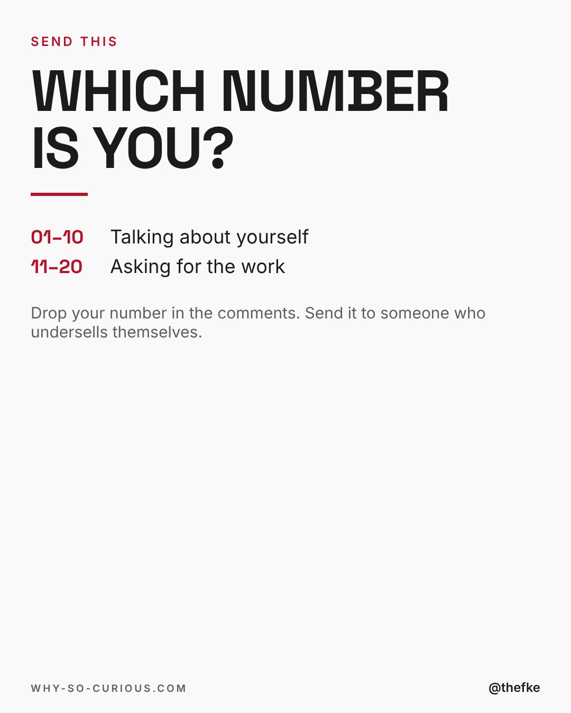

# Do 19.11. · Selling yourself feels awkward? 20 Problems, 20 Books

Abend-Slot. Karussell, 4 Slides. Beim Hochladen 4:5 wählen.

## Caption

```
“I hate selling myself.”
Most people do. So they hedge, hint and hope someone notices.

20 problems that come with selling yourself.
20 books from my shelf that help.

10 about talking about yourself.
10 about asking for the work.

Jonah Berger in Magic Words:
“Saying you ‘recommend’ rather than ‘like’ something makes people 32 percent more likely to take your suggestion.”

Send this to the friend who undersells themselves.

Which number is you?

Books from this post: link in bio.

#bookstagram #bookrecommendations #books
```

## Slides





