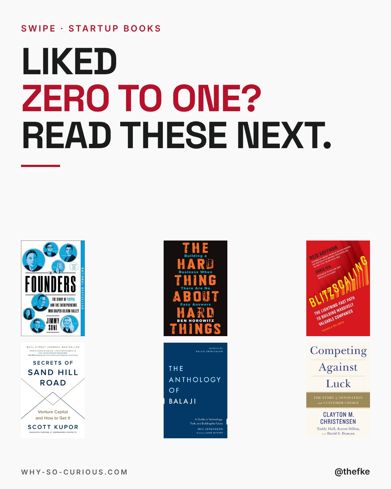
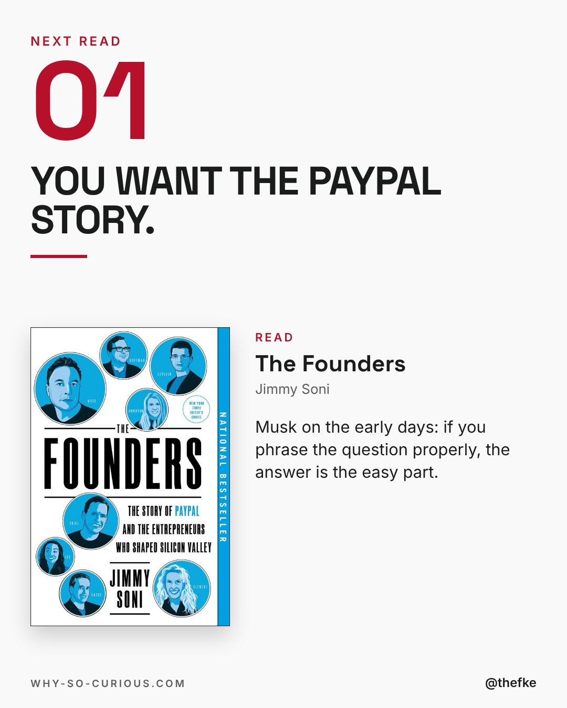
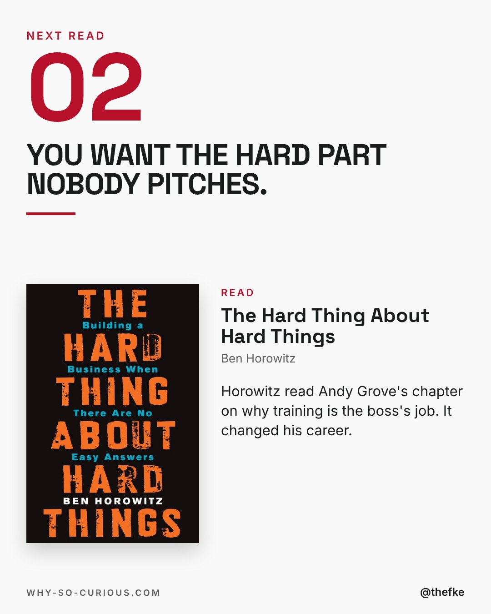
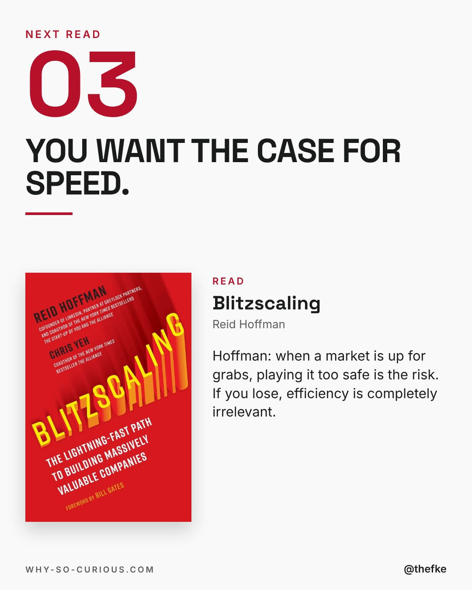
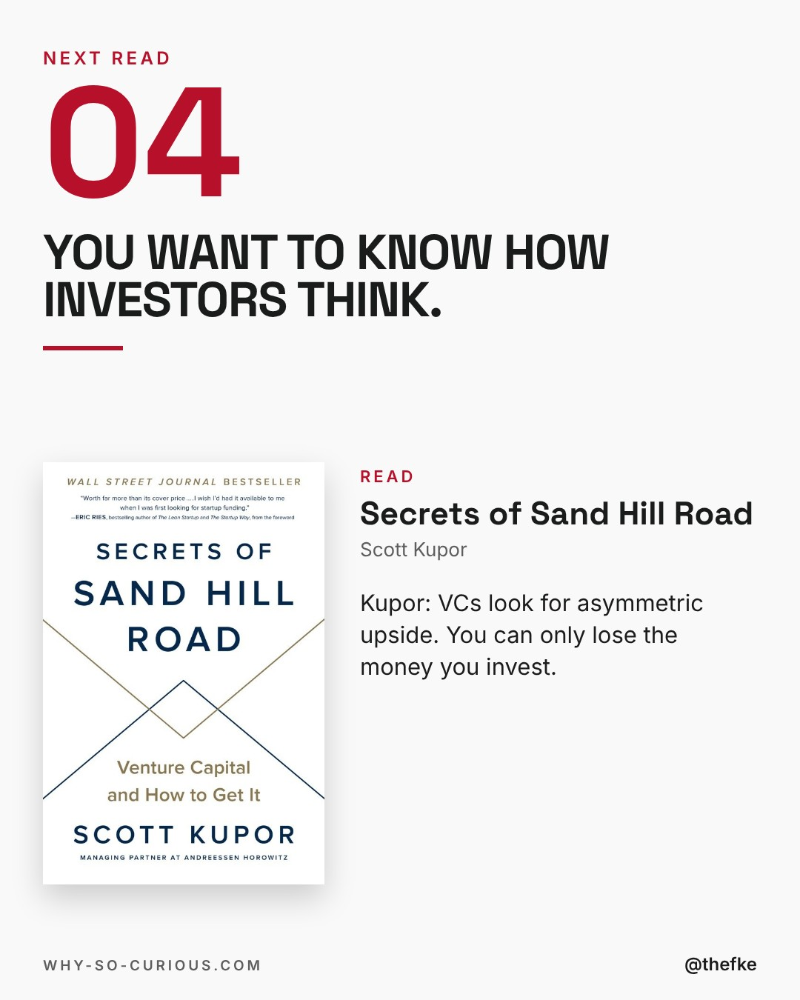
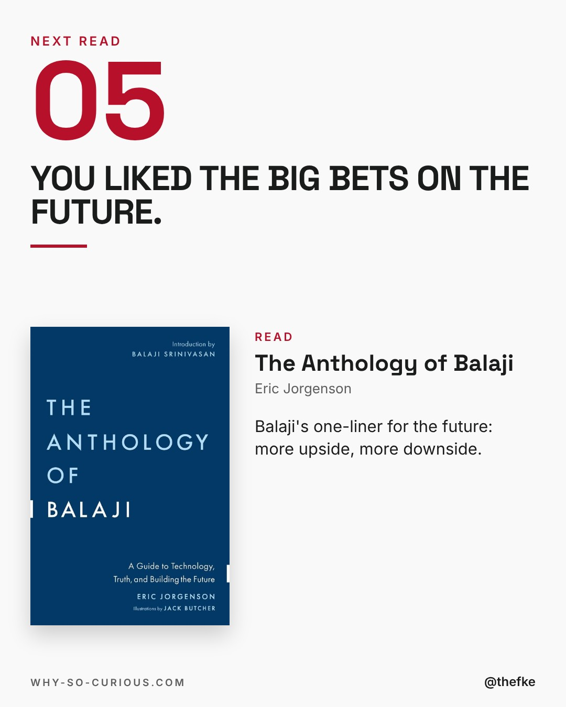
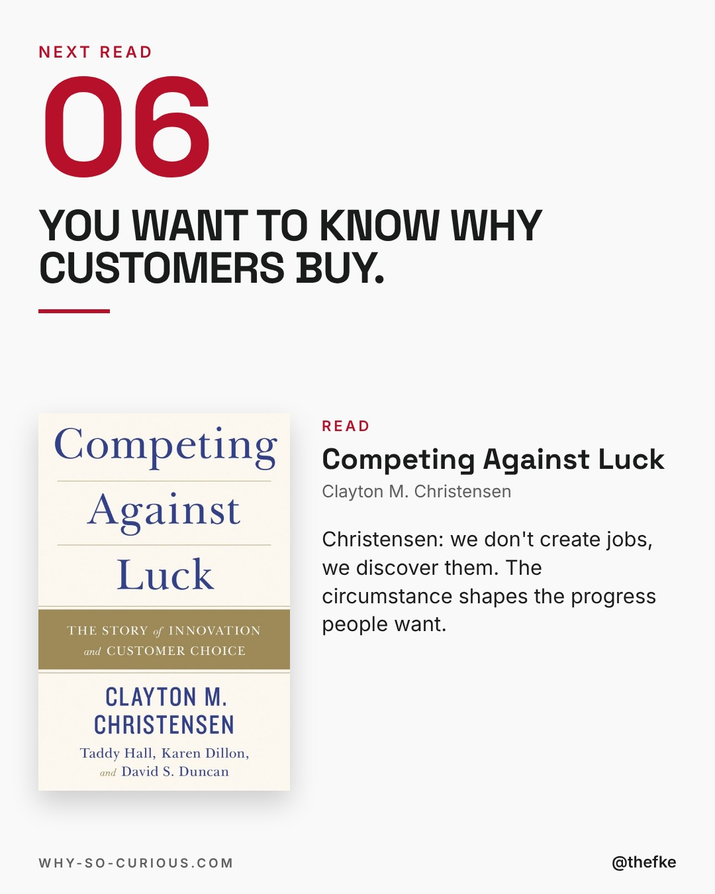
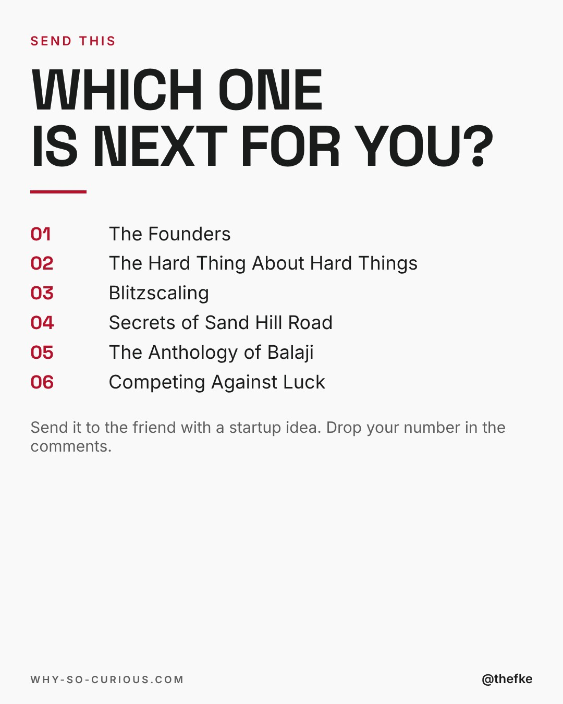

# Mo 23.11. · Liked Zero to One? Read these next

Früh-Slot, wird automatisch gepostet (ohne Musik). Nicht von Hand posten. Karussell, 8 Slides. Beim Hochladen 4:5 wählen.

## Caption

```
You finished Zero to One.
Now you see competition everywhere.

Six books that pick up where Thiel stops.
The PayPal story. The hard parts. The case for speed.
How investors think. The long view. And why customers buy.

Peter Thiel in Zero to One:
“The most contrarian thing of all is not to oppose the crowd but to think for yourself.”

All from my shelf.

Send this to the friend with a startup idea.

Which one is next for you?

Books from this post: link in bio.

#bookstagram #bookrecommendations #books
```

## Slides









