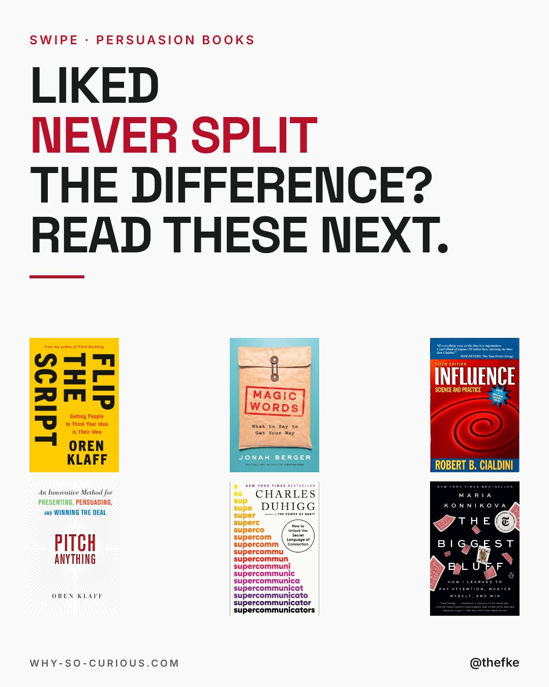
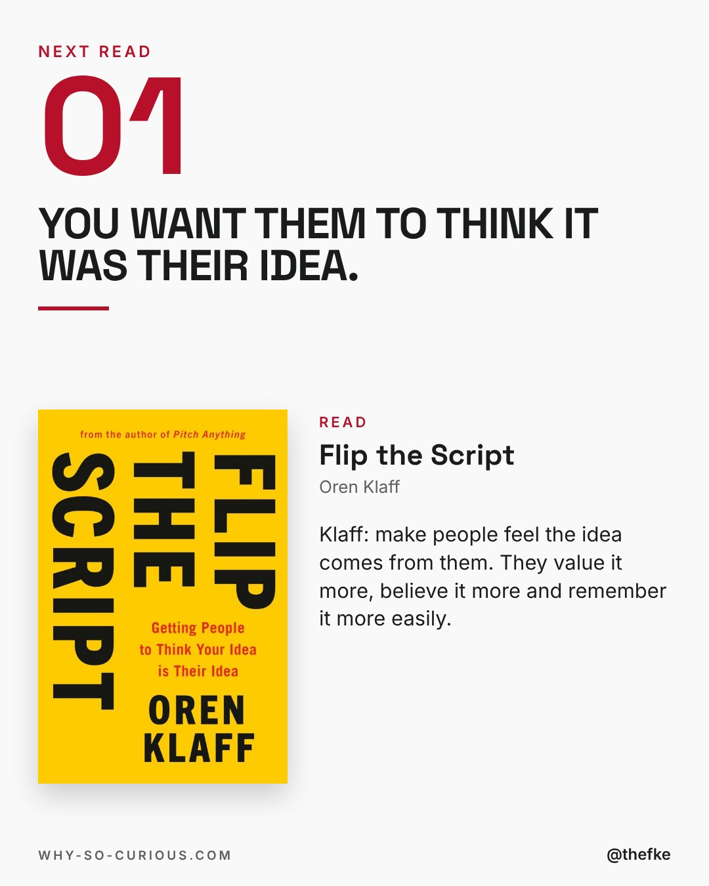
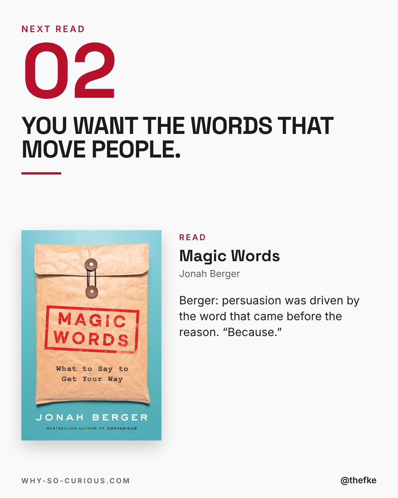
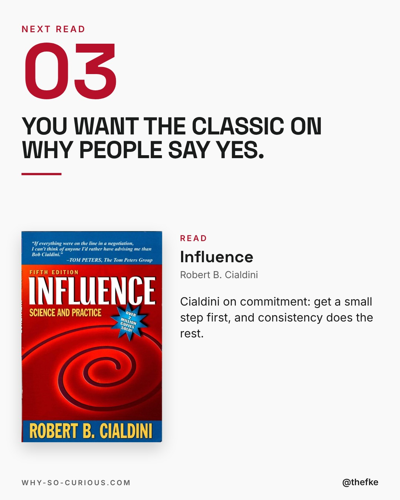
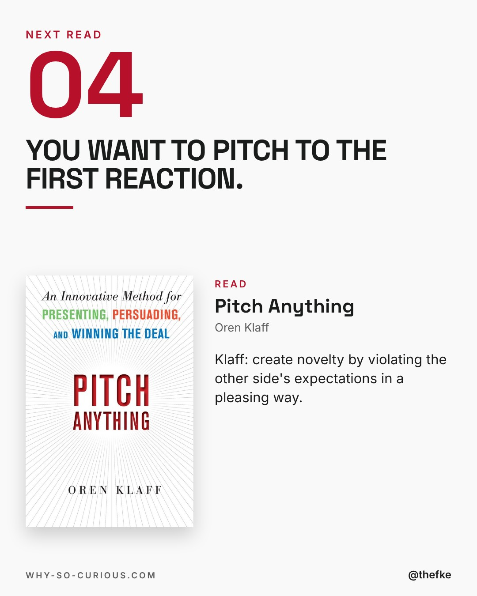
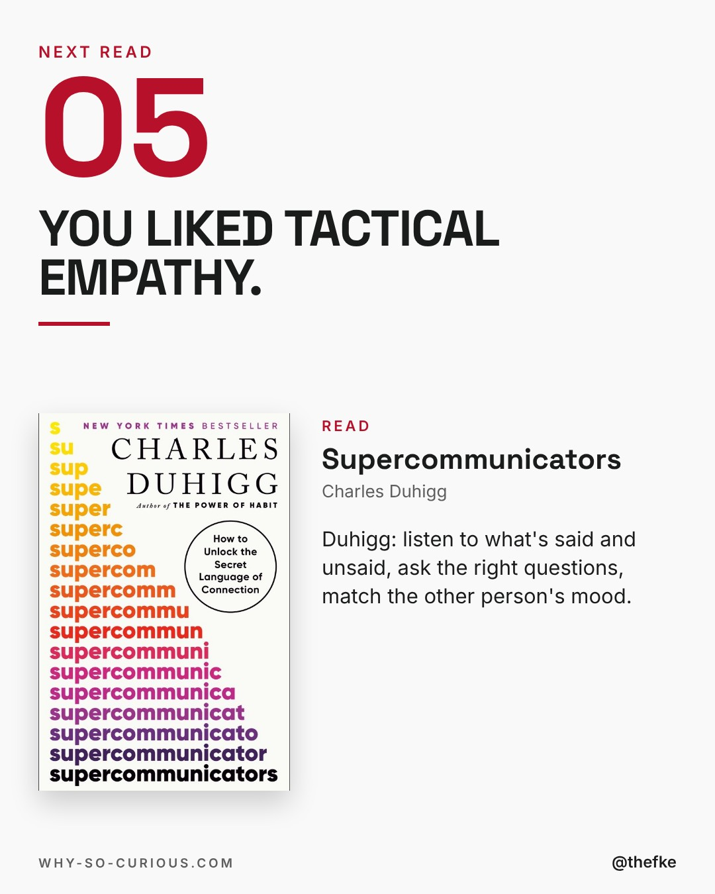
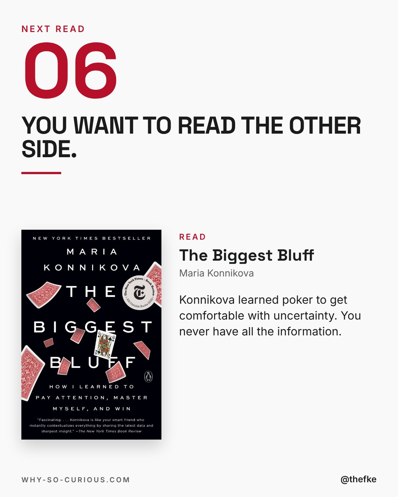
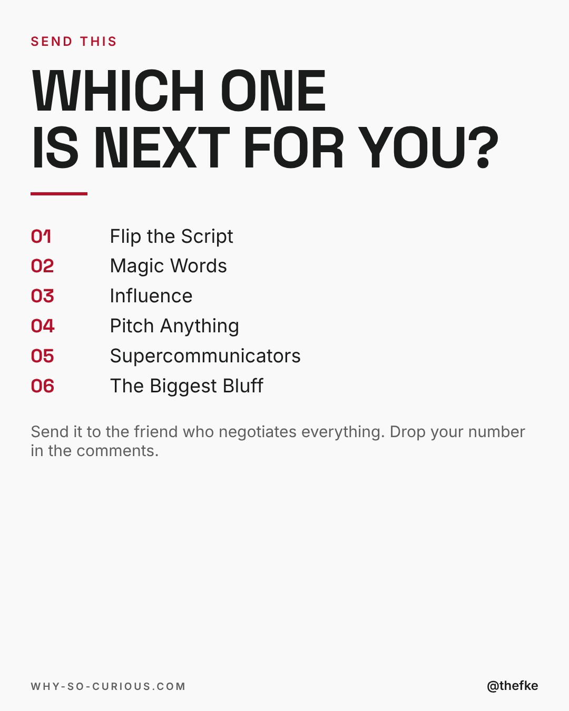

# Di 24.11. · Liked Never Split the Difference? Read these next

Früh-Slot, wird automatisch gepostet (ohne Musik). Nicht von Hand posten. Karussell, 8 Slides. Beim Hochladen 4:5 wählen.

## Caption

```
You finished Never Split the Difference.
Now you label every feeling in the room.

Six books for the next round.
Ideas that feel like their own. Small words. The classic on yes.
The pitch. The listening. And a poker table.

Oren Klaff in Flip the Script, on why pushing fails:
“The human brain is thus wired by evolution to distrust any information from the outside world and to greatly favor that which originates inside us.”

All from my shelf.

Send this to the friend who negotiates everything.

Which one is next for you?

Books from this post: link in bio.

#bookstagram #bookrecommendations #books
```

## Slides









