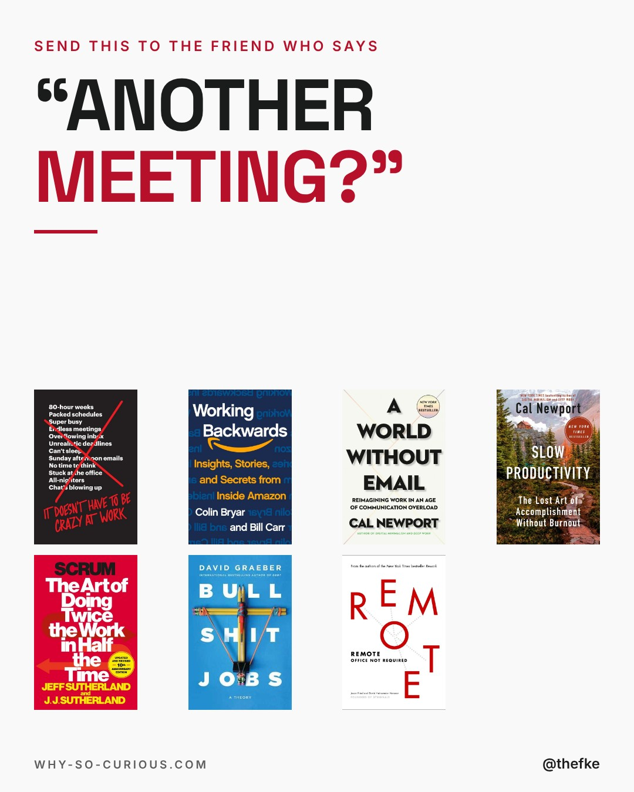
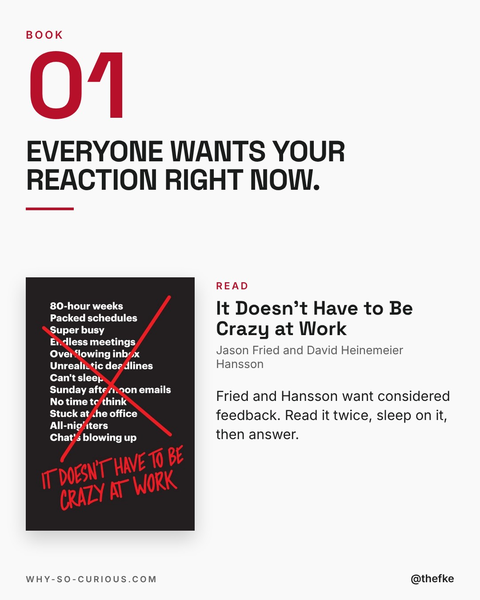
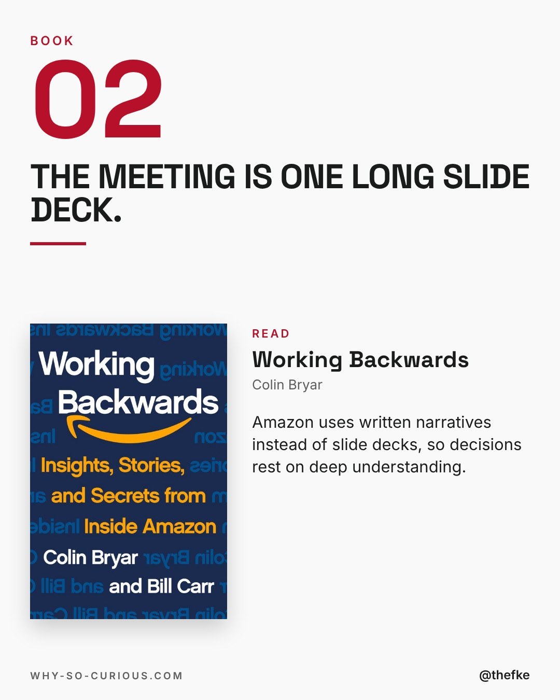
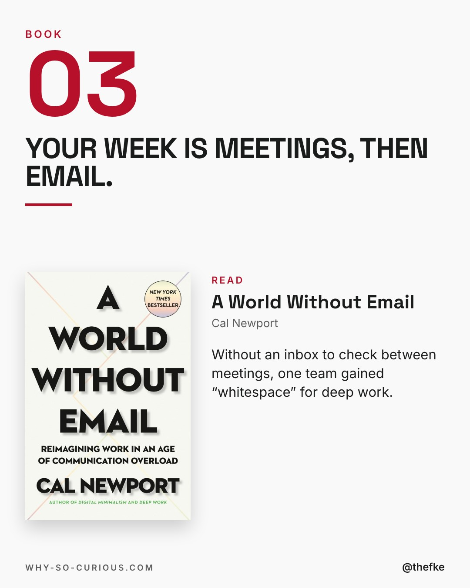
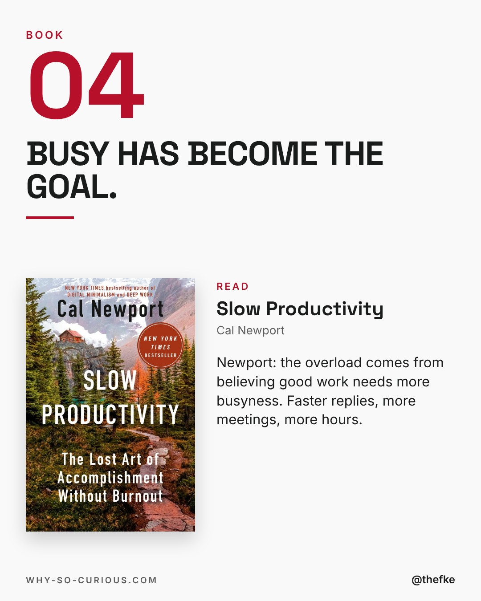
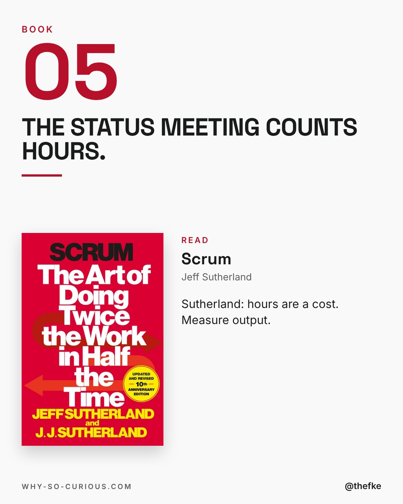
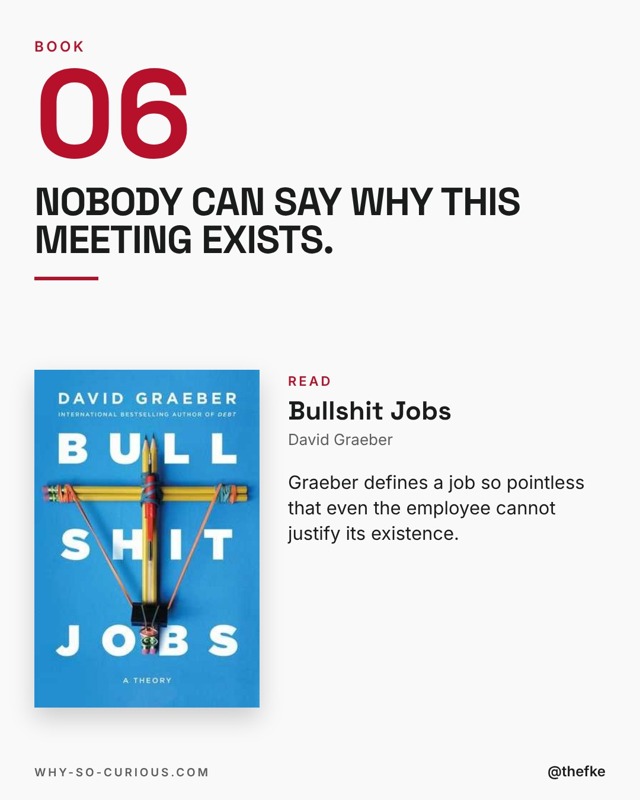
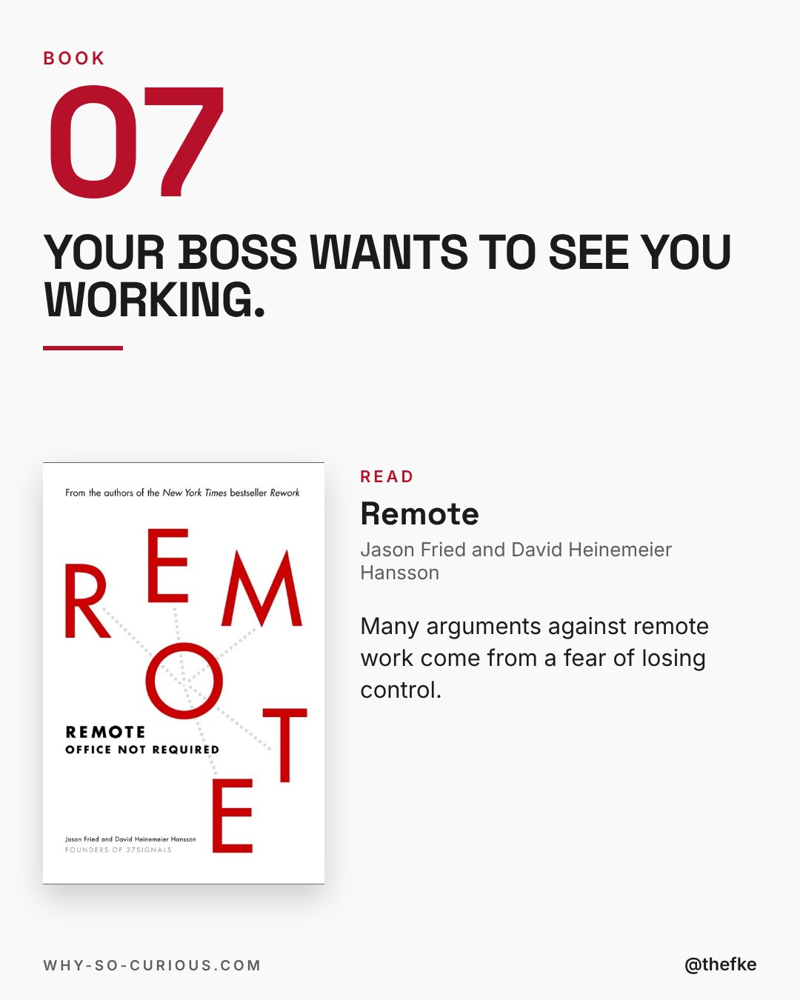
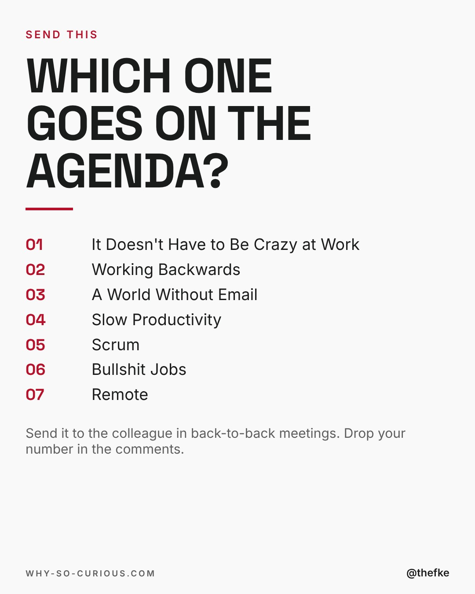

# Mi 25.11. · Books for people who hate meetings

Früh-Slot, wird automatisch gepostet (ohne Musik). Nicht von Hand posten. Karussell, 9 Slides. Beim Hochladen 4:5 wählen.

## Caption

```
“Another meeting?”
Another hour gone.

Seven books for people who hate meetings.
Considered feedback. Written memos. Whitespace.
Output over hours. And the meeting nobody can explain.

One number from A World Without Email by Cal Newport:
“A survey conducted by Adobe revealed that knowledge workers self-report spending more than three hours a day sending and receiving business email.”
Add the meetings on top.

All from my shelf.

Send this to the colleague in back-to-back meetings.

Which one goes on the agenda?

Books from this post: link in bio.

#bookstagram #bookrecommendations #books
```

## Slides










