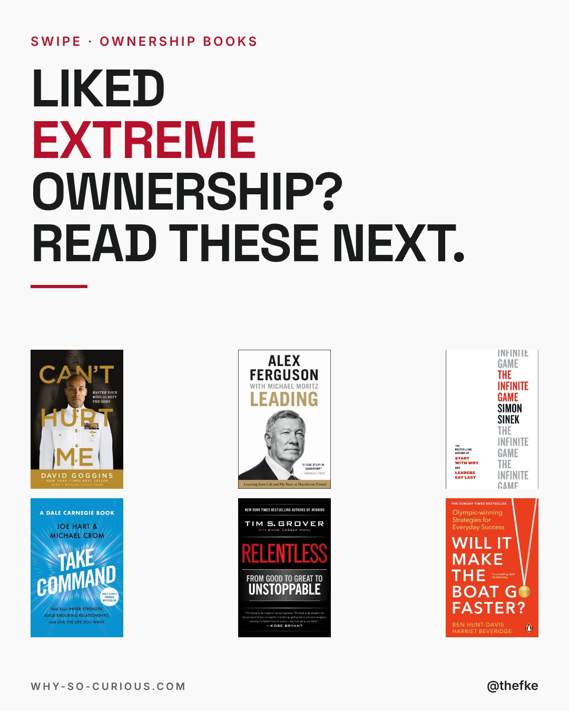
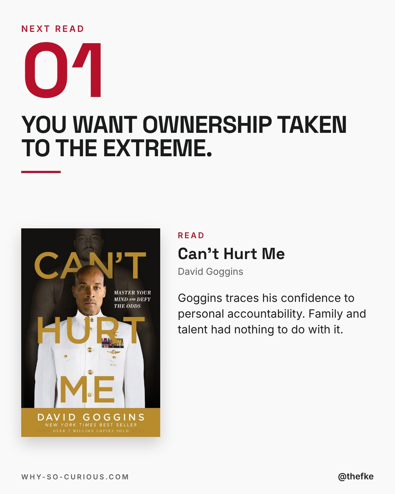
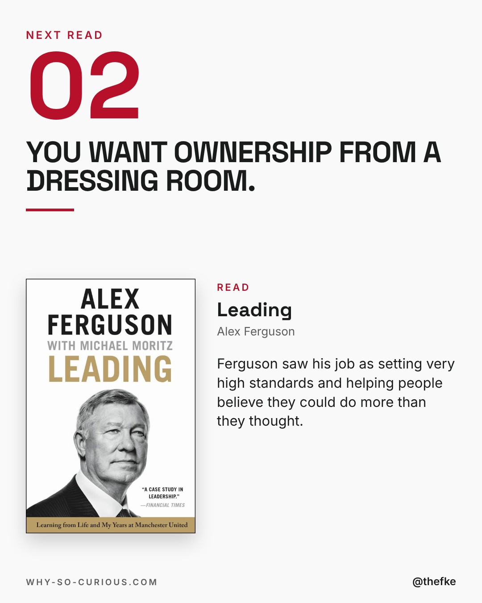
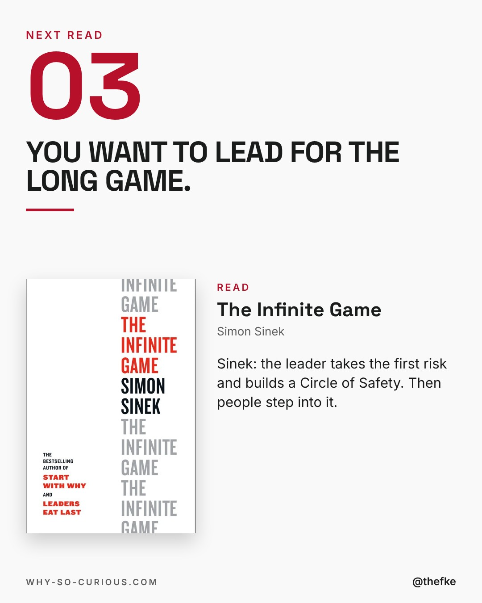
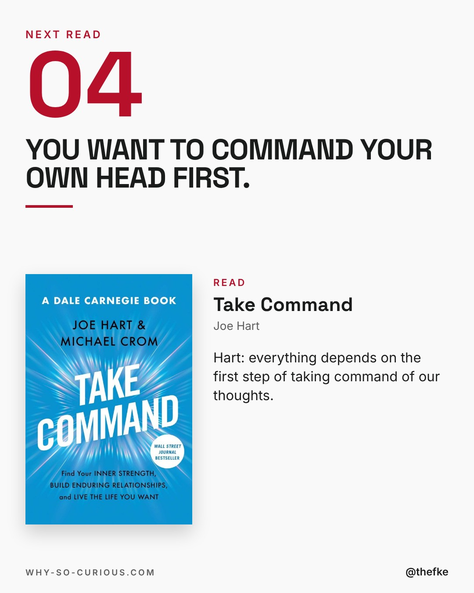
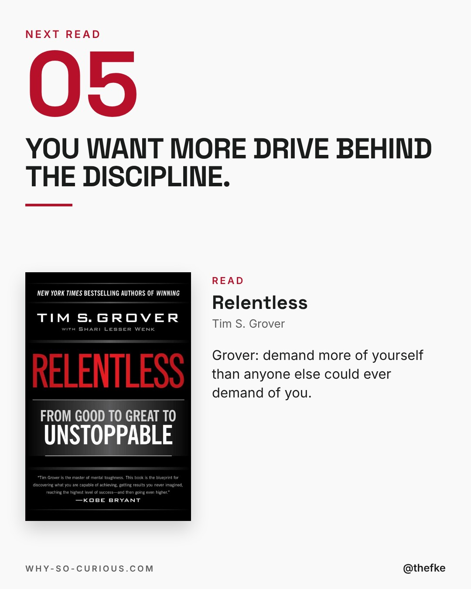
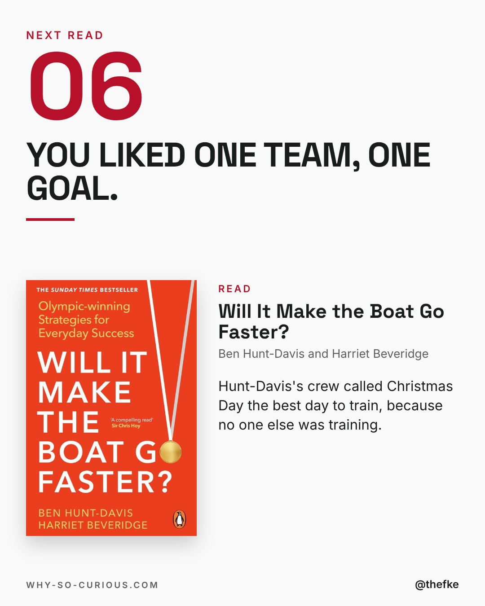
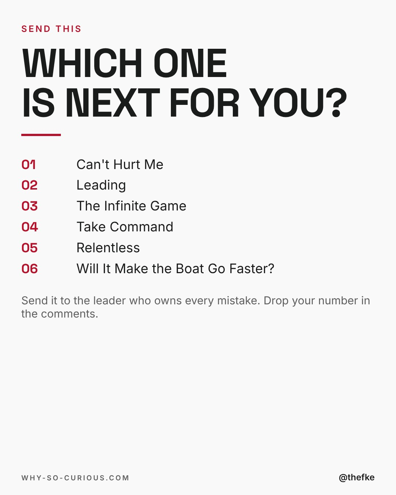

# Sa 28.11. · Liked Extreme Ownership? Read these next

Früh-Slot, wird automatisch gepostet (ohne Musik). Nicht von Hand posten. Karussell, 8 Slides. Beim Hochladen 4:5 wählen.

## Caption

```
You finished Extreme Ownership.
Now every mistake is yours.

Six books that keep the mindset going.
Goggins. Ferguson. Sinek's long game.
Your own thoughts. Grover's drive. And a rowing crew.

One idea from Extreme Ownership:
“The most important part of the brief,” said Jocko, “is to explain your Commander’s Intent.”
When everyone knows the purpose, they can act without further guidance.

All from my shelf.

Send this to the leader who owns every mistake.

Which one is next for you?

Books from this post: link in bio.

#bookstagram #bookrecommendations #books
```

## Slides









