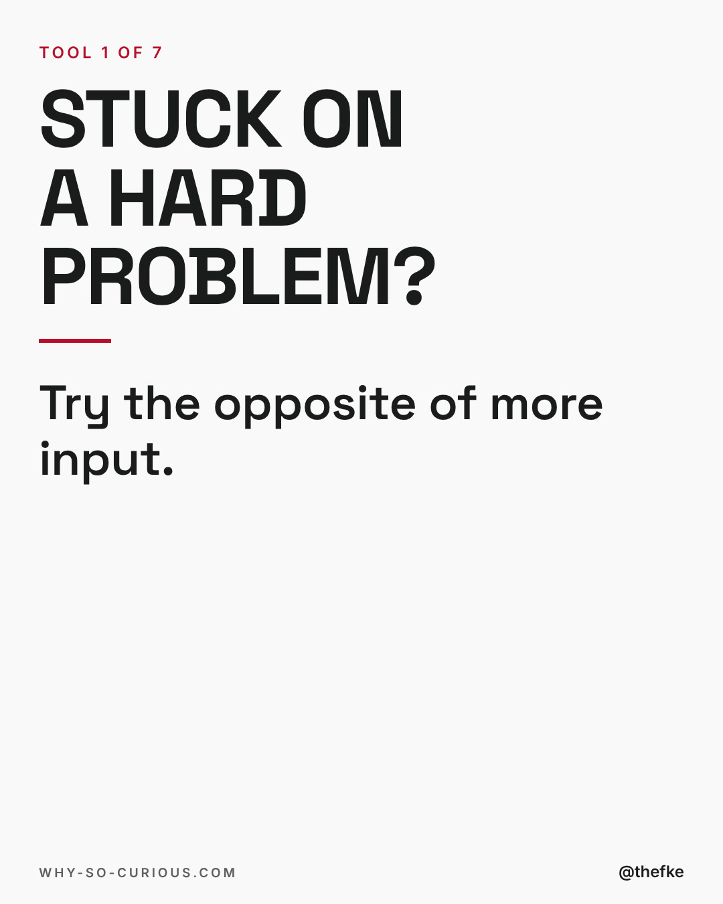
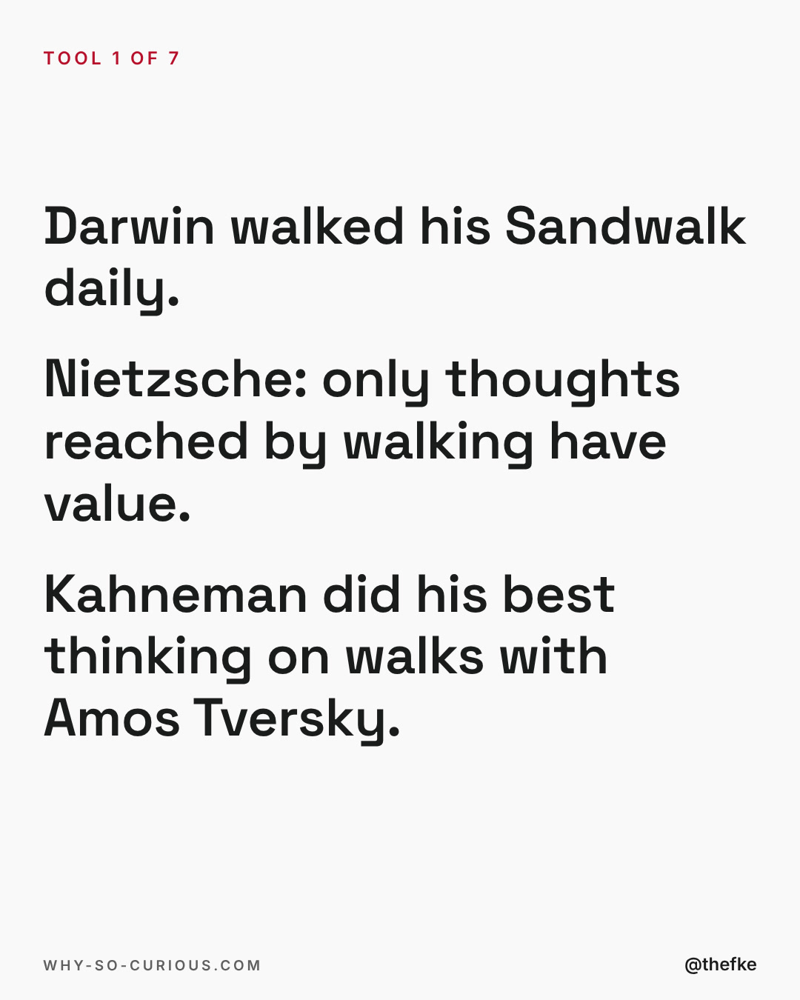
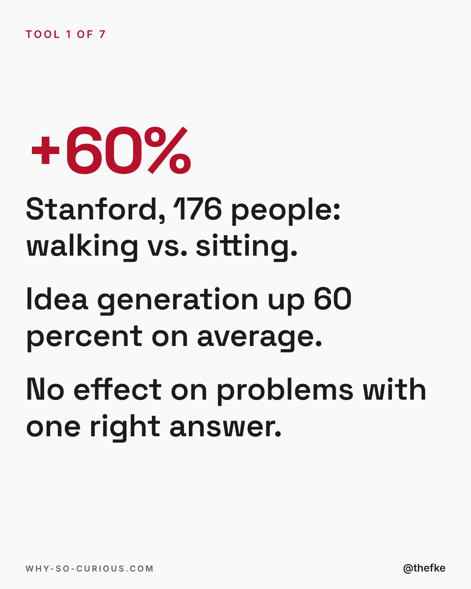
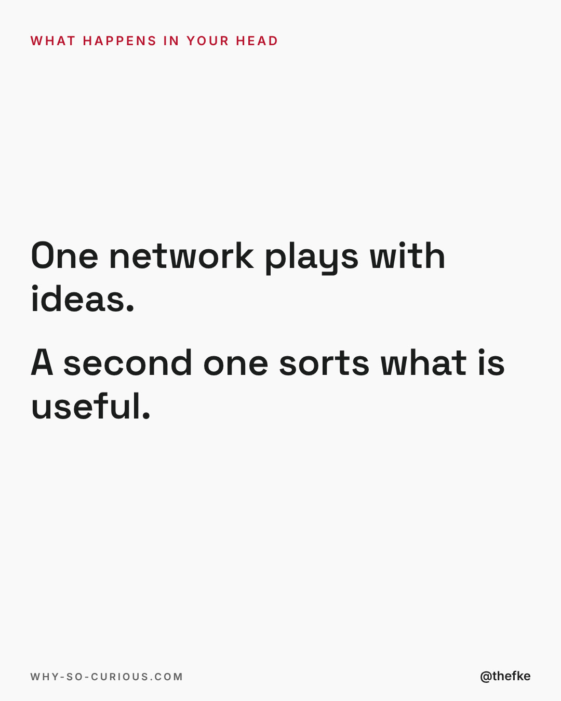
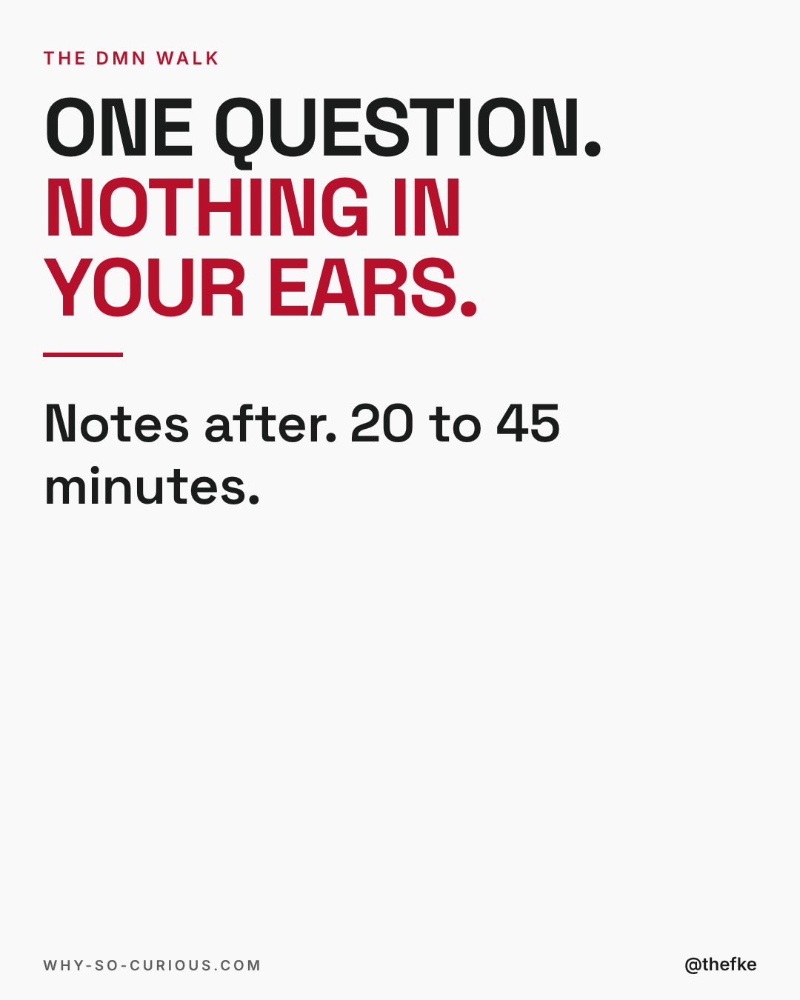

# Mi 02.12. · Stuck on a hard problem? Try the opposite of more input

Karussell, 5 Slides. Beim Hochladen 4:5 wählen.

Abend-Slot 19 bis 20 Uhr MEZ, Format-Test Story-Karussell: Text-Slides statt Bücherraster, mittwochs bis 23.12. Mo und Fr bleiben für die Formate aus dem Hotel-Dreh.

Quelle: `thomas-hefke-os/knowledge/06-content/posts/`, gebaut mit `wsc-web/tools/social/story.mjs`.

## Caption

```
Stuck on a hard problem?
The reflex: read more, listen more, ask more people.

Try the opposite.
One question. Nothing in your ears. A short walk. 🚶

Darwin walked his Sandwalk every day.
Stanford measured it with 176 people: walking lifted idea generation by 60 percent on average.

I call it the DMN walk. Tool 1 in my curiosity toolkit.

Try it once this week?

#books #bookstagram #bookrecommendations #reading #thefke #booklover #whysocurious
```

## Slides






