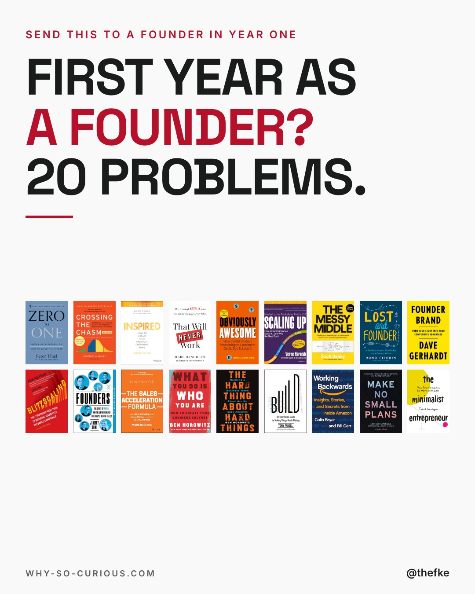
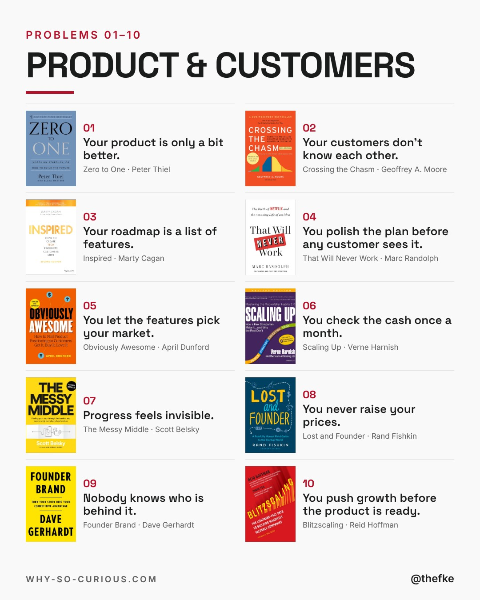
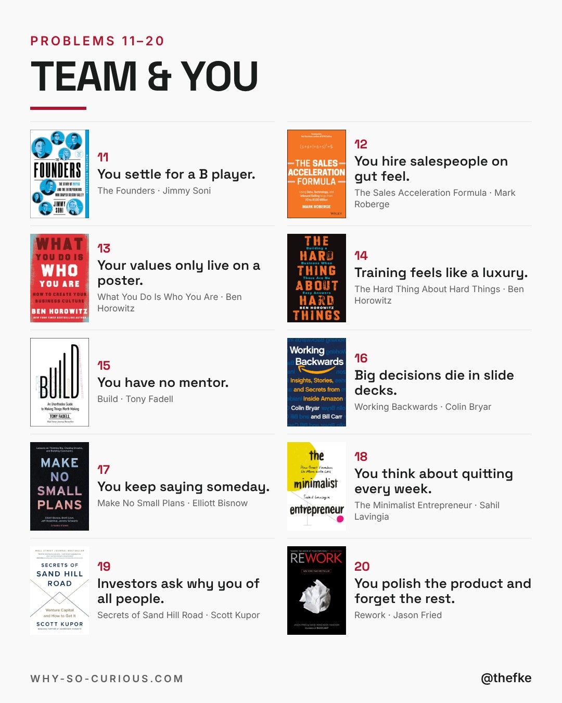
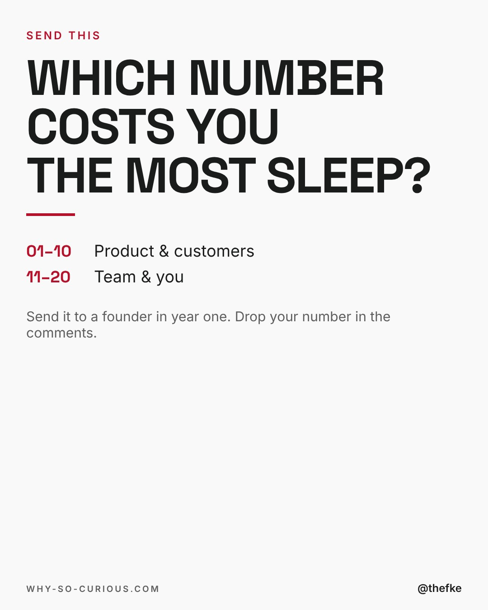

# Mi 02.12. · First year as a founder? 20 Problems, 20 Books

Früh-Slot, wird automatisch gepostet (ohne Musik). Nicht von Hand posten. Karussell, 4 Slides. Beim Hochladen 4:5 wählen.

## Caption

```
Year one as a founder.
Everything is your job. Nothing is finished.

20 problems from the first year.
One book for each.

10 about product and customers.
10 about the team and yourself.

Rand Fishkin in Lost and Founder:
“it’s dangerous to go alone. You want people around you who’ve been through this before and are willing to openly share their experiences.”

All from my shelf.

Send this to a founder in year one.

Which number costs you the most sleep?

Books from this post: link in bio.

#bookstagram #bookrecommendations #books
```

## Slides





