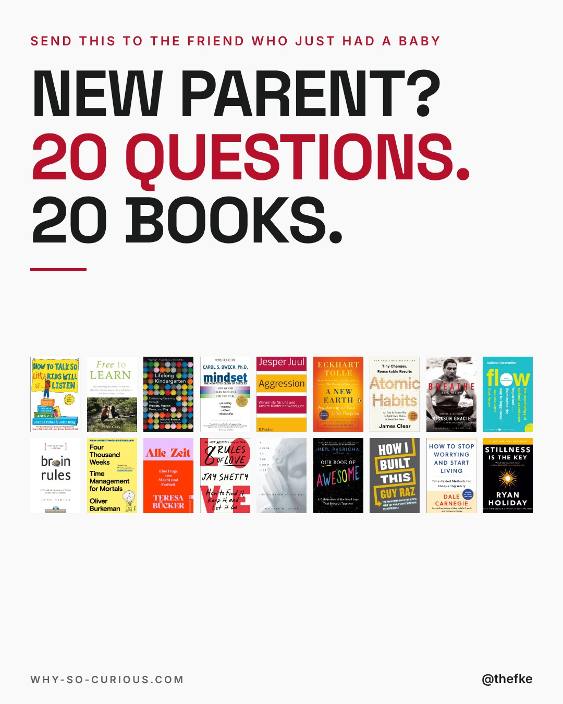
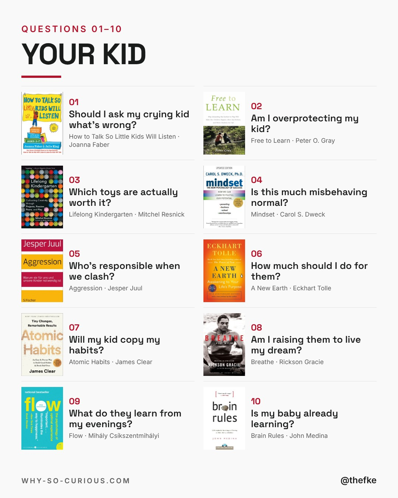
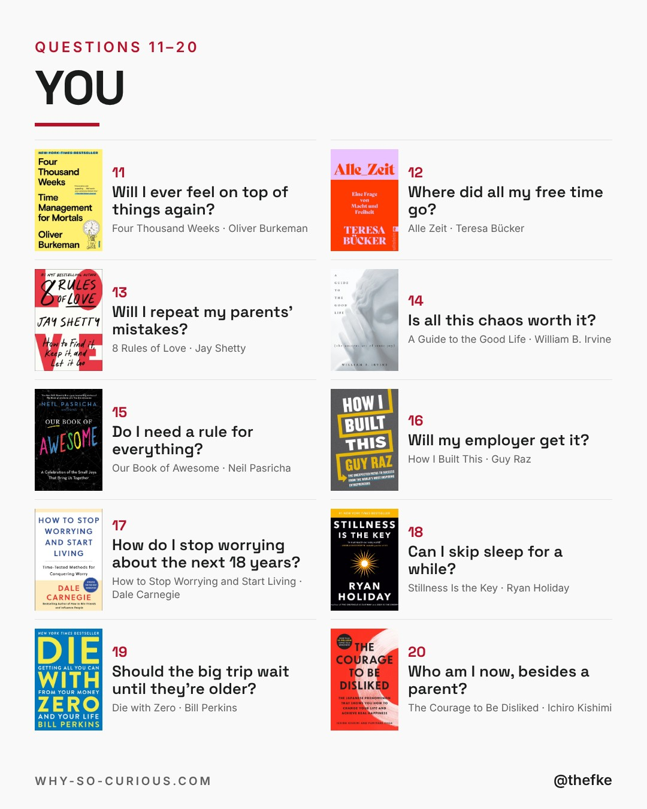
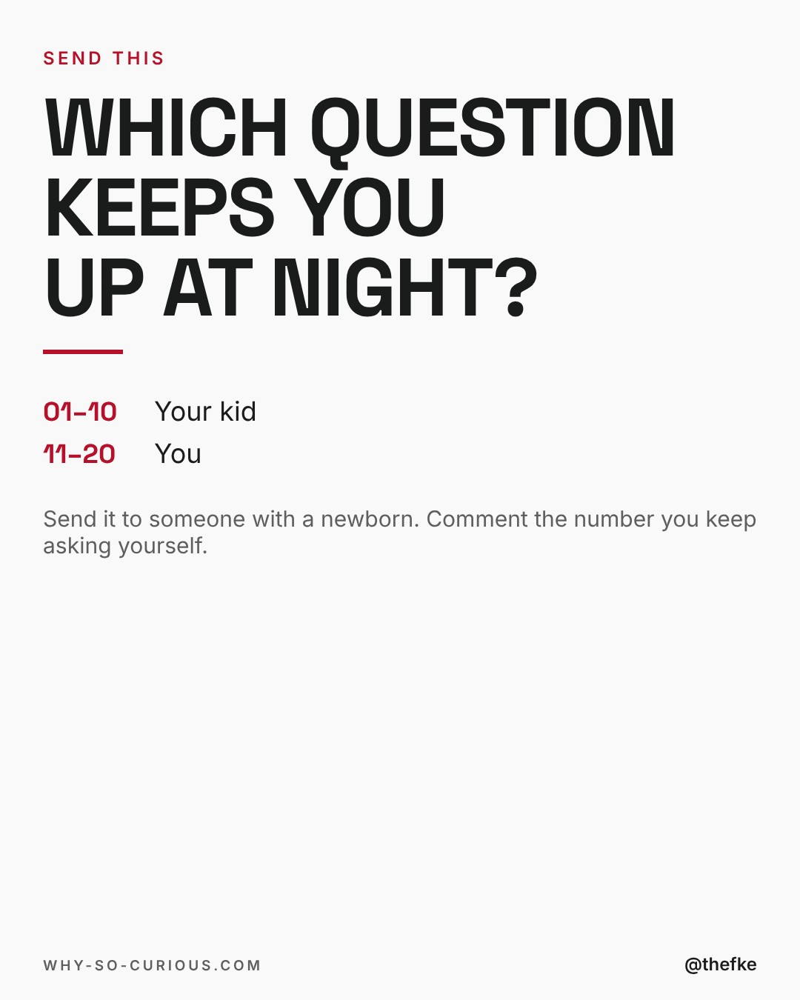

# Do 03.12. · New parent? 20 Questions, 20 Books

Früh-Slot, wird automatisch gepostet (ohne Musik). Nicht von Hand posten. Karussell, 4 Slides. Beim Hochladen 4:5 wählen.

## Caption

```
New parent.
Every day brings a question nobody prepared you for.

20 questions from the first years.
One book for each.

10 about your kid.
10 about you.

Number 3 has the simplest answer, from Lifelong Kindergarten by Mitchel Resnick:
“Ask not what the toy can do for your child; ask what your child can do with the toy.”

All from my shelf.

Send this to someone with a newborn.

Which question keeps you up at night?

Books from this post: link in bio.

#bookstagram #bookrecommendations #books
```

## Slides





