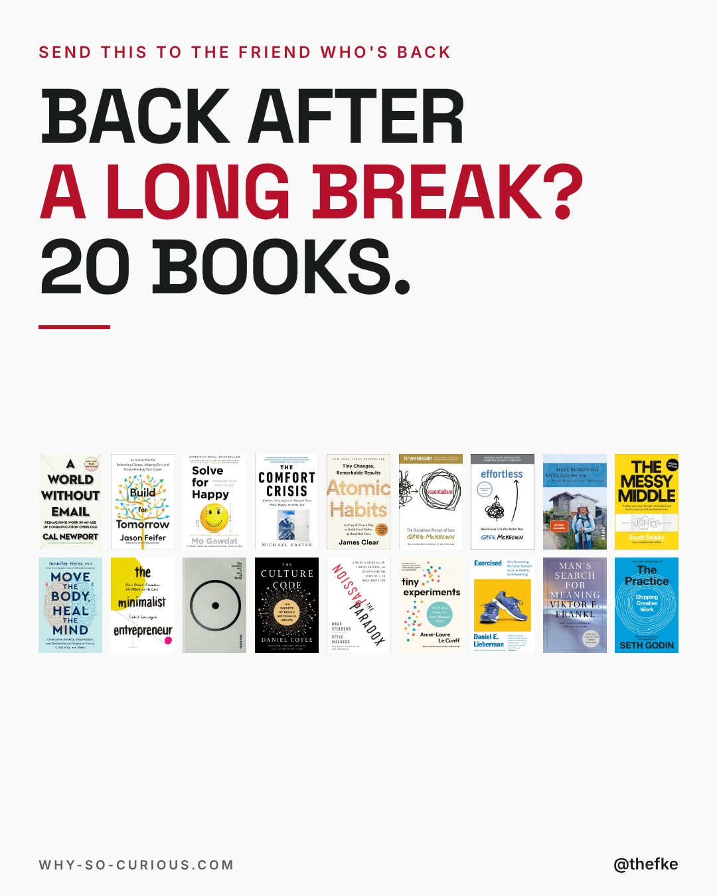
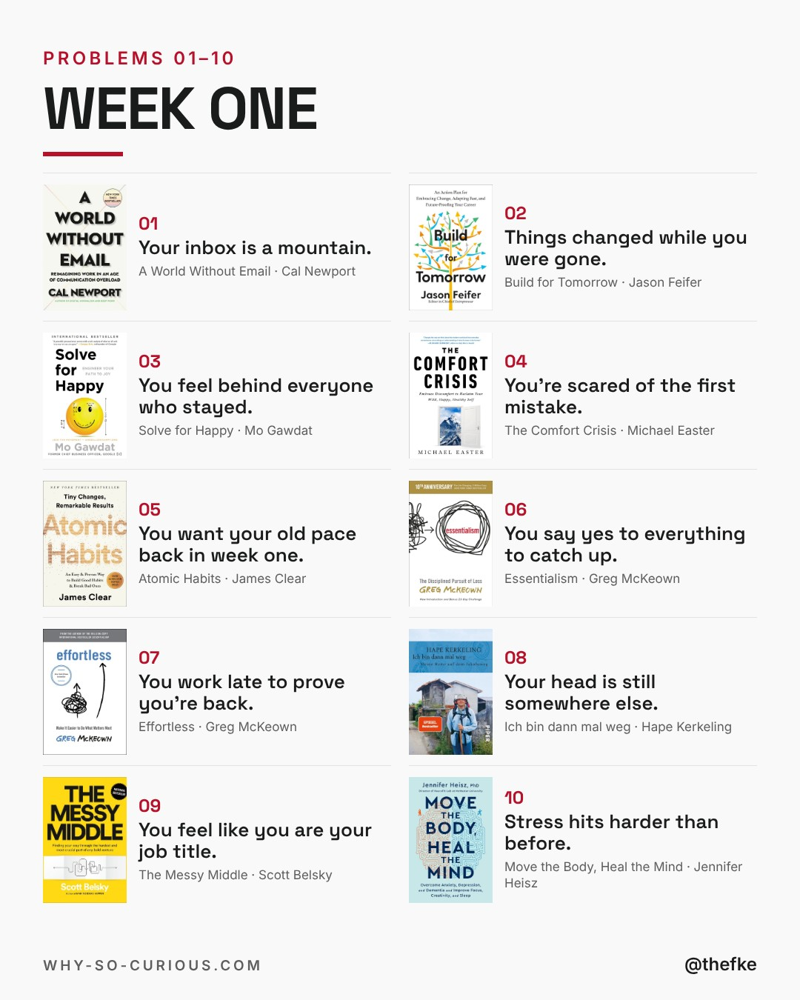
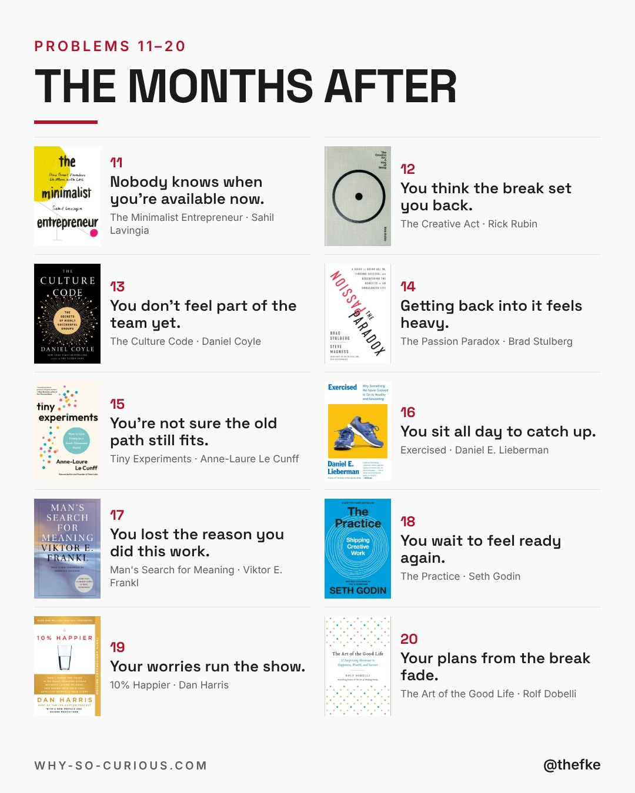
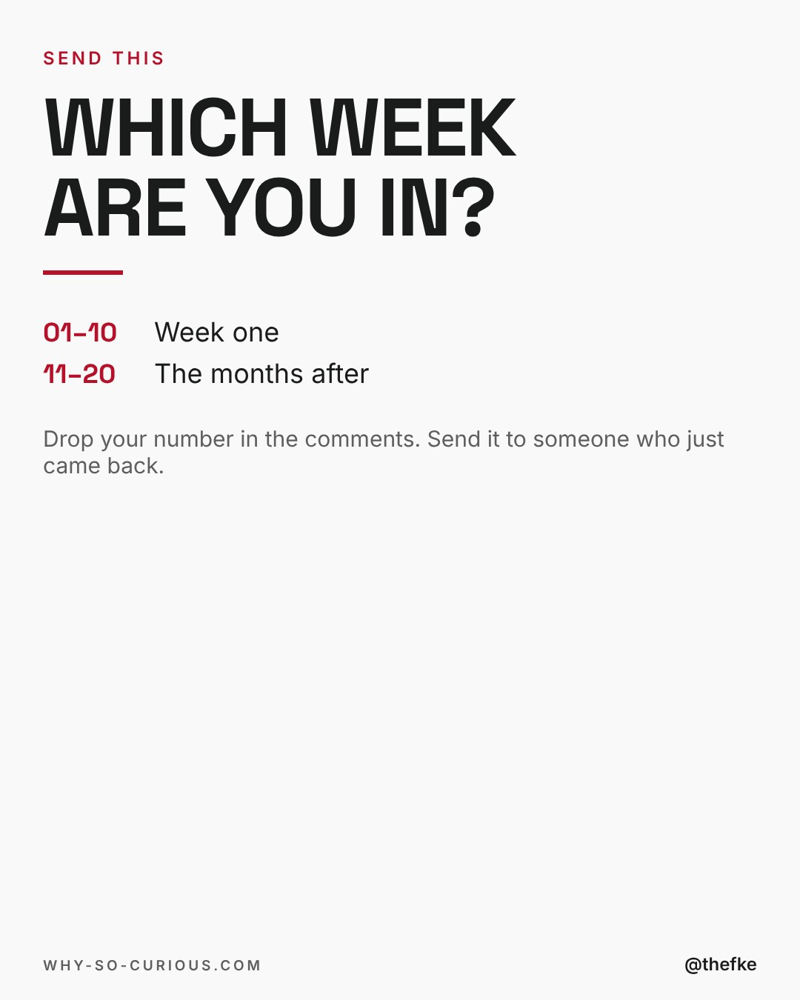

# Fr 04.12. · Back after a long break? 20 Problems, 20 Books

Früh-Slot, wird automatisch gepostet (ohne Musik). Nicht von Hand posten. Karussell, 4 Slides. Beim Hochladen 4:5 wählen.

## Caption

```
Back after a long break.
Parental leave, a sabbatical, time to heal.
The first weeks back come with their own problems.

20 of them.
One book for each.

10 for week one.
10 for the months after.

Rick Rubin in The Creative Act:
“There may be benefit in taking breaks, in stepping away and returning at a later point.”

So the break was not lost time.

All from my shelf.

Send this to someone who just came back.

Which number is you right now?

Books from this post: link in bio.

#bookstagram #bookrecommendations #books
```

## Slides





