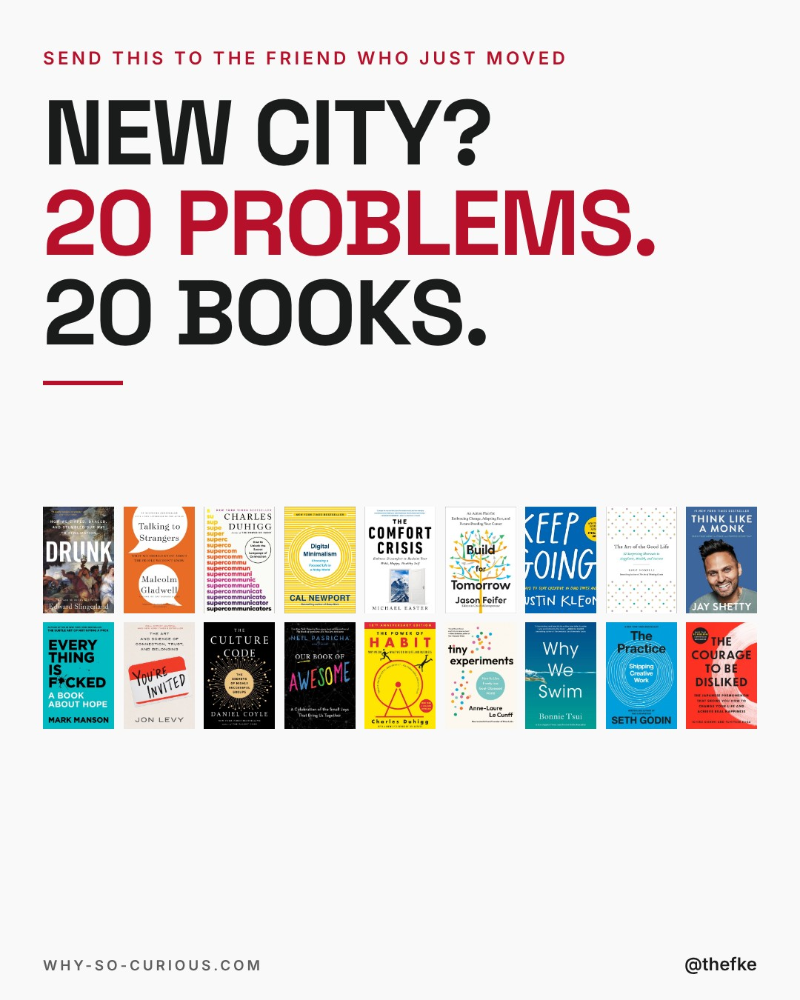
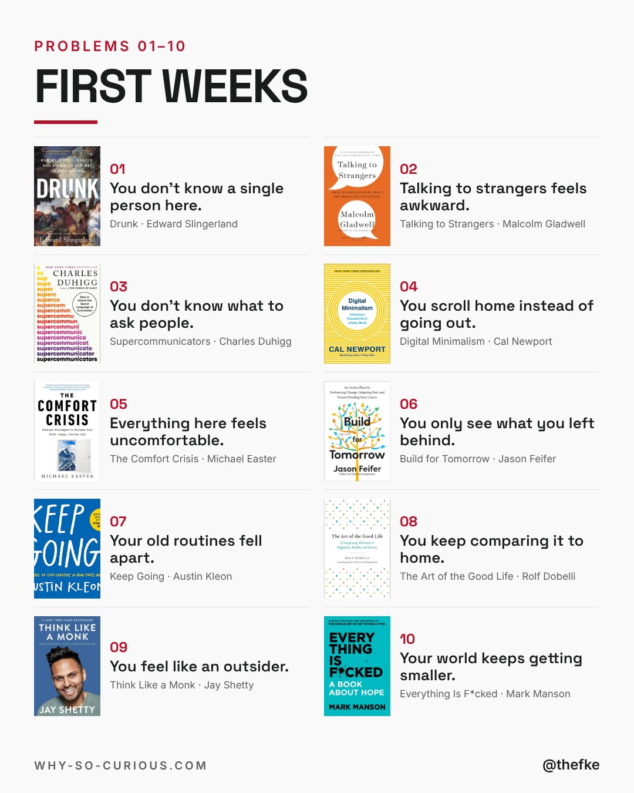
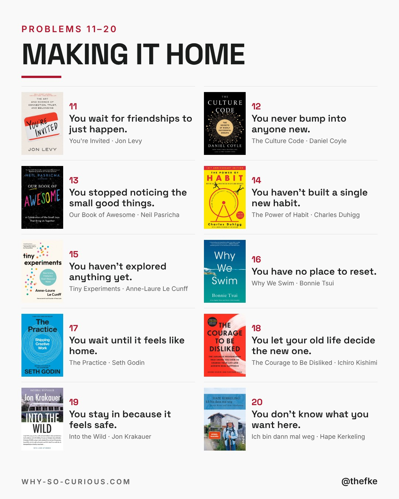

# Sa 05.12. · Moved to a new city? 20 Problems, 20 Books

Früh-Slot, wird automatisch gepostet (ohne Musik). Nicht von Hand posten. Karussell, 4 Slides. Beim Hochladen 4:5 wählen.

## Caption

```
New city.
New streets, new routines, nobody to call.

20 problems from the first months somewhere new.
One book for each.

10 for the first weeks.
10 for making it home.

Malcolm Gladwell in Talking to Strangers:
“We need to talk to them. But we’re terrible at it.”

Everyone in your new city is a stranger. That's a lot of practice.

All from my shelf.

Send this to someone who just moved.

Which number is you right now?

Books from this post: link in bio.

#bookstagram #bookrecommendations #books
```

## Slides





