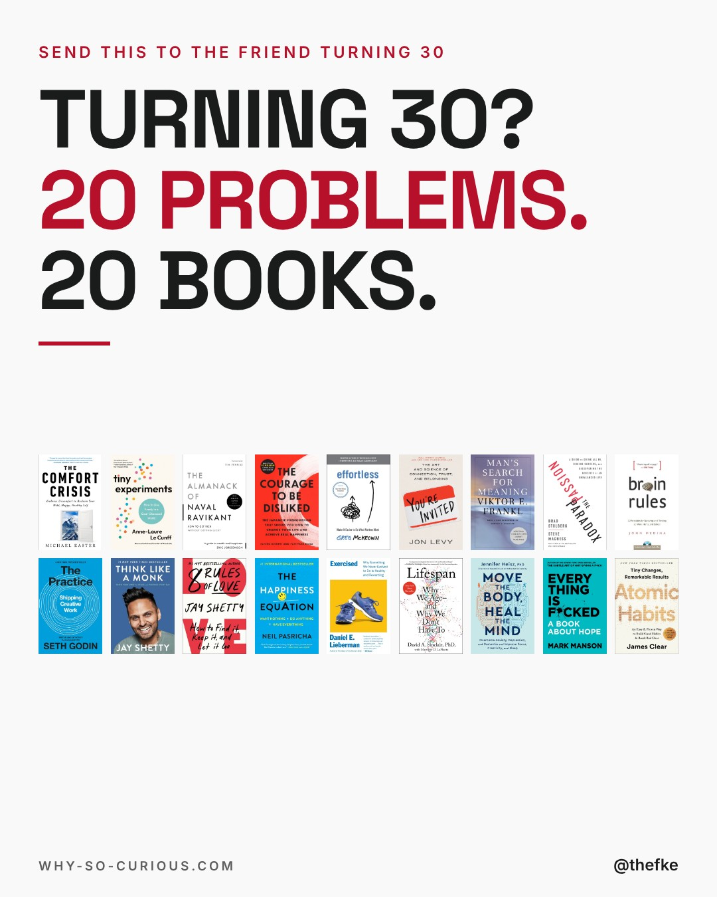
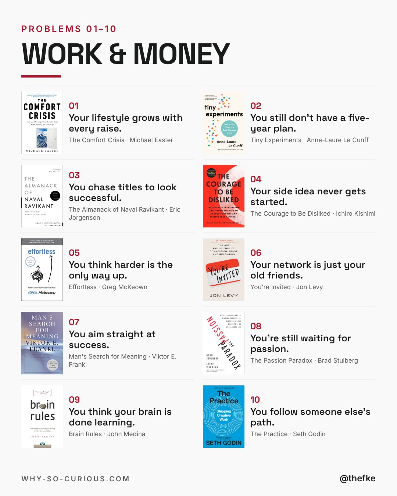
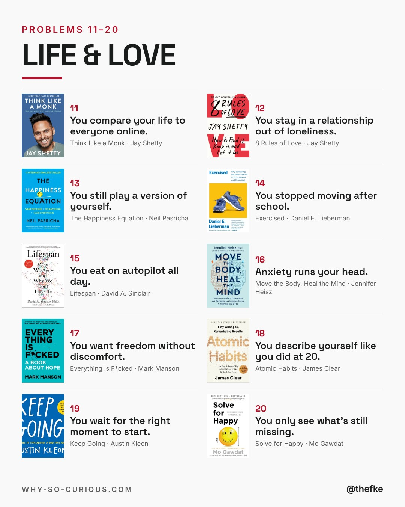
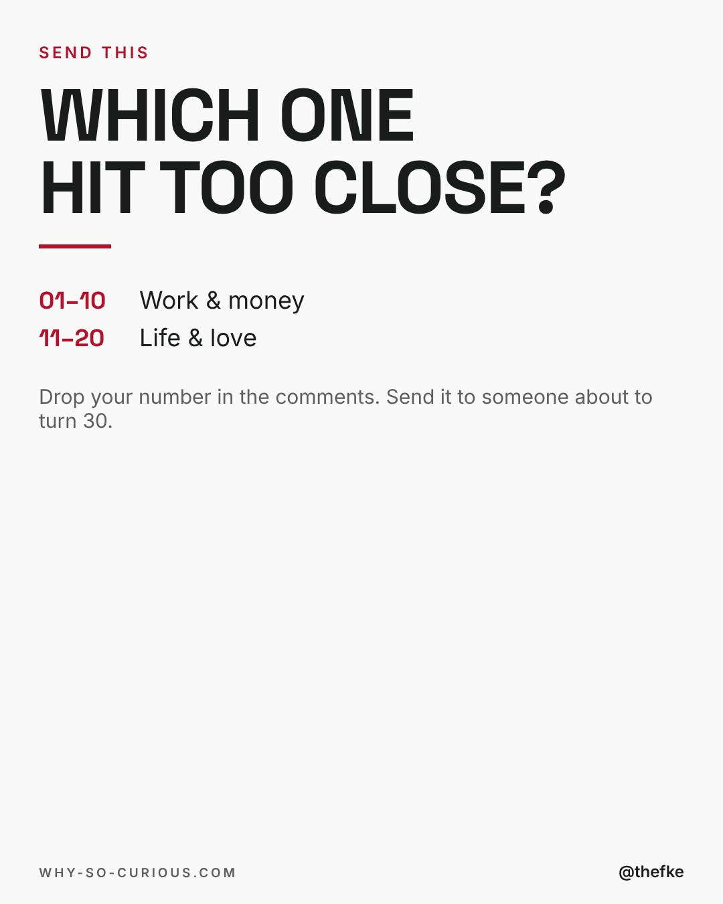

# So 06.12. · Turning 30? 20 Problems, 20 Books

Früh-Slot, wird automatisch gepostet (ohne Musik). Nicht von Hand posten. Karussell, 4 Slides. Beim Hochladen 4:5 wählen.

## Caption

```
Turning 30.
The questions get quieter and harder.

20 problems that show up around 30.
One book for each.

10 about work and money.
10 about life and love.

John Medina in Brain Rules:
“Some regions of the adult brain stay as malleable as a baby’s brain, so we can grow new connections, strengthen existing connections, and even create new neurons, allowing all of us to be lifelong learners.”

So no, 30 is not too late to learn something new.

All from my shelf.

Send this to someone about to turn 30.

Which number hit too close?

Books from this post: link in bio.

#bookstagram #bookrecommendations #books
```

## Slides





