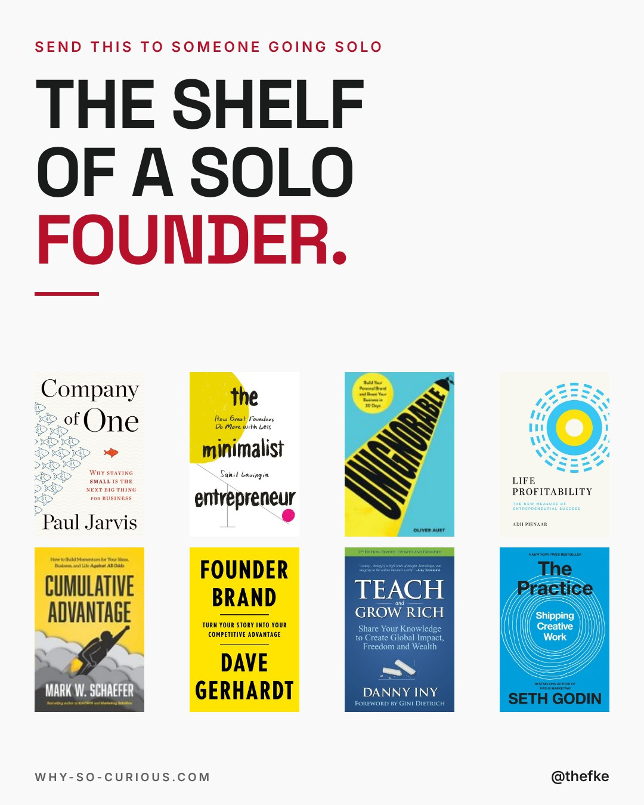
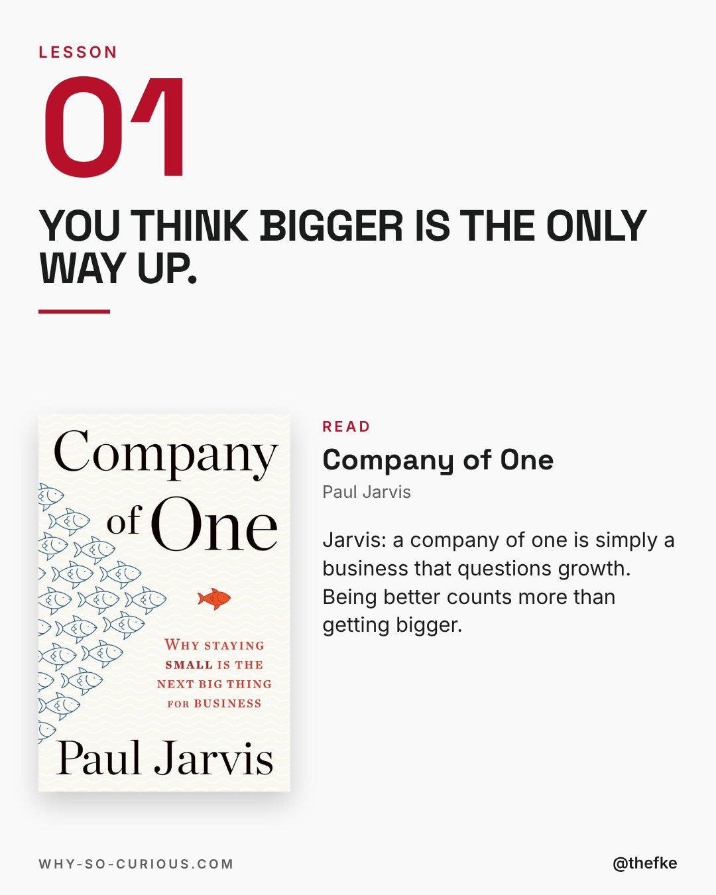
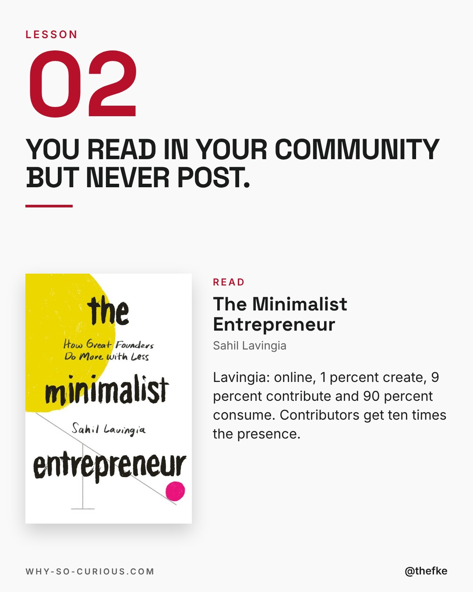
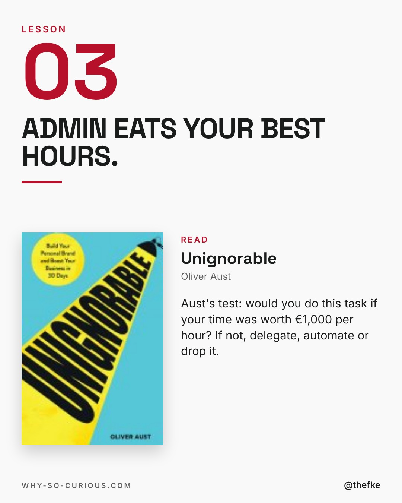
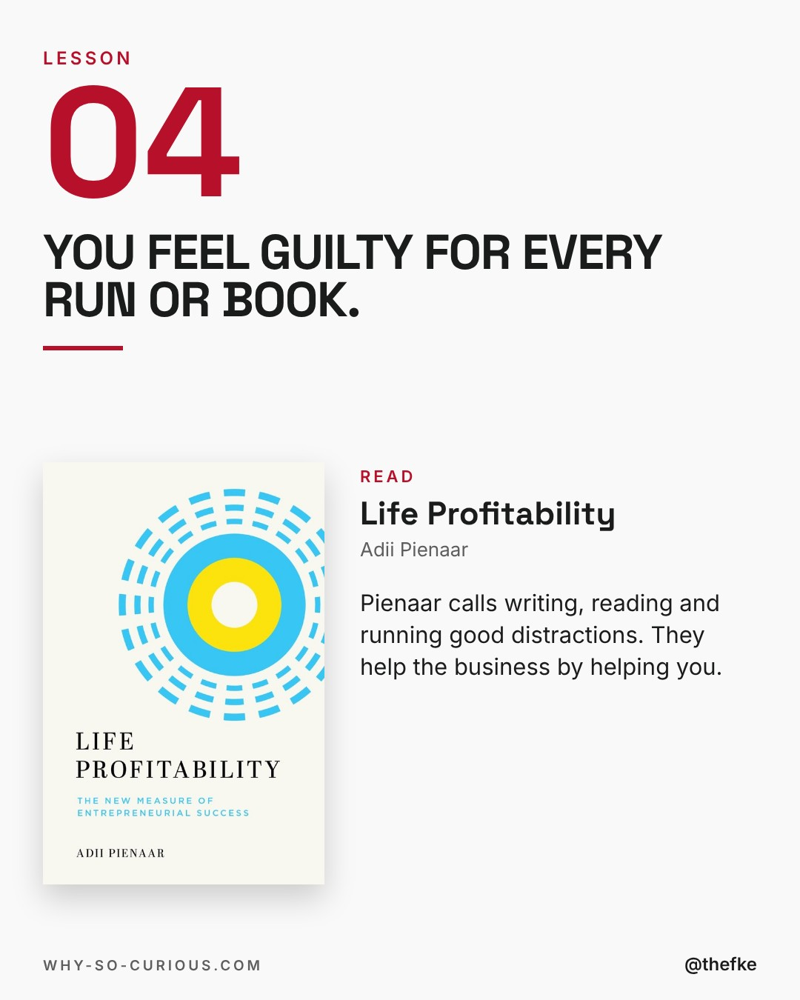
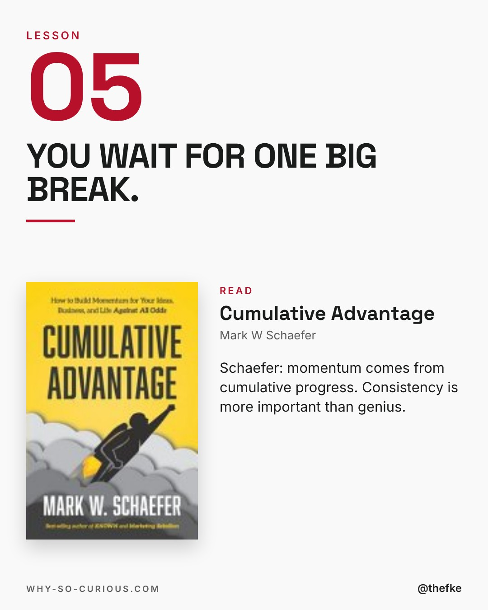
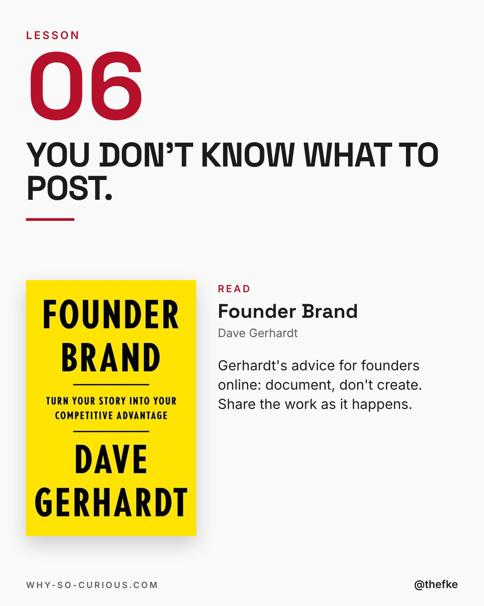
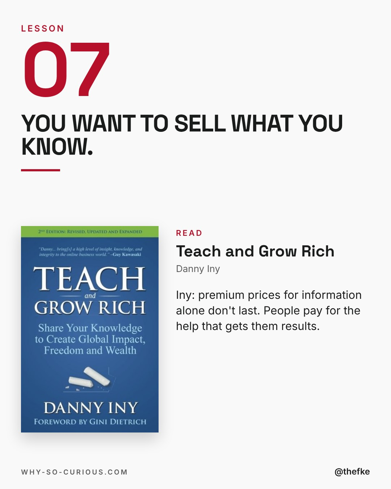
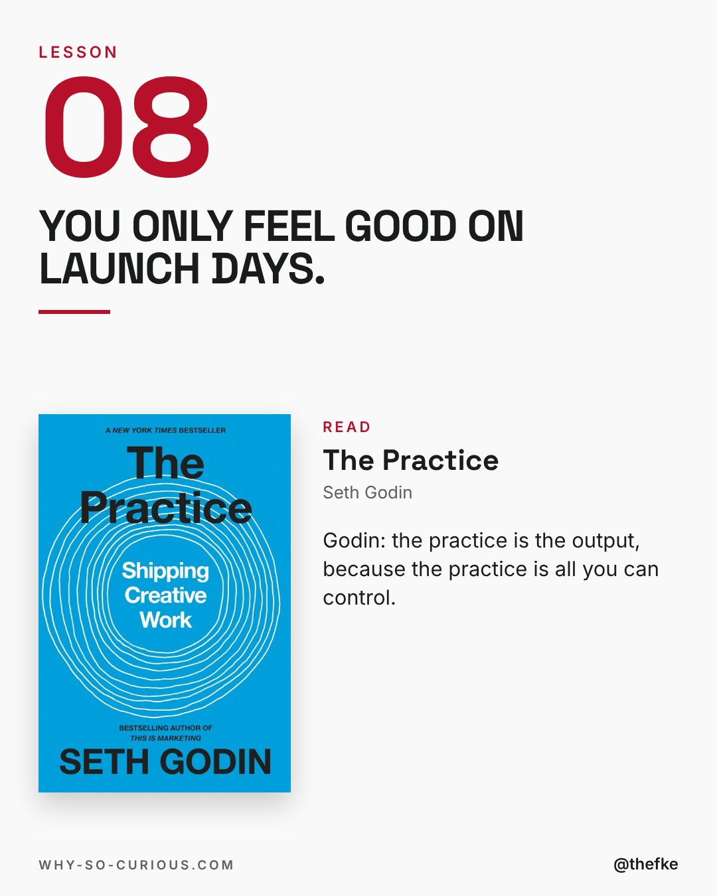
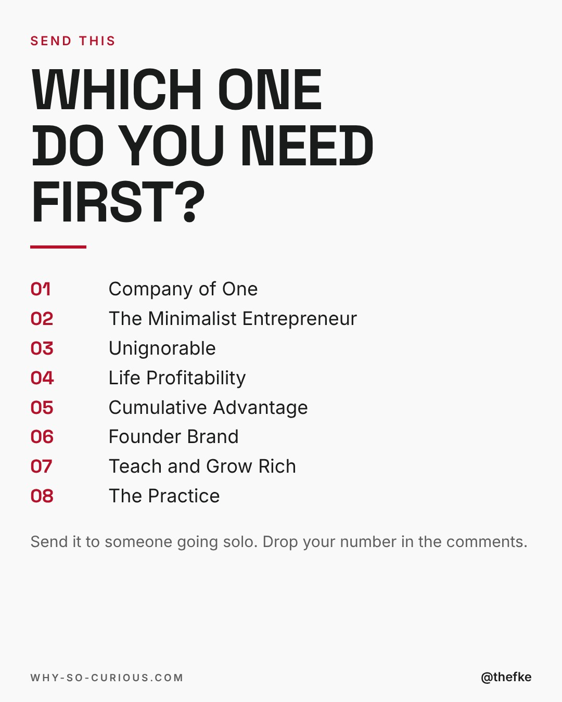

# Di 08.12. · The shelf of a solo founder

Früh-Slot, wird automatisch gepostet (ohne Musik). Nicht von Hand posten. Karussell, 10 Slides. Beim Hochladen 4:5 wählen.

## Caption

```
Going solo means doing everything.
Sales, product, admin, and somehow still posting.

Eight books for the solo founder.
Small on purpose. Visible. Consistent.

Sahil Lavingia in The Minimalist Entrepreneur:
“Most people don’t start. Most people who start don’t continue. Most people who continue give up. Many winners are just the last ones standing. Don’t give up.”

All from my shelf.

Send this to someone who just went solo.

Which one do you need first?

Books from this post: link in bio.

#bookstagram #bookrecommendations #books
```

## Slides











