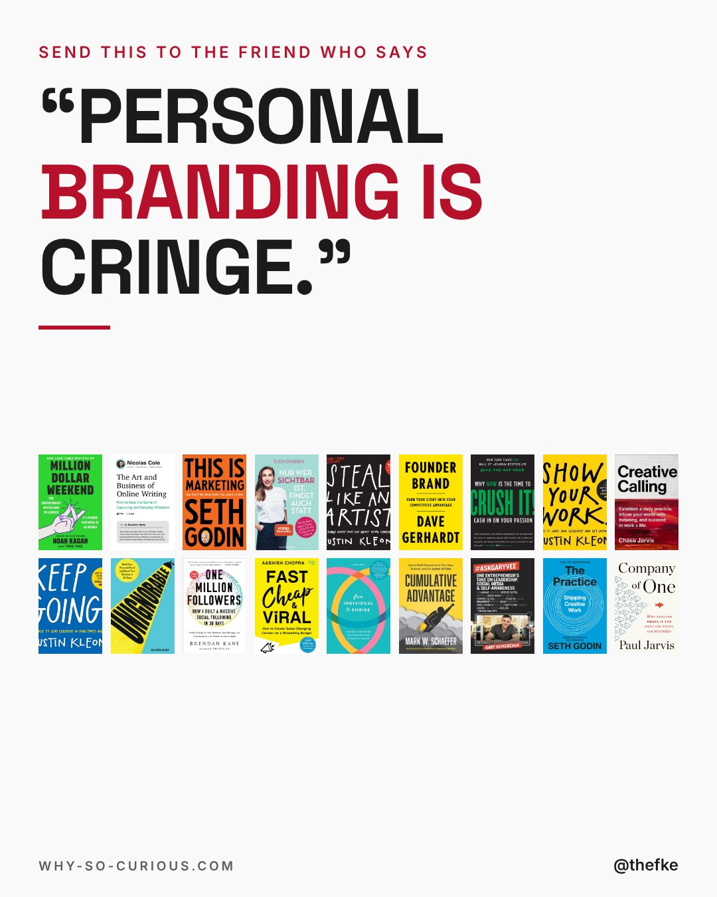
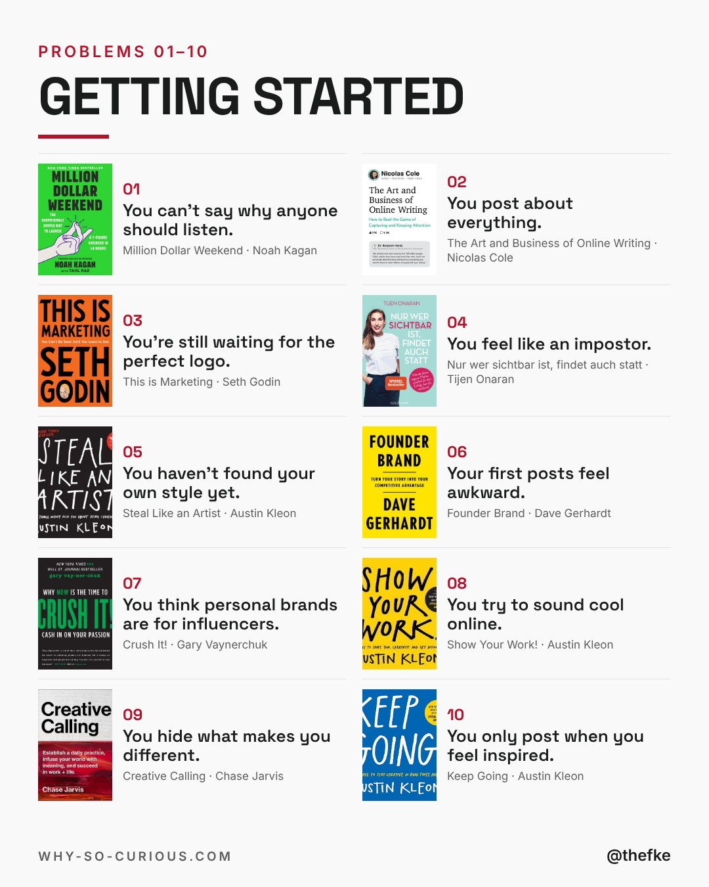
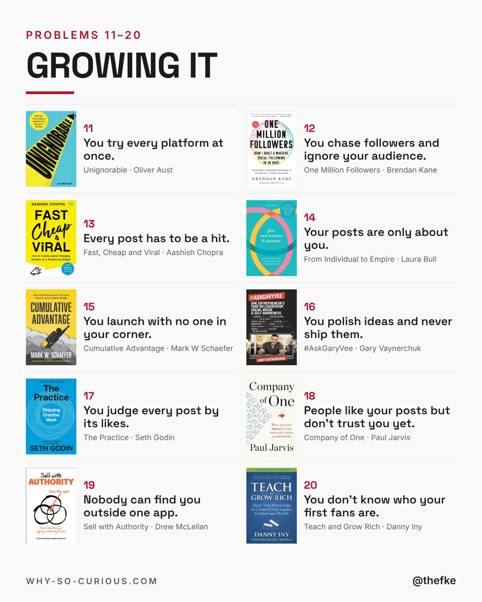
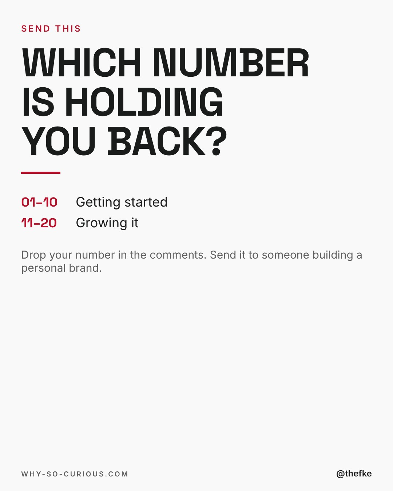

# Mi 09.12. · Building a personal brand? 20 Problems, 20 Books

Früh-Slot, wird automatisch gepostet (ohne Musik). Nicht von Hand posten. Karussell, 4 Slides. Beim Hochladen 4:5 wählen.

## Caption

```
“Personal branding is cringe.”
Until you need a job, a client or a stage.

20 problems that come with building a personal brand.
20 books from my shelf that help.

10 about getting started.
10 about growing it.

Austin Kleon quotes Yohji Yamamoto in Steal Like an Artist:
“Start copying what you love. Copy copy copy copy. At the end of the copy you will find your self.”

Send this to someone building a personal brand.

Which number is holding you back?

Books from this post: link in bio.

#bookstagram #bookrecommendations #books
```

## Slides





