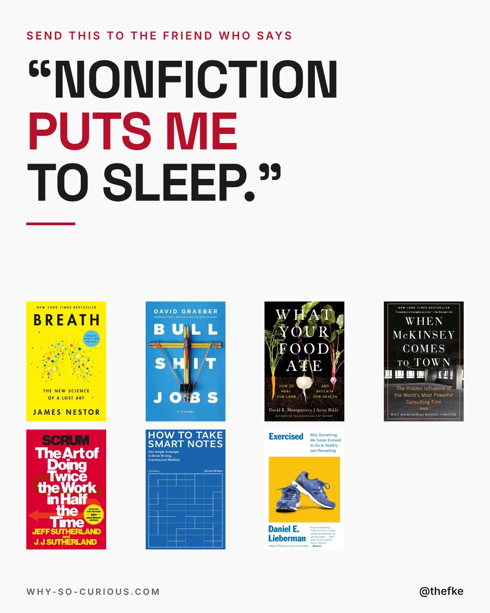
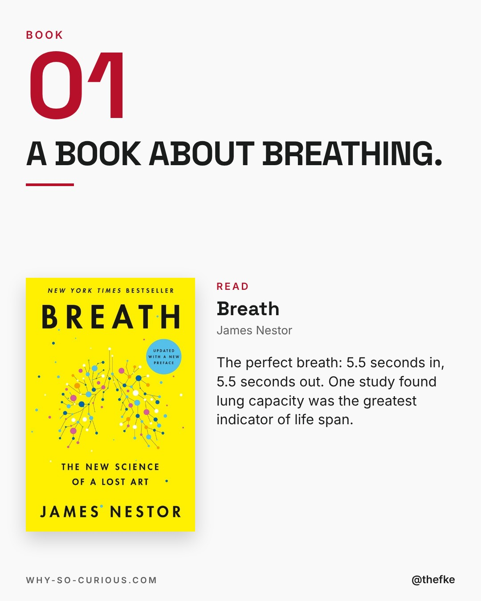
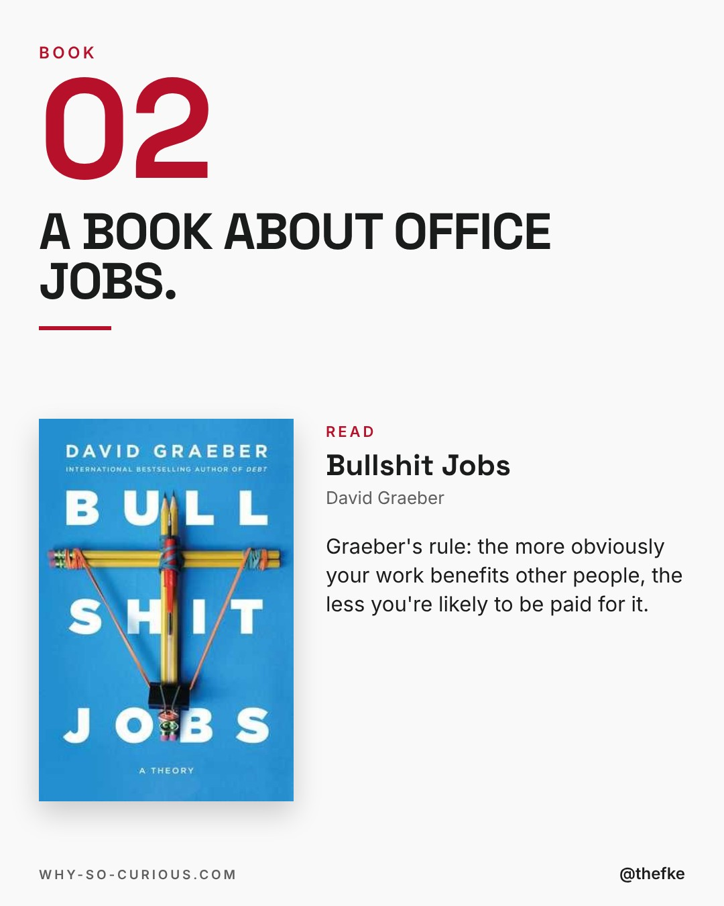
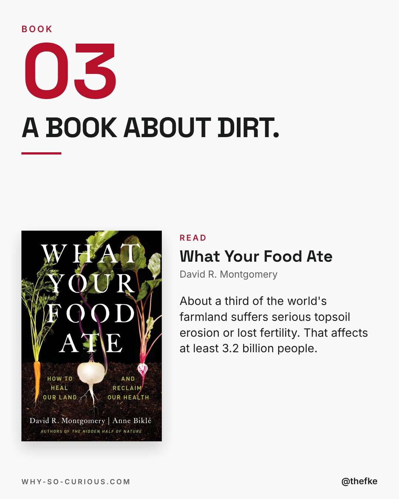
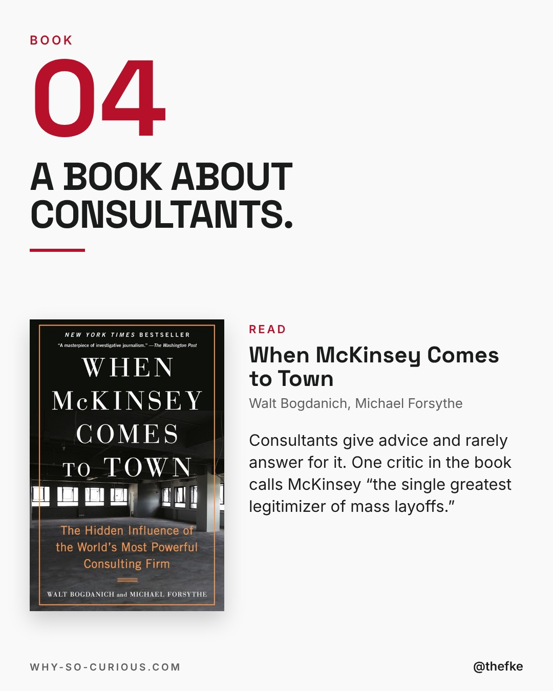
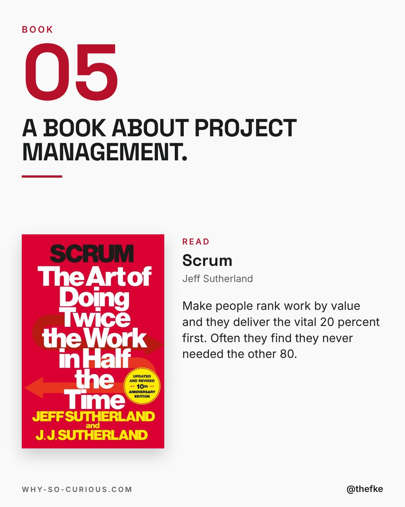
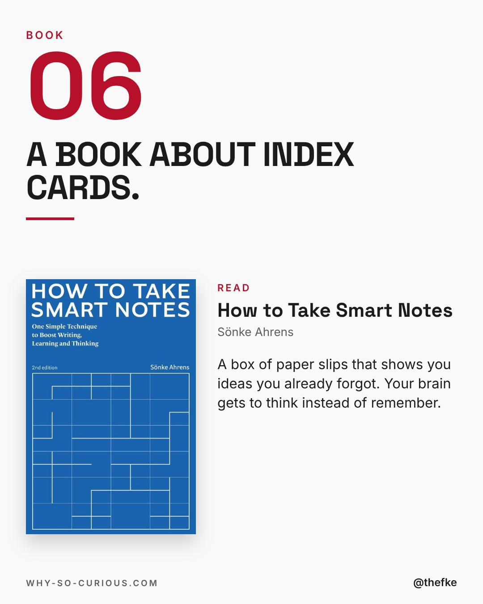
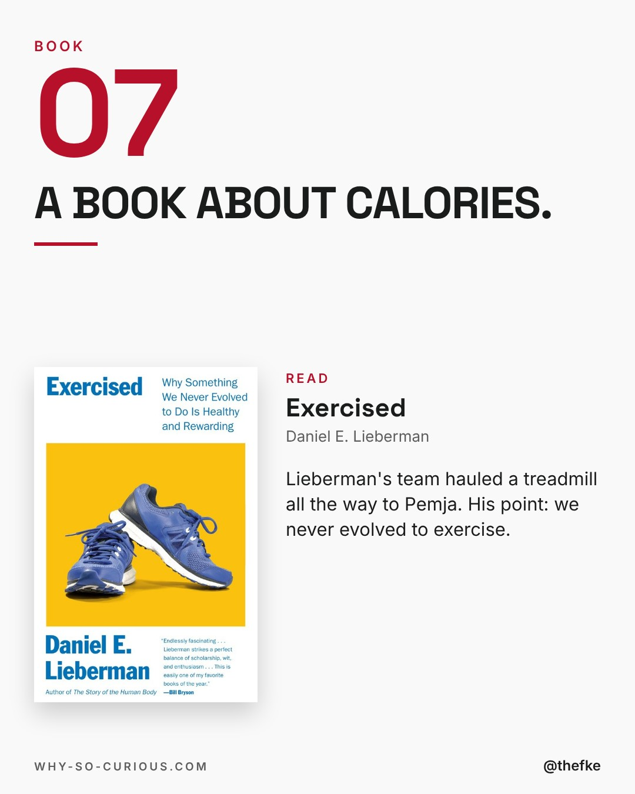
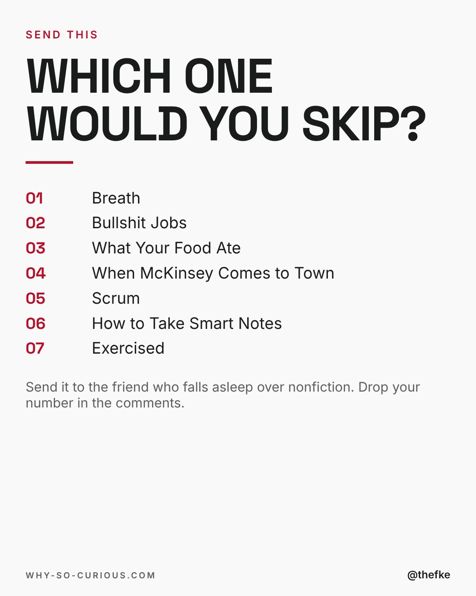

# Do 10.12. · Books that sound boring. They aren't, Part 2

Früh-Slot, wird automatisch gepostet (ohne Musik). Nicht von Hand posten. Karussell, 9 Slides. Beim Hochladen 4:5 wählen.

## Caption

```
“Nonfiction puts me to sleep.”
Seven more titles that sound like homework.

Breathing. Dirt. Index cards. Consultants.
Open them and every one has a detail you'll repeat at dinner.

The wildest detail is in Breath by James Nestor.
The perfect breath is 5.5 seconds in, 5.5 seconds out.
And one study found lung capacity was the greatest indicator of life span.

All from my shelf.

Send this to the friend who falls asleep over nonfiction.

Which one would you have skipped?

Books from this post: link in bio.

#bookstagram #bookrecommendations #books
```

## Slides










