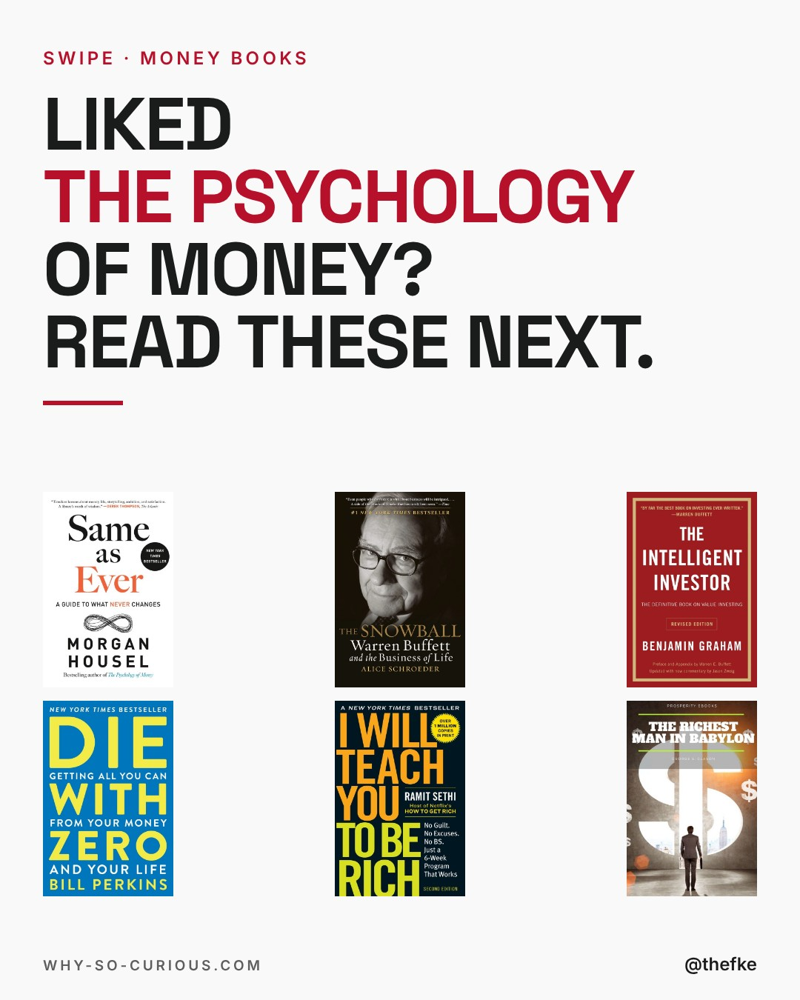
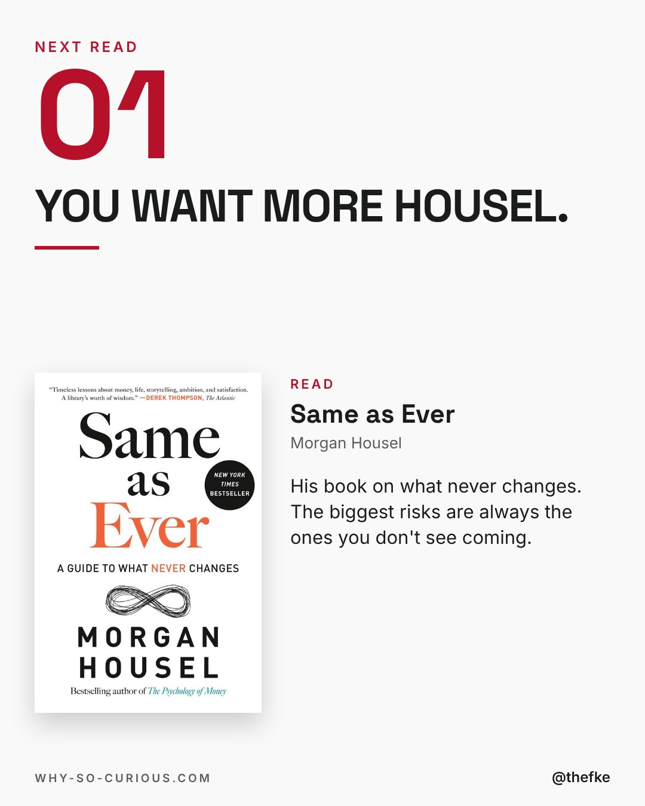
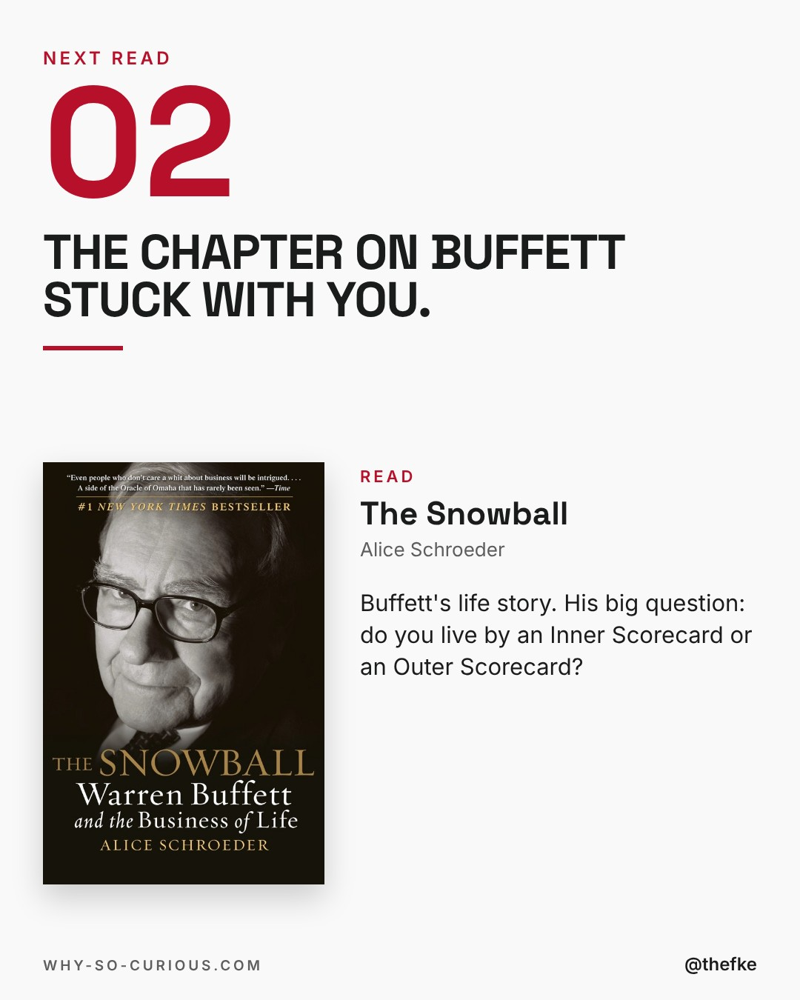
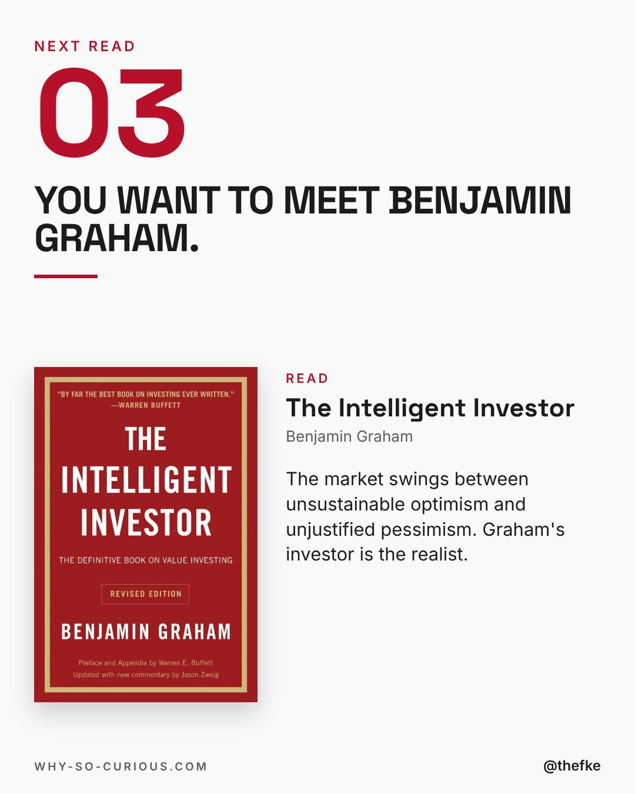
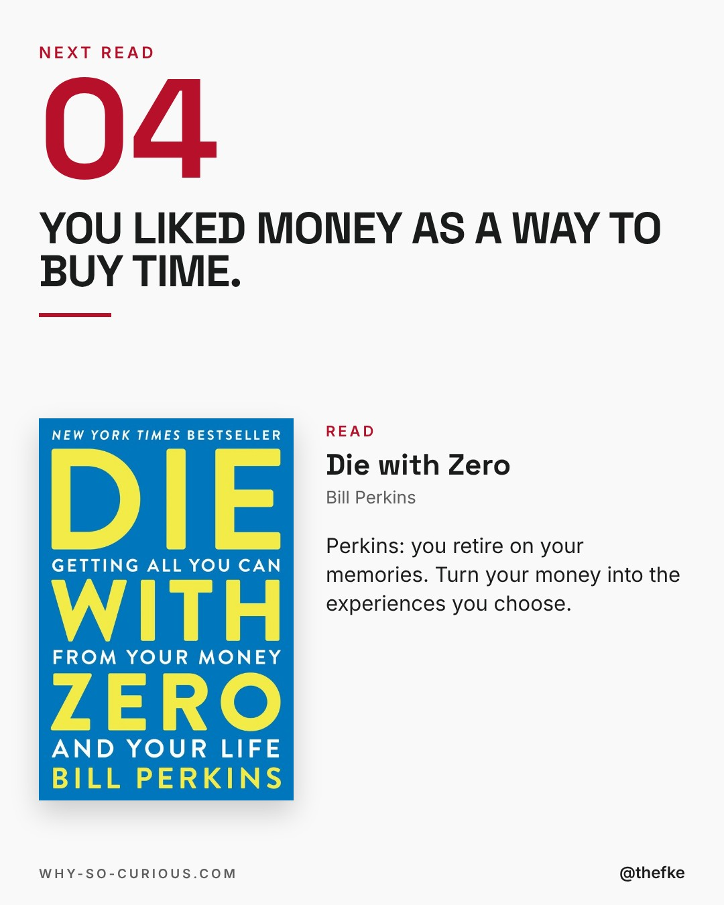
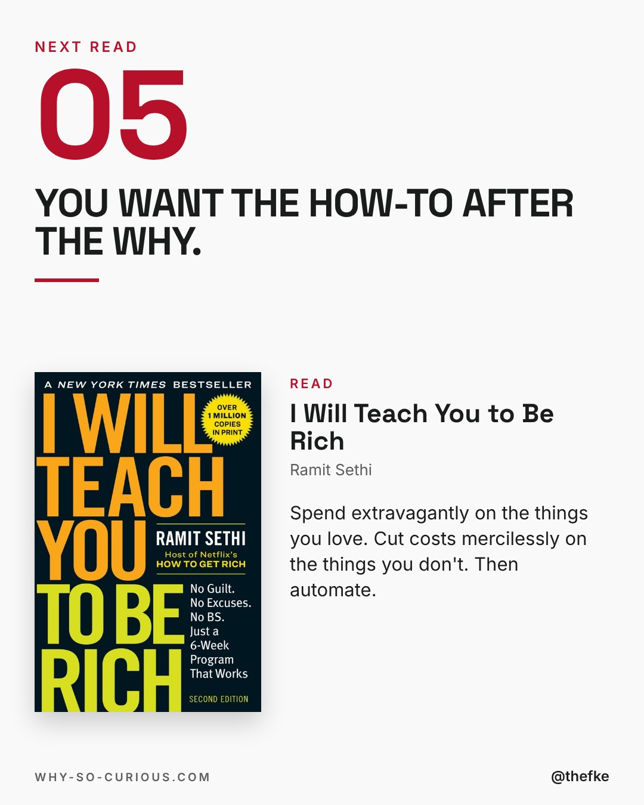
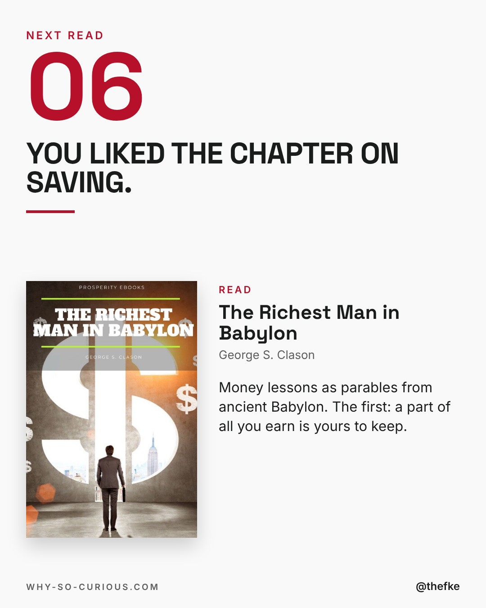
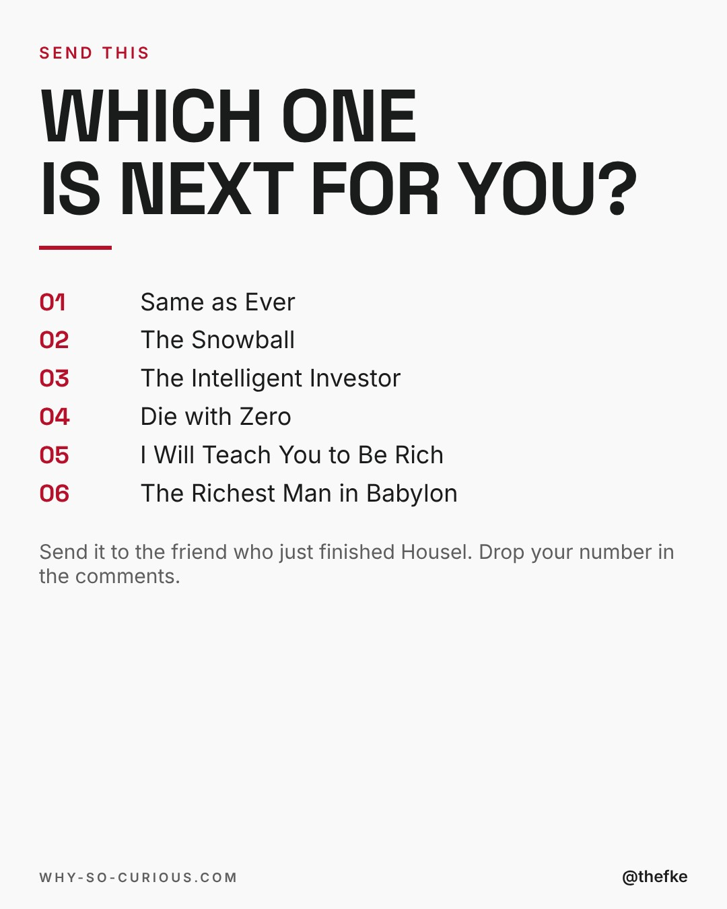

# Fr 11.12. · Liked The Psychology of Money? Read these next

Abend-Slot. Karussell, 8 Slides. Beim Hochladen 4:5 wählen.

## Caption

```
You finished The Psychology of Money.
Now what?

Morgan Housel has a line worth keeping:
“Controlling your time is the highest dividend money pays.”

Six books that pick up where he stops.
More Housel. Buffett's life. Benjamin Graham.
Money as memories. The how-to. And ancient Babylon.

All from my shelf.

Send this to the friend who just finished Housel.

Which one is next for you?

Books from this post: link in bio.

#books #bookstagram #bookrecommendations #reading #thefke #booklover #whysocurious
```

## Slides









