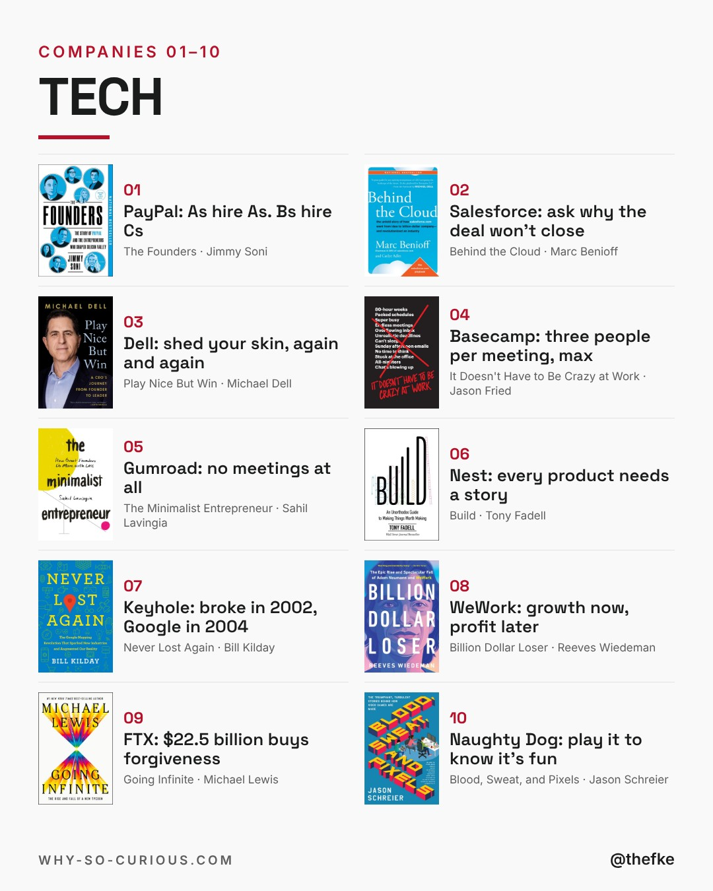
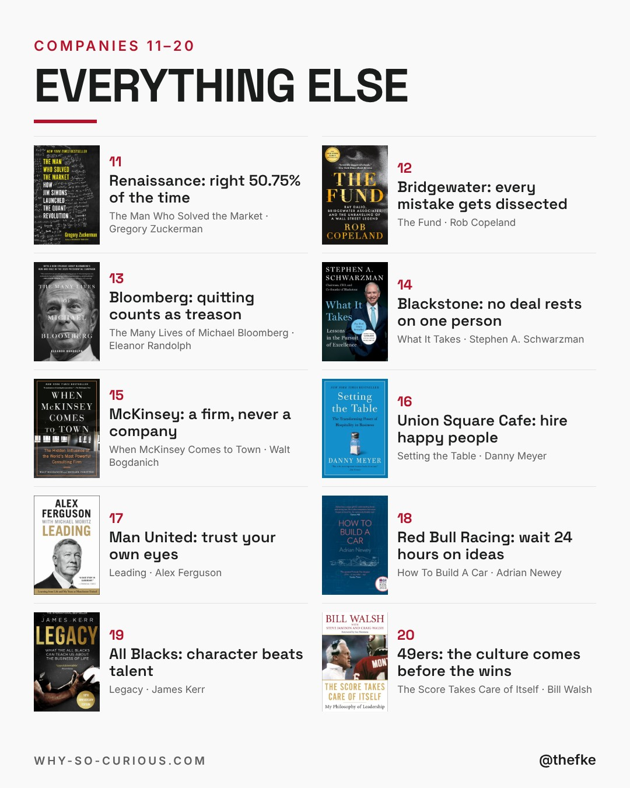
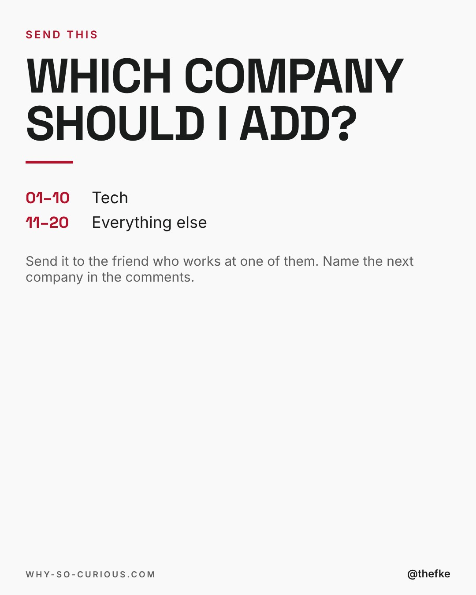

# Fr 11.12. · How They Really Work: 20 More Companies

Früh-Slot, wird automatisch gepostet (ohne Musik). Nicht von Hand posten. Karussell, 4 Slides. Beim Hochladen 4:5 wählen.

## Caption

```
Part 1 had Apple, Amazon and Netflix.
Here are 20 companies with stranger rules.

Basecamp rarely meets, and almost never with more than three people.
Gumroad has no meetings at all.
At Bloomberg, a resignation counted as treason.

And Red Bull Racing sits on every idea for a day before anyone acts on it.

20 companies. 20 books from my shelf.
10 from tech, 10 from everything else.

Send this to the friend who works at one of them.

Which company should I add?

Books from this post: link in bio.

#bookstagram #bookrecommendations #books
```

## Slides





