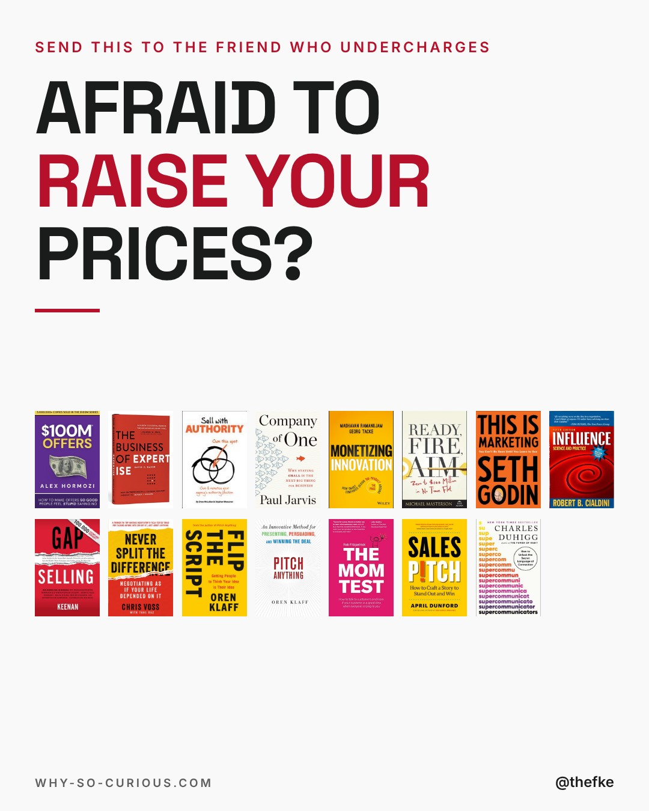
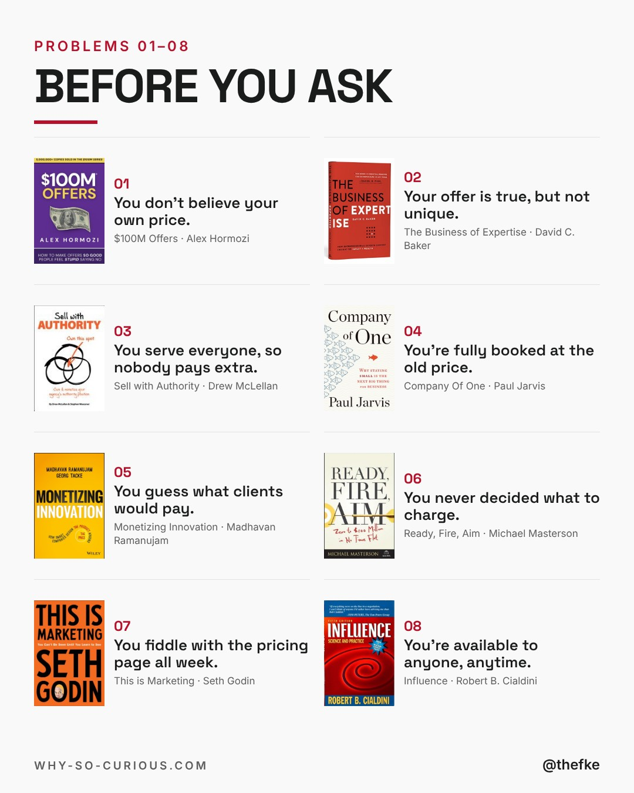
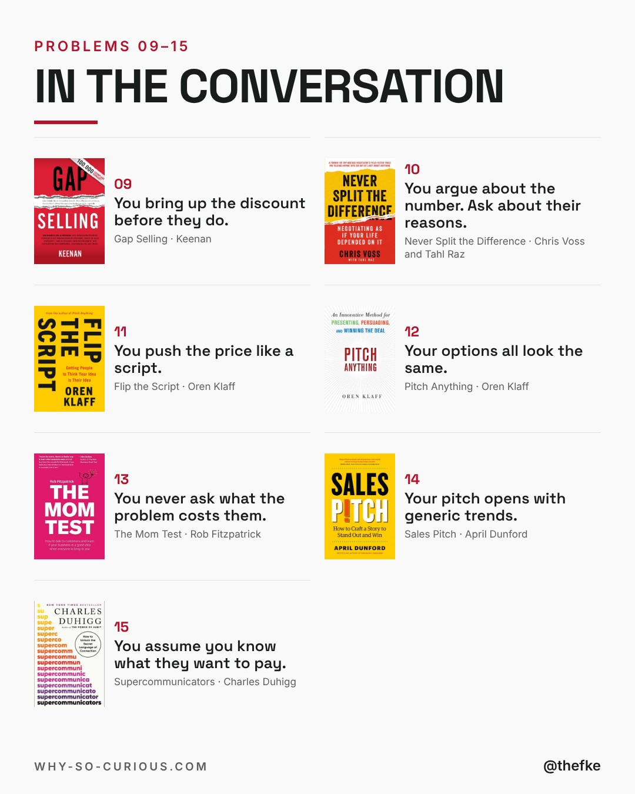
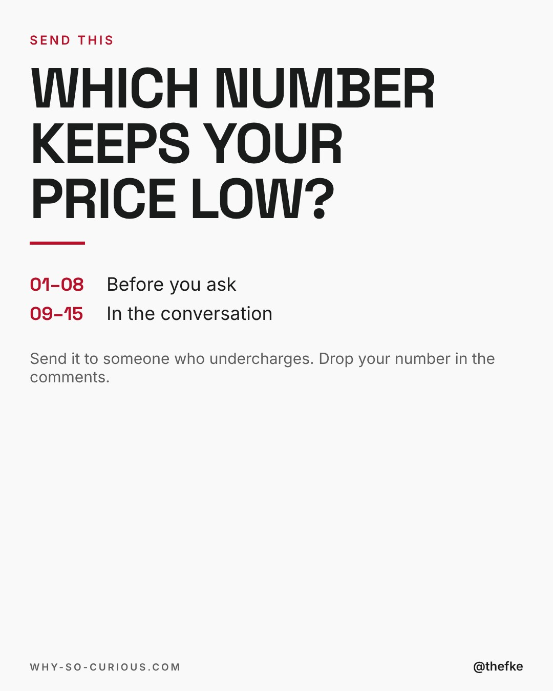

# Fr 11.12. · Afraid to raise your prices? 15 Problems, 15 Books

Karussell, 4 Slides. Beim Hochladen 4:5 wählen.

## Caption

```
Your calendar is full.
Your price hasn't moved since you started.

15 problems that keep your price low.
One book for each.

8 before you ask.
7 in the conversation.

Alex Hormozi in $100M Offers:
“First and foremost, charge a premium. It will allow you to do things no one else can to make your clients successful.”

All from my shelf.

Send this to the friend who undercharges.

Which number keeps your price low?

Books from this post: link in bio.

#bookstagram #bookrecommendations #books
```

## Slides





