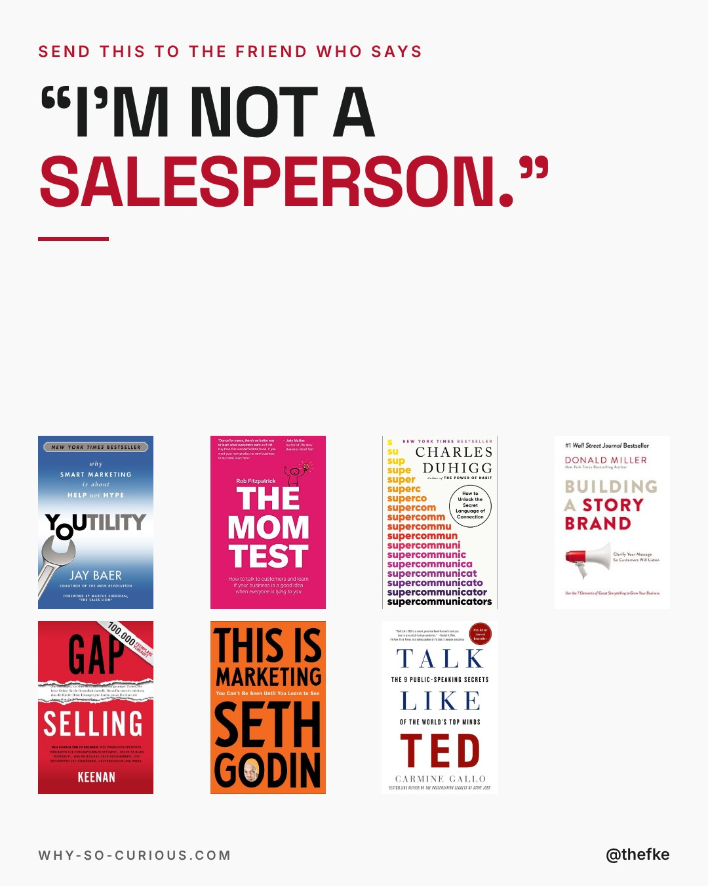
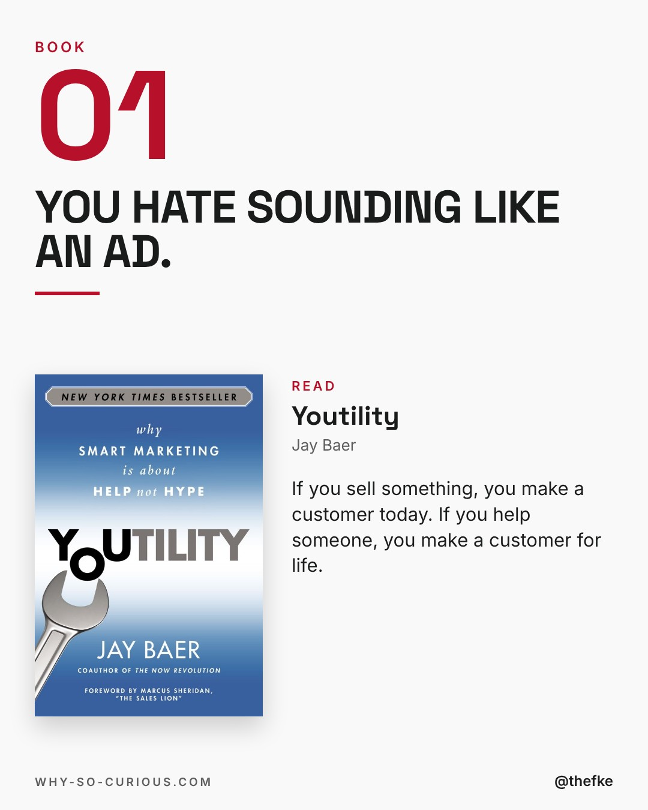
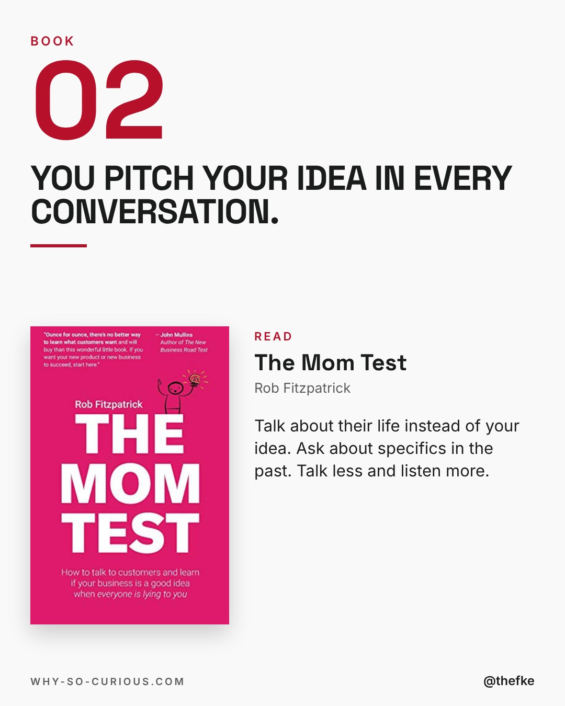
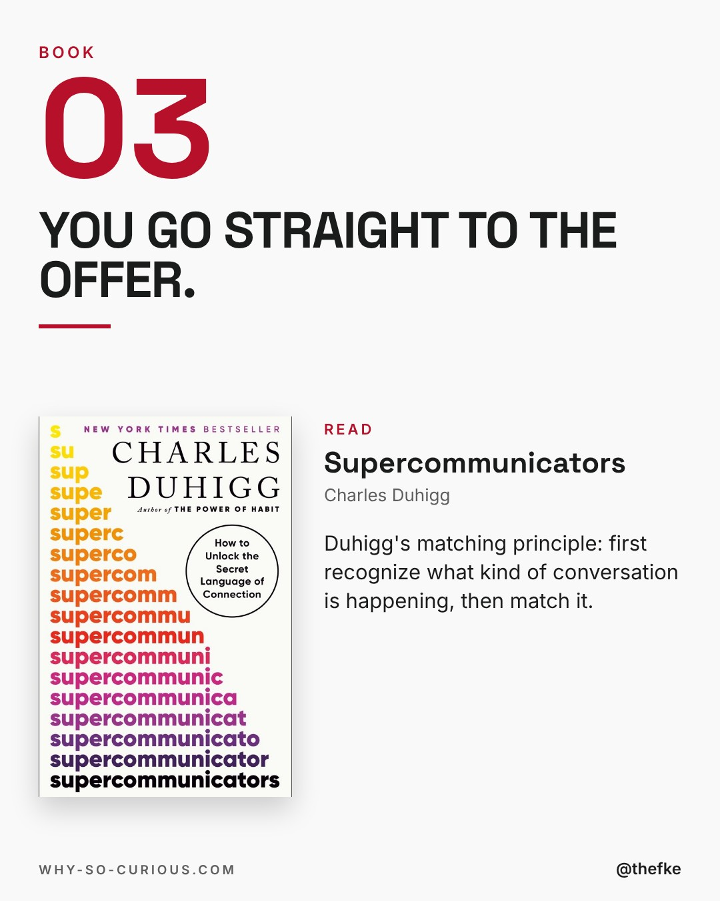
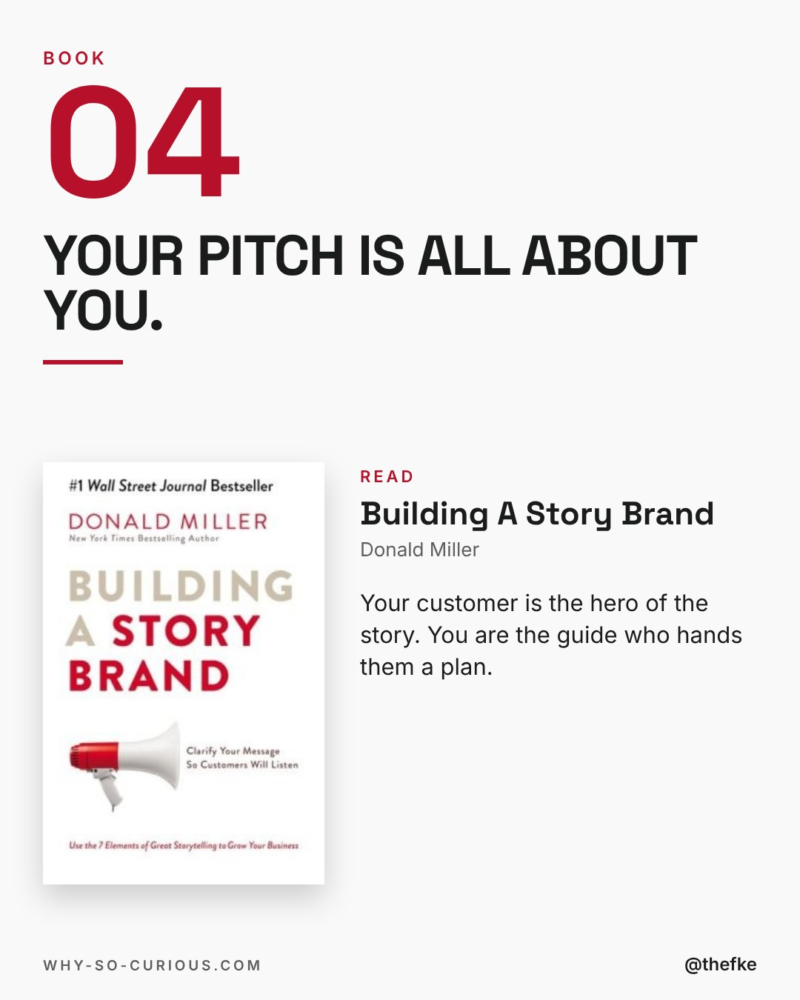
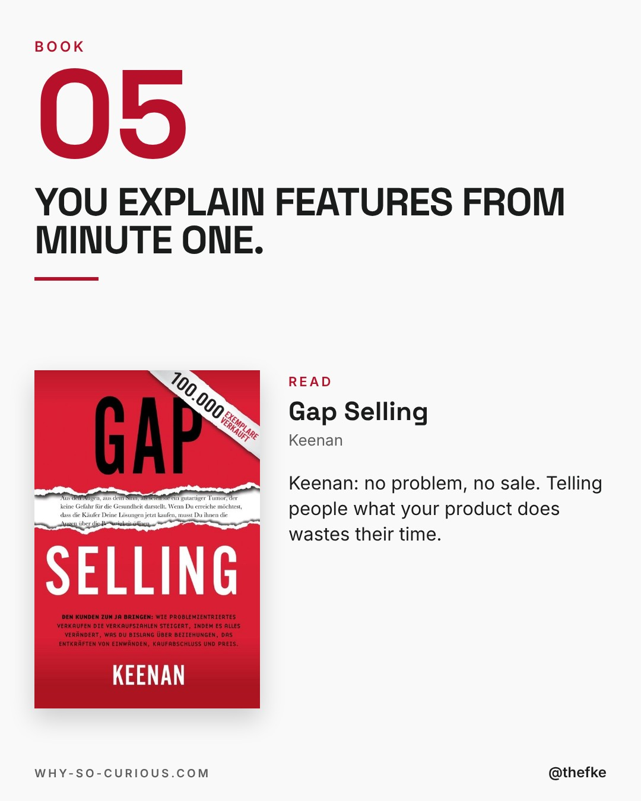
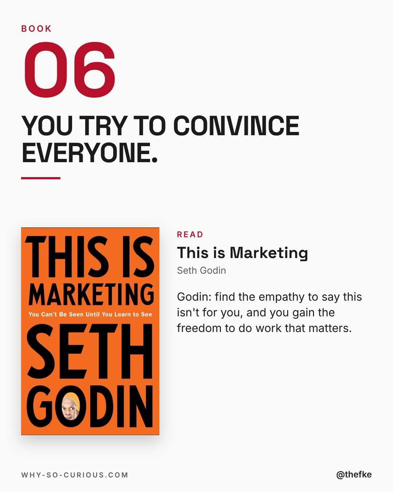
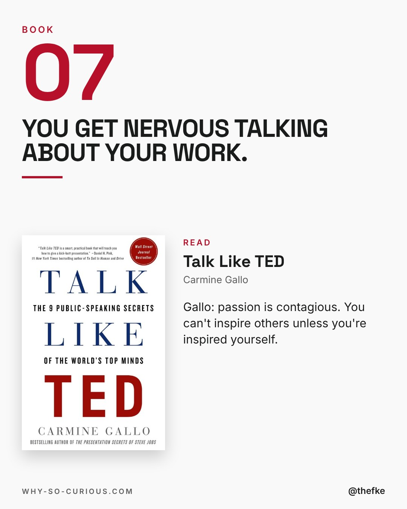
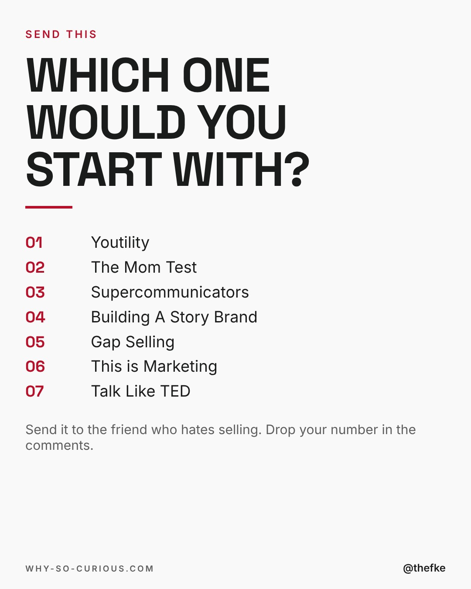

# So 13.12. · Books that teach you to sell without being salesy

Früh-Slot, wird automatisch gepostet (ohne Musik). Nicht von Hand posten. Karussell, 9 Slides. Beim Hochladen 4:5 wählen.

## Caption

```
“I'm not a salesperson.”
You still have to sell your work.

Seven books that teach selling without the pushy part.
Help first. Listen more. Make the customer the hero.
And let some people go.

Donald Miller in Building a StoryBrand:
“The fact is, pretty websites don’t sell things. Words sell things.”

All from my shelf.

Send this to the friend who hates selling.

Which one would you start with?

Books from this post: link in bio.

#bookstagram #bookrecommendations #books
```

## Slides










