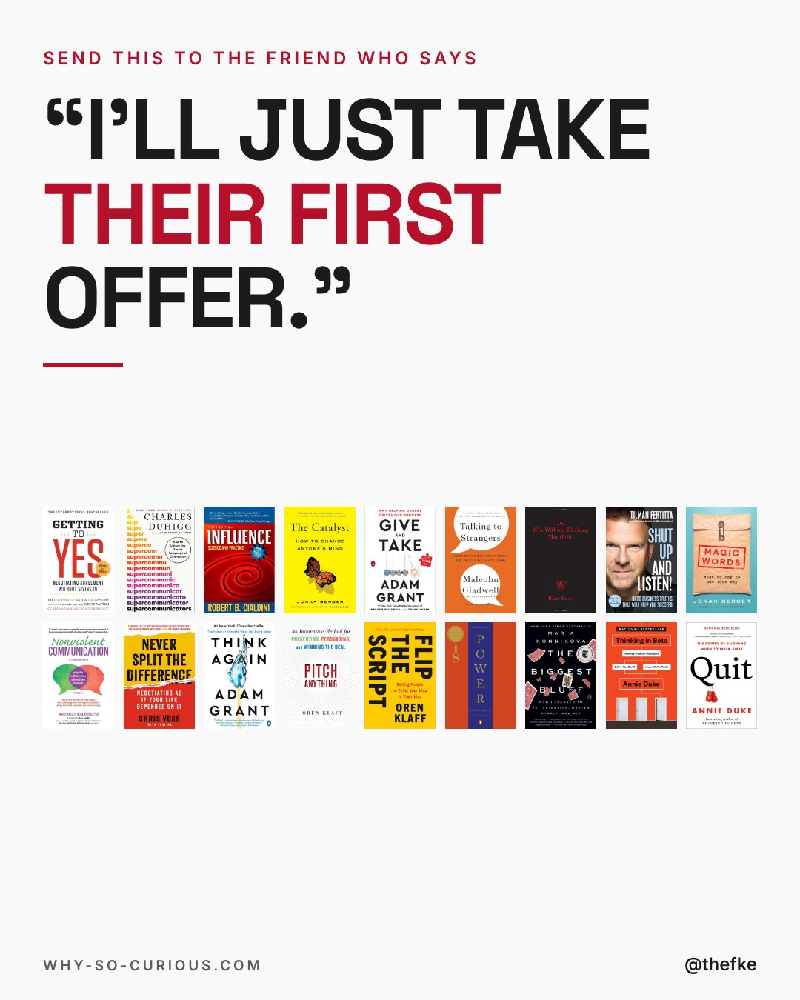
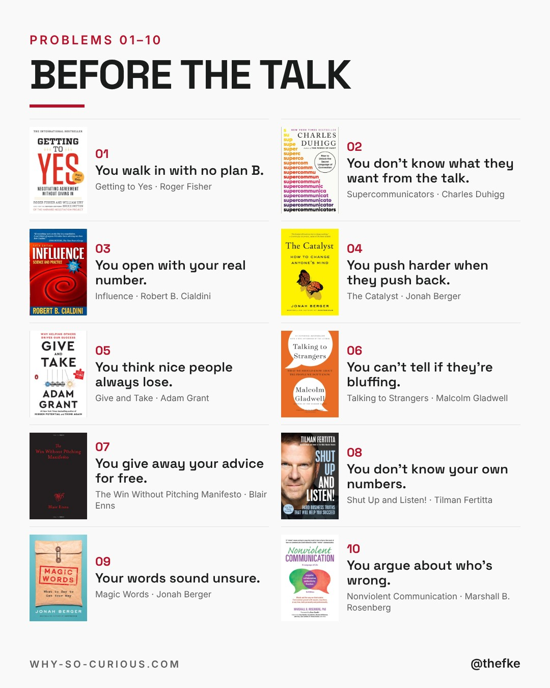
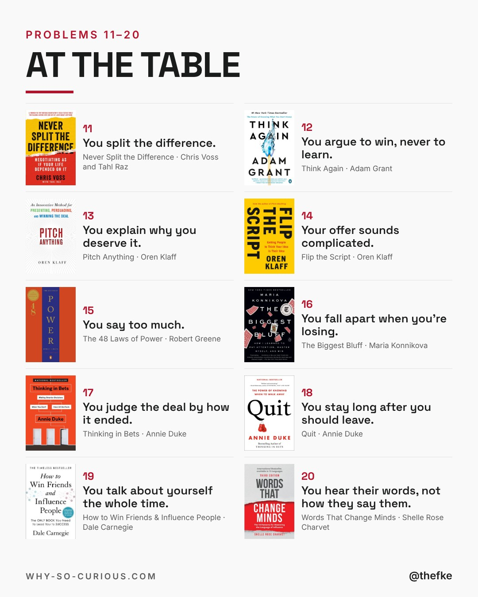
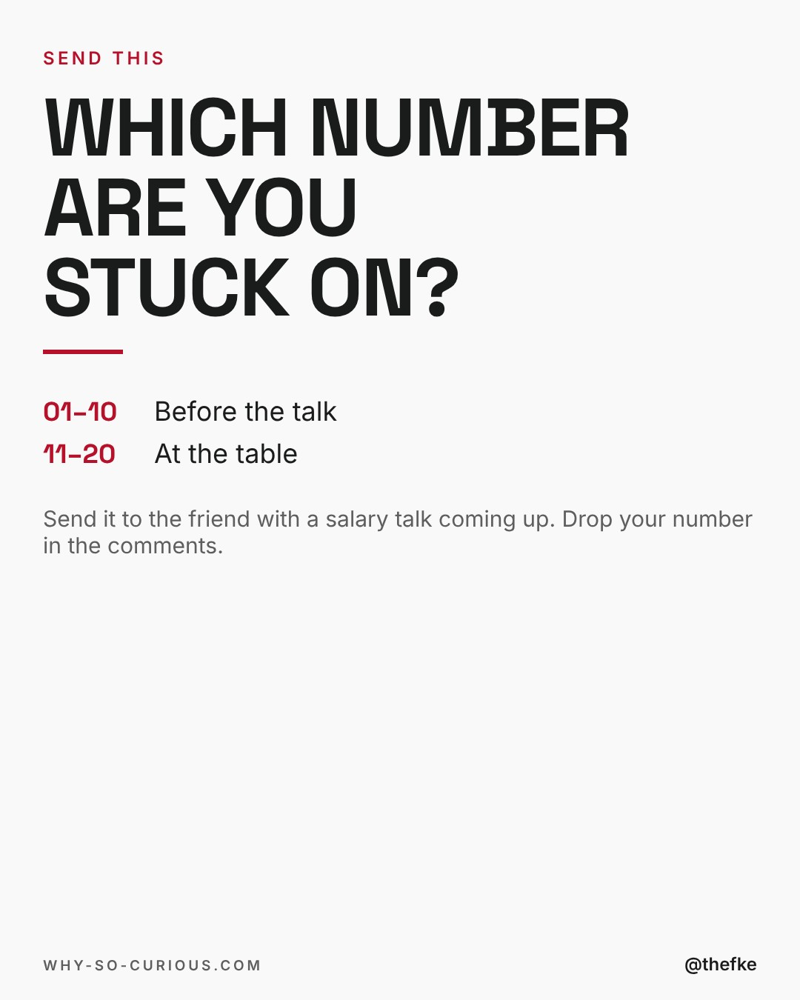

# Mo 14.12. · 20 Negotiation Problems, 20 Books

Früh-Slot, wird automatisch gepostet (ohne Musik). Nicht von Hand posten. Karussell, 4 Slides. Beim Hochladen 4:5 wählen.

## Caption

```
“I'll just take their first offer.”
Then you think about it for a year.

20 negotiation problems.
20 books from my shelf that help.

10 before the talk.
10 at the table.

Chris Voss in Never Split the Difference:
“Negotiation is not an act of battle; it’s a process of discovery. The goal is to uncover as much information as possible.”

Send this to the friend with a salary talk coming up.

Which number are you stuck on?

Books from this post: link in bio.

#bookstagram #bookrecommendations #books
```

## Slides





