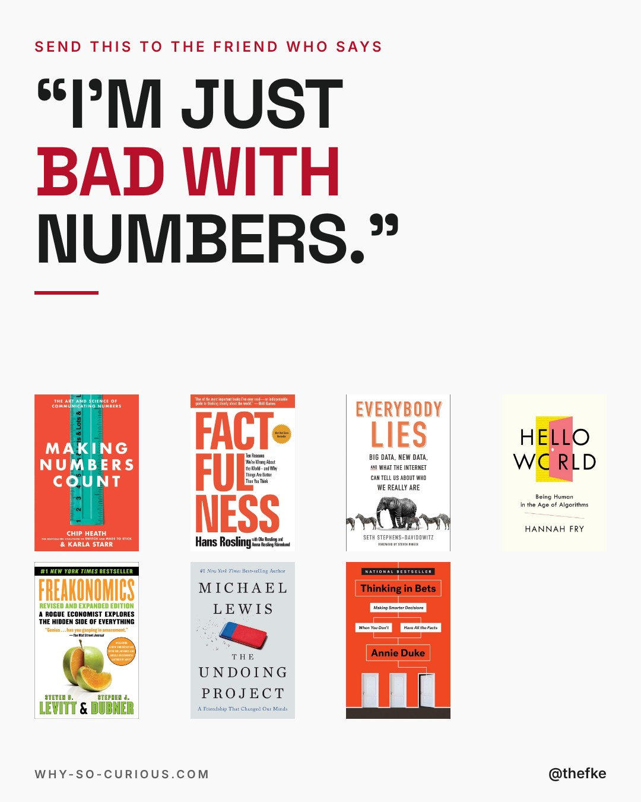
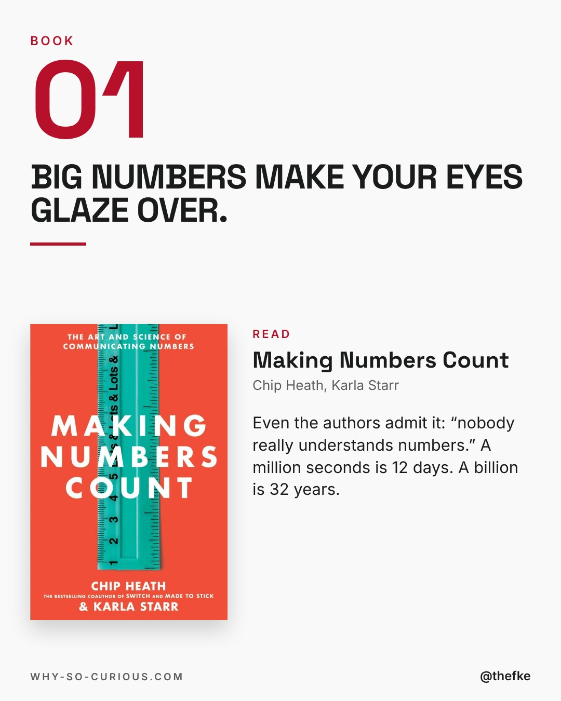
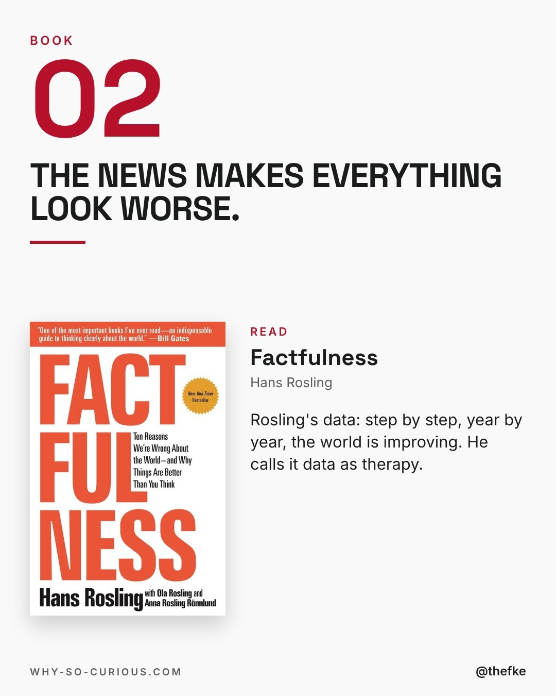
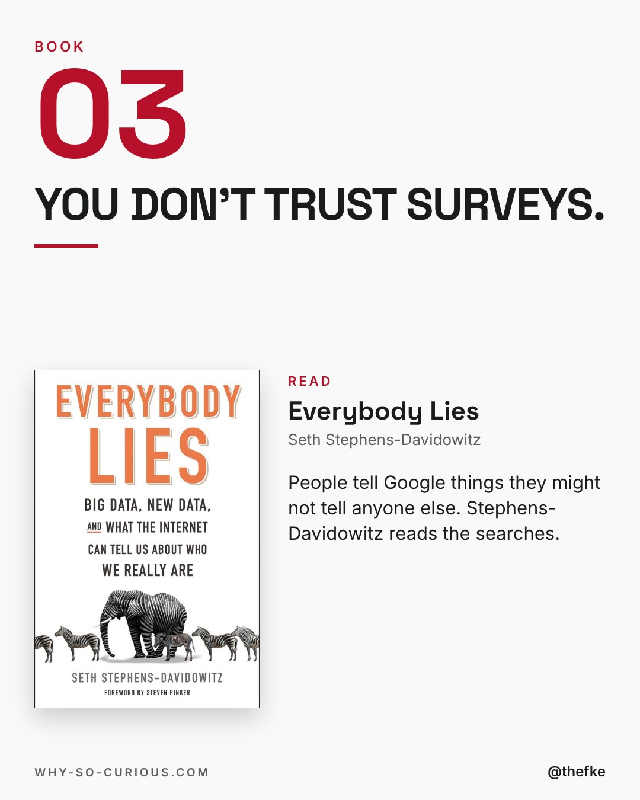
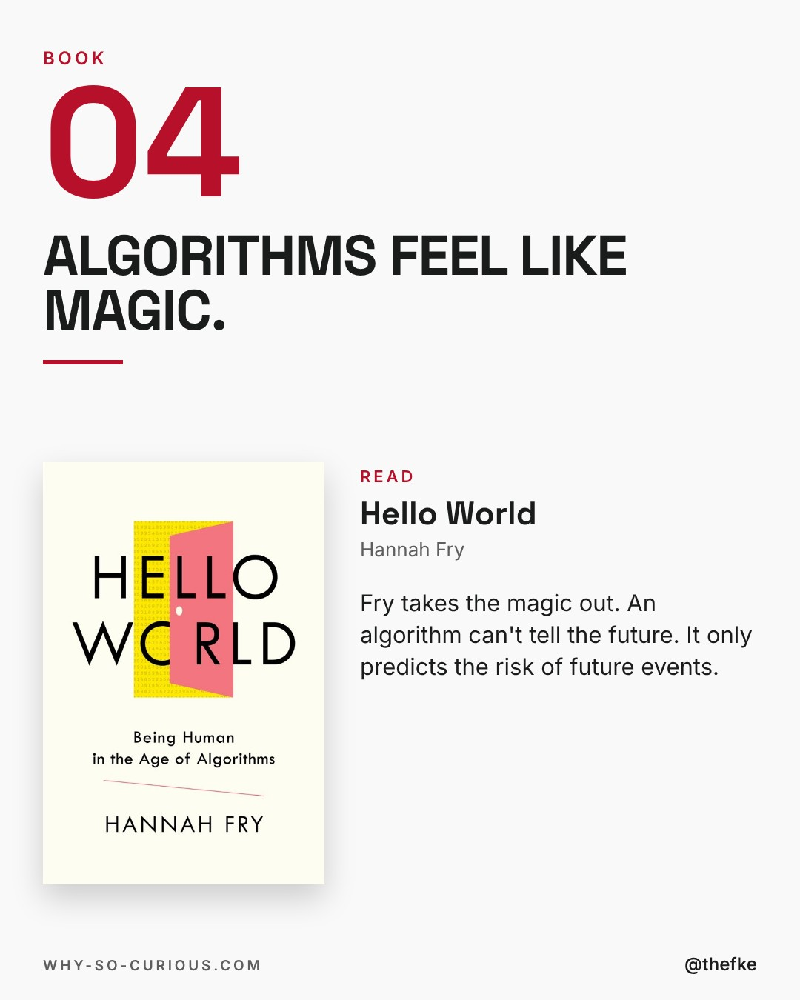
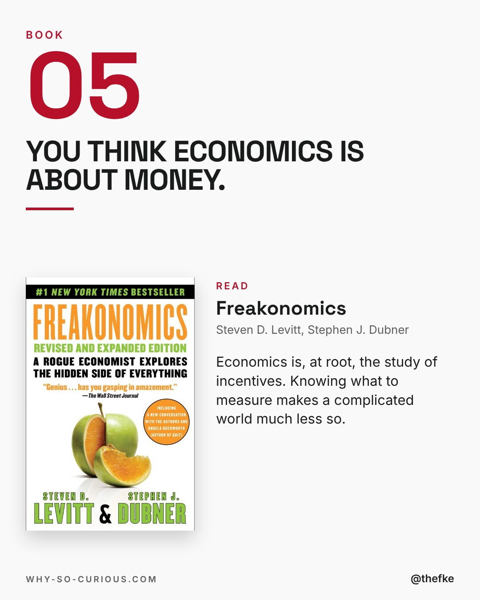
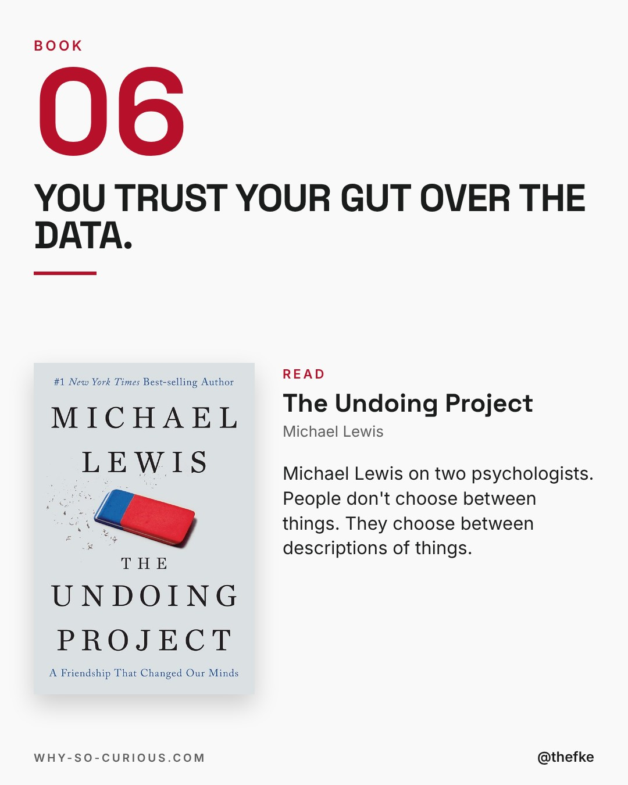
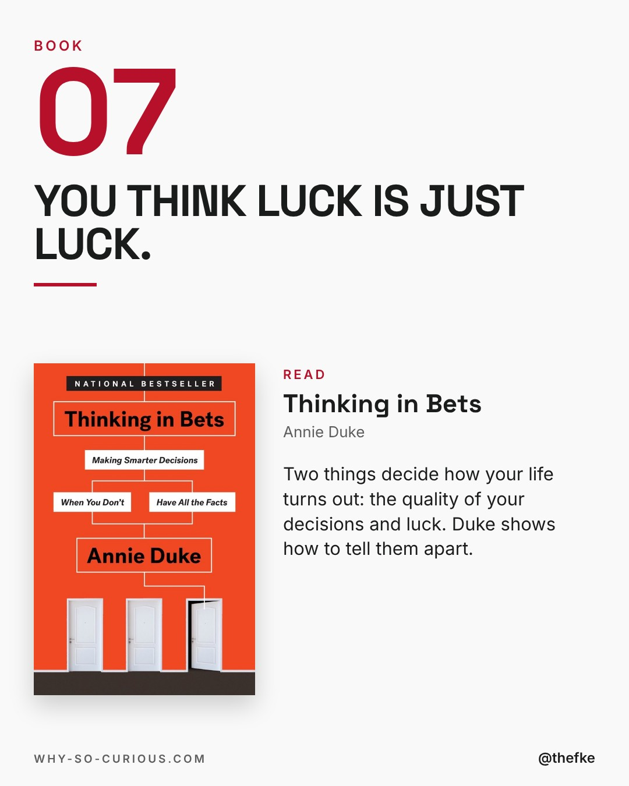
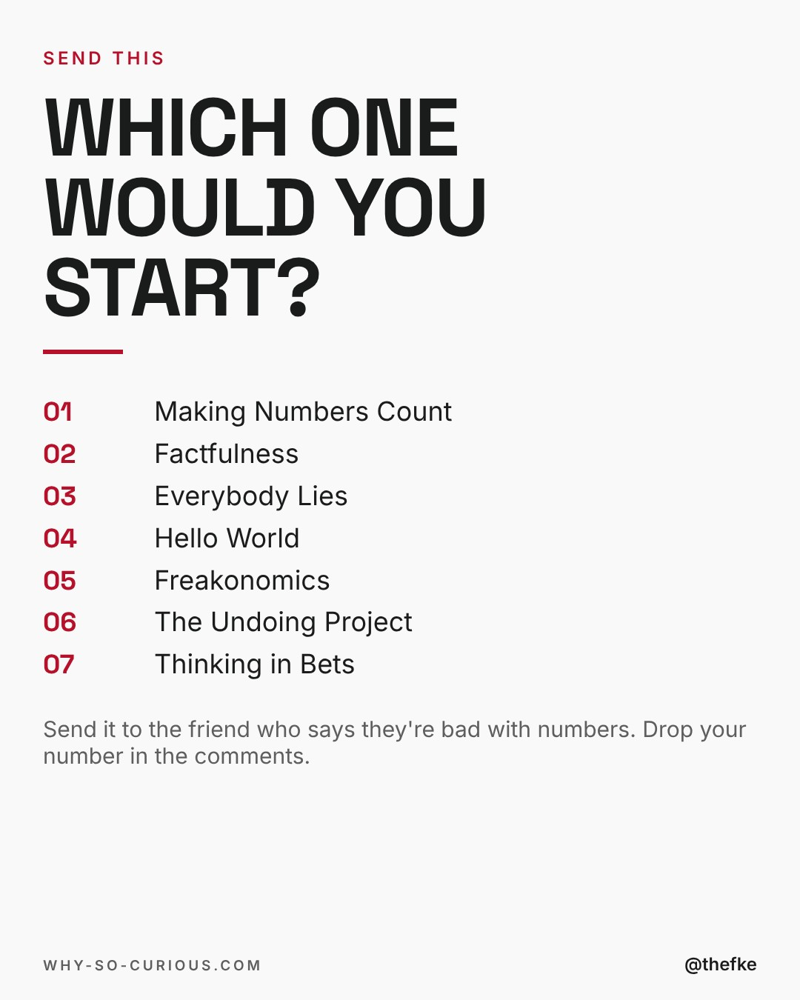

# Mo 14.12. · Books for people who think they're bad with numbers

Abend-Slot. Karussell, 9 Slides. Beim Hochladen 4:5 wählen.

## Caption

```
“I'm just bad with numbers.”
Maybe the numbers were just explained badly.

Seven books that explain them well.

Chip Heath and Karla Starr start with an honest line:
“nobody really understands numbers. Nobody.”
Then they translate.
A million seconds is 12 days. A billion seconds is 32 years.

All from my shelf.

Send this to the friend who says they're bad with numbers.

Which one would you start with?

Books from this post: link in bio.

#books #bookstagram #bookrecommendations #reading #thefke #booklover #whysocurious
```

## Slides










