# Mo 14.12. · 10 companies. How they handled failure

Karussell, 12 Slides. Beim Hochladen 4:5 wählen.

## Caption

```
Your plan just failed.
So did theirs.

Keyhole ran out of cash in 2002.
Musk's focus in 2008 probably saved Tesla from bankruptcy.
Netflix has a rule for failed bets: sunshine it.

10 companies. How they handled failure.

The best line is from James Dyson in Invention:
“Learning by failure is a remarkably good way of gaining knowledge.”

All from my shelf.

Send this to a founder having a hard month.

Which company would you copy?

Books from this post: link in bio.

#bookstagram #bookrecommendations #books
```

## Slides

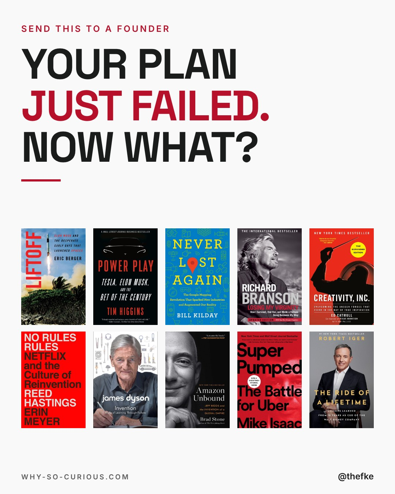

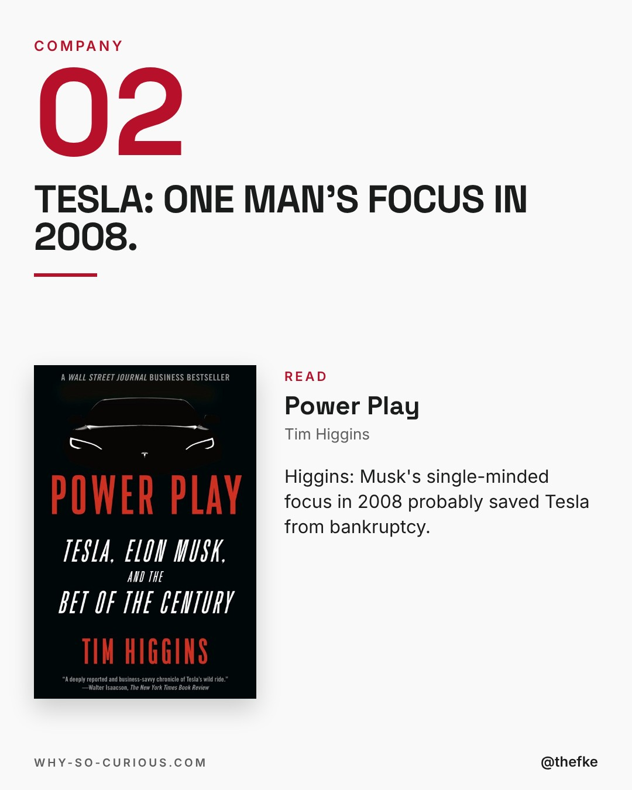
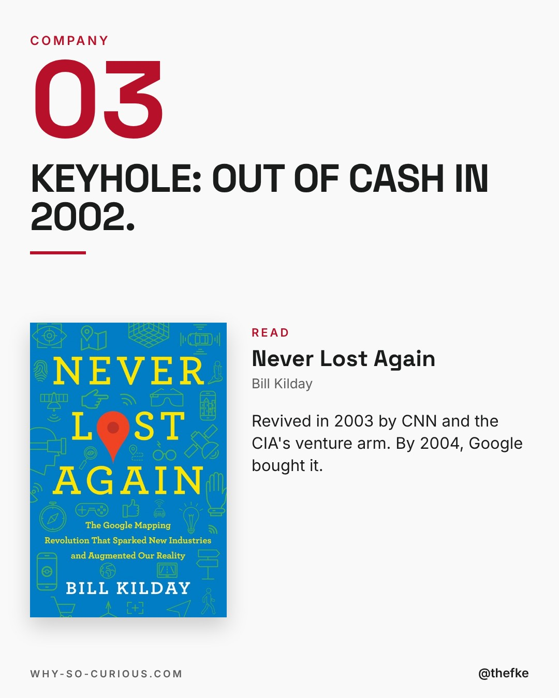
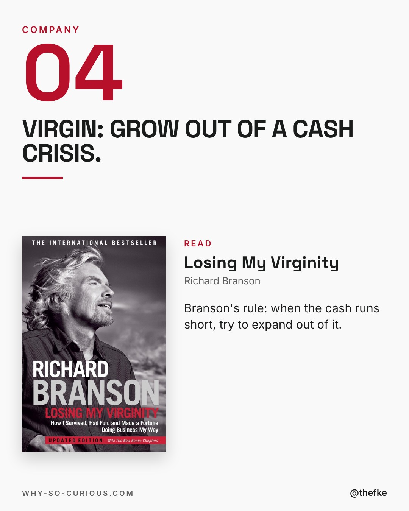
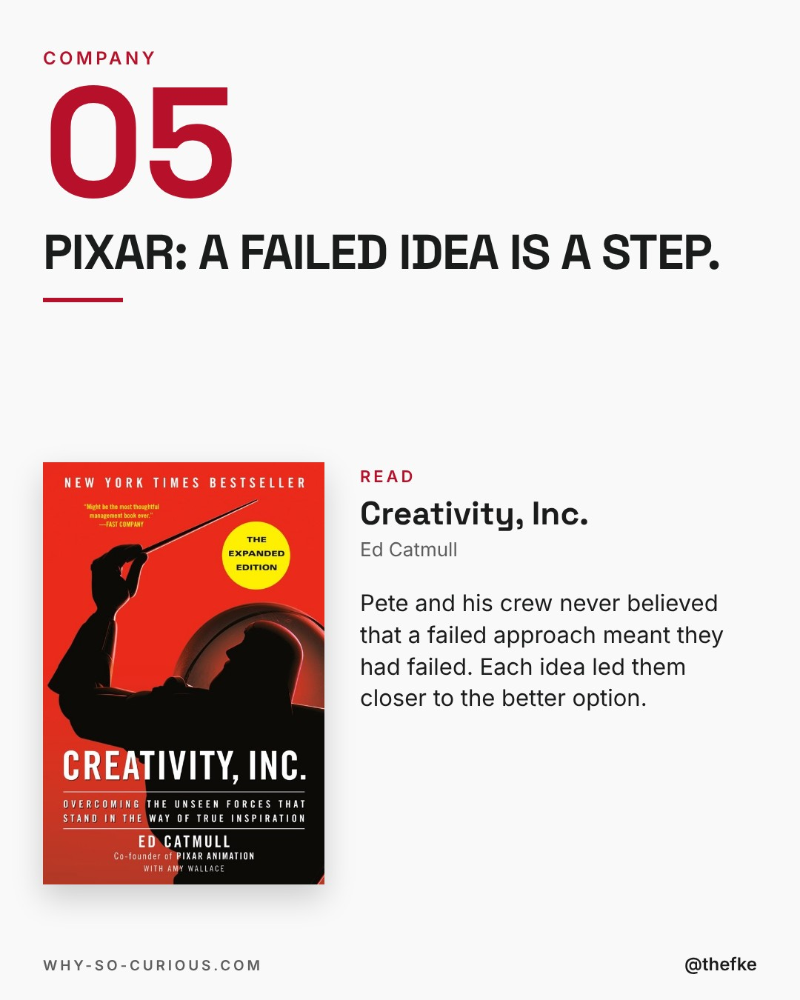
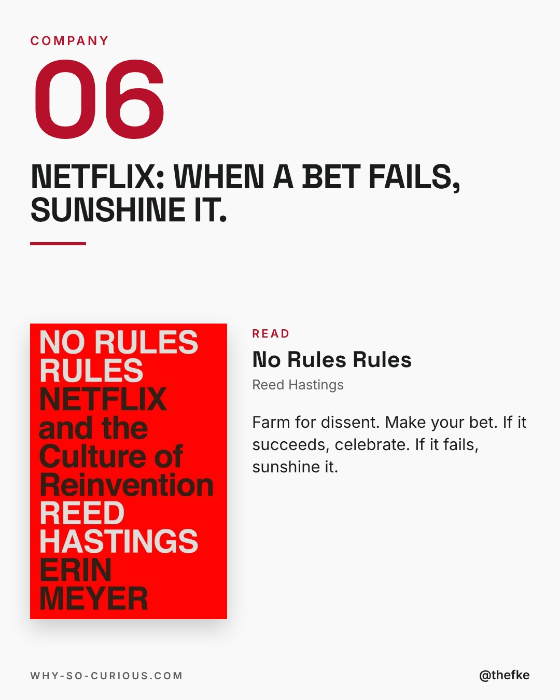
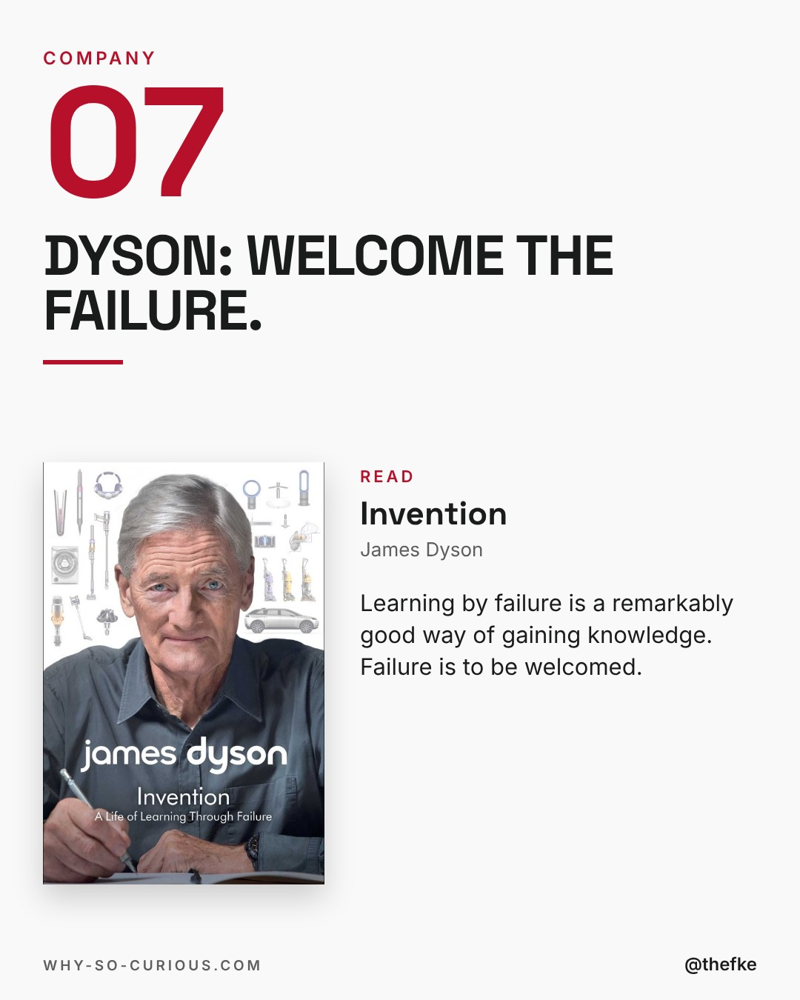
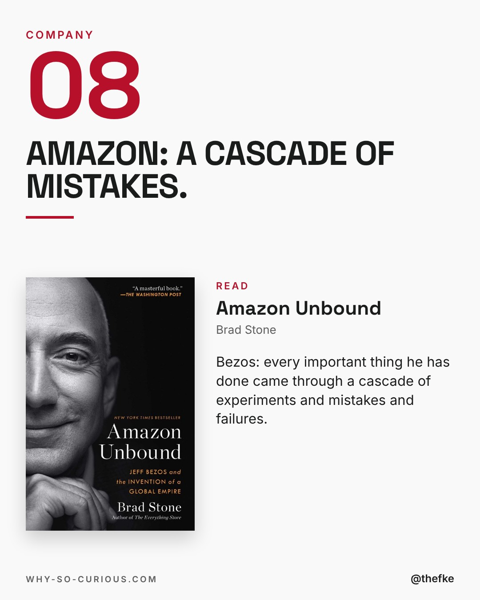
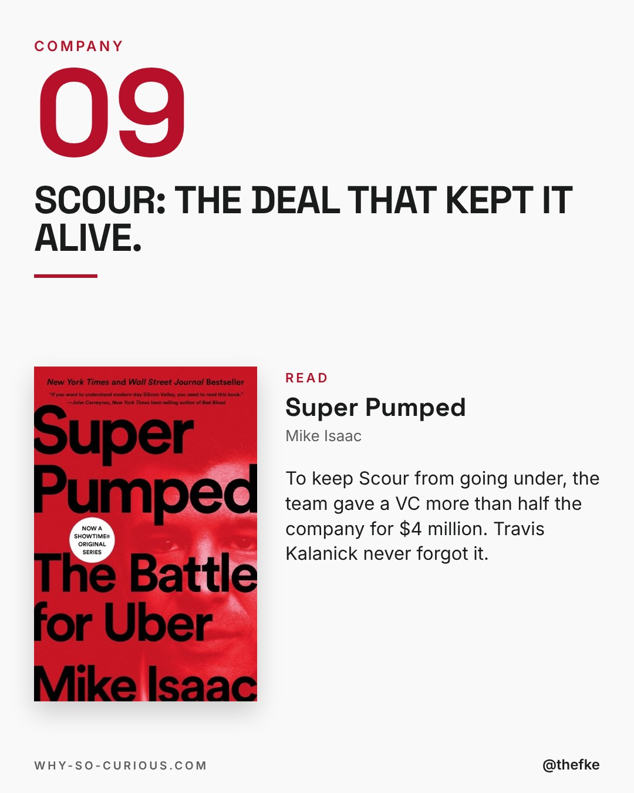
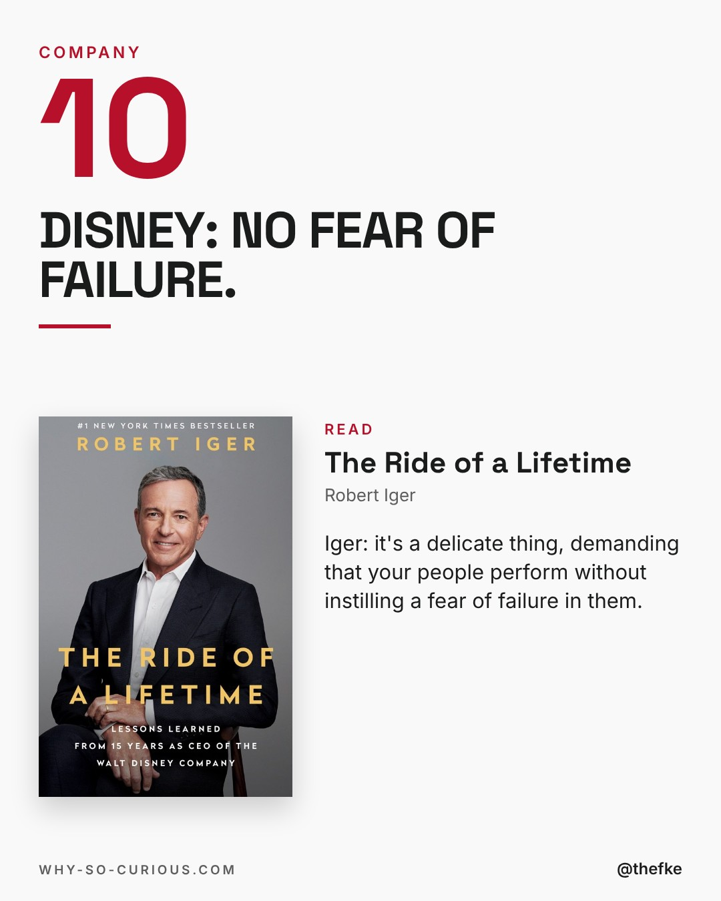
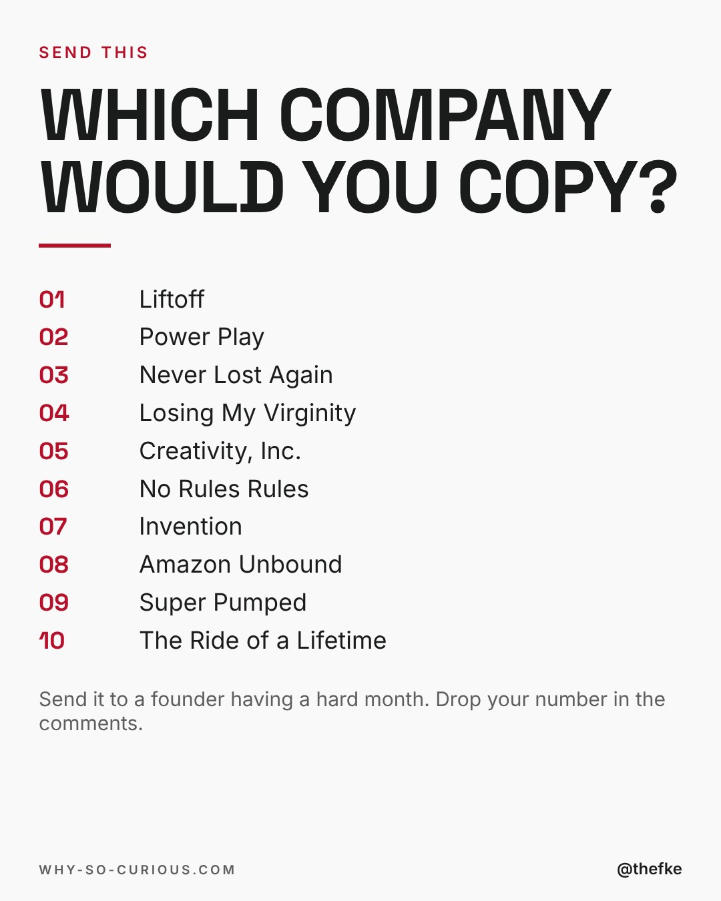
