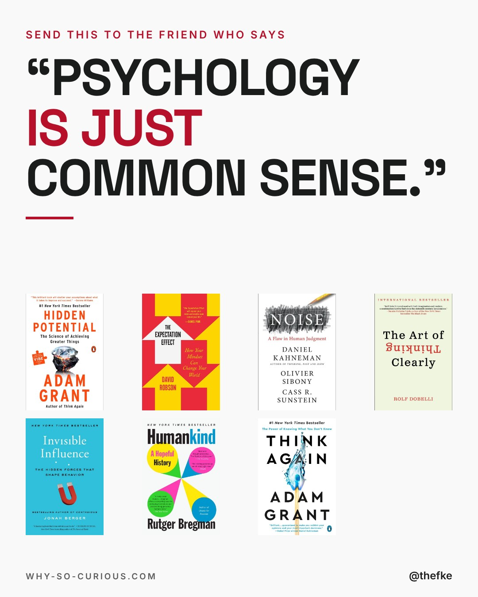
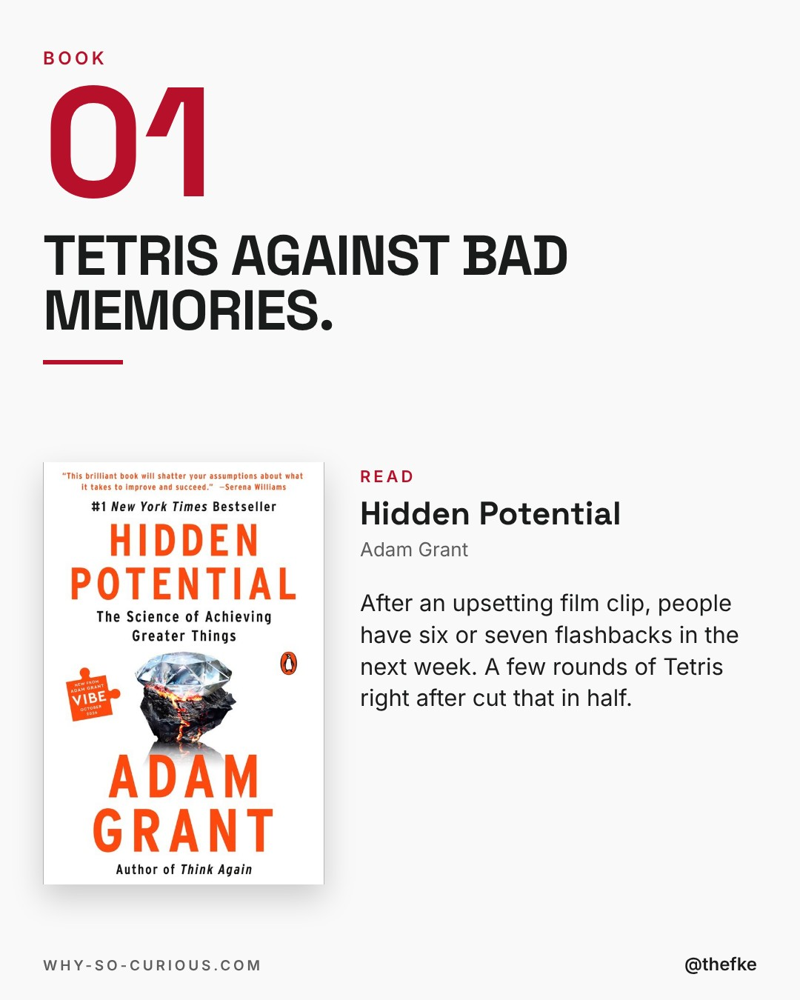
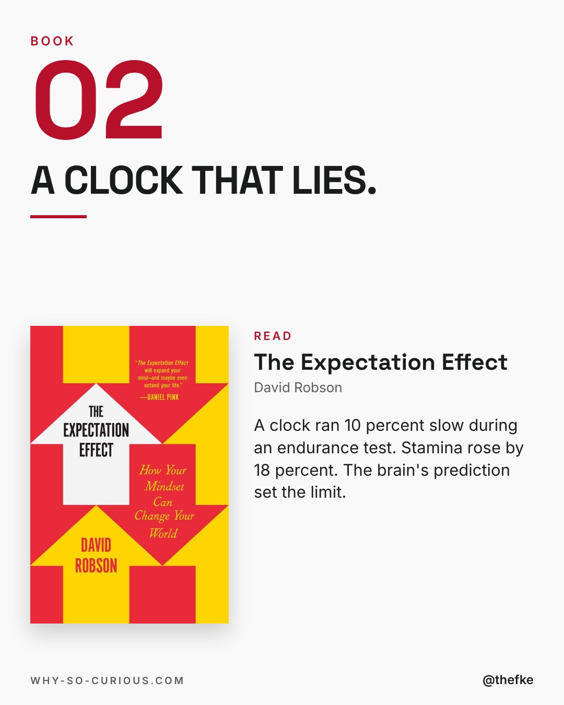
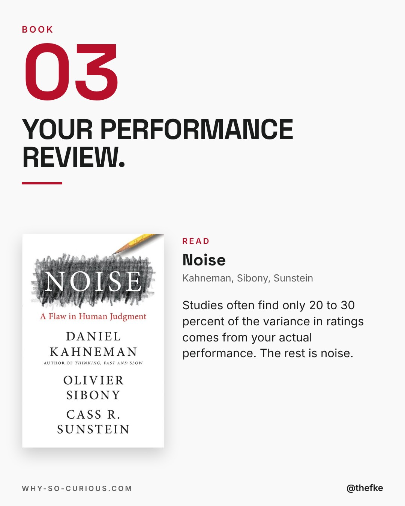
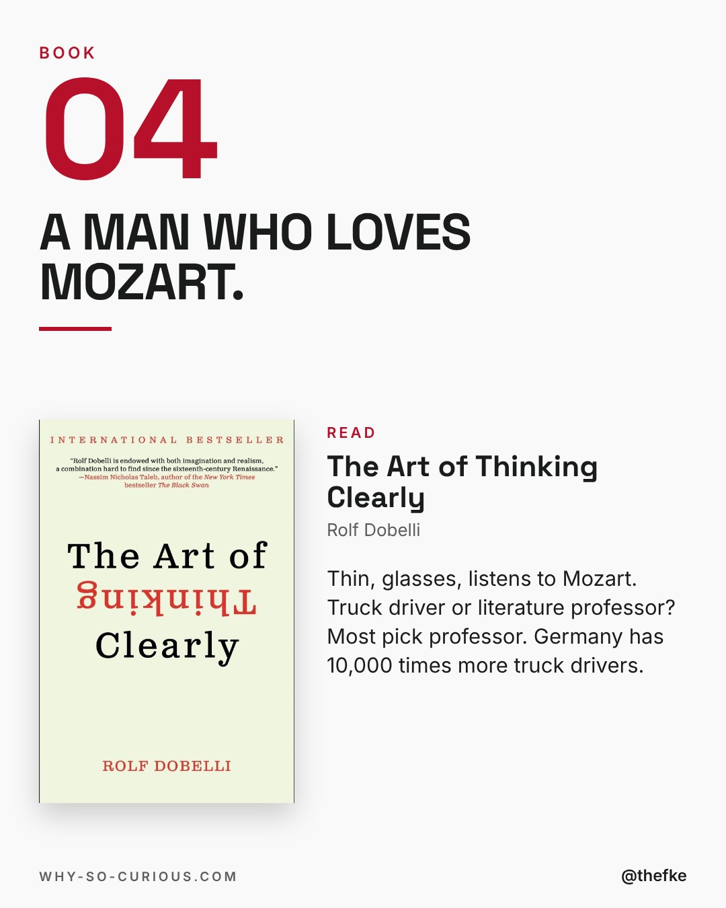
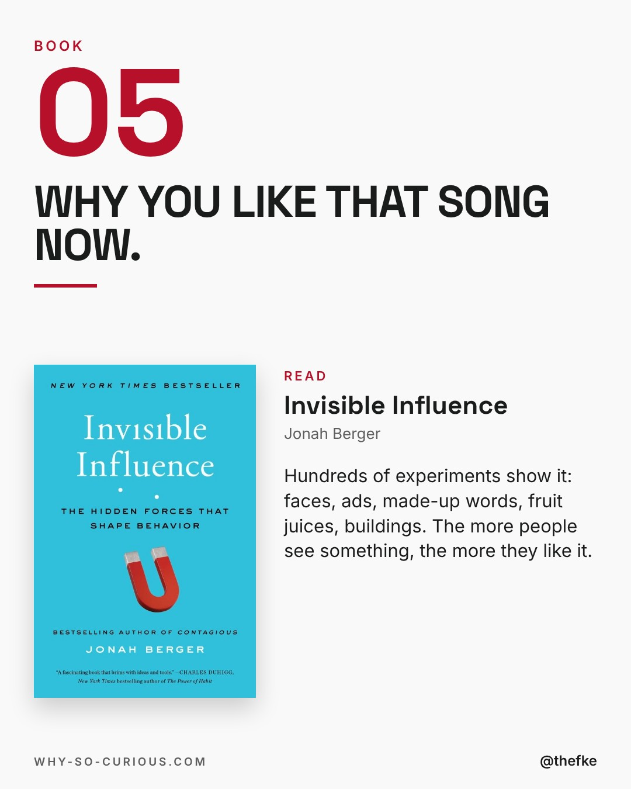
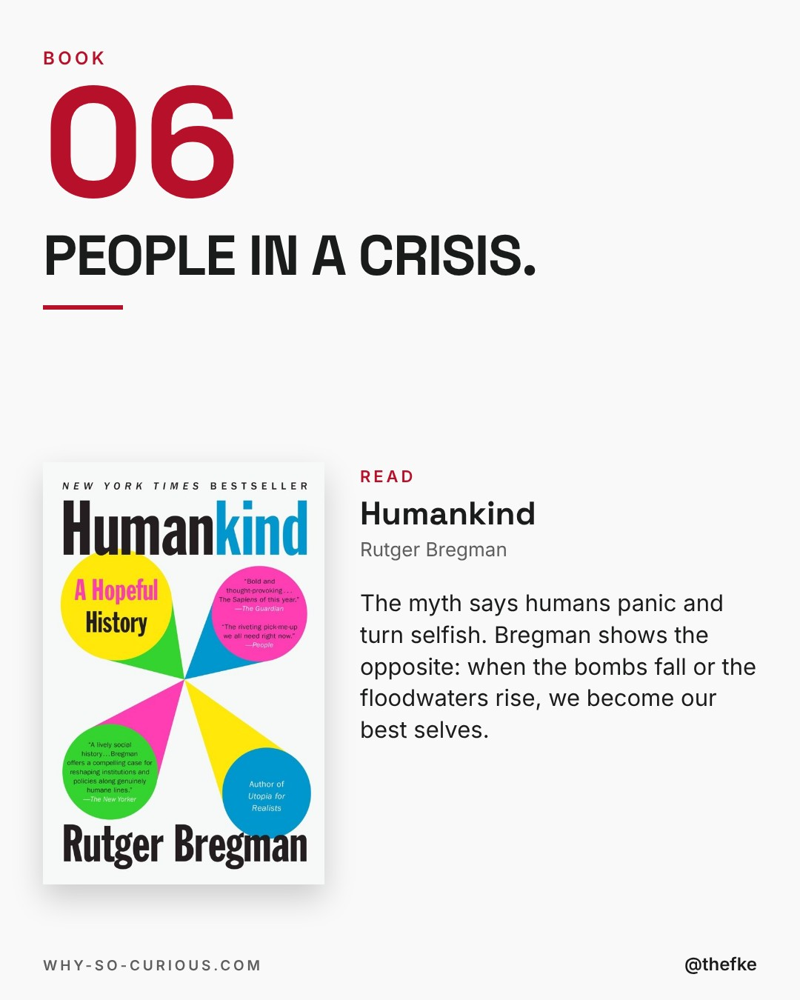
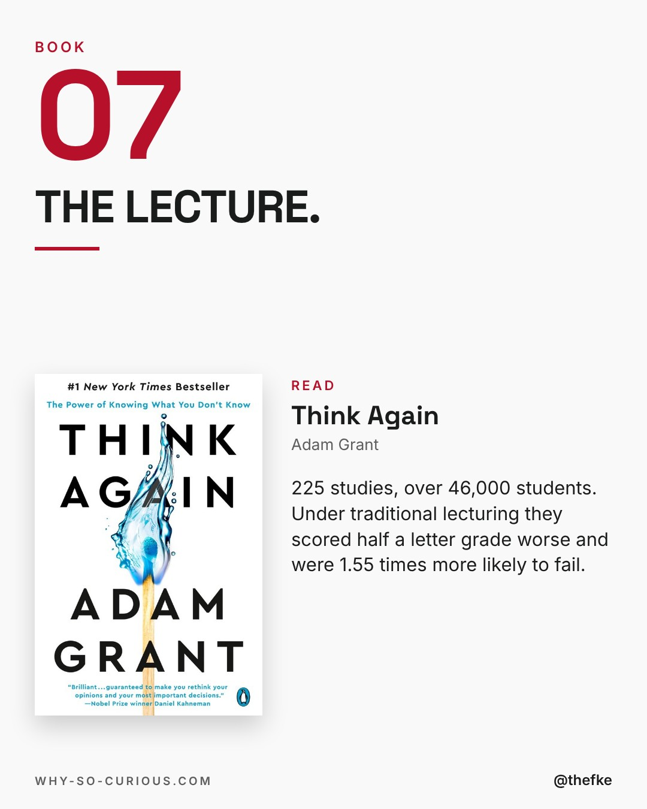
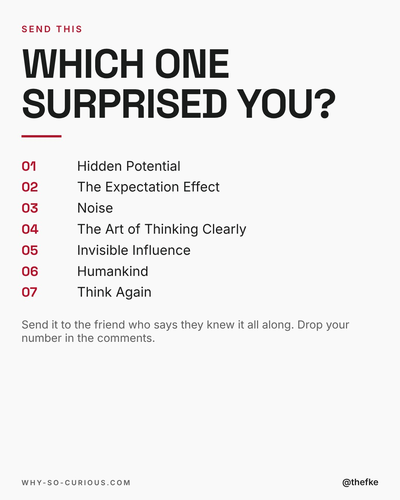

# Di 15.12. · “Psychology is just common sense.” Seven books that disagree

Früh-Slot, wird automatisch gepostet (ohne Musik). Nicht von Hand posten. Karussell, 9 Slides. Beim Hochladen 4:5 wählen.

## Caption

```
“Psychology is just common sense.”
Seven findings that say otherwise.

Tetris against bad memories. A clock that lies. A performance review that is mostly noise.
Each one sounds obvious only after someone tested it.

The strangest one is in The Expectation Effect by David Robson.
A clock ran slow during an endurance test, and people simply lasted longer:
“their stamina increased by 18 per cent when the clock ran slow”

All from my shelf.

Send this to the friend who says they knew it all along.

Which one surprised you?

Books from this post: link in bio.

#bookstagram #bookrecommendations #books
```

## Slides










