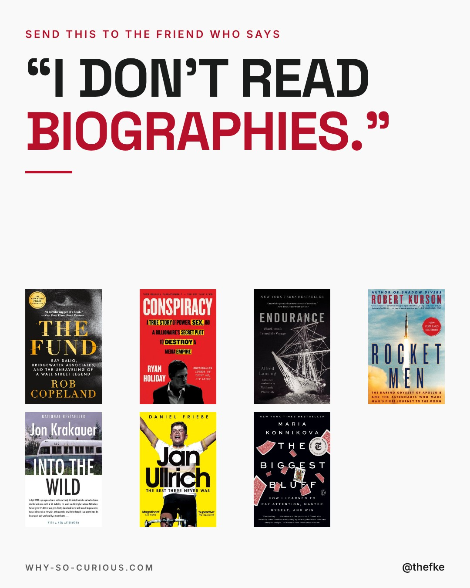
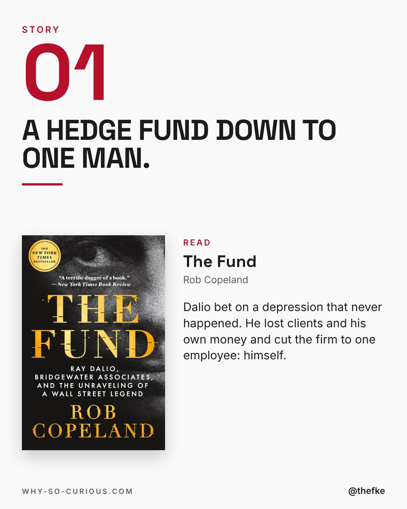
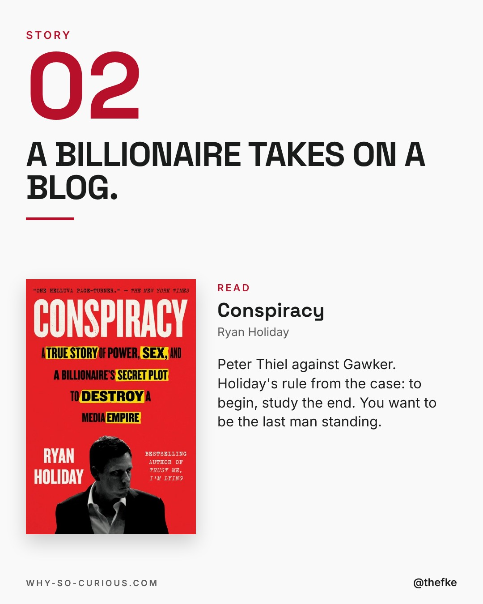
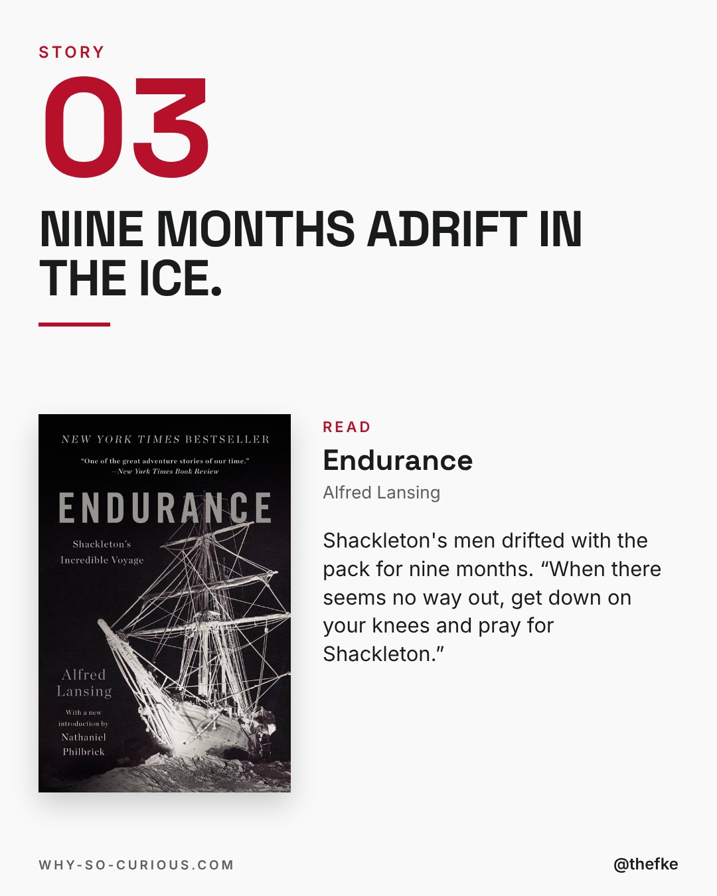
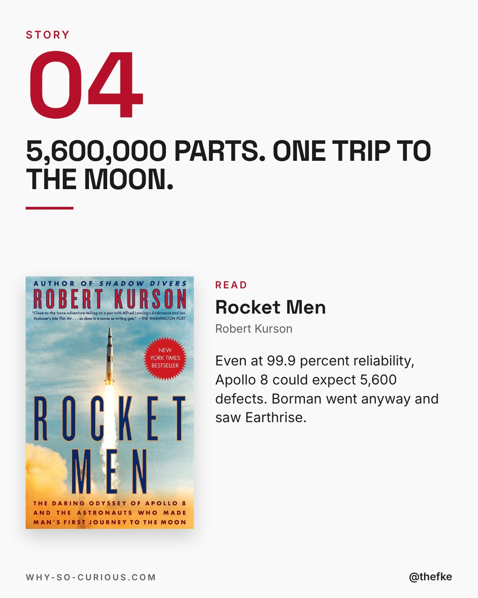
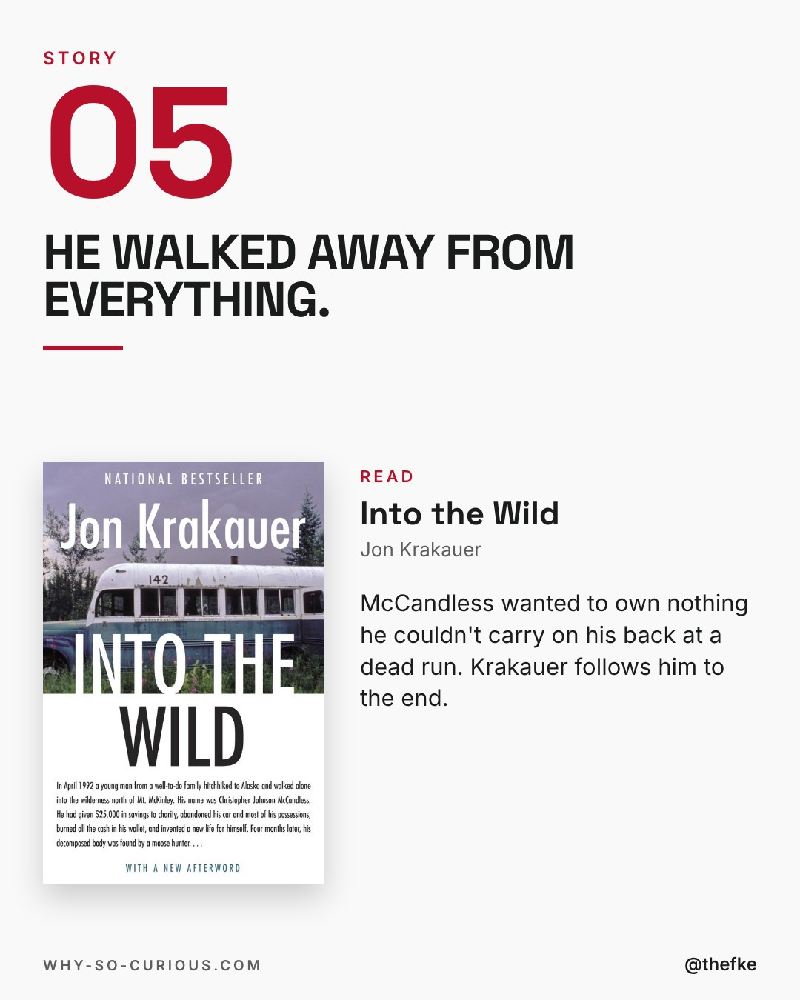
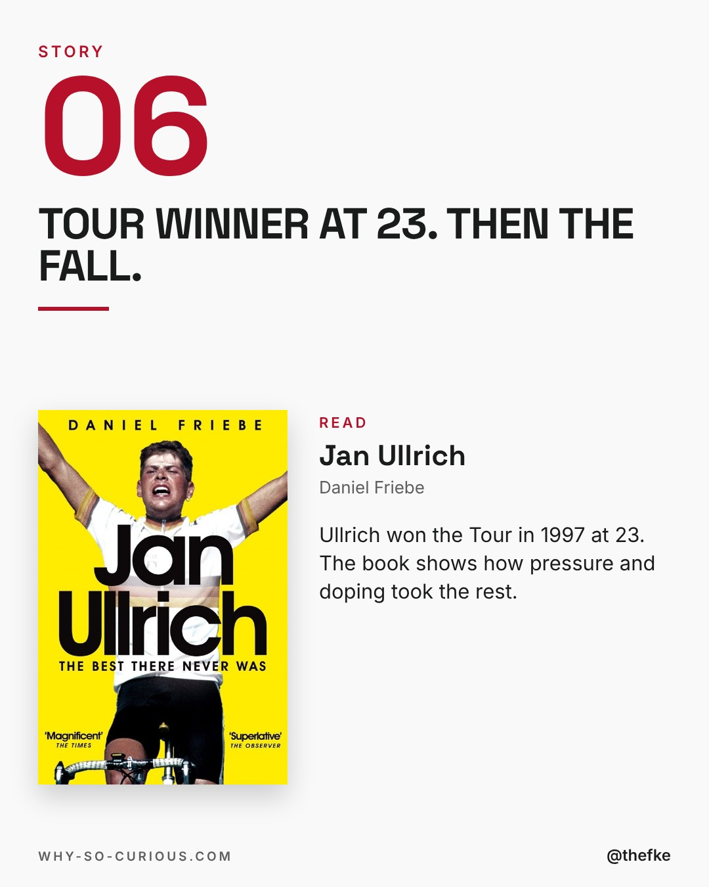
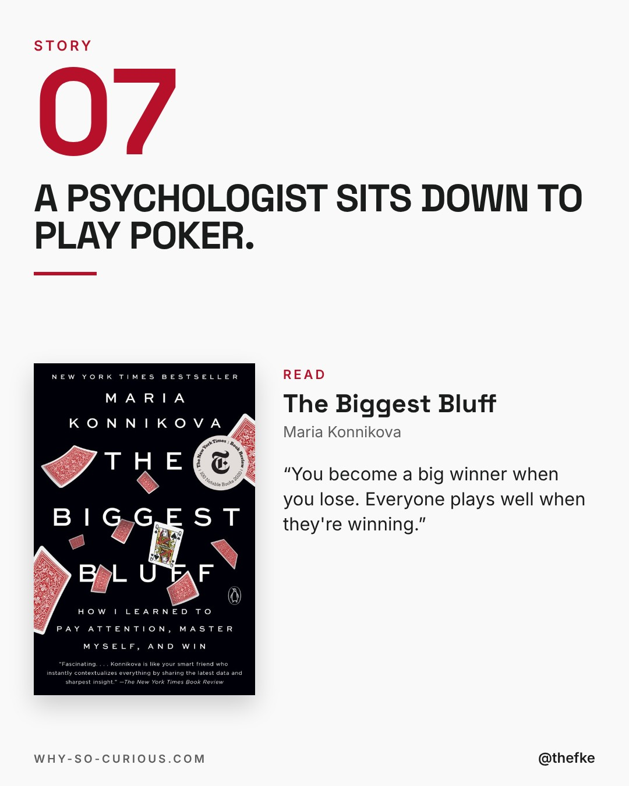
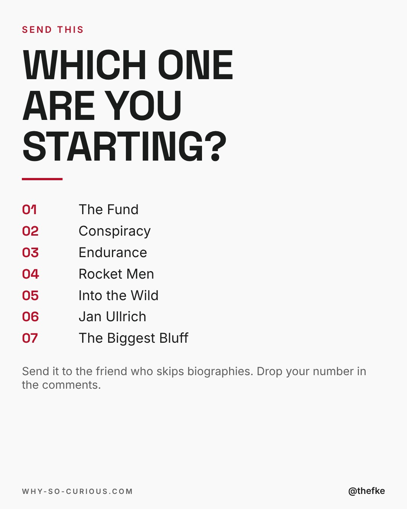

# Di 15.12. · Biographies that read like thrillers, Part 2

Abend-Slot. Karussell, 9 Slides. Beim Hochladen 4:5 wählen.

## Caption

```
“I don't read biographies.”
Then you haven't met these seven.

A hedge fund cut down to one man.
Nine months adrift in the Antarctic ice.
A billionaire against a blog.

The best line is in Endurance, about Shackleton:
“when you are in a hopeless situation, when there seems no way out, get down on your knees and pray for Shackleton.”

All from my shelf.

Send this to the friend who skips biographies.

Which one are you starting?

Books from this post: link in bio.

#books #bookstagram #bookrecommendations #reading #thefke #booklover #whysocurious
```

## Slides










