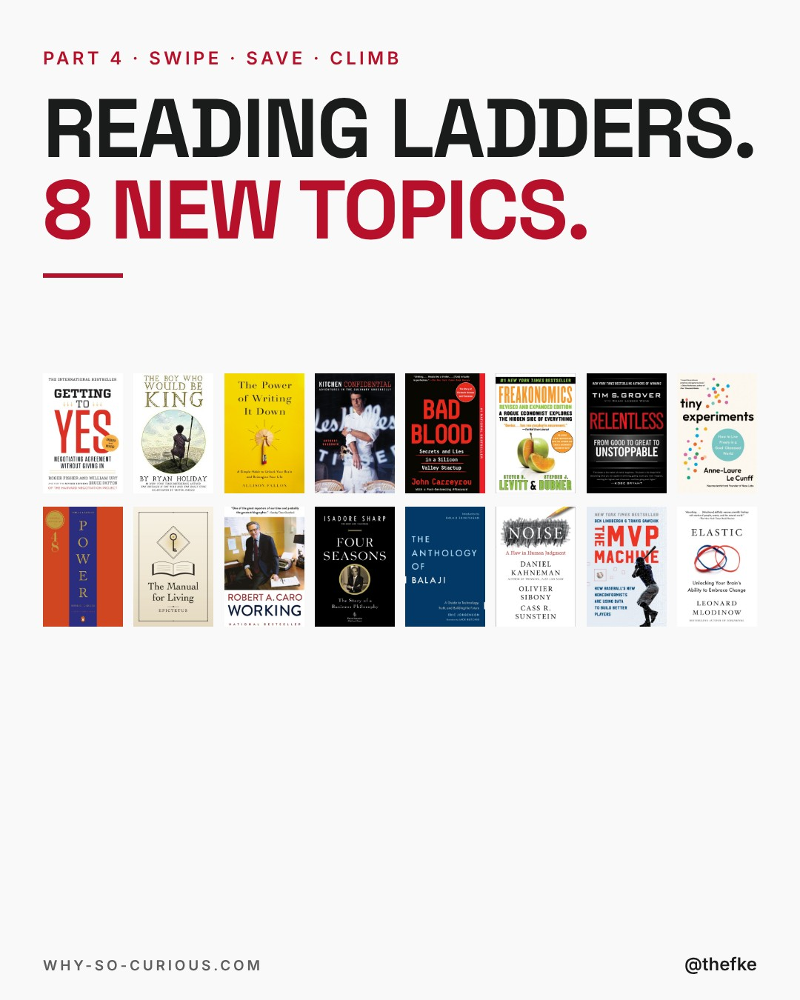
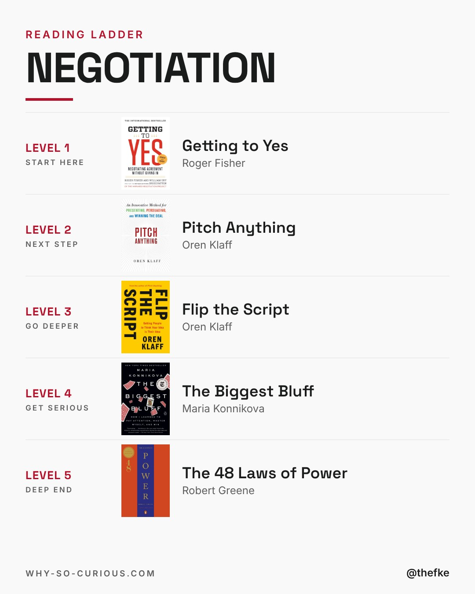
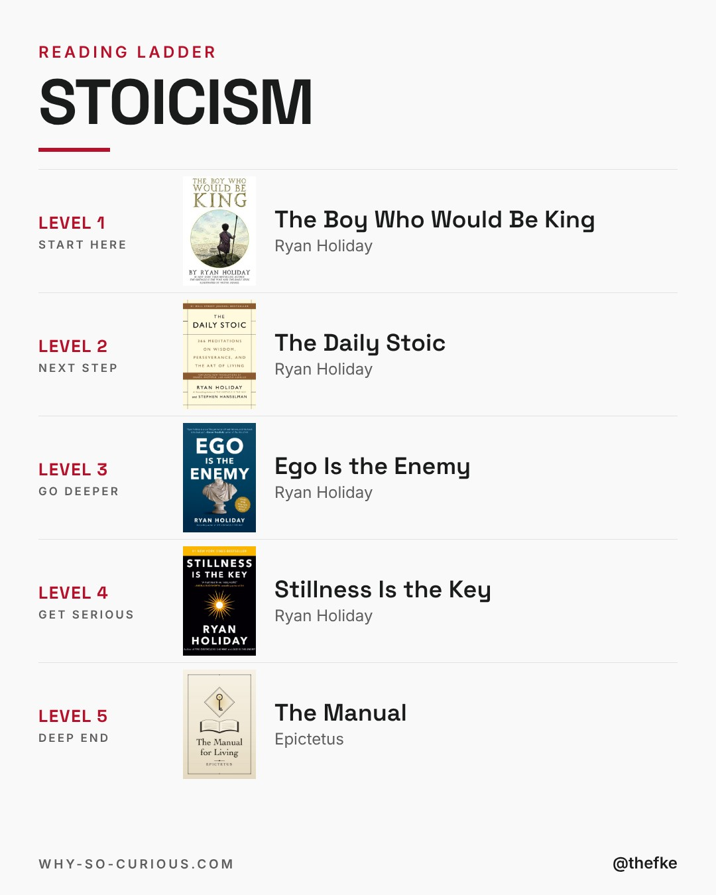
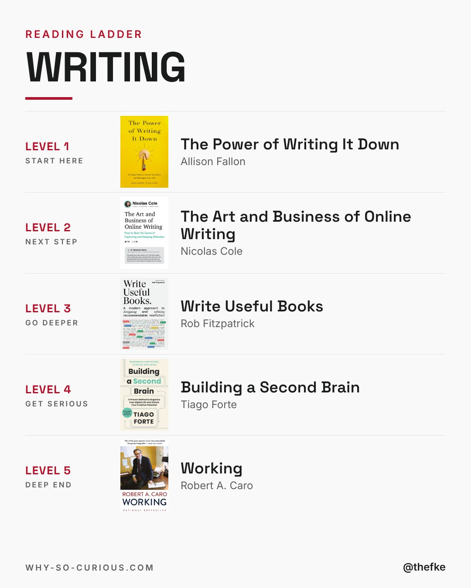
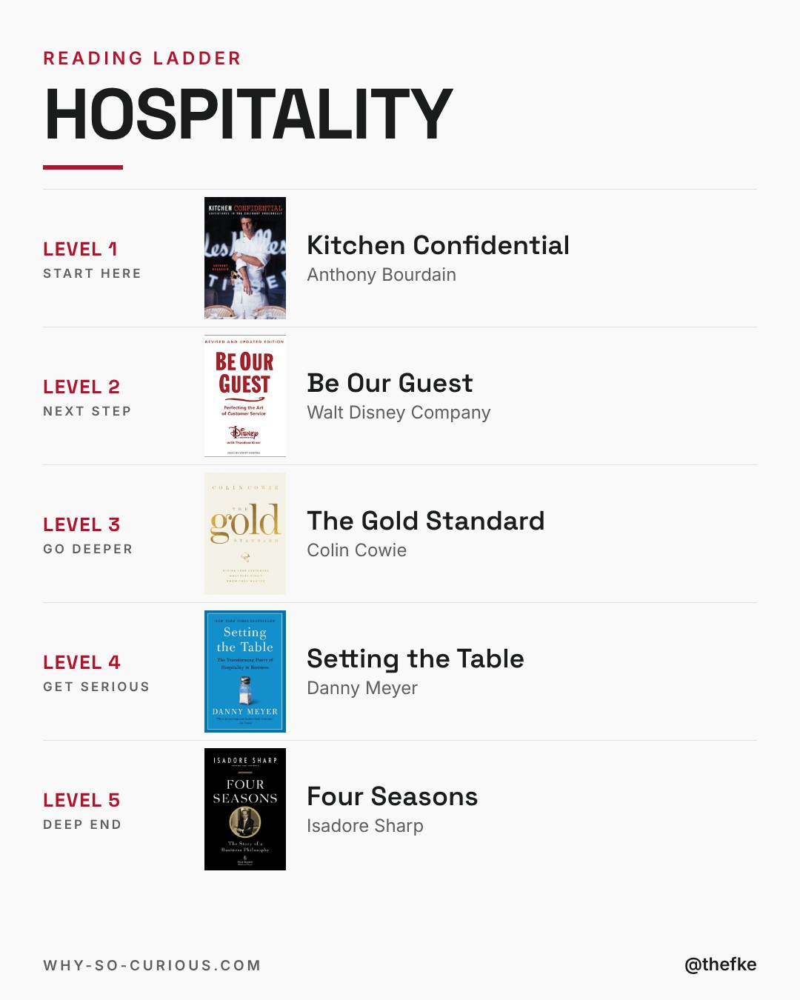
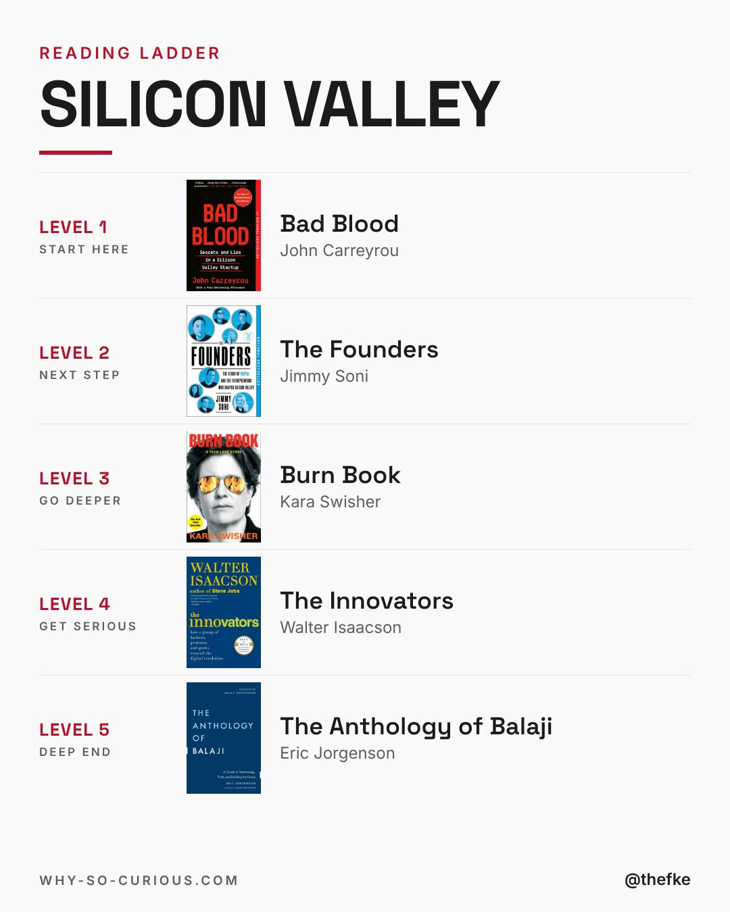
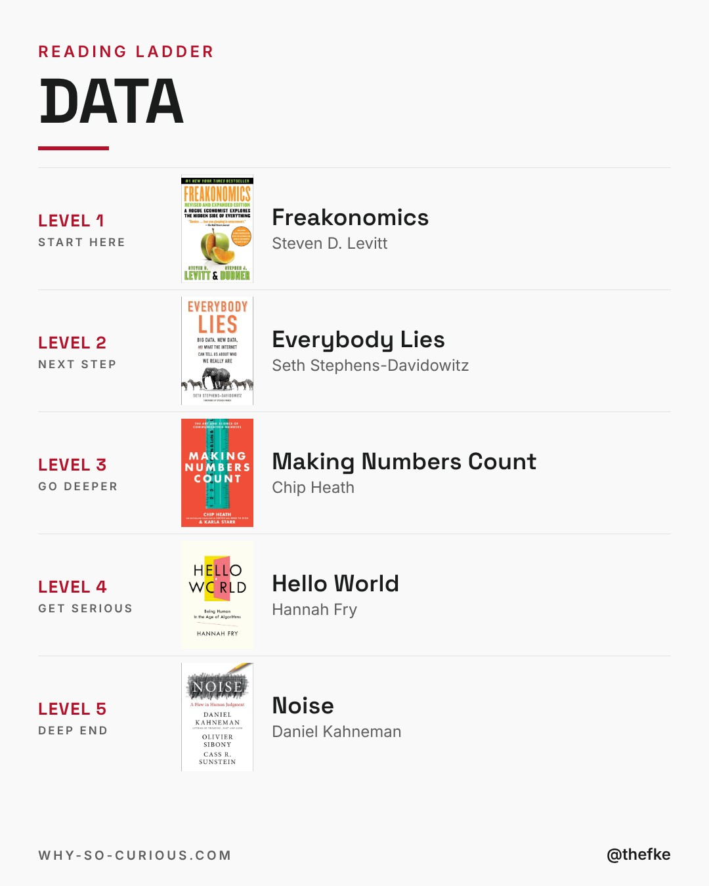
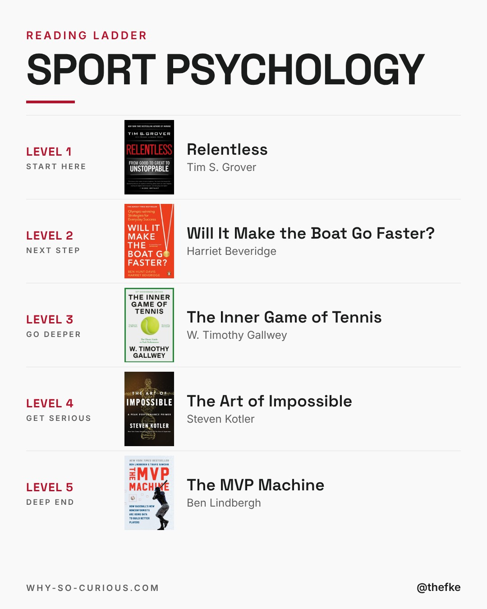
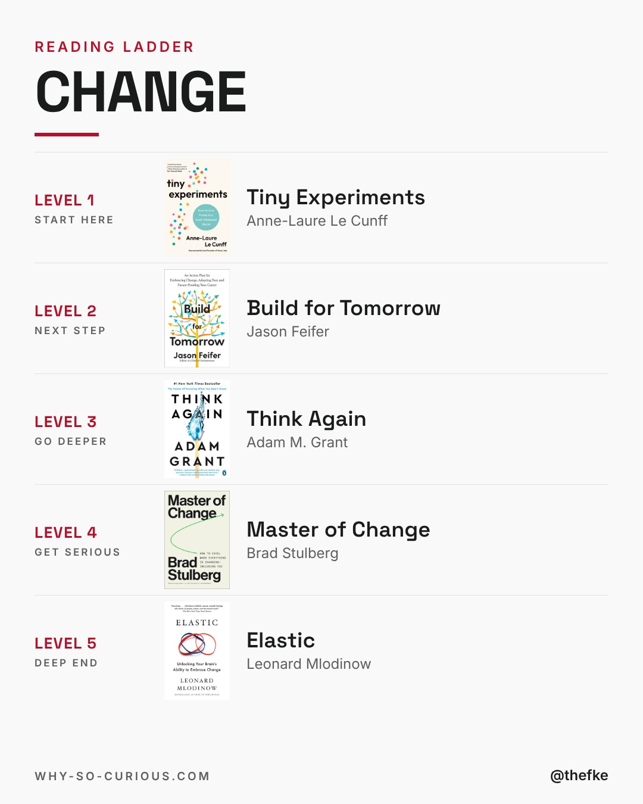
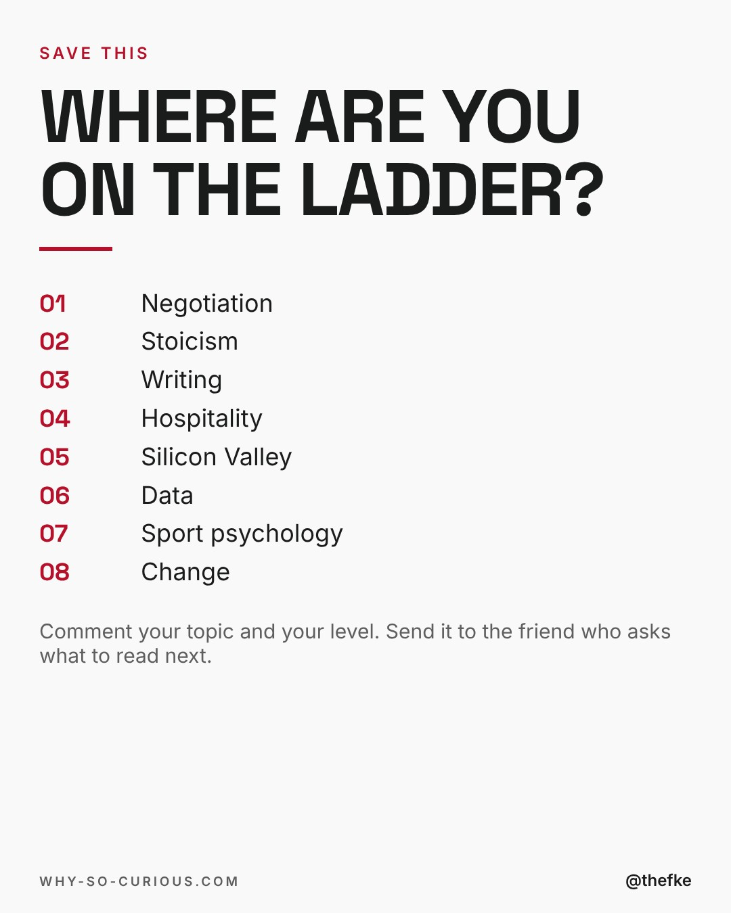

# Di 15.12. · Reading Ladders, Part 4

Karussell, 10 Slides. Beim Hochladen 4:5 wählen.

## Caption

```
Reading ladders, part 4.

Negotiation, stoicism, writing, hospitality.
Silicon Valley, data, sport psychology, change.

5 levels each.
Level 1 gets you in. Level 5 is the deep end.

The hospitality ladder ends with Four Seasons.
Isadore Sharp sums up his managers' role with an old Japanese proverb:
“If they work for you, you work for them.”

All 40 books from my shelf.

Save it and climb one step at a time.
Send it to the friend who asks what to read next.

Which topic, which level?

Books from this post: link in bio.

#books #bookstagram #bookrecommendations #reading #thefke #booklover #whysocurious
```

## Slides











