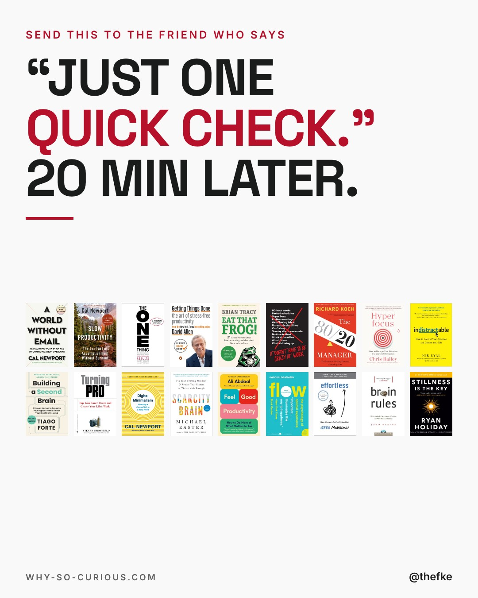
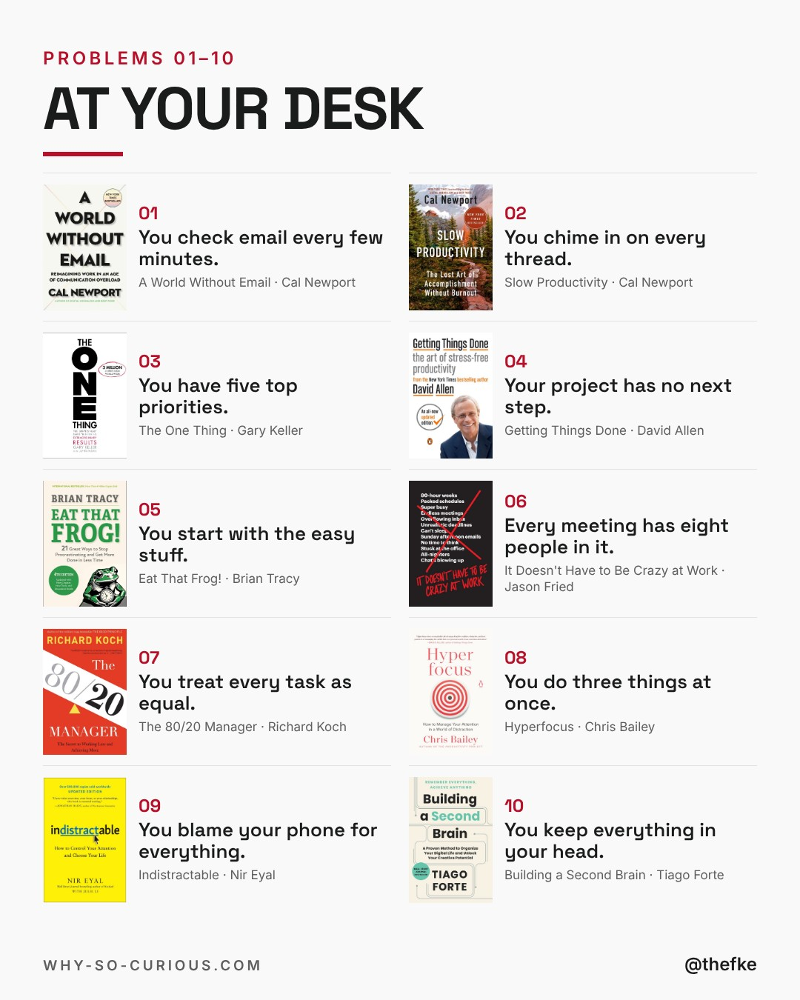
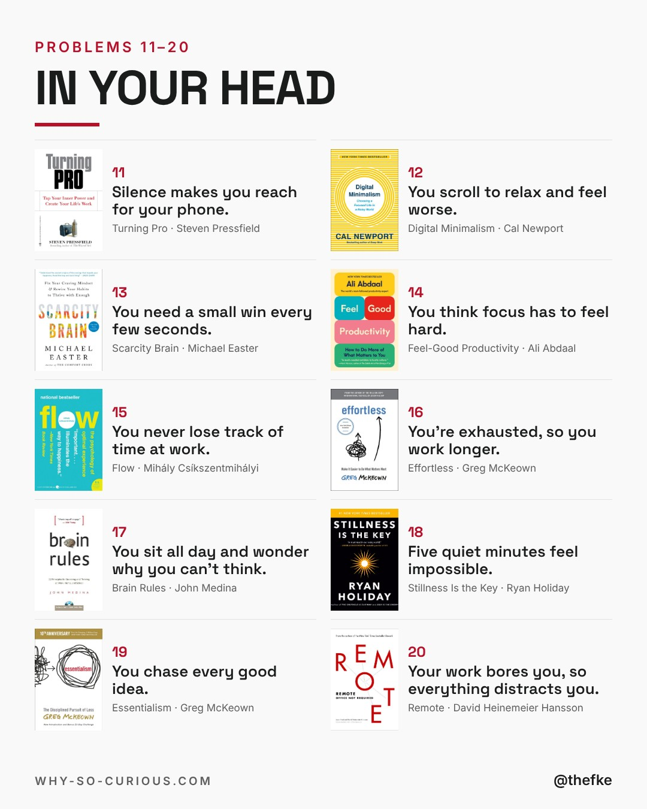
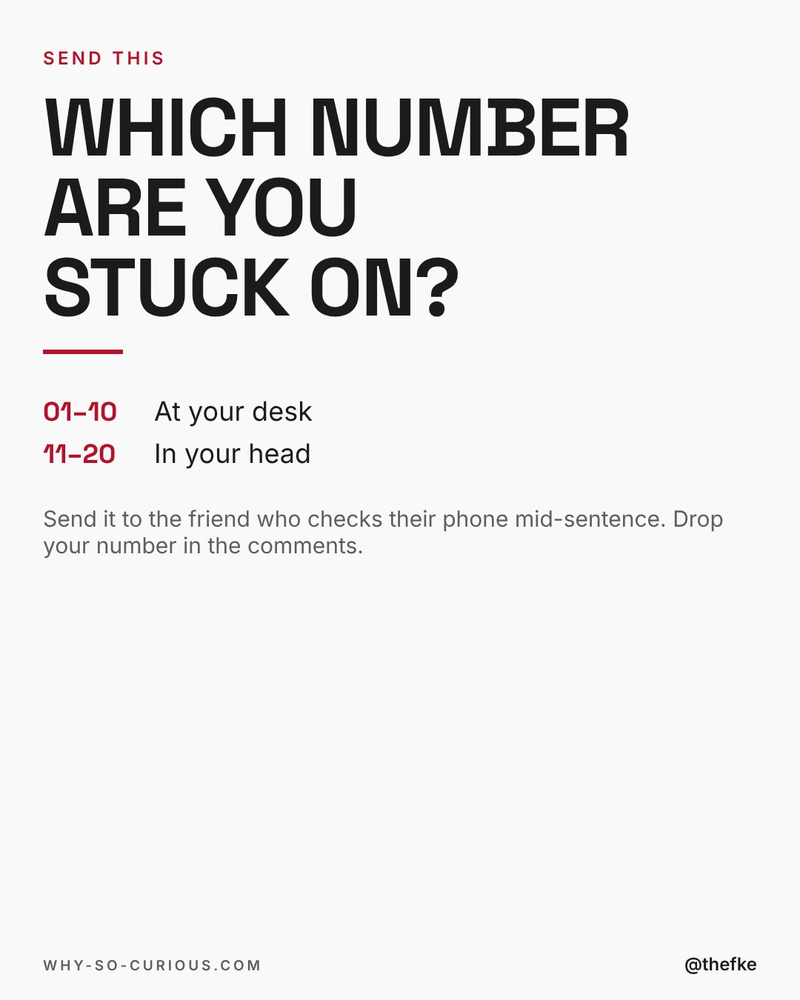

# Mi 16.12. · 20 Focus Problems, 20 Books

Karussell, 4 Slides. Beim Hochladen 4:5 wählen.

## Caption

```
“Just one quick check.”
Twenty minutes later you're still checking.

20 focus problems.
20 books from my shelf that help.

10 at your desk.
10 in your head.

Cal Newport in A World Without Email:
“One study estimates that by 2019 the average worker was sending and receiving 126 business emails per day, which works out to about one message every four minutes.”

Send this to the friend who checks their phone mid-sentence.

Which number are you stuck on?

Books from this post: link in bio.

#books #bookstagram #bookrecommendations #reading #thefke #booklover #whysocurious
```

## Slides





