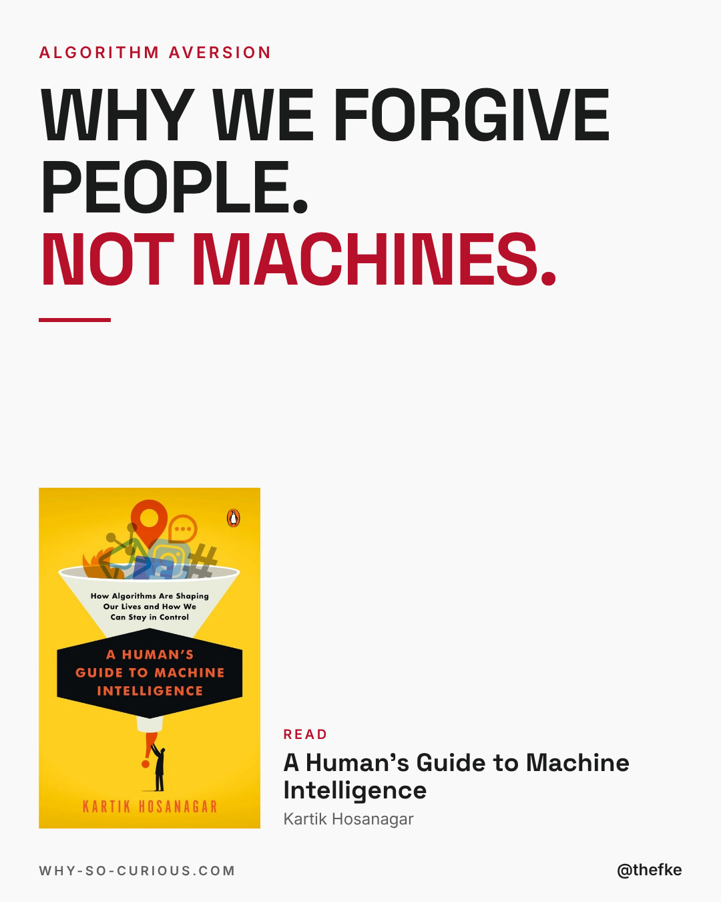
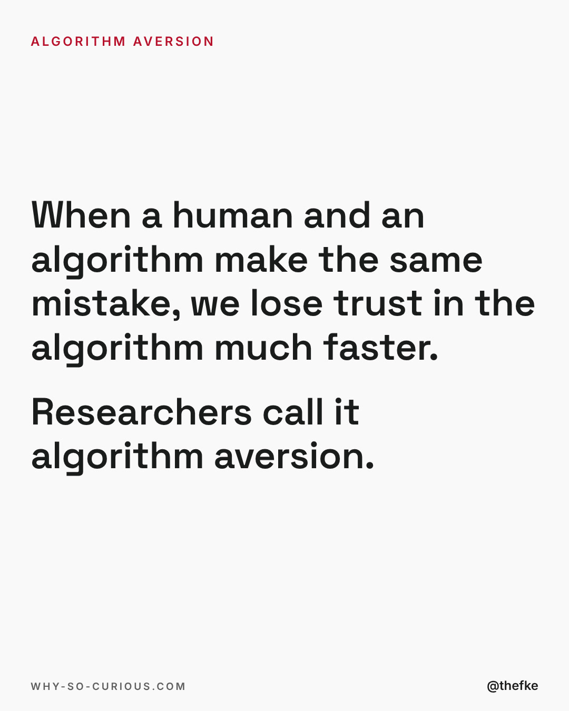
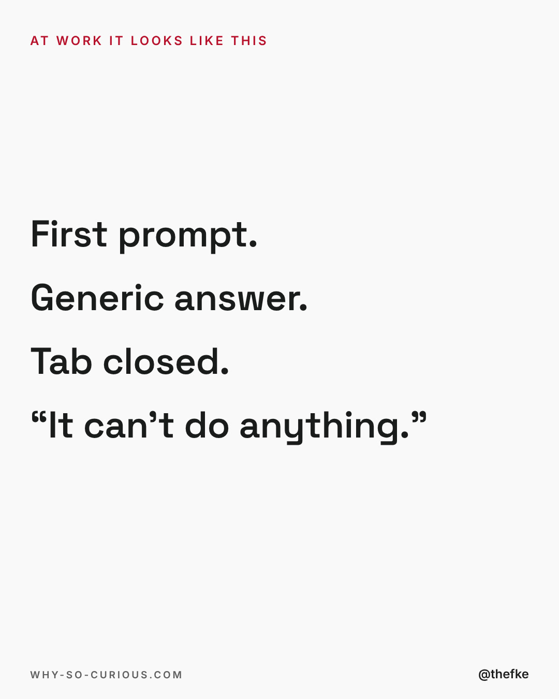
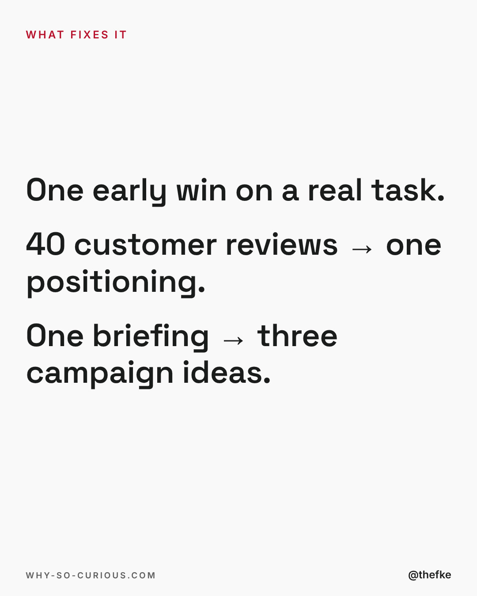
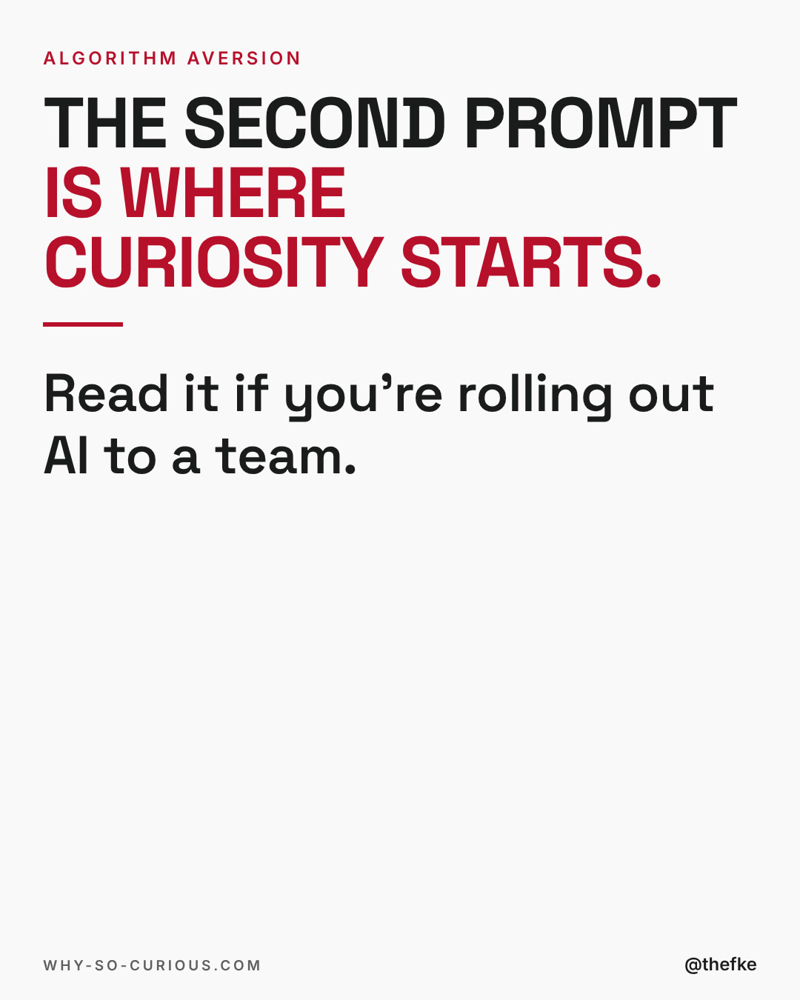

# Mi 16.12. · Why we forgive people. Not machines

Karussell, 5 Slides. Beim Hochladen 4:5 wählen.

Abend-Slot 19 bis 20 Uhr MEZ, Format-Test Story-Karussell: Text-Slides statt Bücherraster, mittwochs bis 23.12. Mo und Fr bleiben für die Formate aus dem Hotel-Dreh.

Quelle: `thomas-hefke-os/knowledge/06-content/posts/`, gebaut mit `wsc-web/tools/social/story.mjs`.

## Caption

```
The licenses are bought.
The IT announcement is out.
And marketing uses ChatGPT to… rewrite emails. 🤣

Kartik Hosanagar calls it algorithm aversion.
A colleague makes a mistake, we forgive.
The machine makes the same mistake, the trust is gone.

What keeps a team going: one early win on a real task.

Honest question: what does your team use AI for most?
Rewriting emails counts too. 👇

#books #bookstagram #bookrecommendations #reading #thefke #booklover #whysocurious
```

## Slides






