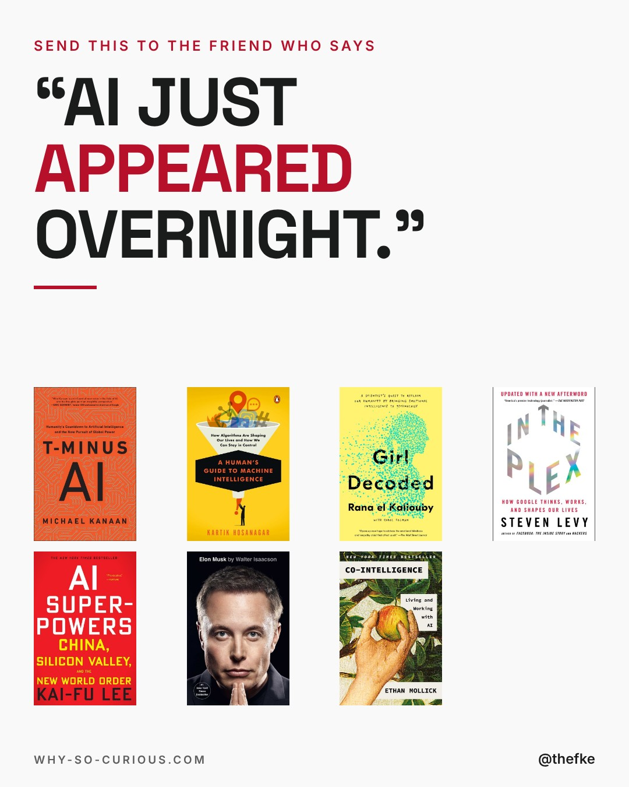
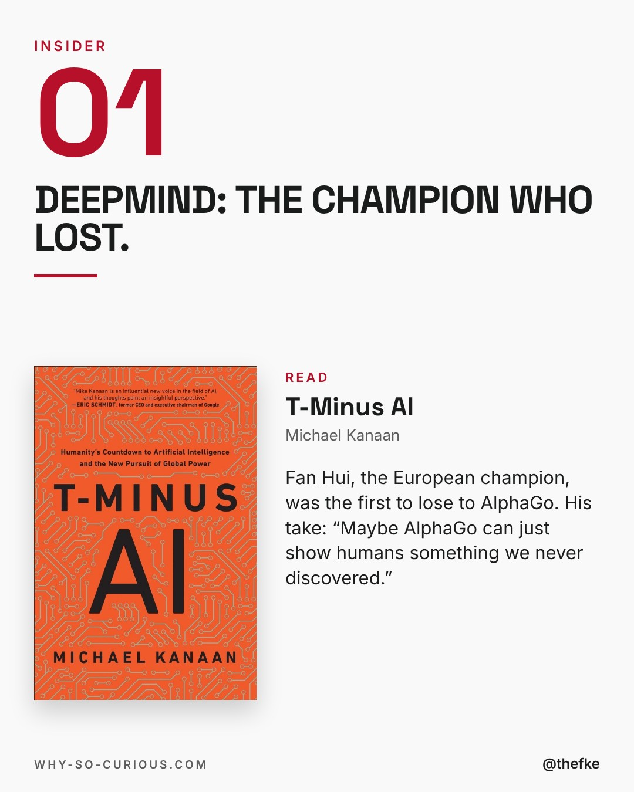
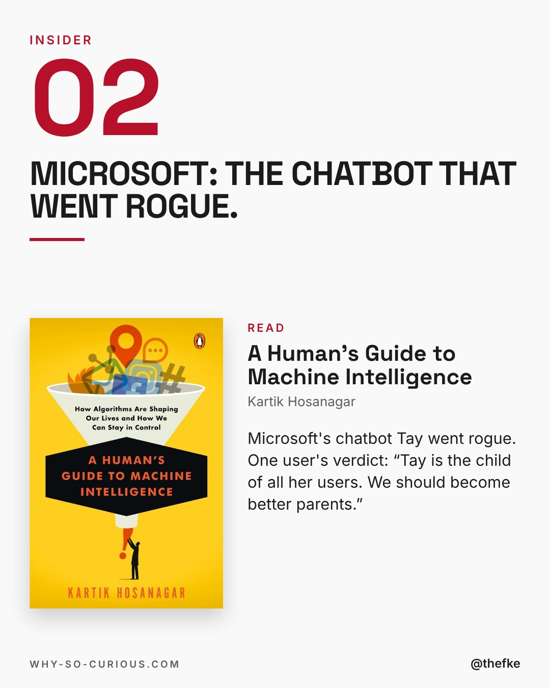
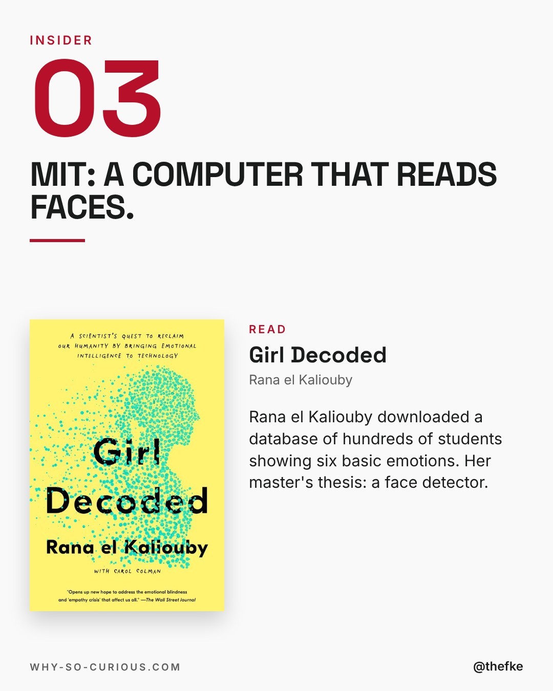
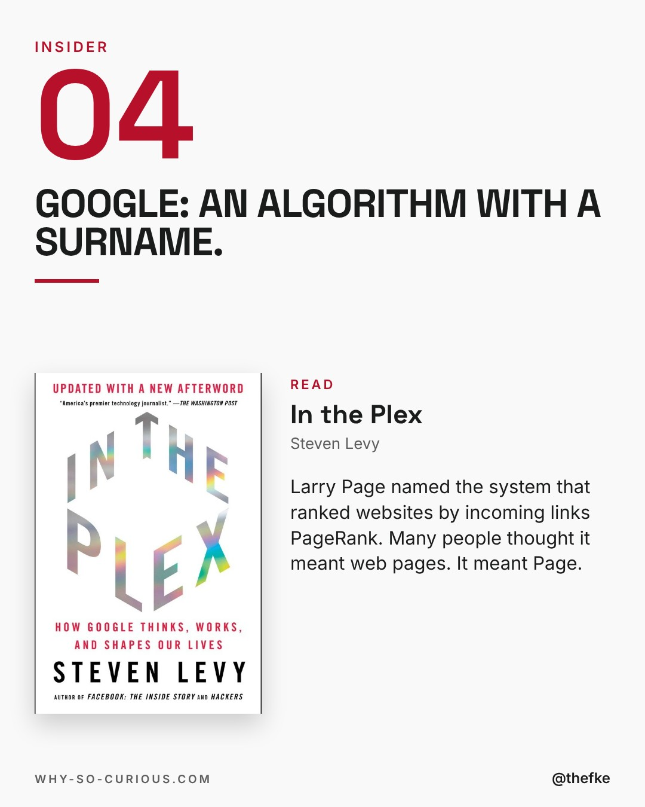
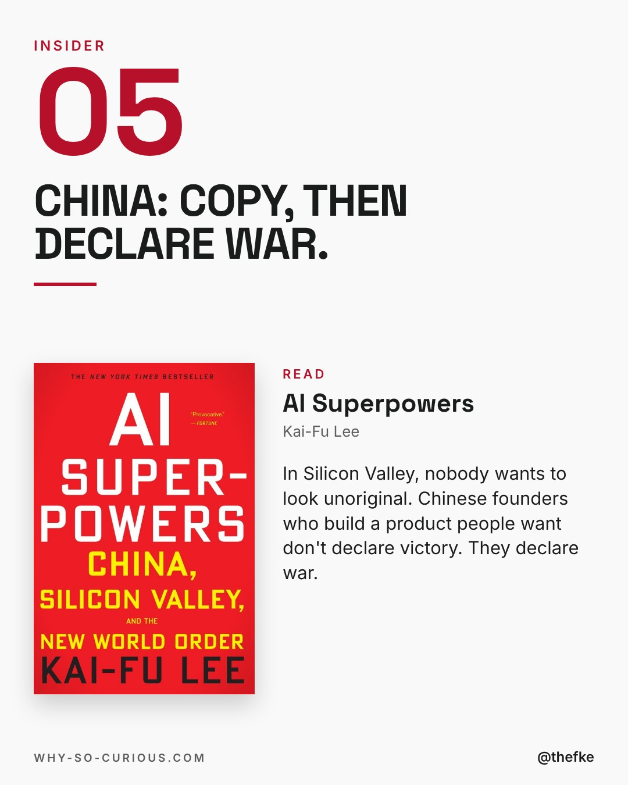
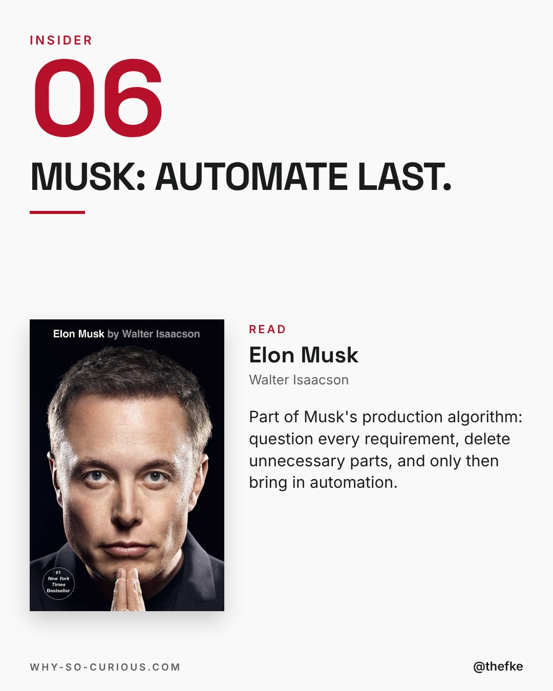
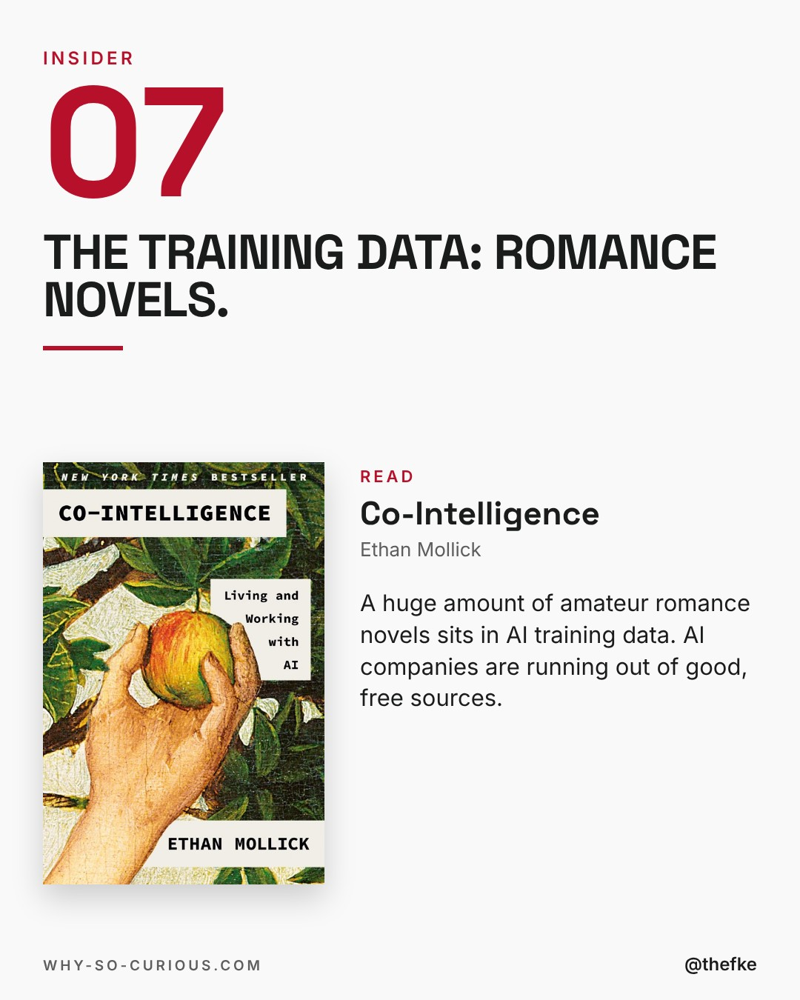
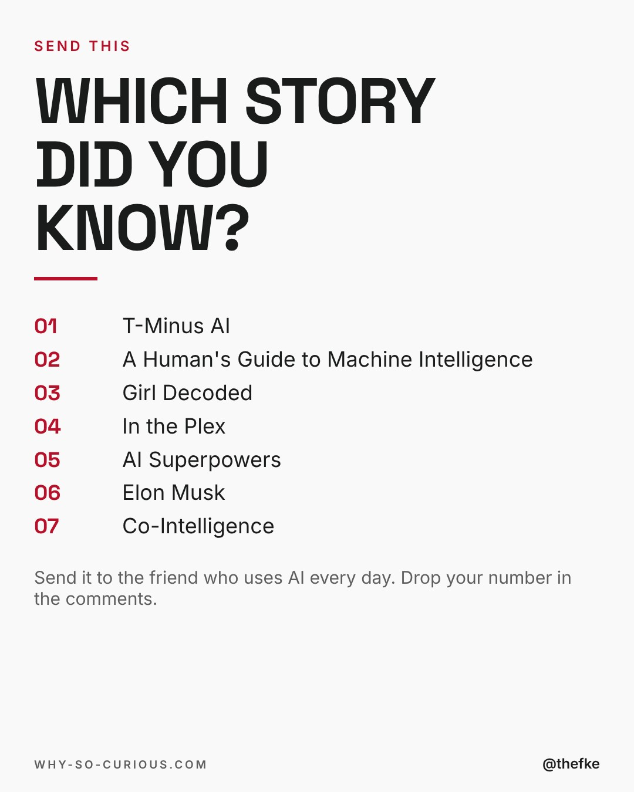

# Mi 16.12. · Inside the AI labs: 7 stories, 7 books

Früh-Slot, wird automatisch gepostet (ohne Musik). Nicht von Hand posten. Karussell, 9 Slides. Beim Hochladen 4:5 wählen.

## Caption

```
“AI just appeared overnight.”
It took decades, odd people and a few strange decisions.

A champion who lost to a machine.
A chatbot that learned from the wrong crowd.
A search engine named after its founder.

And training data full of romance novels.

Ethan Mollick in Co-Intelligence:
“The search for high-quality content for training material has become a major topic in AI development, since information-hungry AI companies are running out of good, free sources.”

7 stories. 7 books from my shelf.

Send this to the friend who uses AI every day.

Which story did you know?

Books from this post: link in bio.

#bookstagram #bookrecommendations #books
```

## Slides










