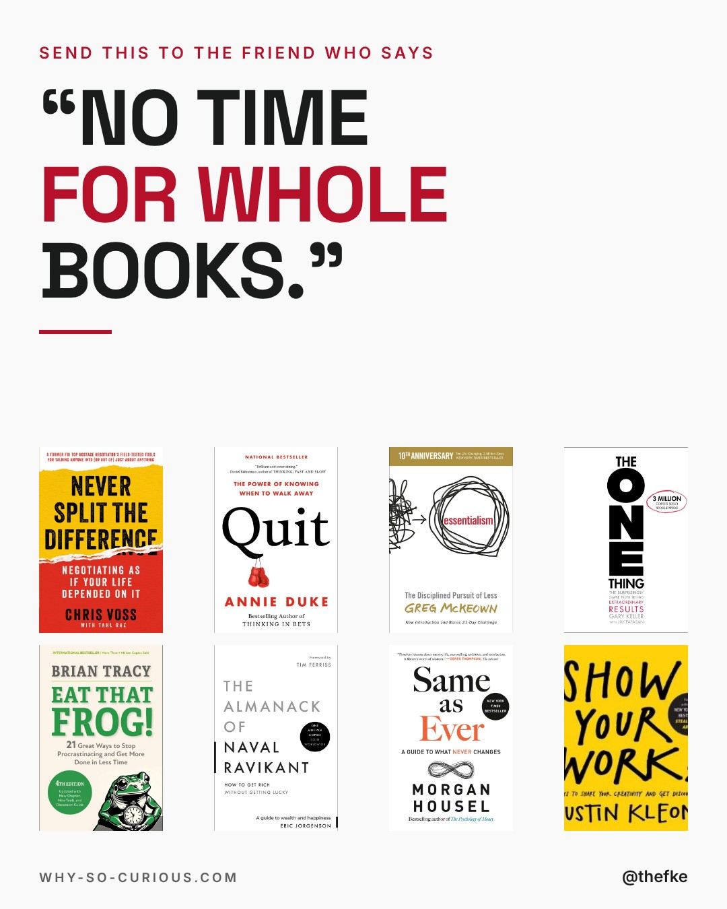
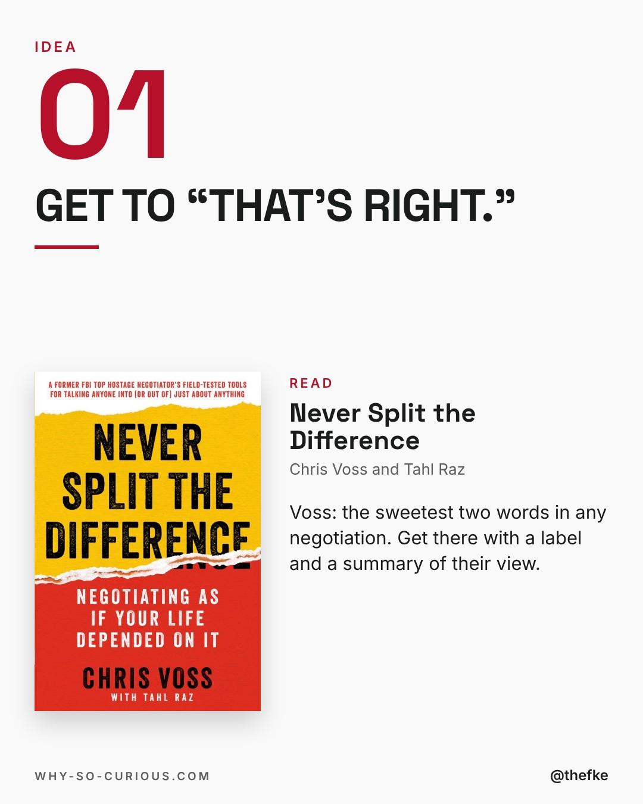
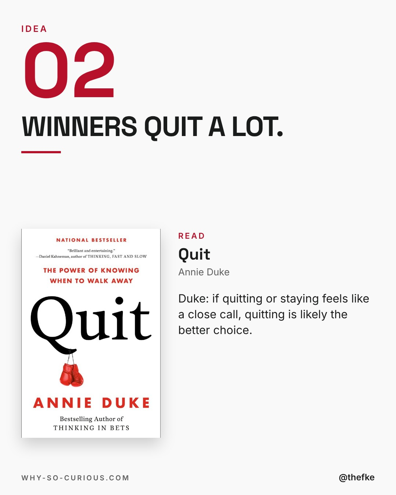
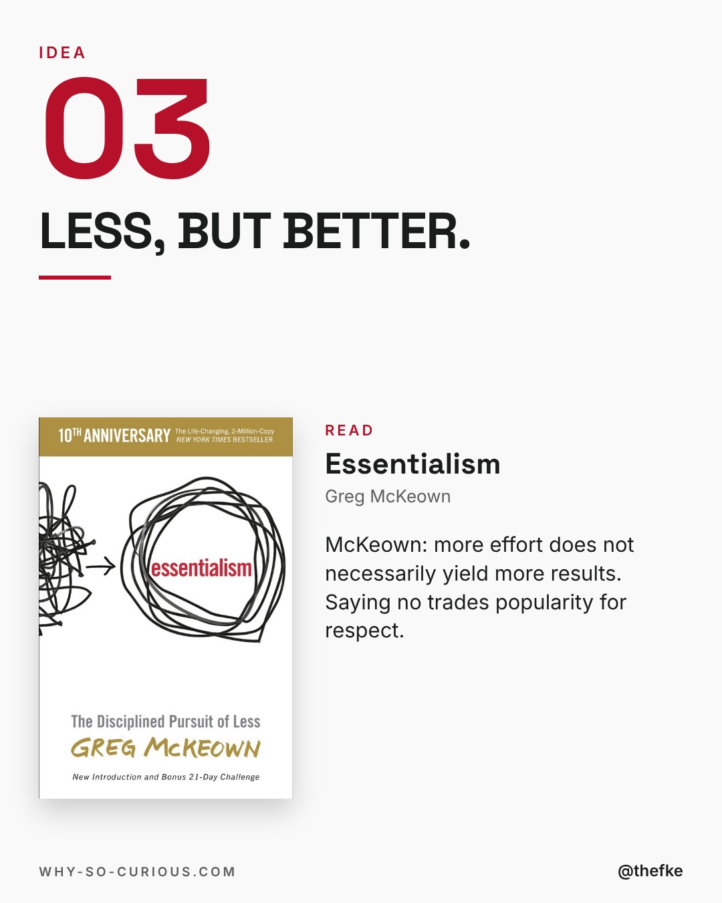
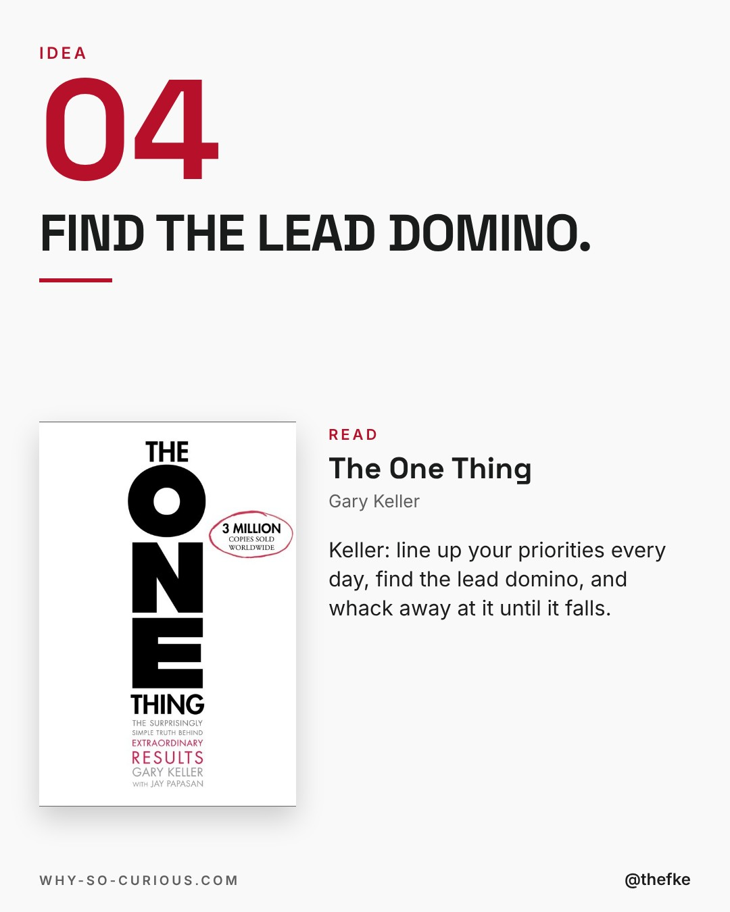
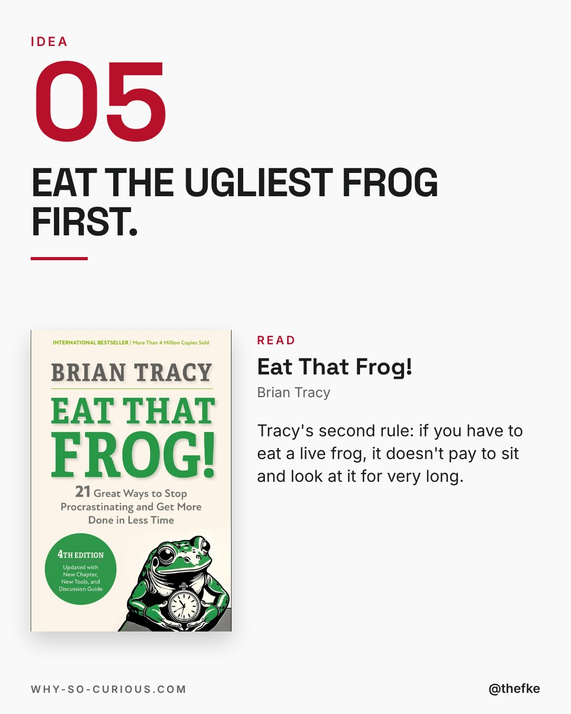
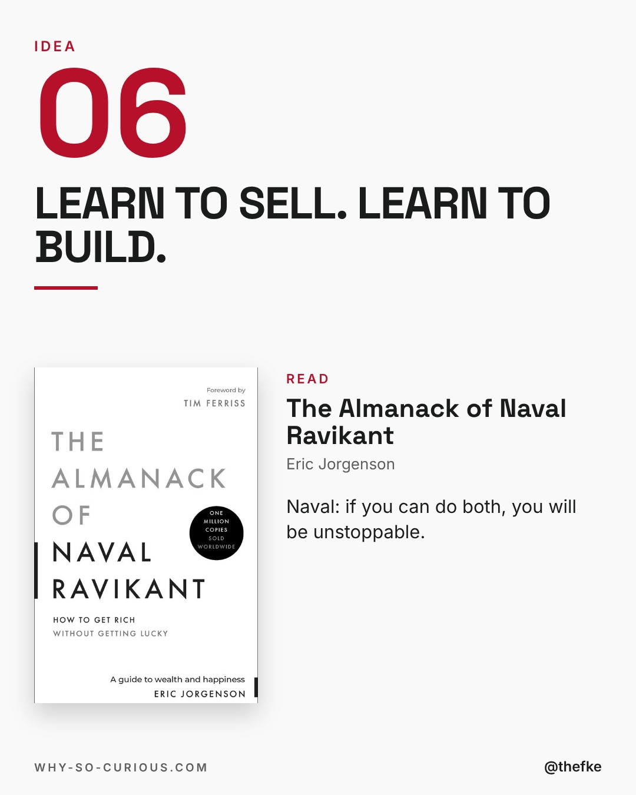
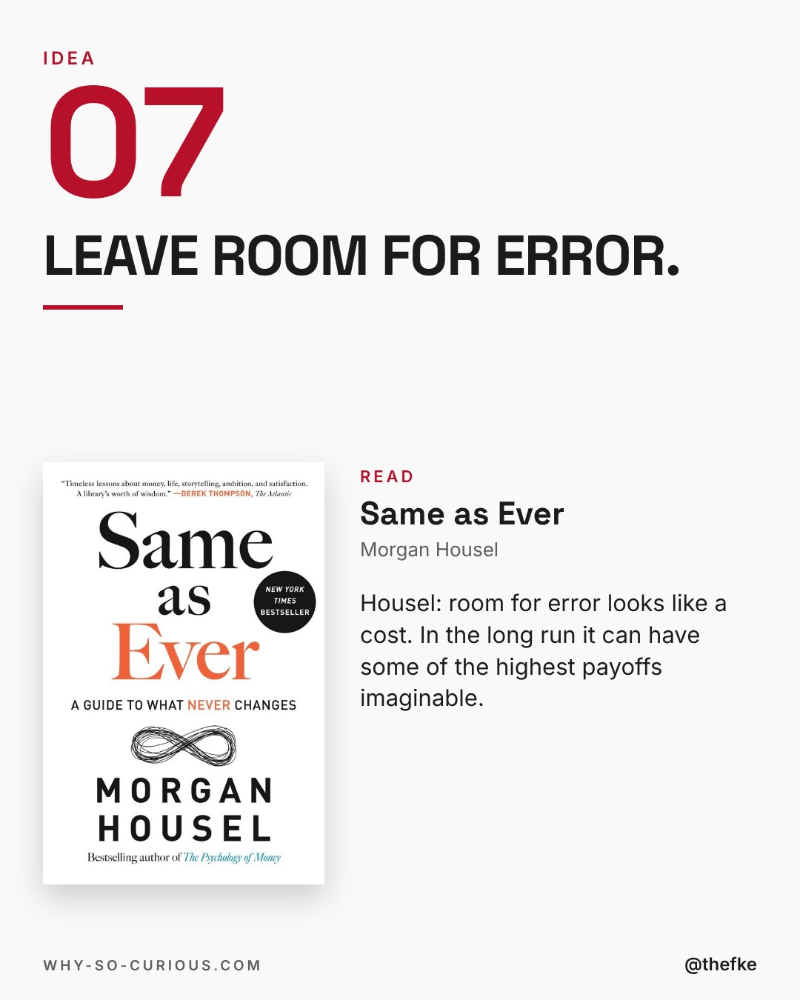
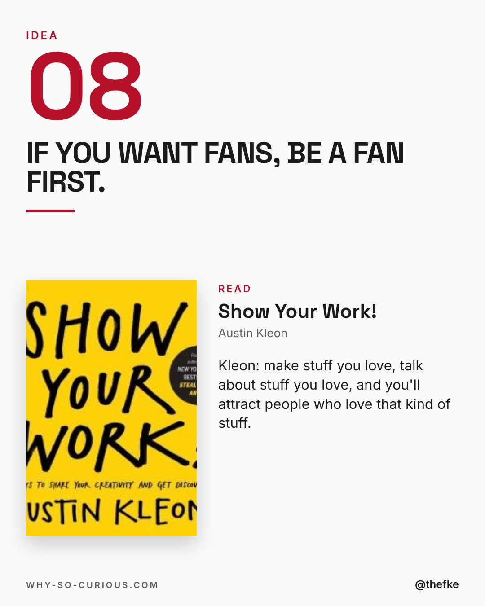
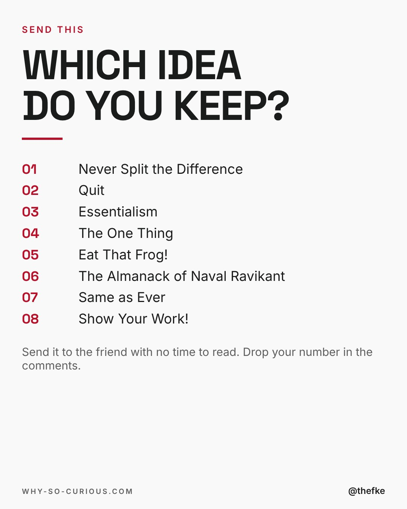

# Mi 16.12. · One idea worth the whole book, Part 2

Abend-Slot. Karussell, 10 Slides. Beim Hochladen 4:5 wählen.

## Caption

```
“No time for whole books.”
Fine. Start with one idea each.

Find the lead domino.
Eat the ugliest frog first.
Winners quit a lot.

Annie Duke in Quit:
“If you feel like you've got a close call between quitting and persevering, it's likely that quitting is the better choice.”

All from my shelf.

Send this to the friend with no time to read.

Which idea do you keep?

Books from this post: link in bio.

#bookstagram #bookrecommendations #books
```

## Slides











