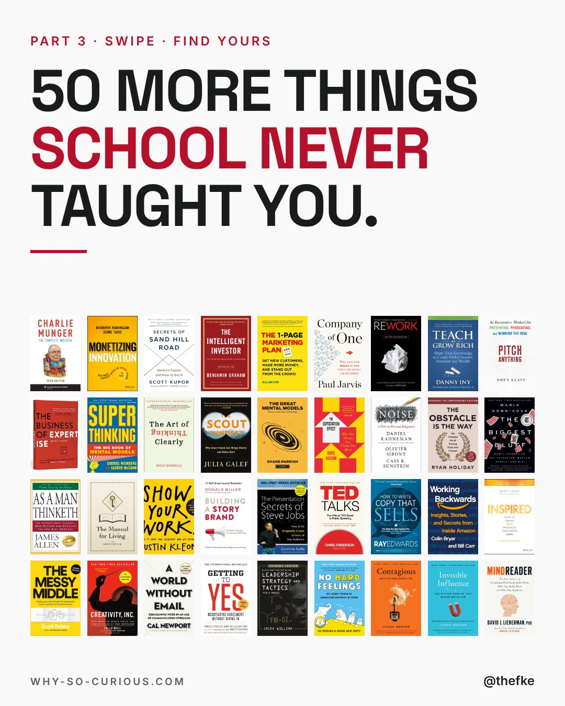
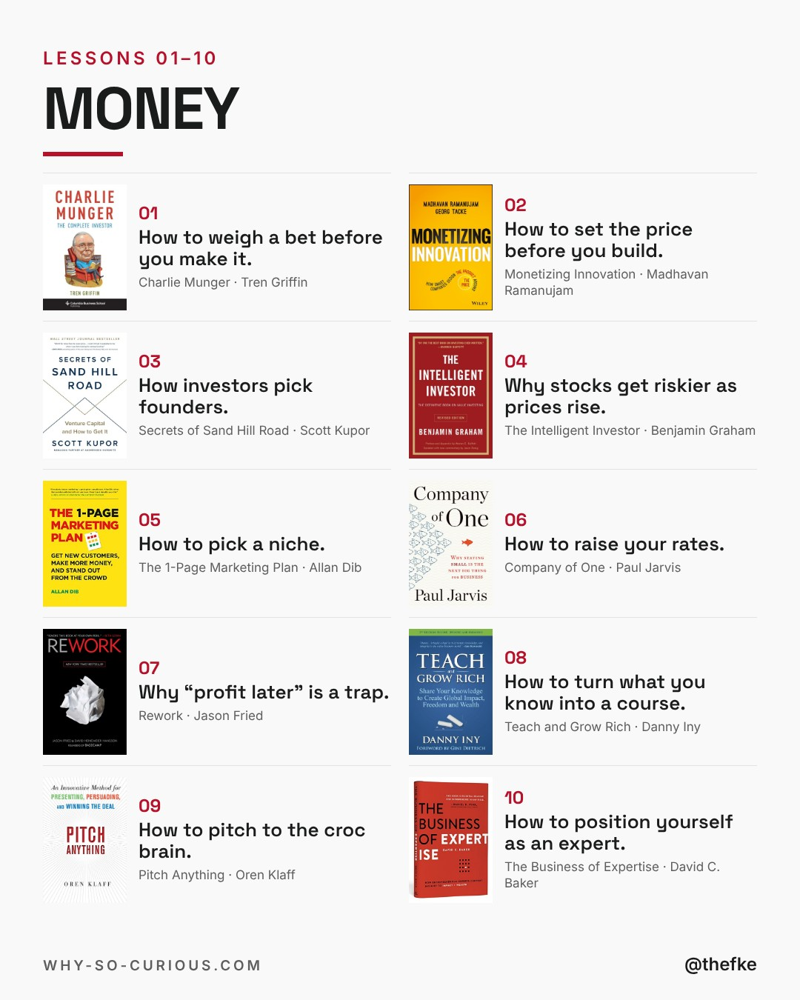
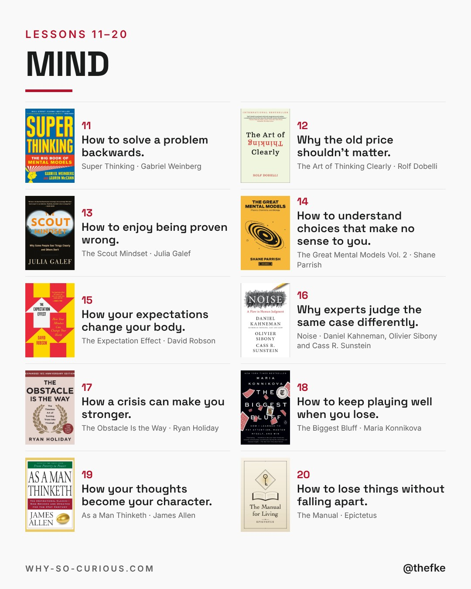
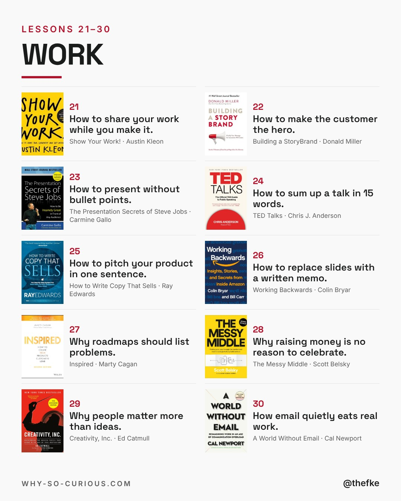
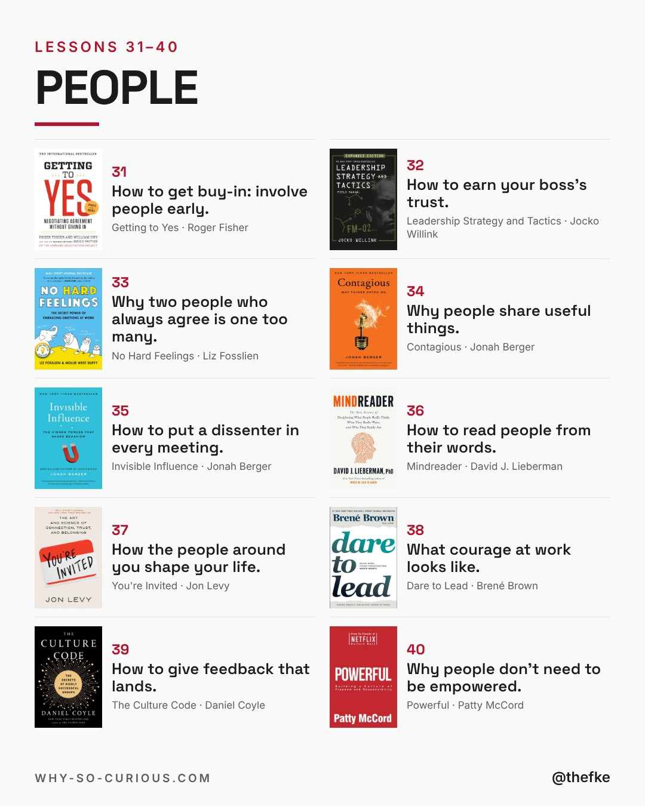
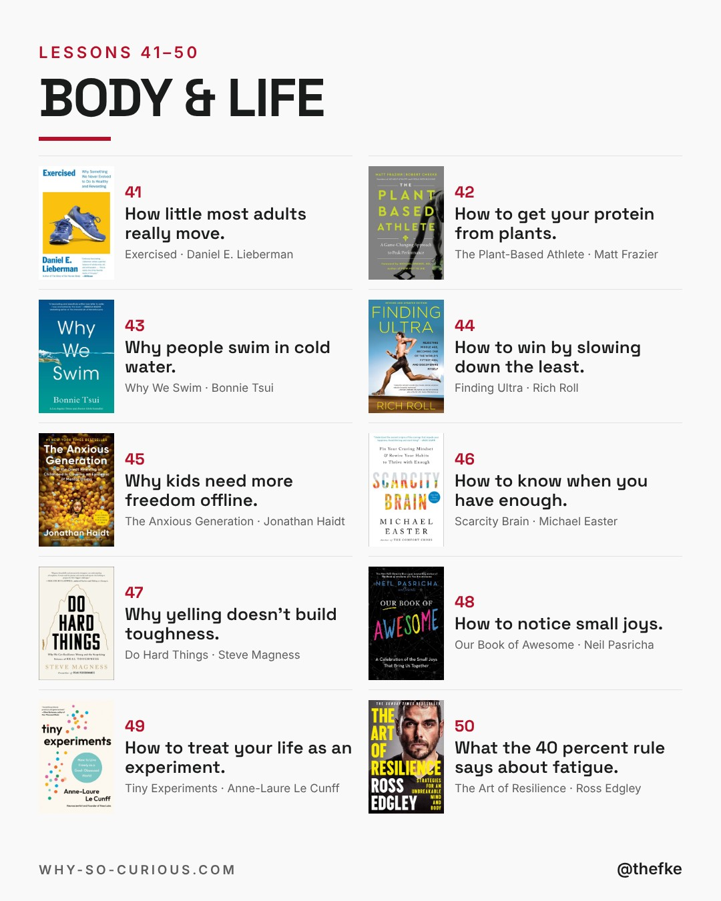
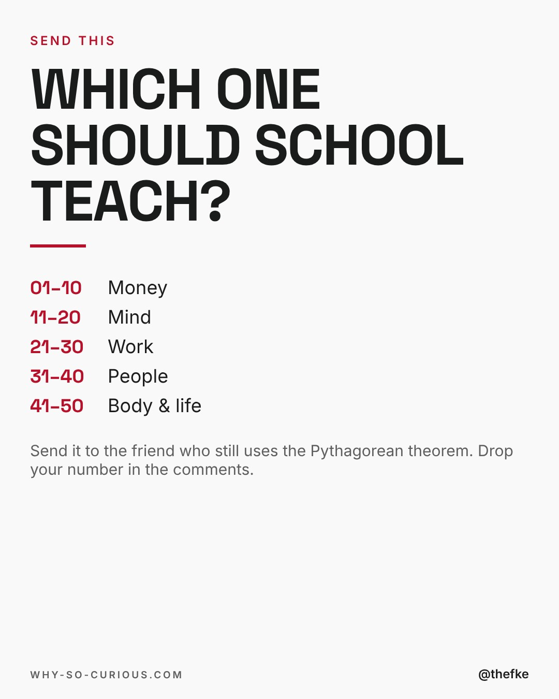

# Do 17.12. · 50 Things School Never Taught You, Part 3

Karussell, 7 Slides. Beim Hochladen 4:5 wählen.

## Caption

```
School taught us to raise our hand.
Nobody taught us how to raise our rates.

50 more things school never taught you.
50 books from my shelf that do.

Money. Mind. Work. People. Body & life.
10 each.

Number 44 comes from Finding Ultra by Rich Roll:
“The prize never goes to the fastest guy,” Chris replied. “It goes to the guy who slows down the least.”

Send this to the friend who still uses the Pythagorean theorem.

Which number should every school teach?

Books from this post: link in bio.

#bookstagram #bookrecommendations #books
```

## Slides








