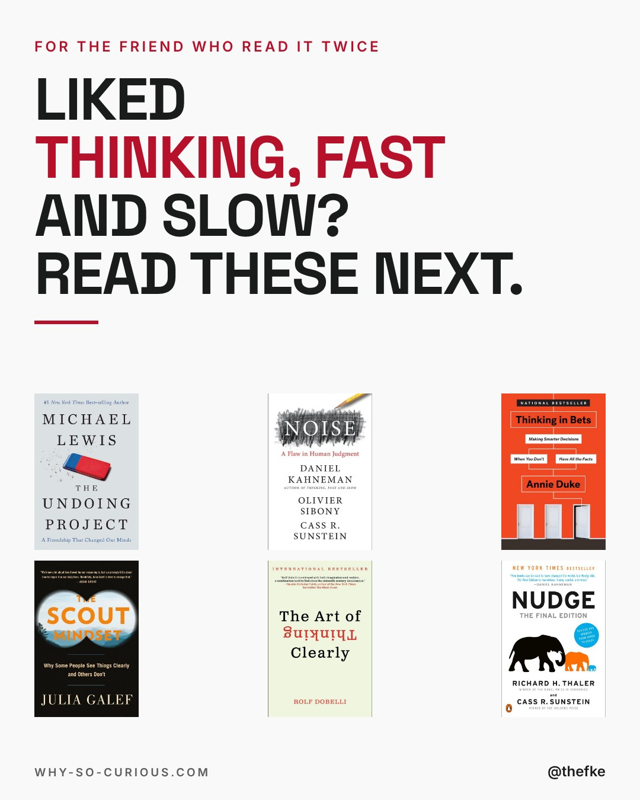
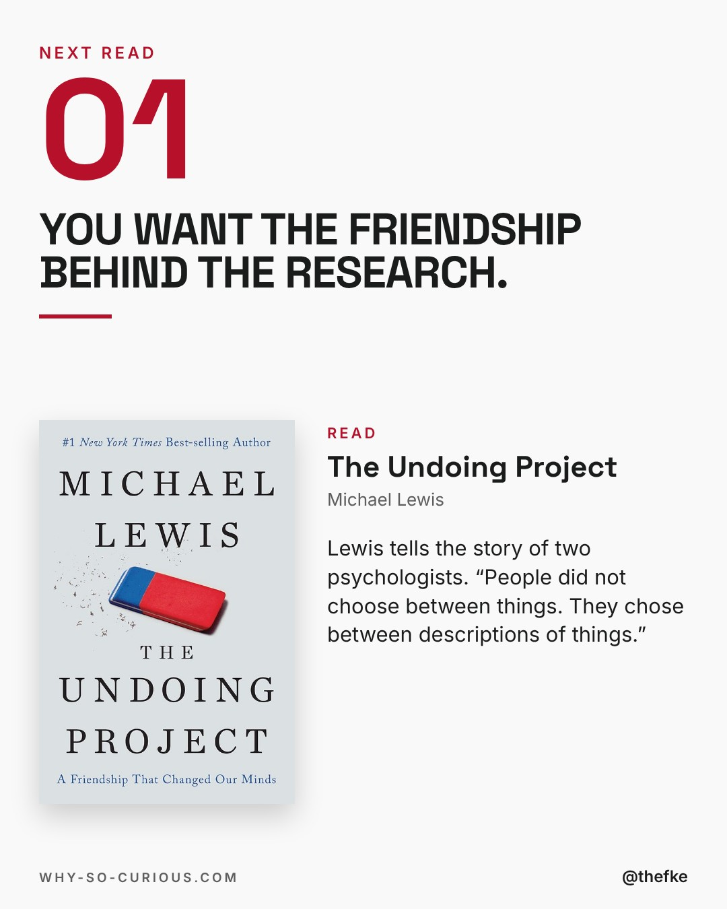
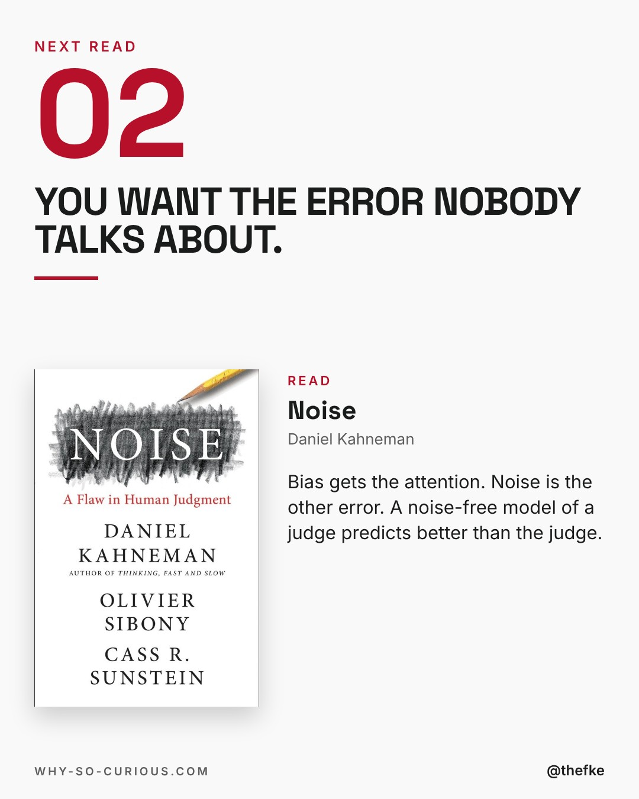
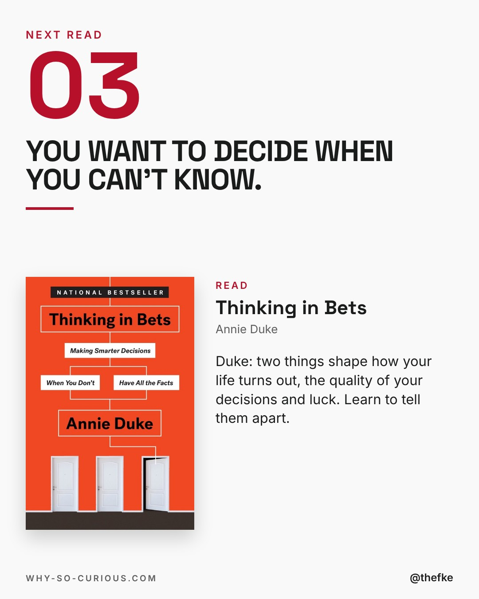
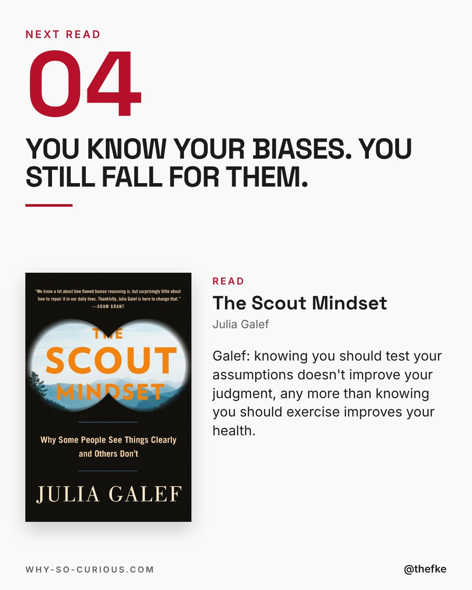
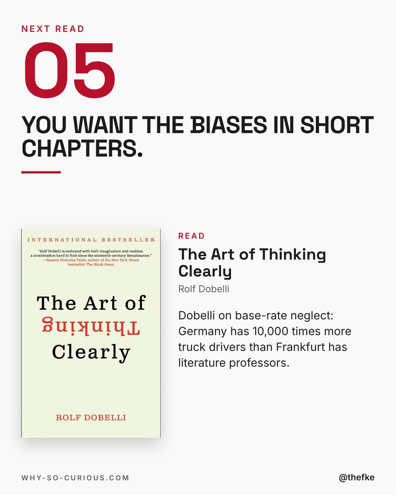
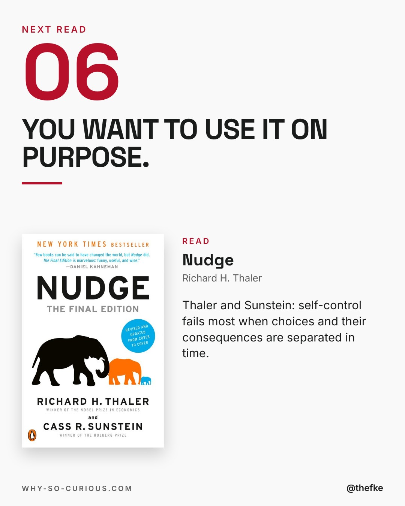
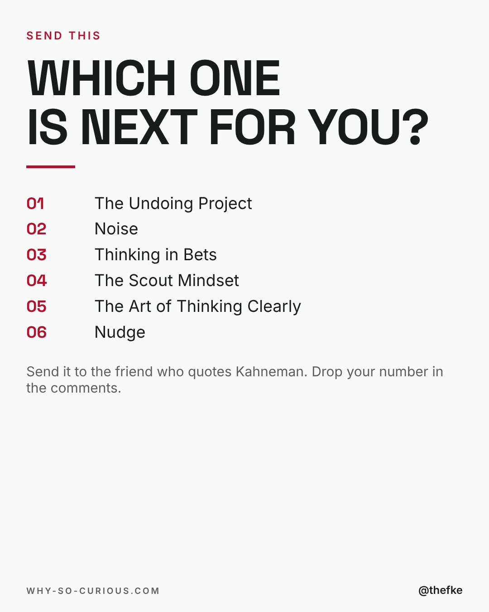

# Do 17.12. · Liked Thinking, Fast and Slow? Read these next

Abend-Slot. Karussell, 8 Slides. Beim Hochladen 4:5 wählen.

## Caption

```
You finished Thinking, Fast and Slow.
Now every meeting looks like a bias.

Six books for what comes next.
The friendship behind the research.
The error nobody measures.
And how to decide when you can't know.

Julia Galef in The Scout Mindset:
“Knowing that you should test your assumptions doesn't automatically improve your judgment, any more than knowing you should exercise automatically improves your health.”

All from my shelf.

Send this to the friend who quotes Kahneman.

Which one is next for you?

Books from this post: link in bio.

#bookstagram #bookrecommendations #books
```

## Slides









