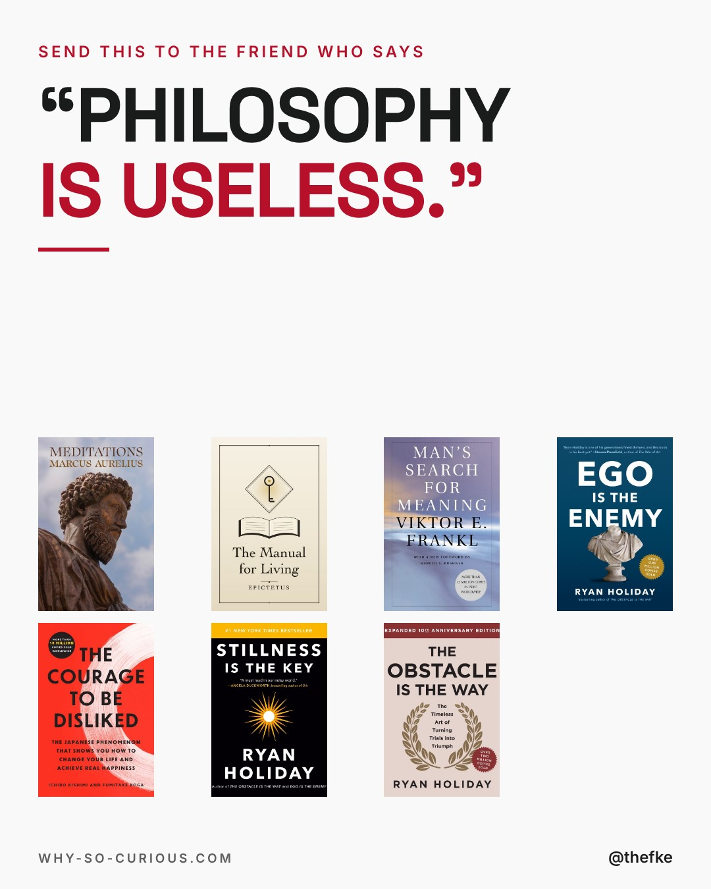
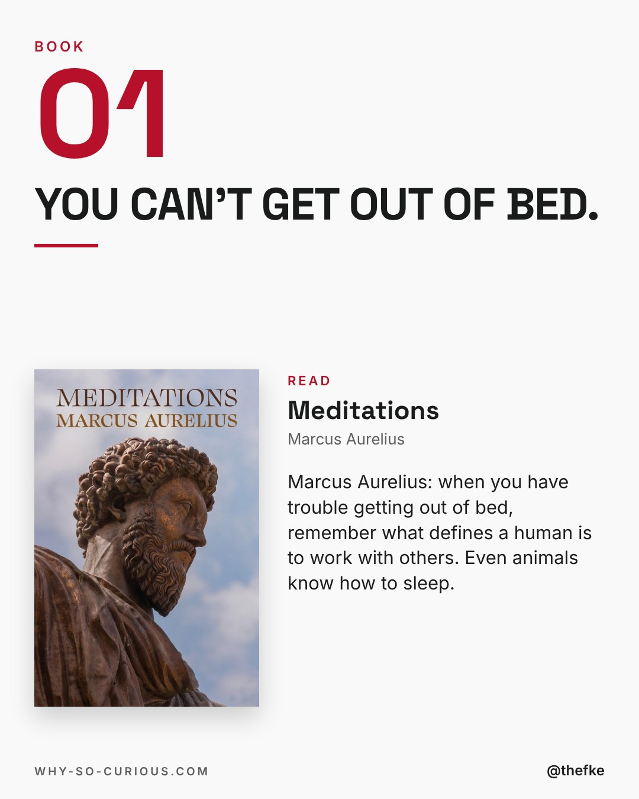
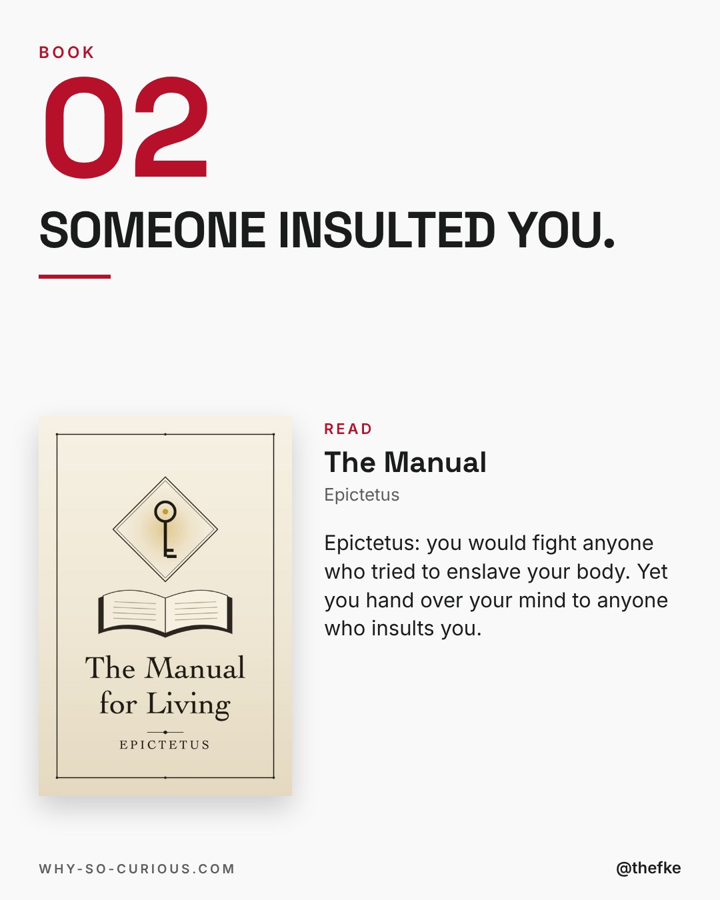
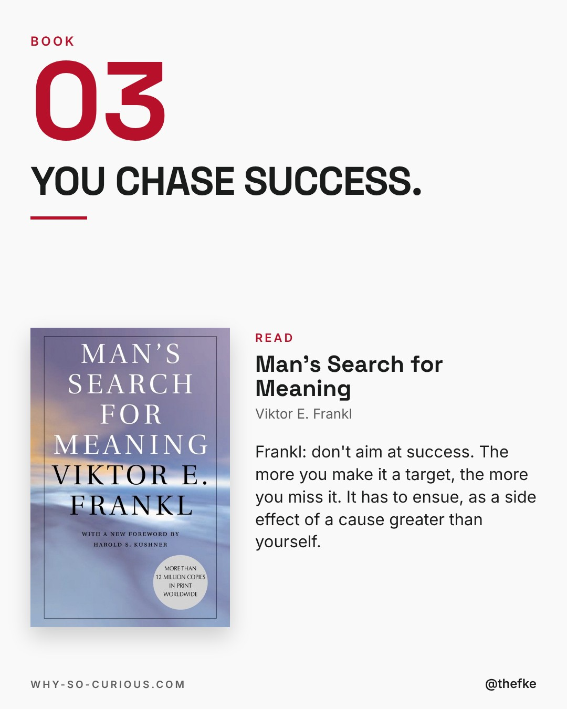
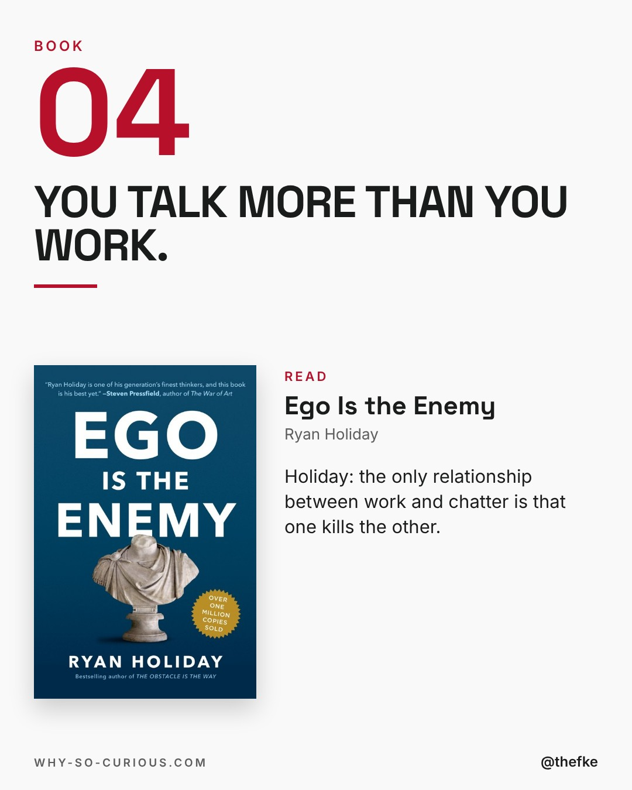
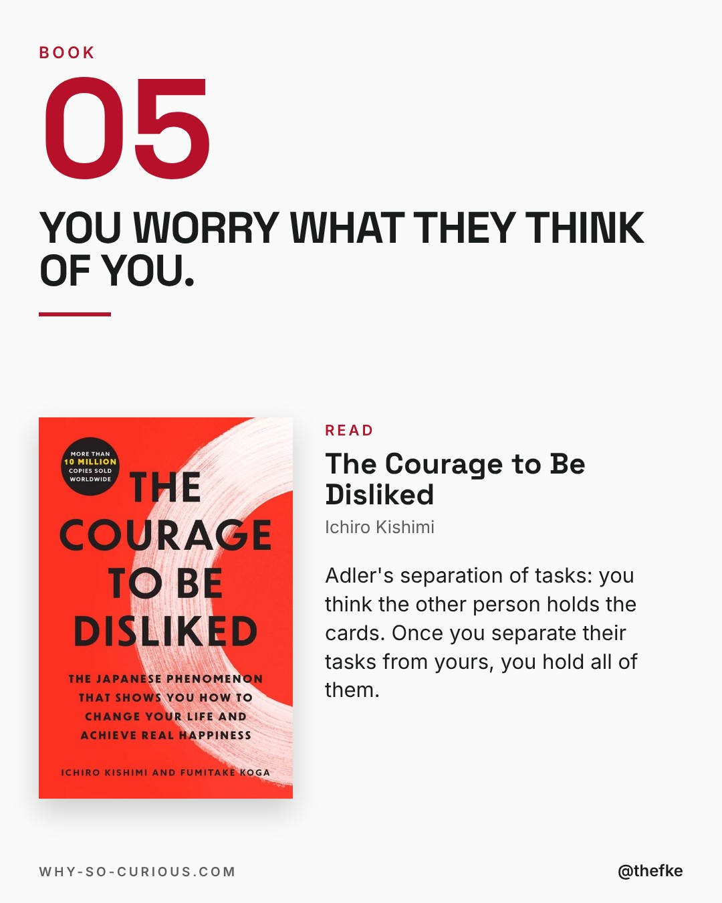
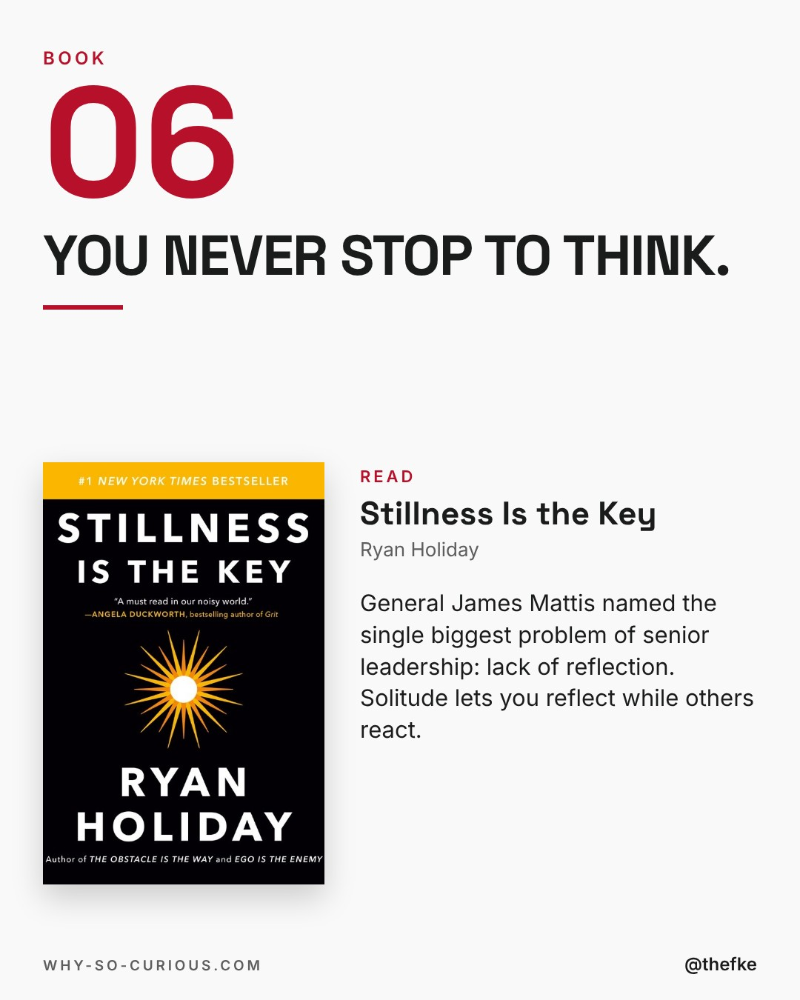
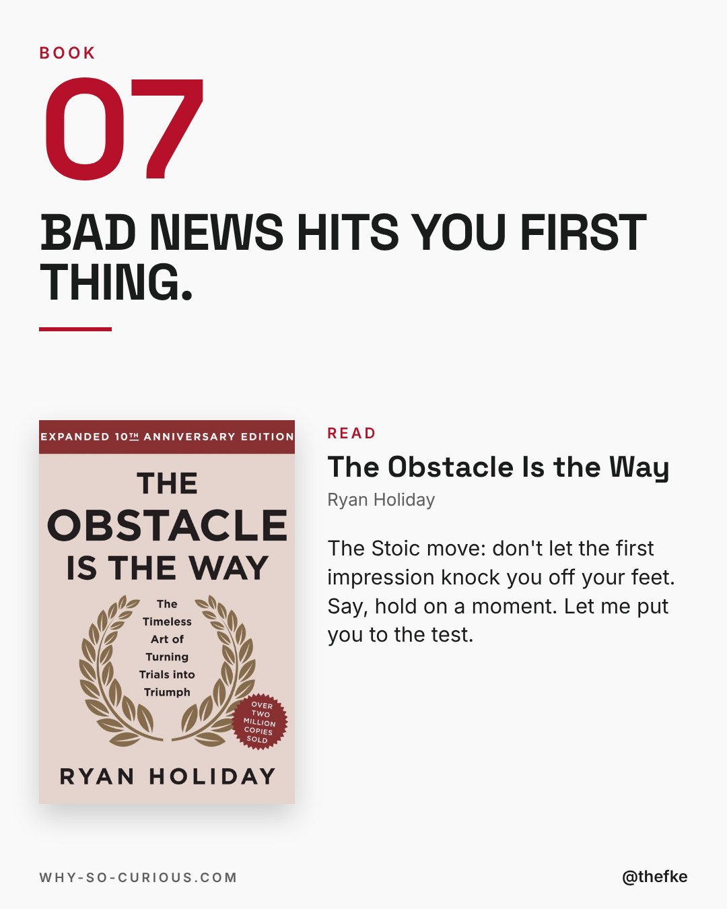
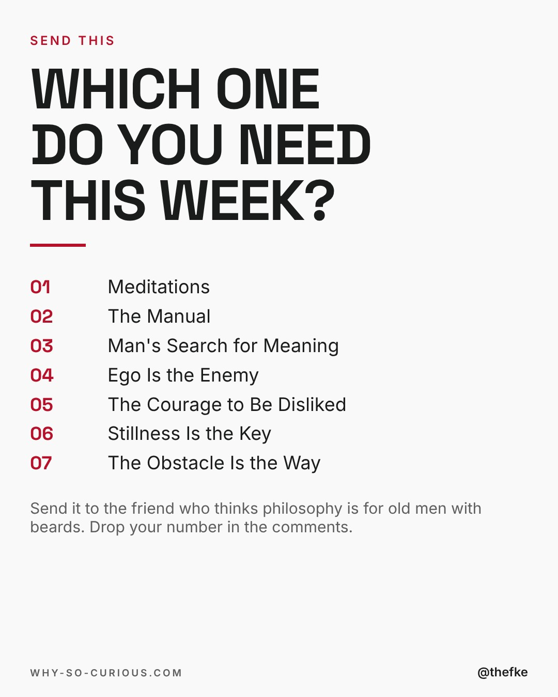

# Do 17.12. · “Philosophy is useless.” Seven books that disagree

Früh-Slot, wird automatisch gepostet (ohne Musik). Nicht von Hand posten. Karussell, 9 Slides. Beim Hochladen 4:5 wählen.

## Caption

```
“Philosophy is useless.”
Then try these on a Monday.

You can't get out of bed. Someone insulted you. You talk more than you work.
Seven old ideas for seven very normal problems.

Epictetus in The Manual:
“People who are ignorant of philosophy blame others for their own misfortunes. Those who are beginning to learn philosophy blame themselves. Those who have mastered philosophy blame no one.”

All from my shelf.

Send this to the friend who thinks philosophy is for old men with beards.

Which one do you need this week?

Books from this post: link in bio.

#bookstagram #bookrecommendations #books
```

## Slides










