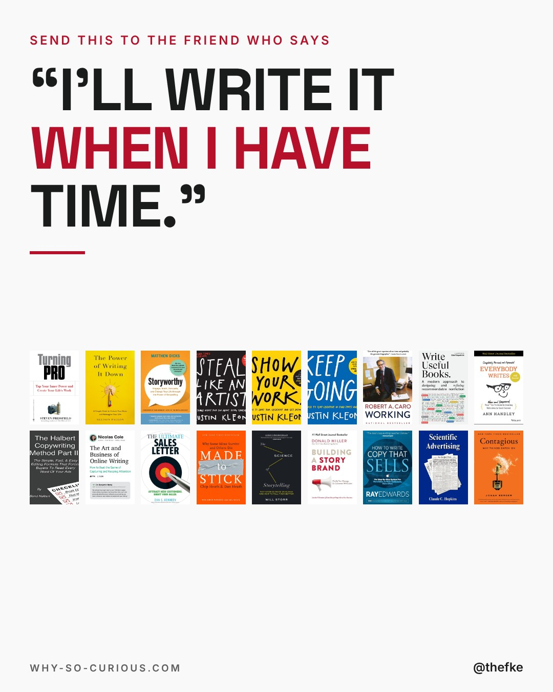
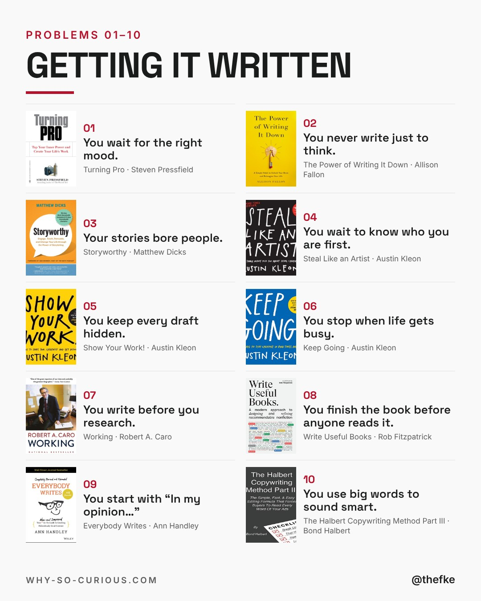
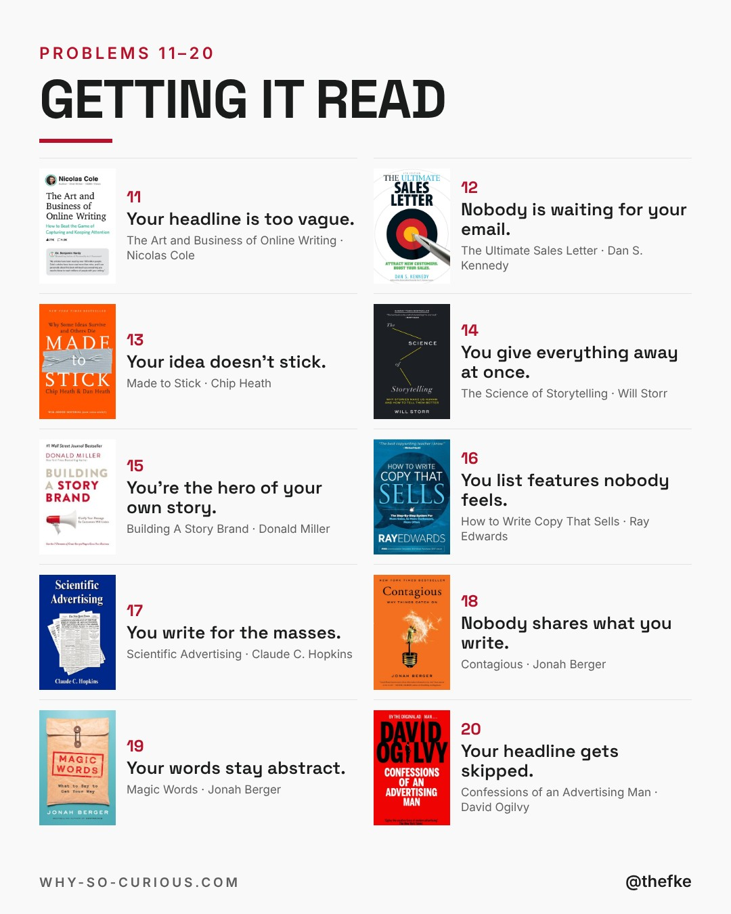
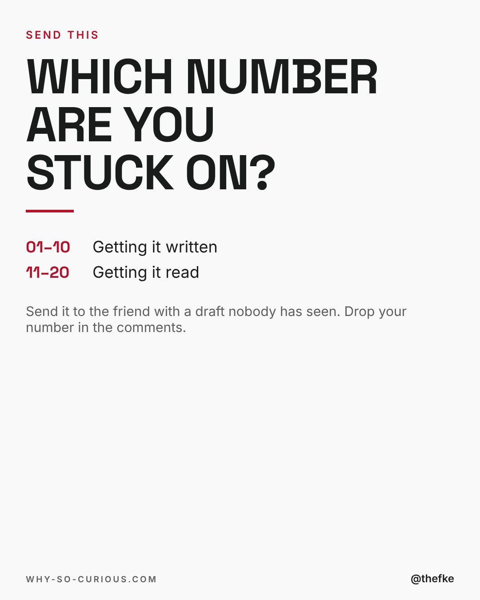

# Fr 18.12. · 20 Writing Problems, 20 Books

Früh-Slot, wird automatisch gepostet (ohne Musik). Nicht von Hand posten. Karussell, 4 Slides. Beim Hochladen 4:5 wählen.

## Caption

```
“I'll write it when I have time.”
You won't. Nobody does.

20 writing problems.
20 books from my shelf that help.

10 about getting it written.
10 about getting it read.

Steven Pressfield in Turning Pro:
“Resistance hates two qualities above all others: concentration and depth.”

Send this to the friend with a draft nobody has seen.

Which number are you stuck on?

Books from this post: link in bio.

#bookstagram #bookrecommendations #books
```

## Slides





