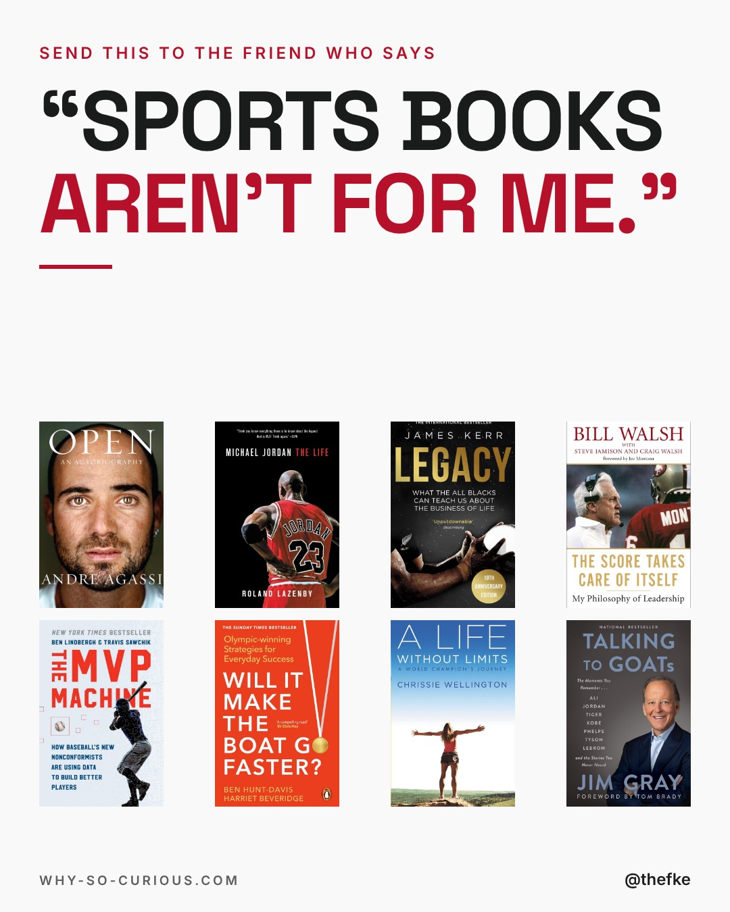
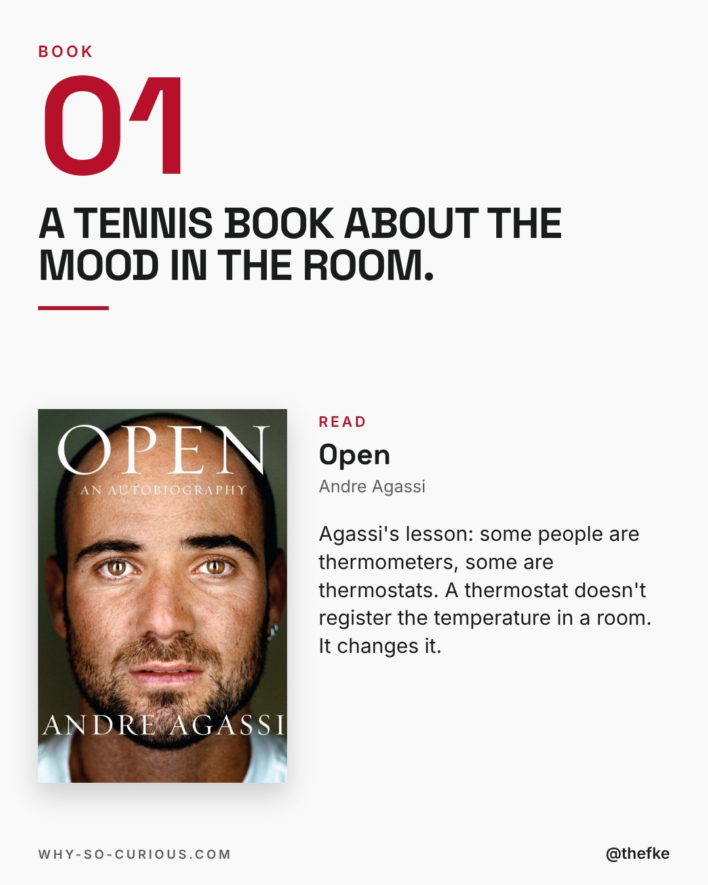
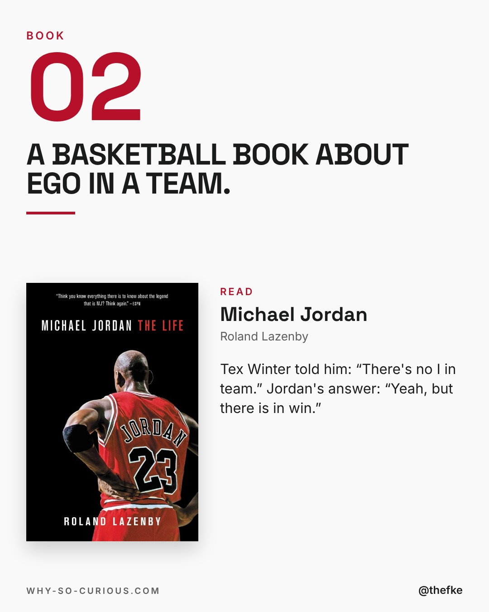
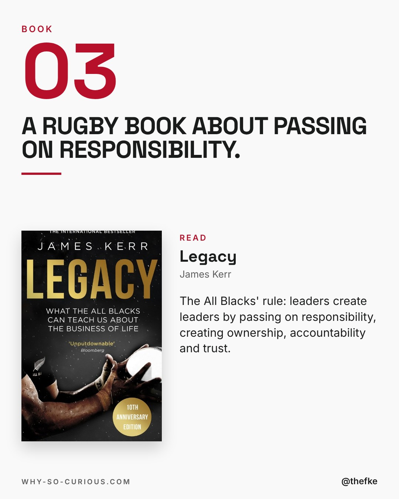
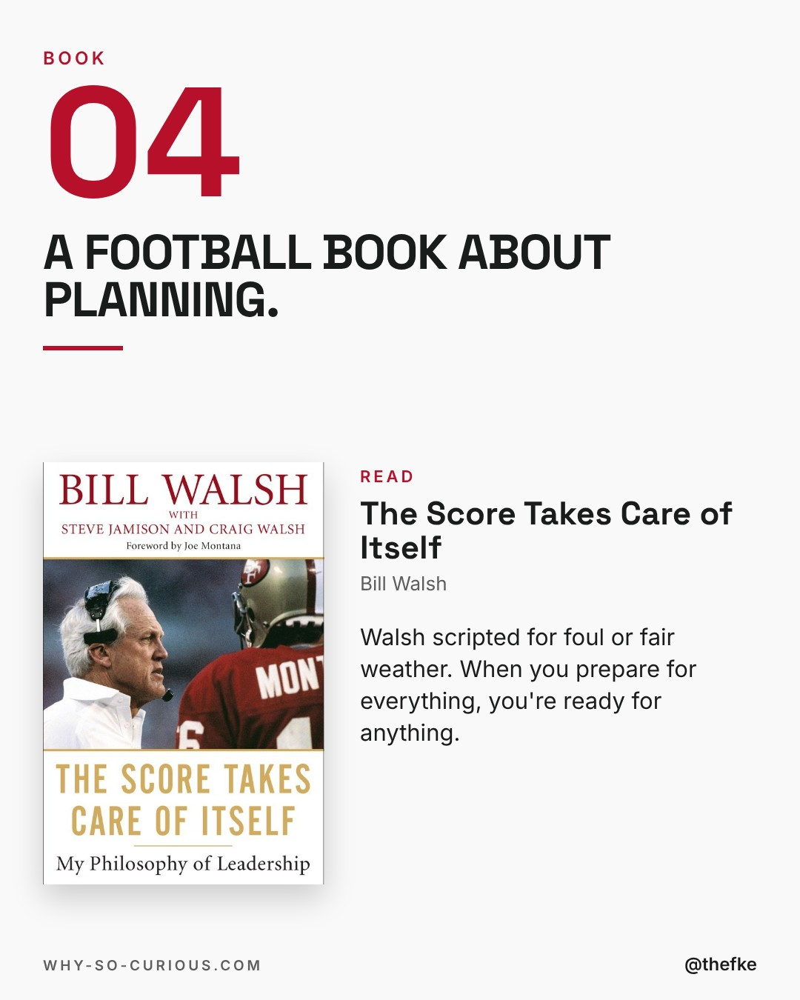
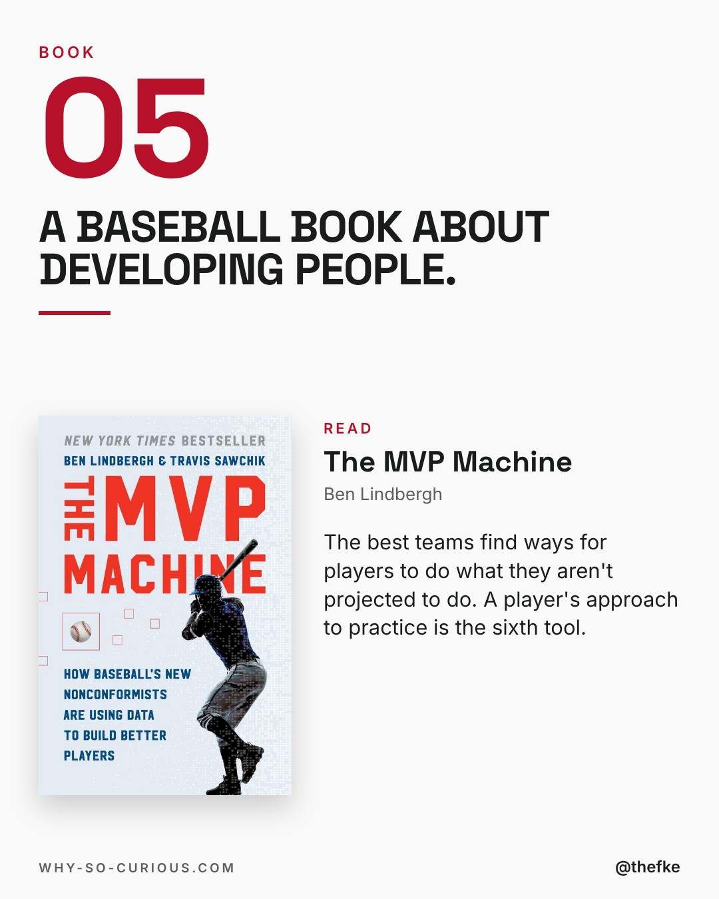
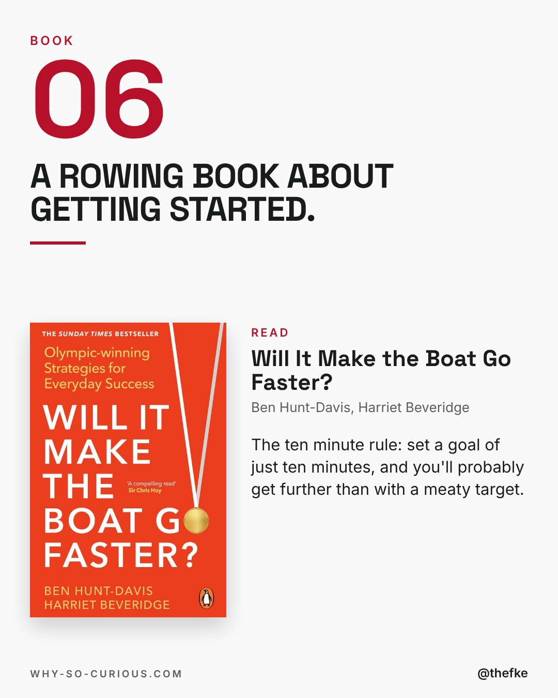
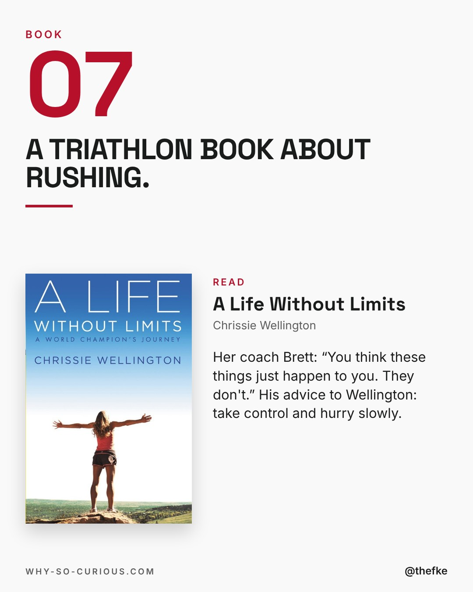
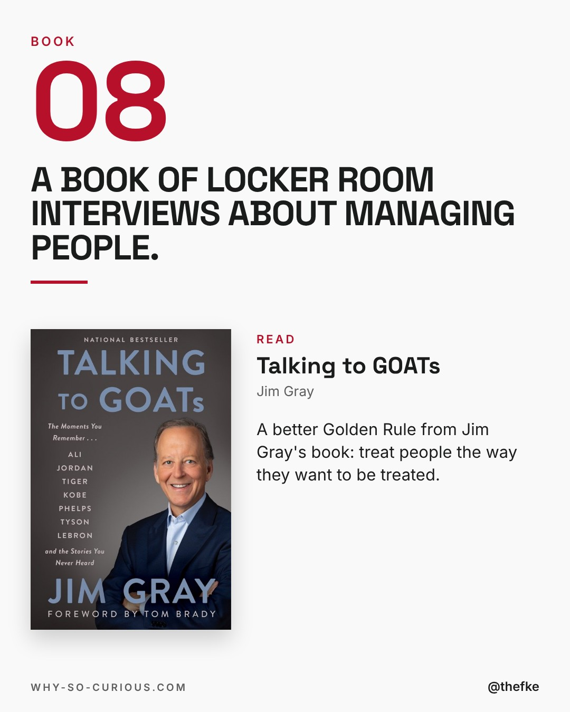
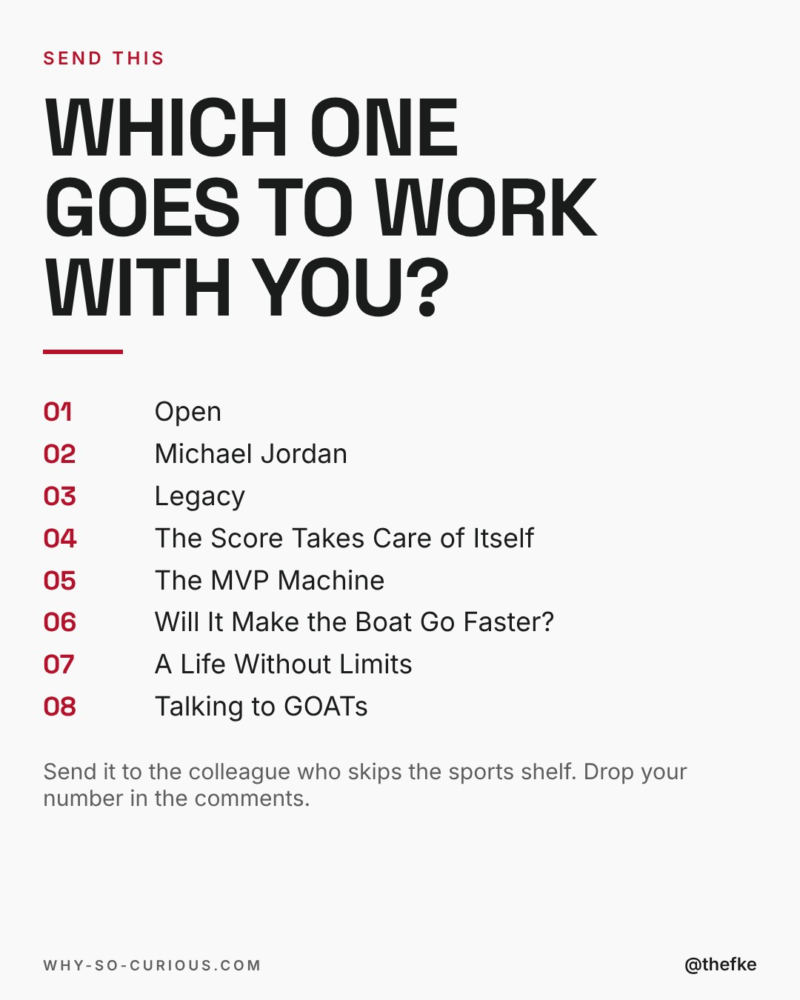

# Fr 18.12. · Sports books that are really about work

Abend-Slot. Karussell, 10 Slides. Beim Hochladen 4:5 wählen.

## Caption

```
“Sports books aren't for me.”
Then you're skipping a shelf full of work books.

Tennis, basketball, rugby, football.
Baseball, rowing, triathlon.
Every one of them is really about work.

The line to remember is in Open.
Agassi is told: “some people are thermometers, some are thermostats. You're a thermostat. You don't register the temperature in a room, you change it.”

All from my shelf.

Send this to the colleague who skips the sports shelf.

Which one would you bring to work?

Books from this post: link in bio.

#bookstagram #bookrecommendations #books
```

## Slides











