# Sa 19.12. · Last minute: books that look like you planned this

Abend-Slot. Karussell, 12 Slides. Beim Hochladen 4:5 wählen.

## Caption

```
No gift yet?
Nobody needs to know.

Ten books that look like you thought about it for weeks.
The runner. The new team lead. The founder friend.
And the parents of a curious kid.

Ramit Sethi in I Will Teach You to Be Rich:
“Spend extravagantly on the things you love, and cut costs mercilessly on the things you don’t.”

All from my shelf.

Send this to the friend who is still shopping.

Who is left on your list?

Books from this post: link in bio.

#bookstagram #bookrecommendations #books
```

## Slides

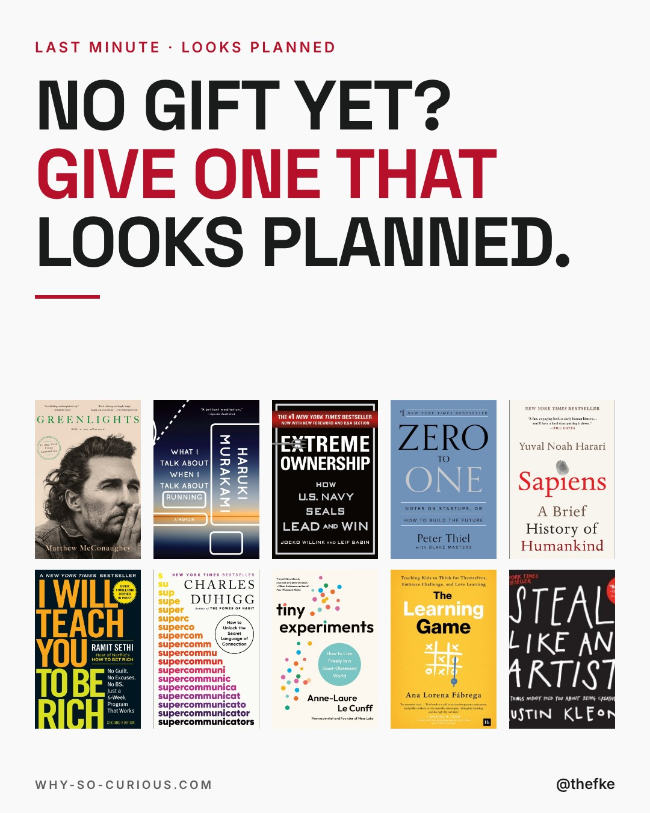
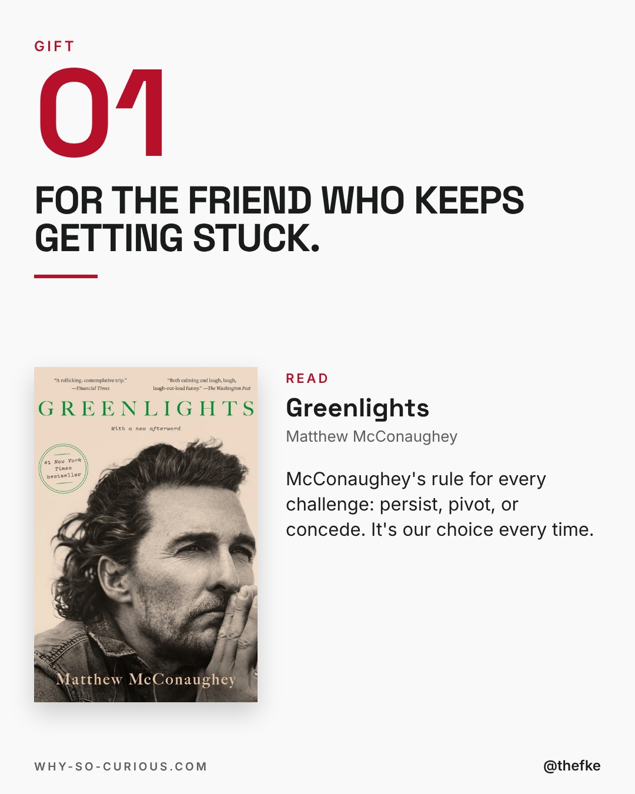
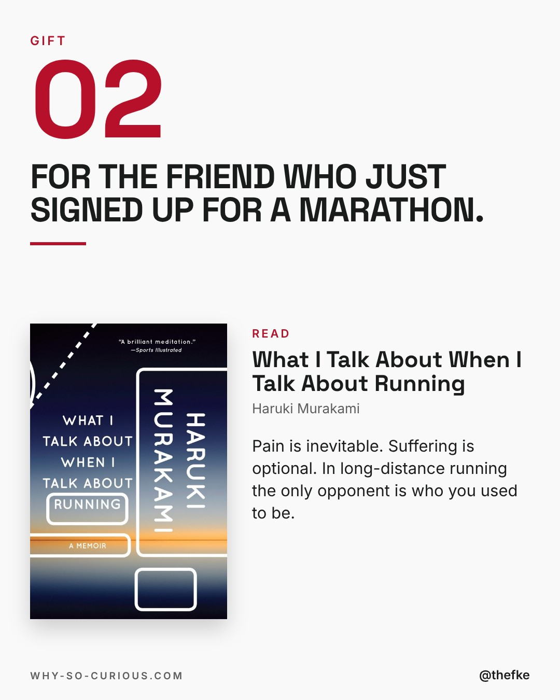
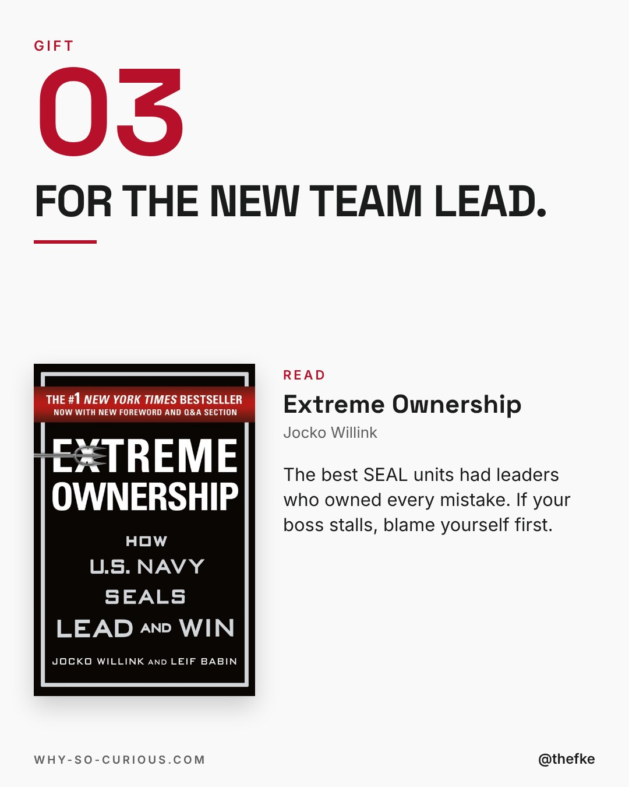
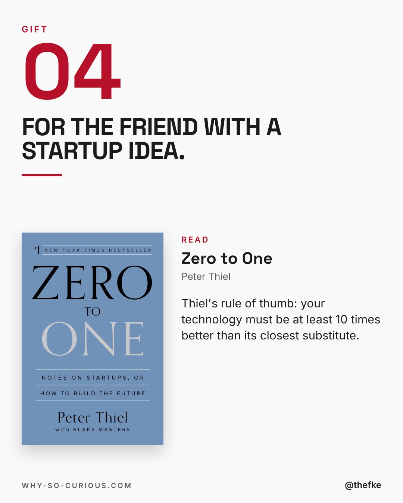
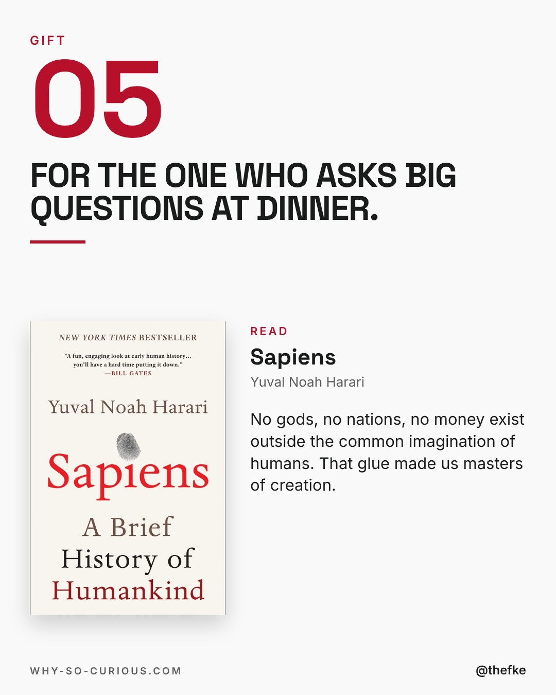
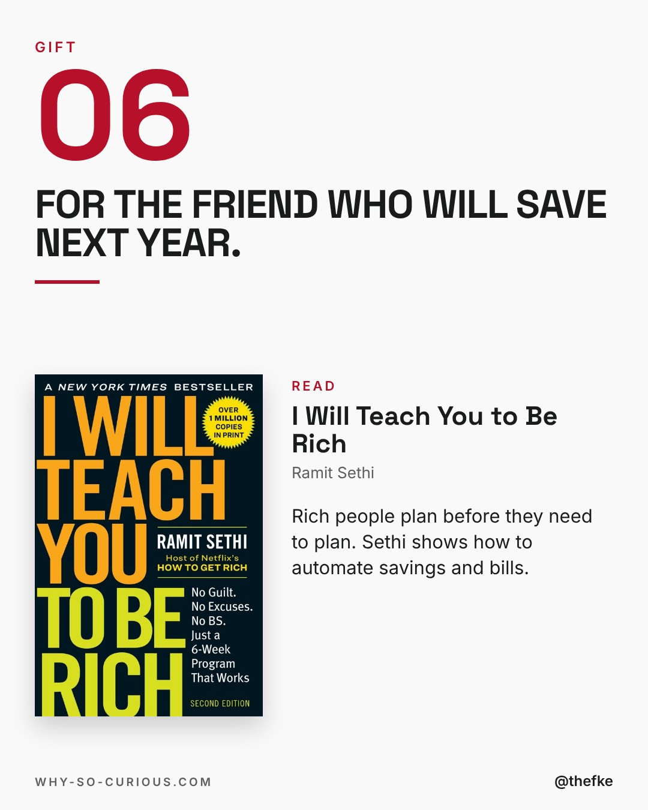
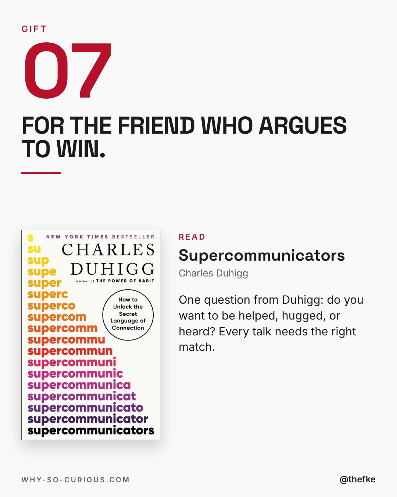
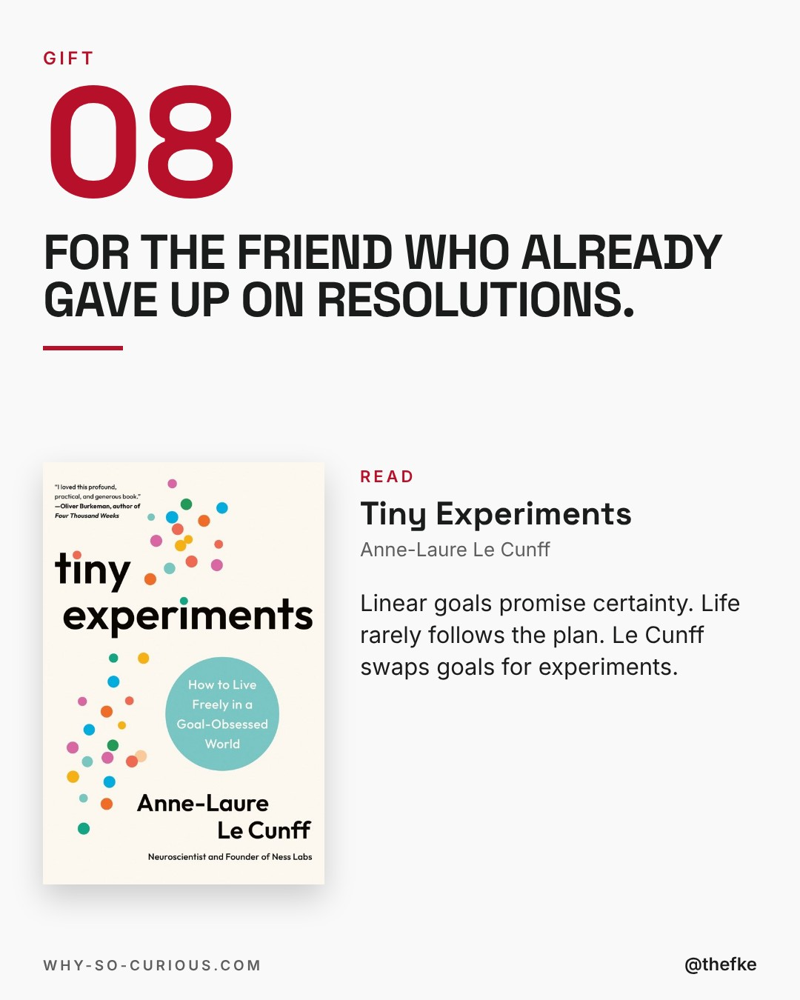
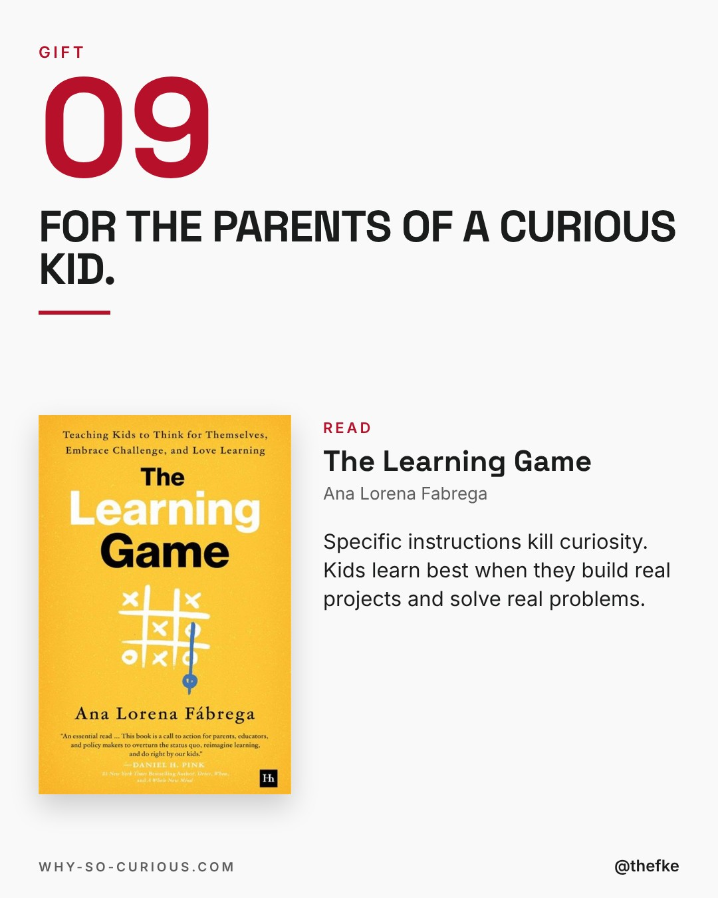
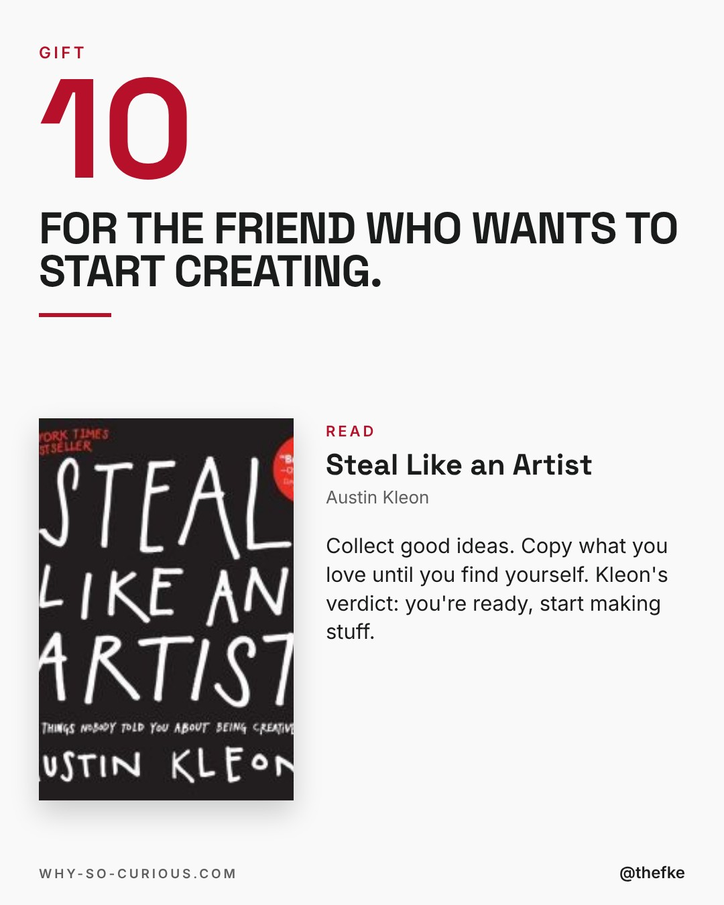
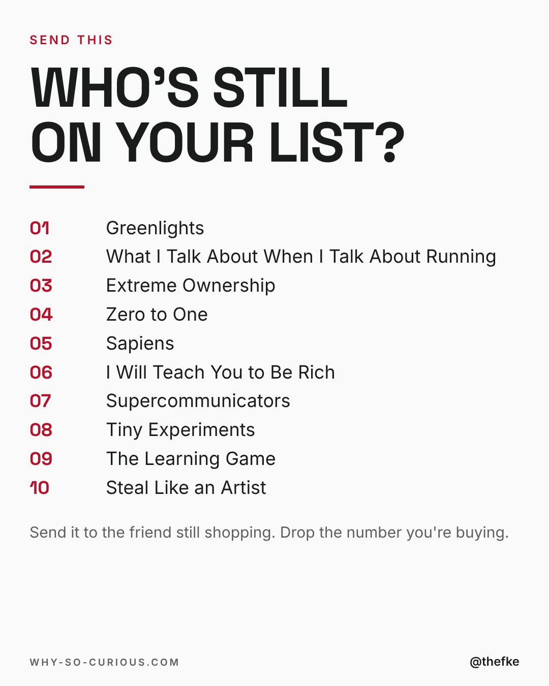
