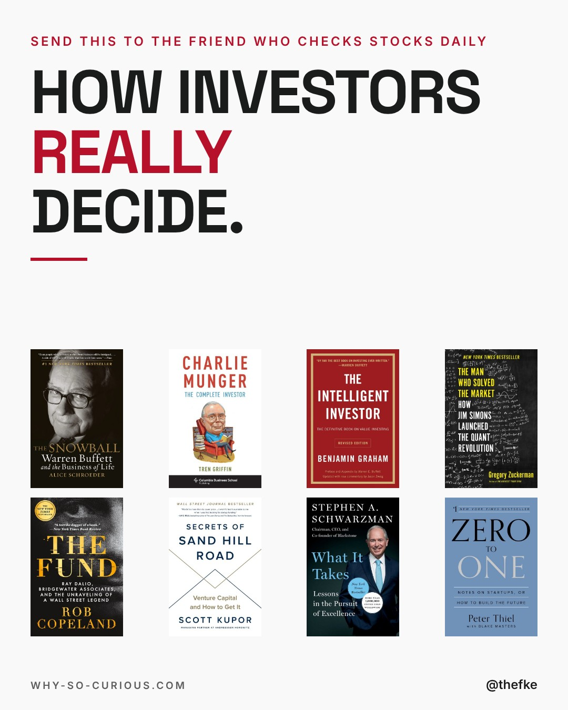
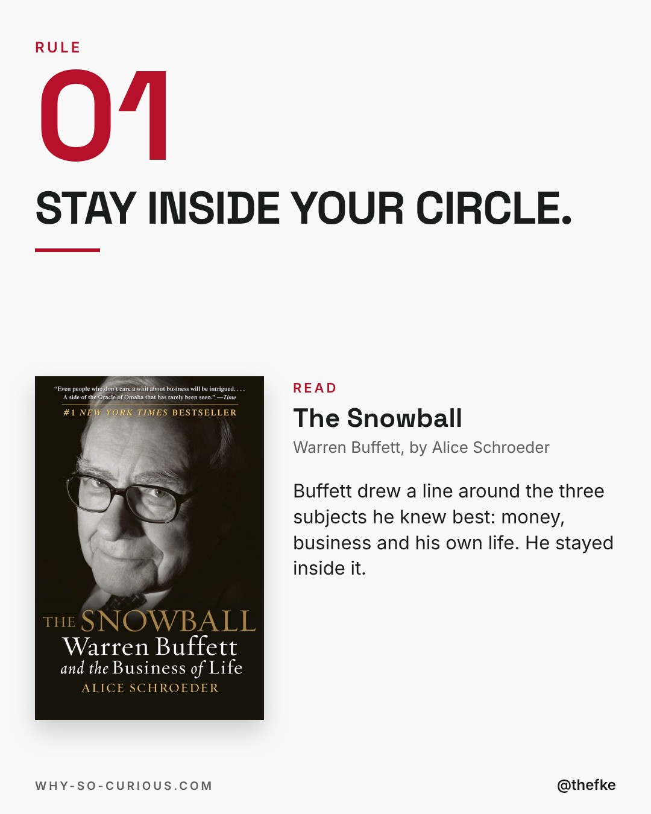
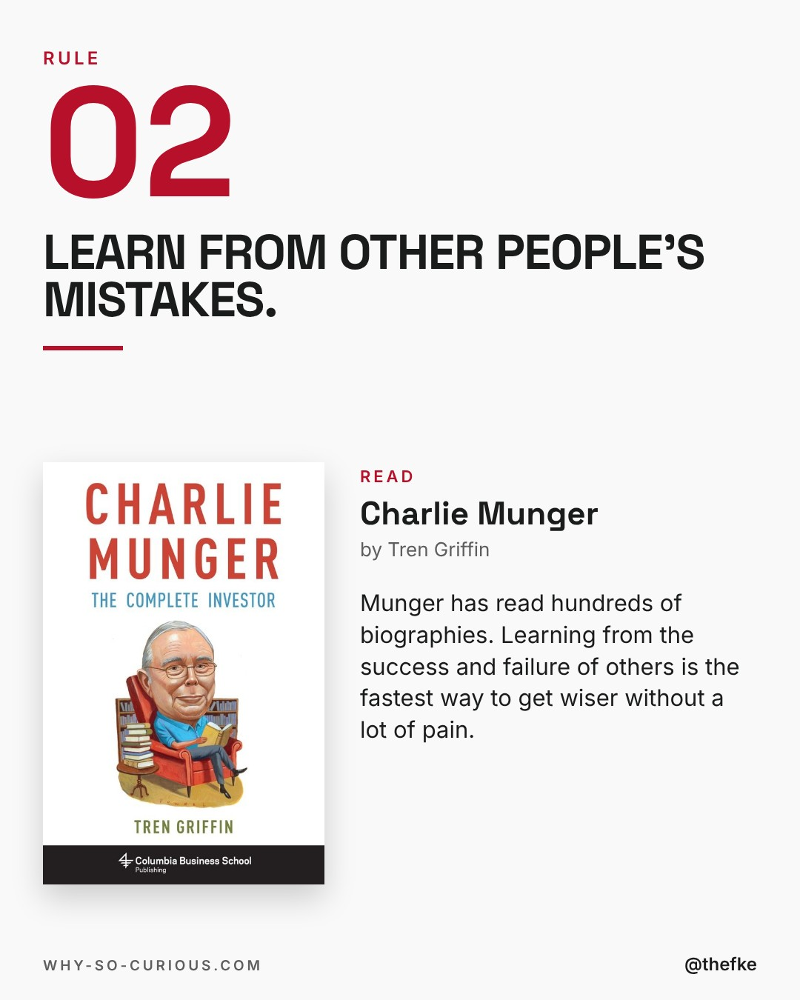
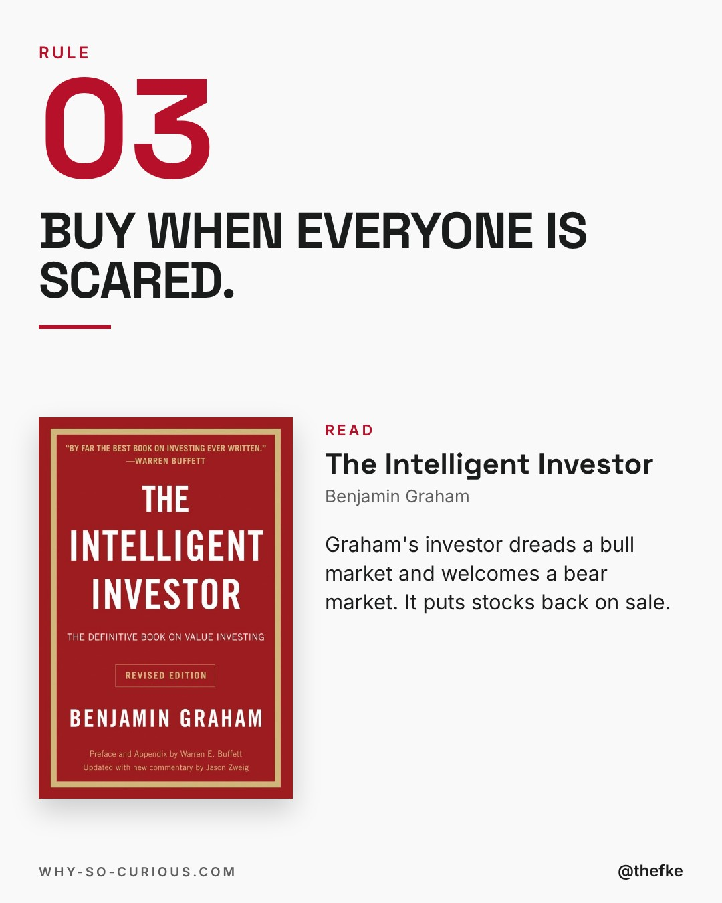
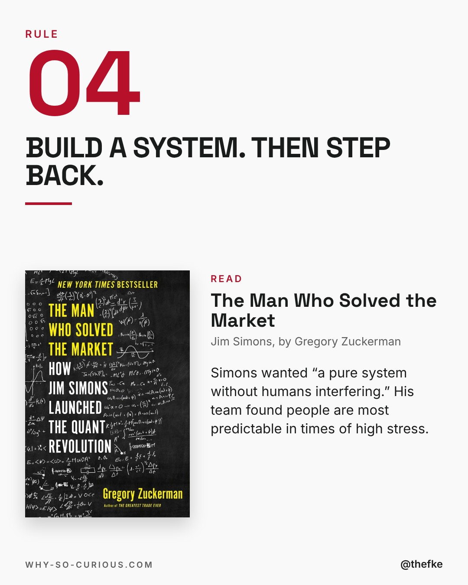
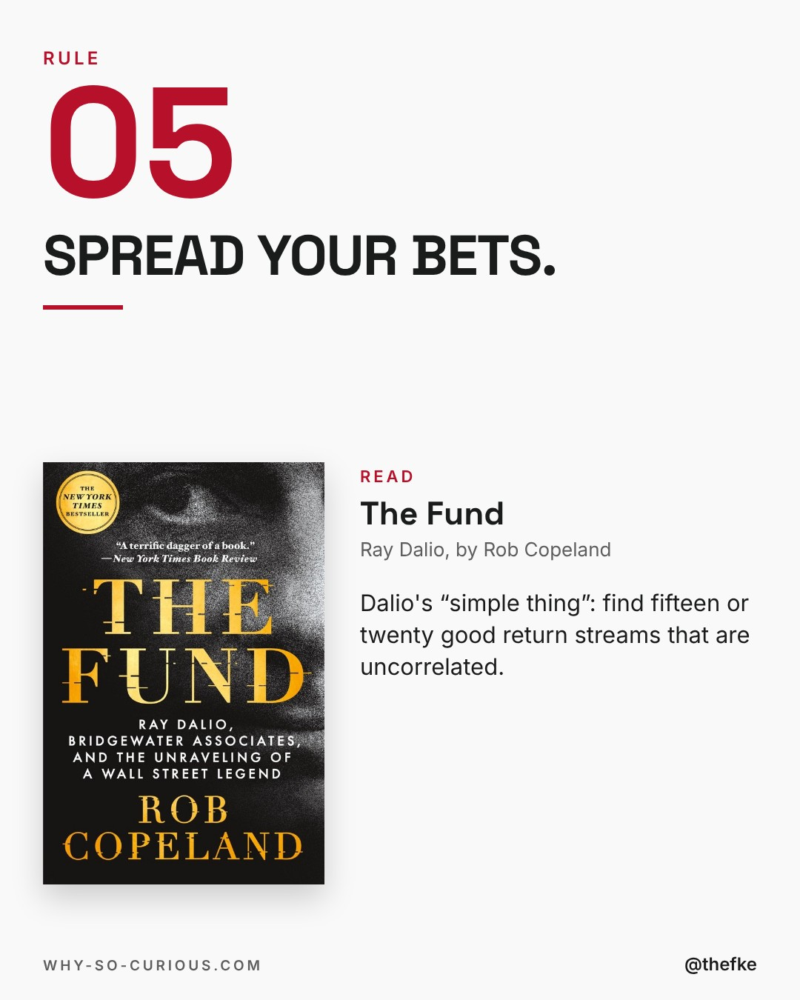
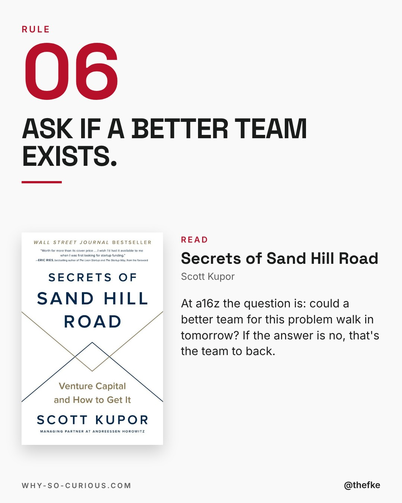
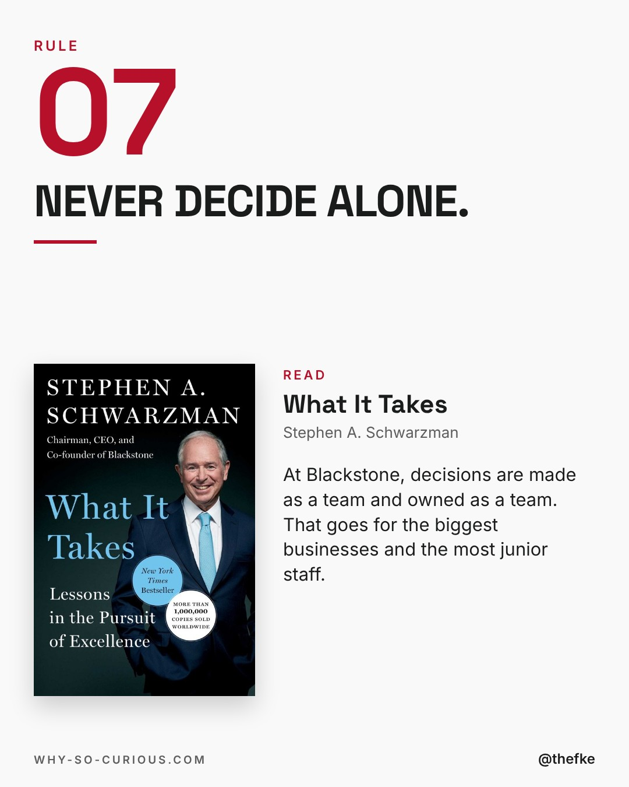
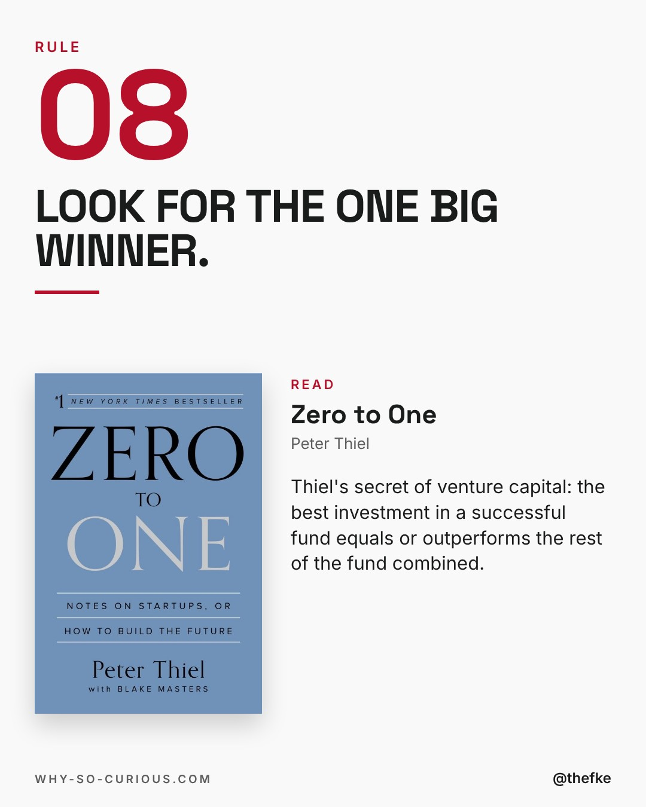
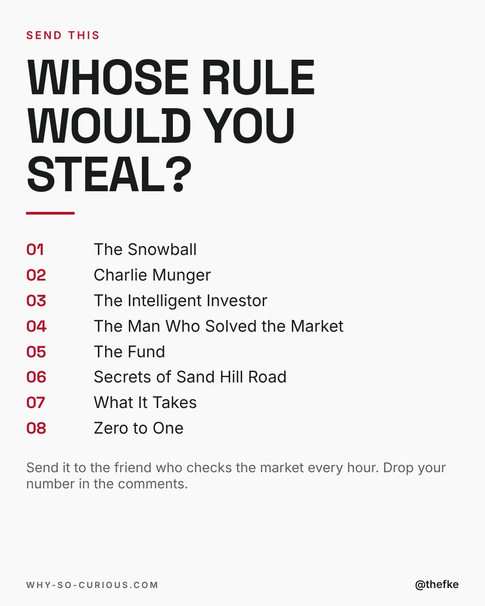

# Sa 19.12. · How investors really decide: 8 rules

Früh-Slot, wird automatisch gepostet (ohne Musik). Nicht von Hand posten. Karussell, 10 Slides. Beim Hochladen 4:5 wählen.

## Caption

```
Buffett stayed inside three subjects.
Simons wanted a system without humans.
Thiel looks for the one investment that beats the rest of the fund.

8 investors. 8 rules.
All from books on my shelf.

Benjamin Graham in The Intelligent Investor:
“The intelligent investor is a realist who sells to optimists and buys from pessimists.”

Most of these rules work far beyond money.

Send this to the friend who checks the market every hour.

Whose rule would you steal?

Books from this post: link in bio.

#bookstagram #bookrecommendations #books
```

## Slides











