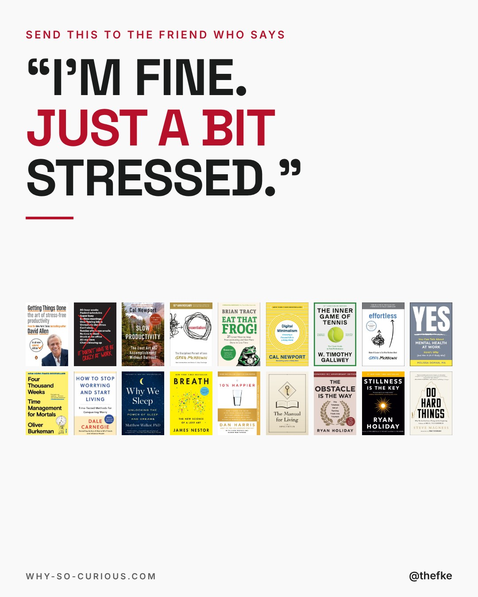
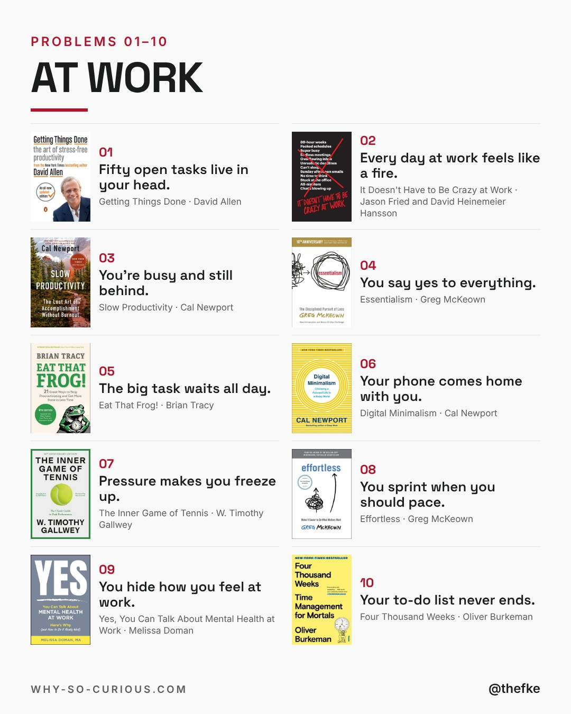
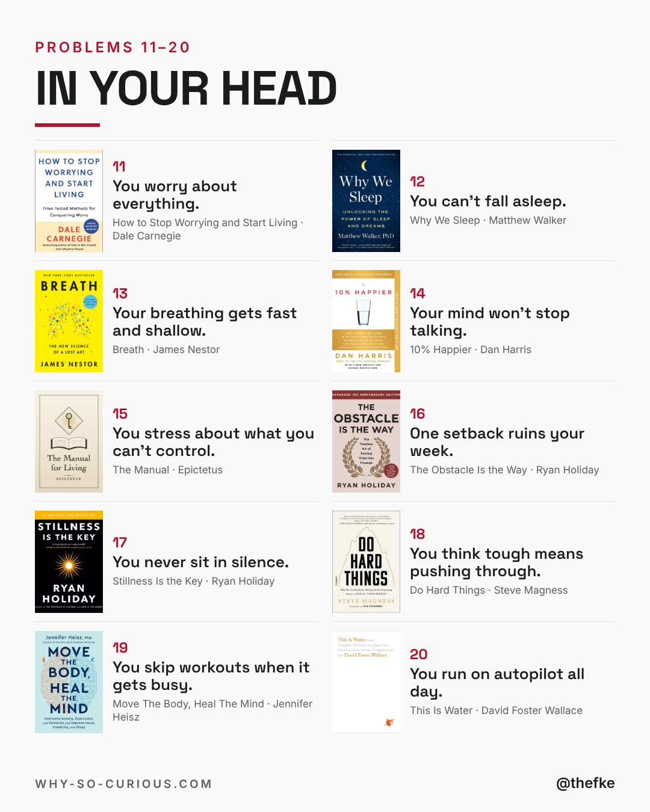
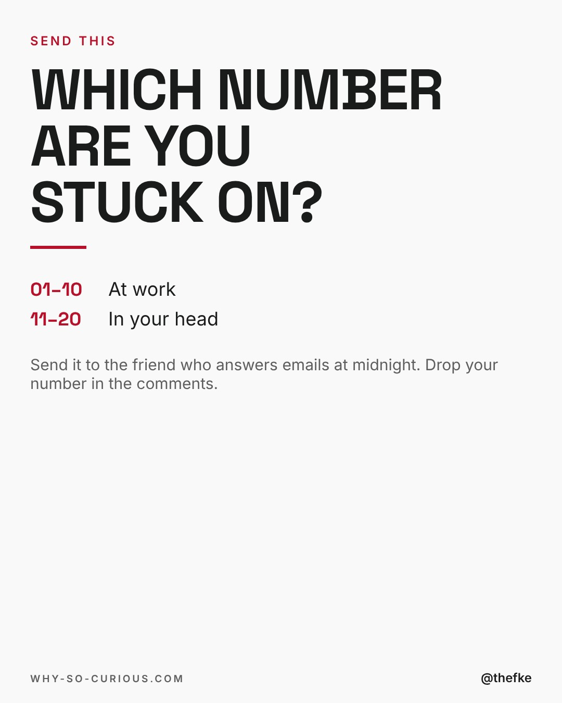

# So 20.12. · 20 Stress Problems, 20 Books

Früh-Slot, wird automatisch gepostet (ohne Musik). Nicht von Hand posten. Karussell, 4 Slides. Beim Hochladen 4:5 wählen.

## Caption

```
“I'm fine. Just a bit stressed.”
Said every day for three months.

20 stress problems.
20 books from my shelf that help.

10 at work.
10 in your head.

David Allen in Getting Things Done:
“Anything that does not belong where it is, the way it is, is an “open loop,” which will be pulling on your attention if it’s not appropriately managed.”

Send this to the friend who answers emails at midnight.

Which number are you stuck on?

Books from this post: link in bio.

#bookstagram #bookrecommendations #books
```

## Slides





