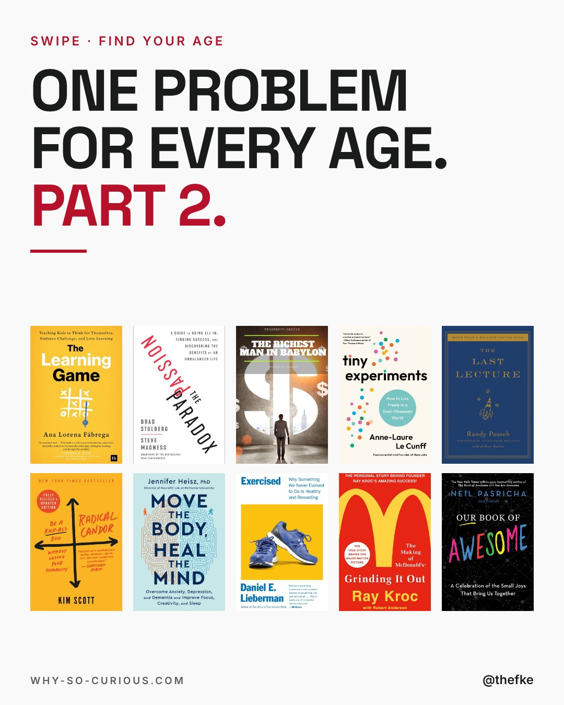
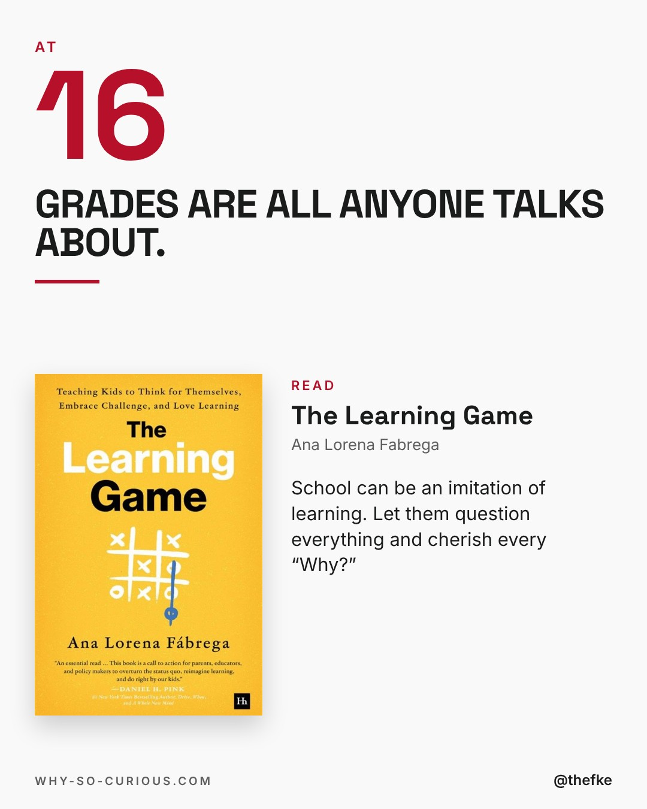
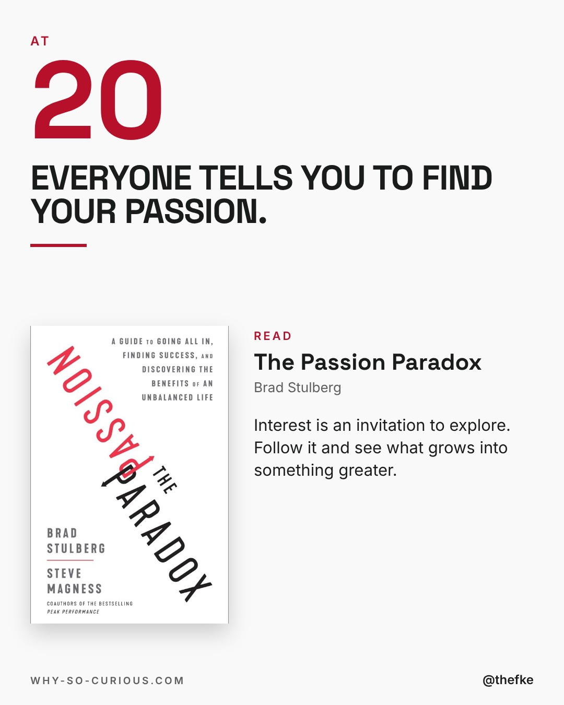
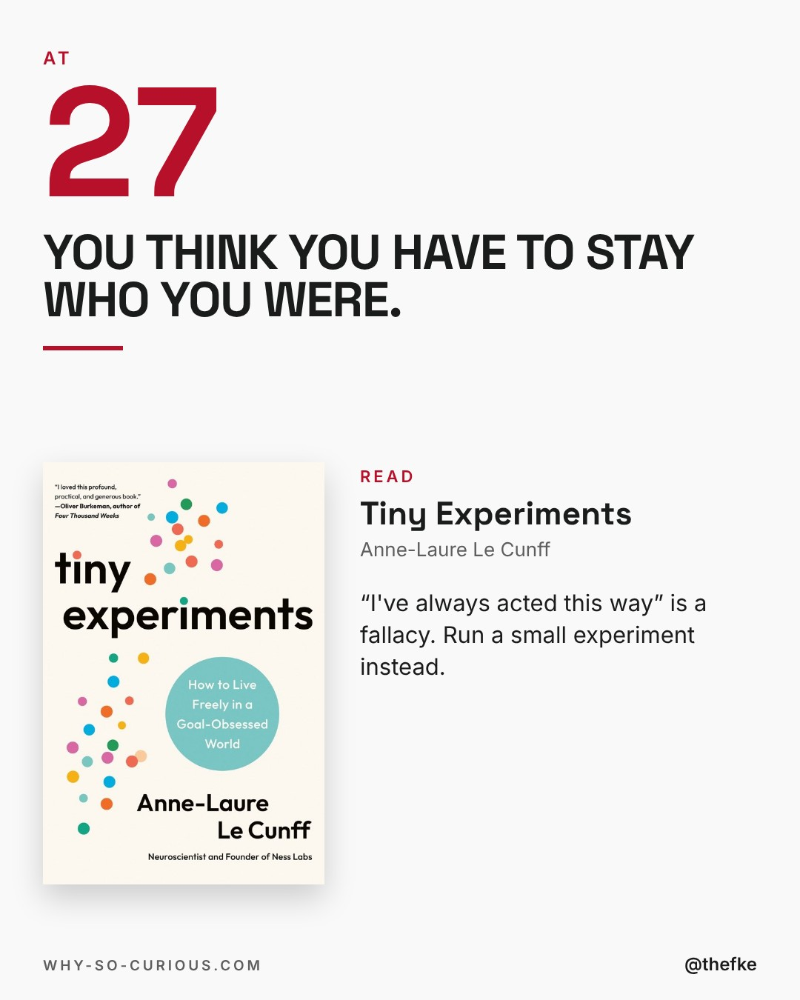
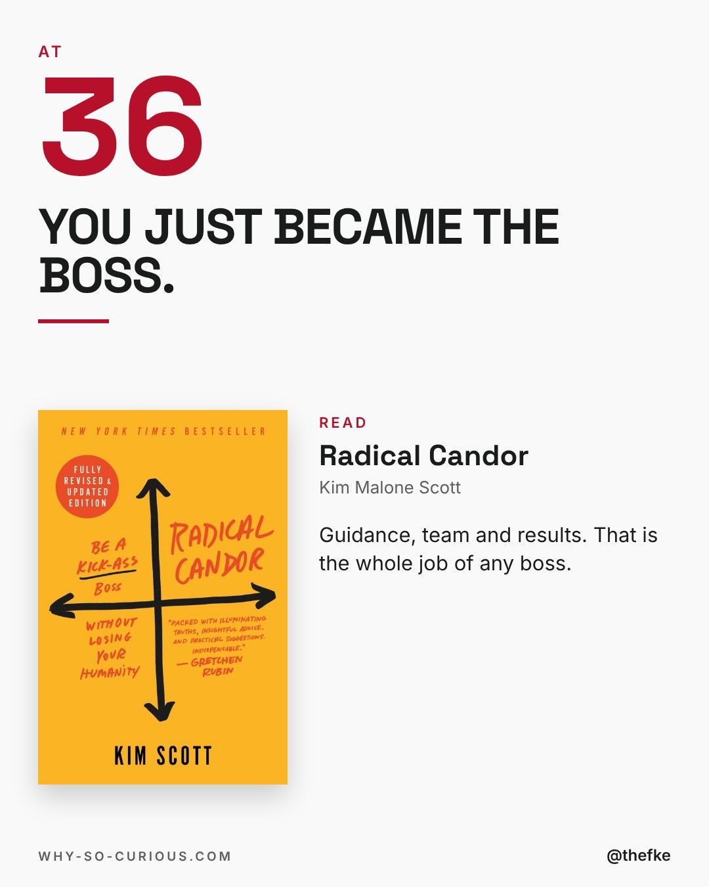
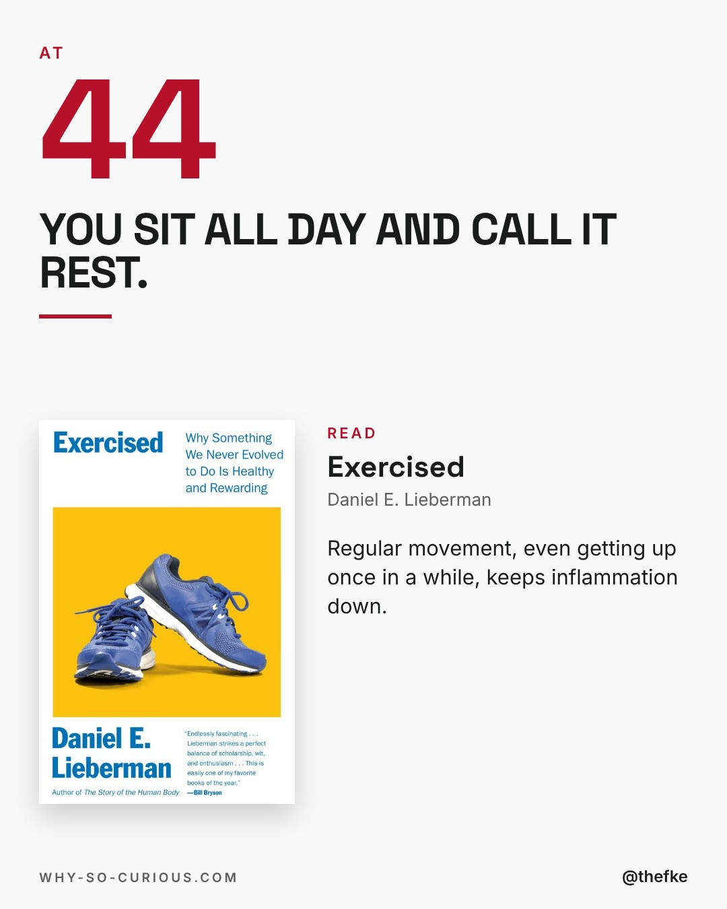
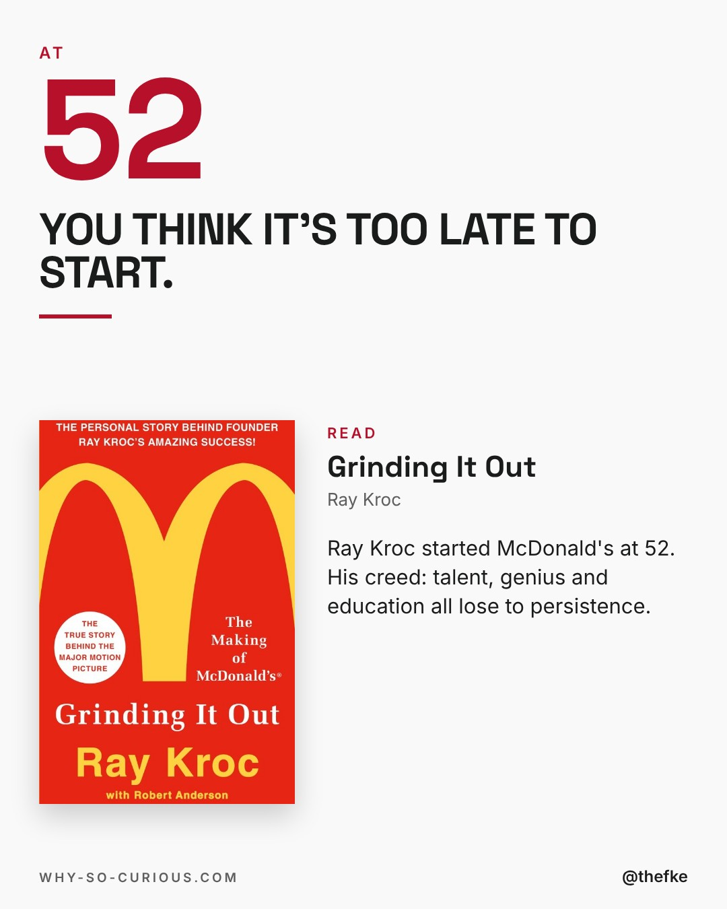
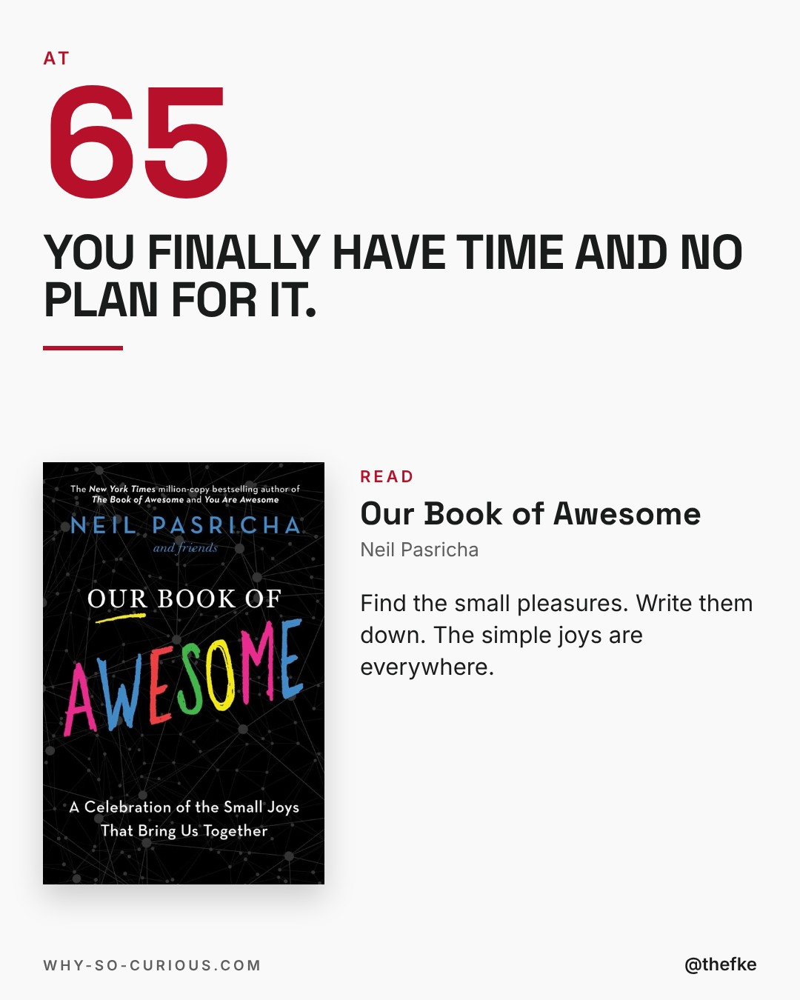
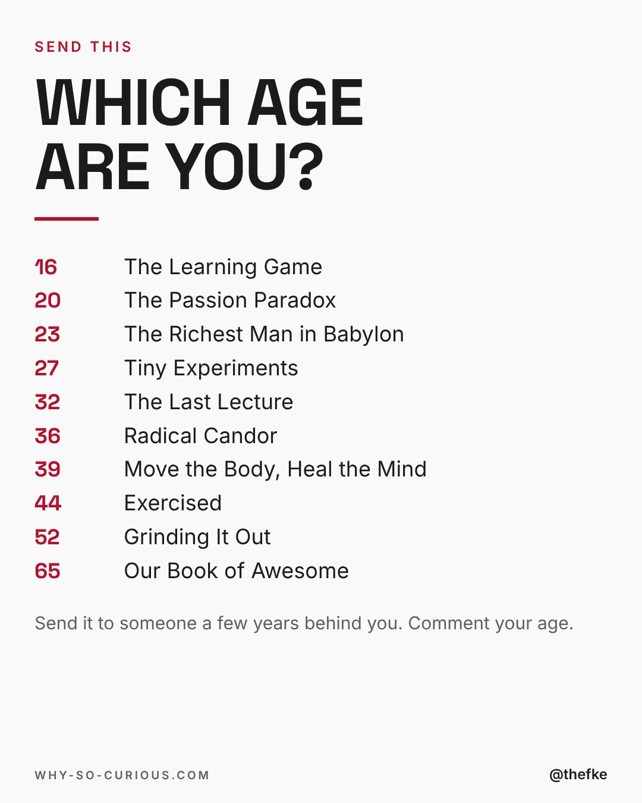

# So 20.12. · One Problem for Every Age, Part 2

Karussell, 12 Slides. Beim Hochladen 4:5 wählen.

## Caption

```
At 23 your first paycheck is gone in a week.
At 36 you're suddenly the boss.
At 65 you finally have time and no plan for it.

One problem for every age, part 2.
One book for each.

At 36 it's Kim Scott in Radical Candor:
“Guidance, team, and results: these are the responsibilities of any boss.”

All from my shelf.

Find yours. Then send it to someone a few years behind you.

Which age are you?

Books from this post: link in bio.

#bookstagram #bookrecommendations #books
```

## Slides













