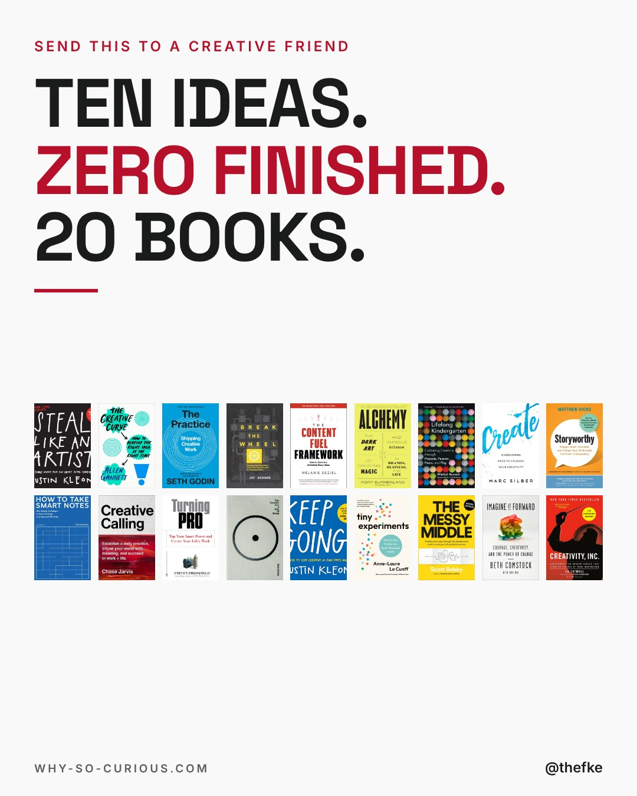
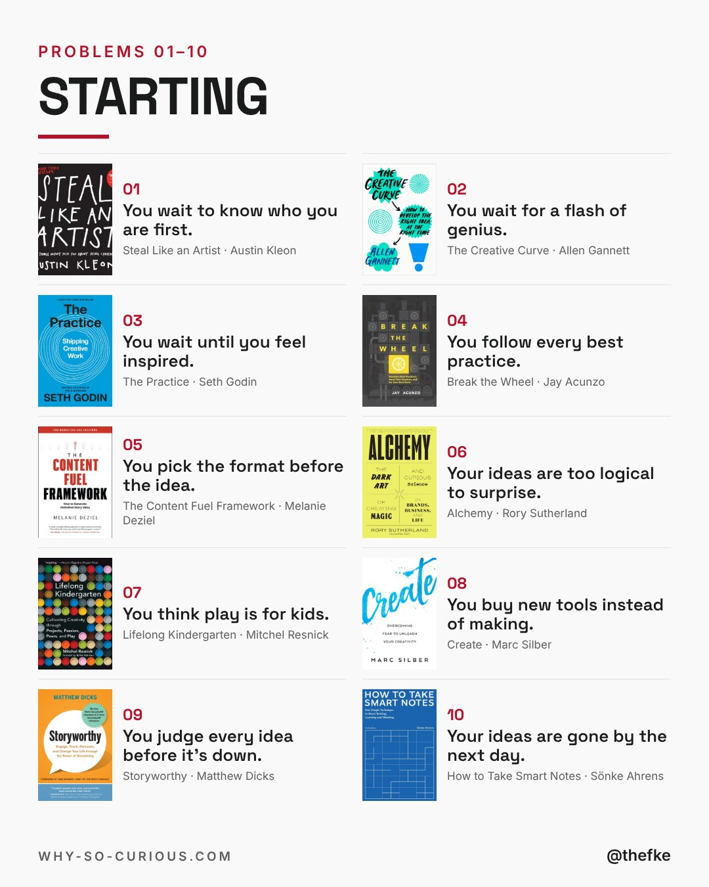
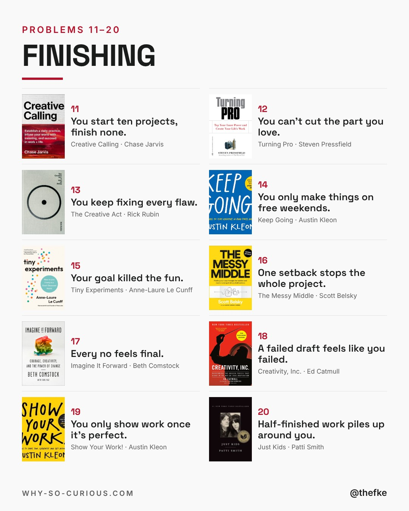
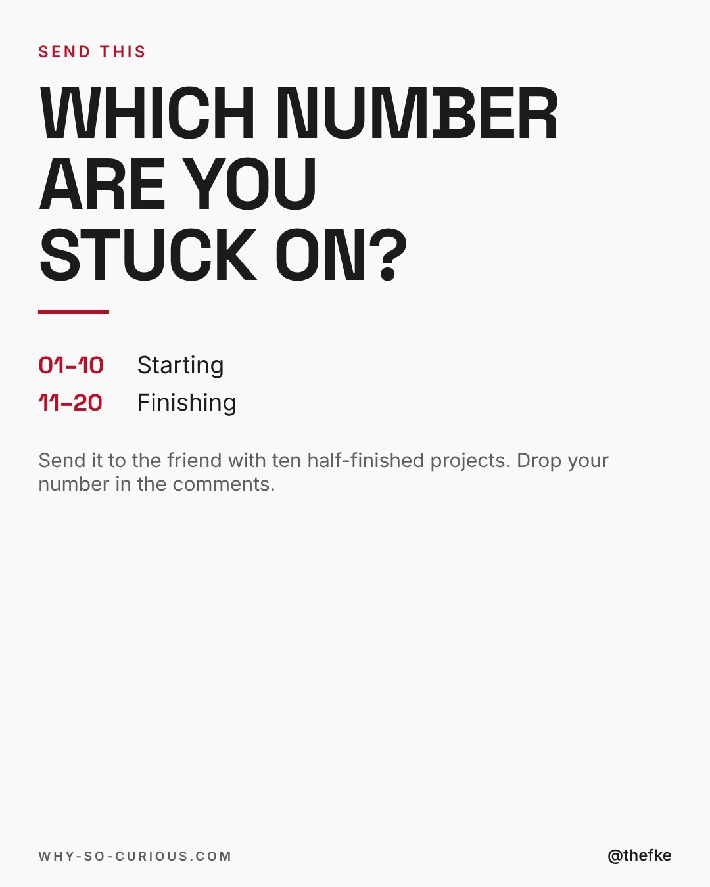

# Mo 21.12. · 20 Creative Problems, 20 Books

Karussell, 4 Slides. Beim Hochladen 4:5 wählen.

## Caption

```
Ten ideas in your notes app.
Zero finished.

20 creative problems.
20 books from my shelf that help.

10 about starting.
10 about finishing.

The iconic song remembered as a flash of genius?
In The Creative Curve, Allen Gannett shows it took Paul McCartney almost twenty months of grueling work.

Send this to the friend with ten half-finished projects.

Which number are you stuck on?

Books from this post: link in bio.

#bookstagram #bookrecommendations #books
```

## Slides





