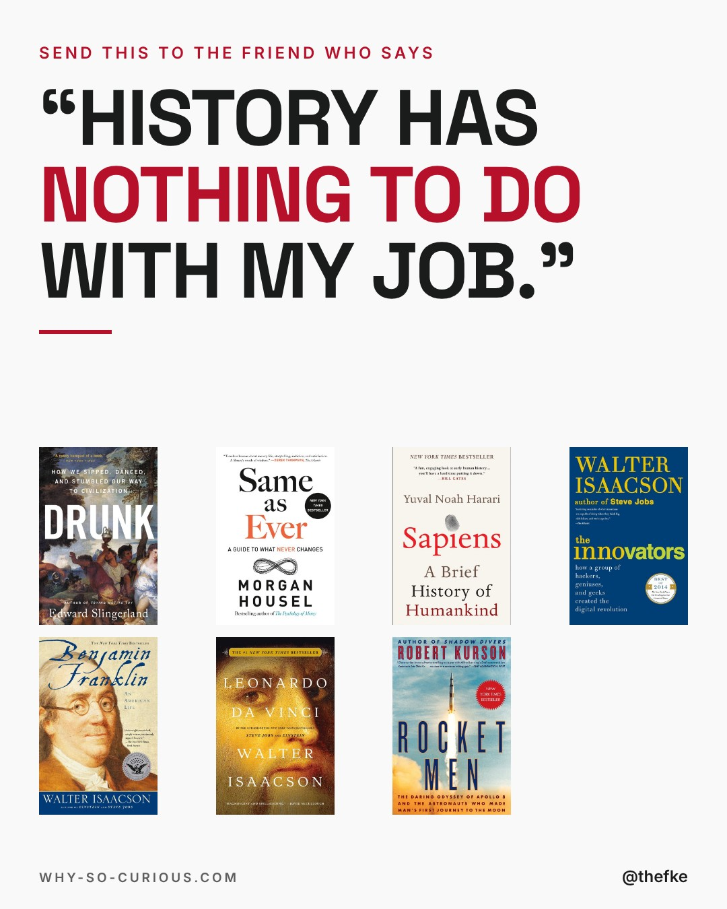
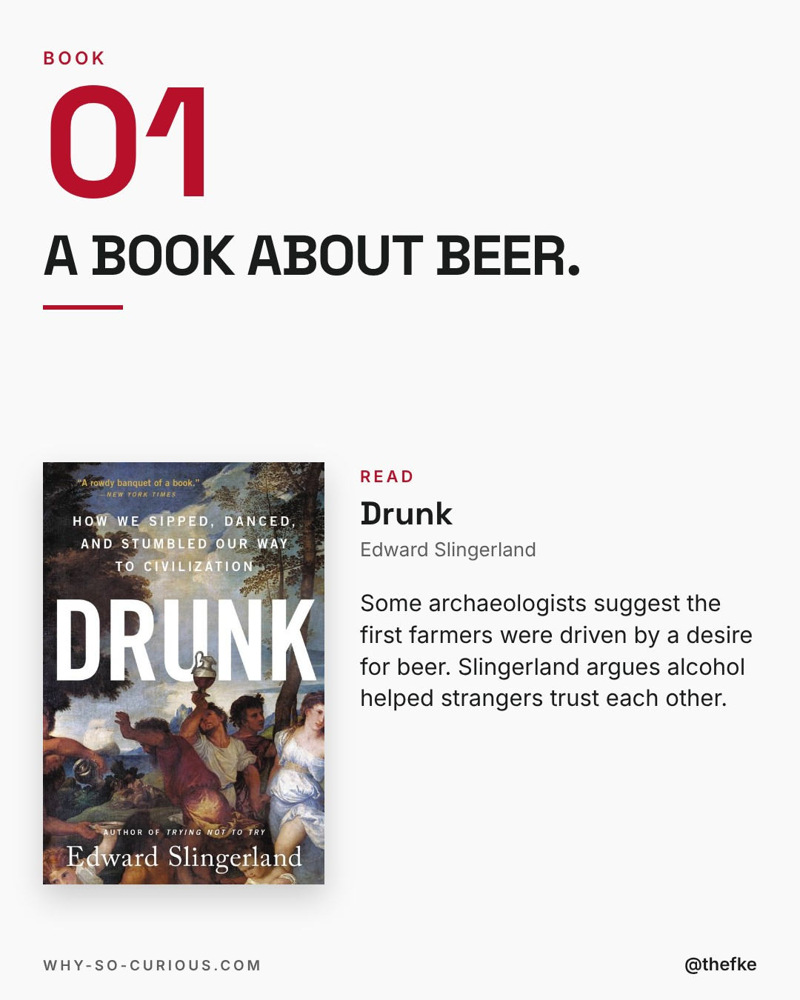
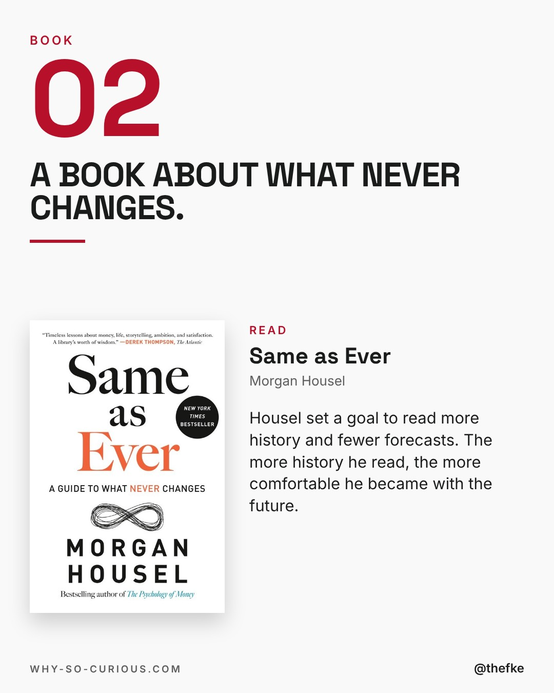
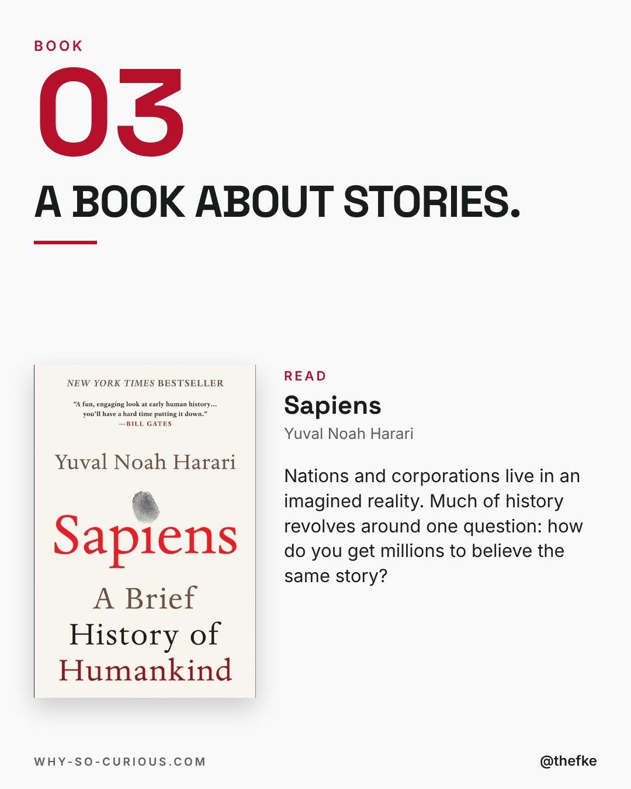
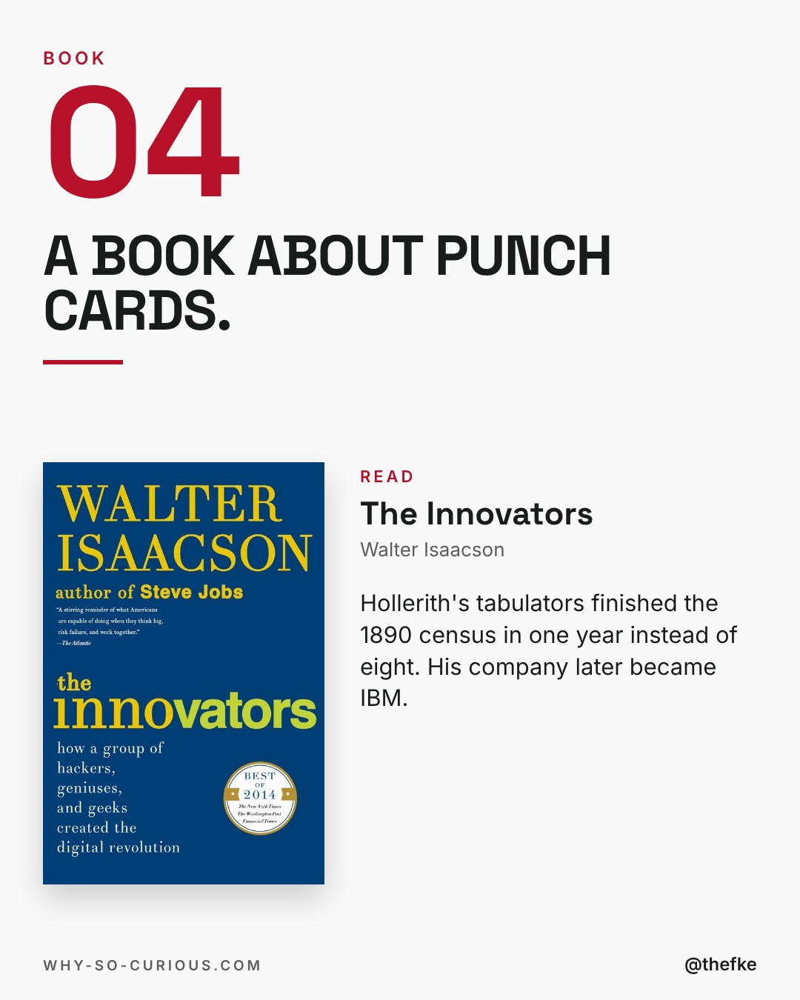
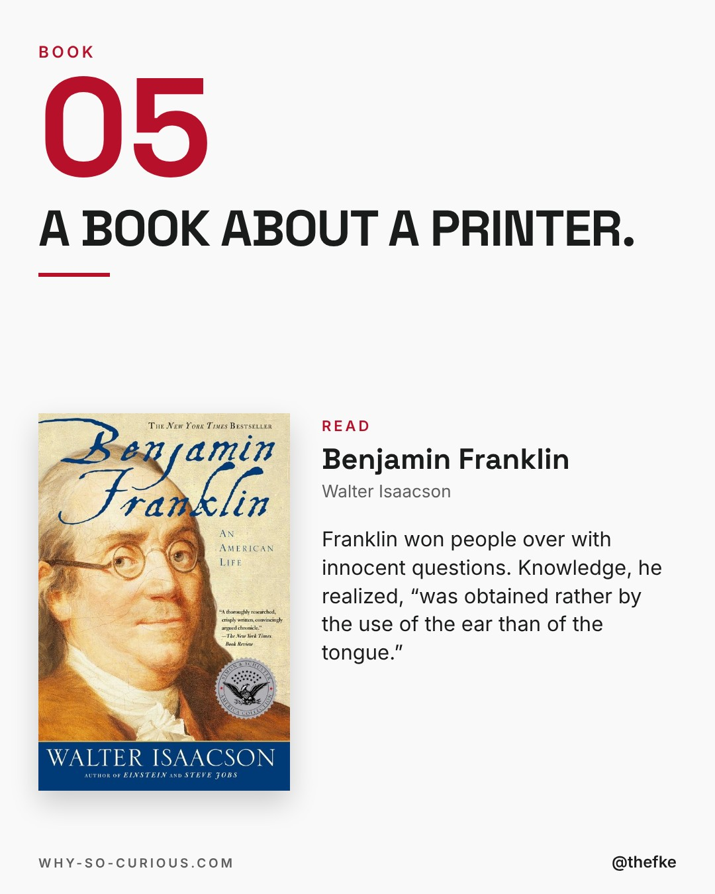
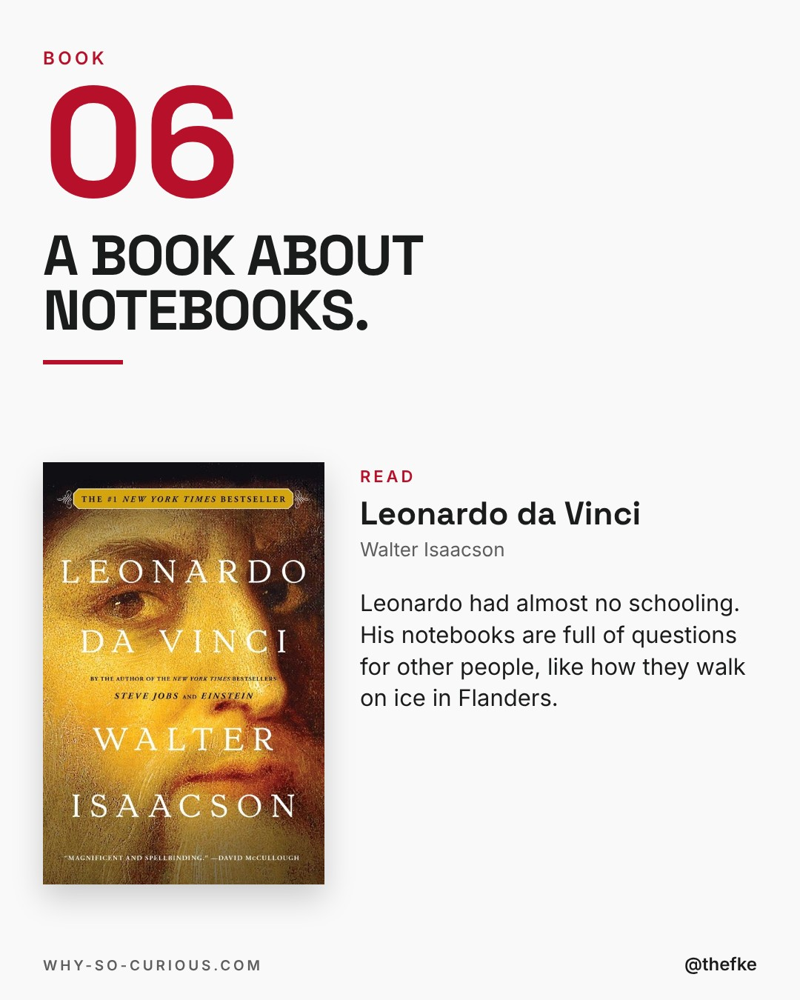
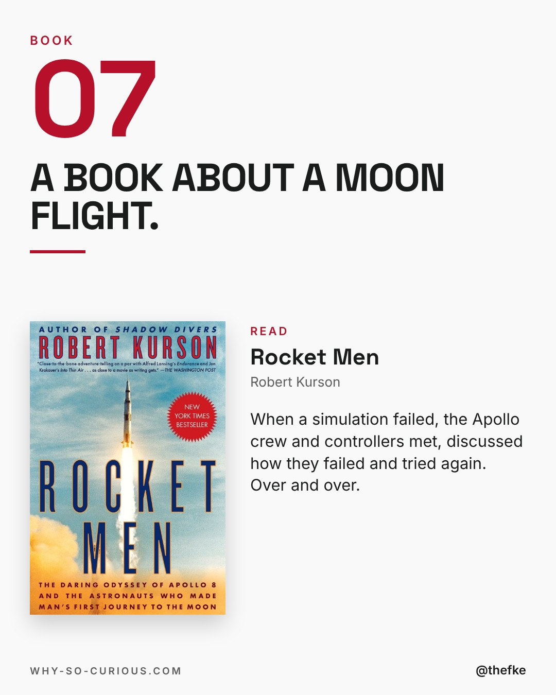
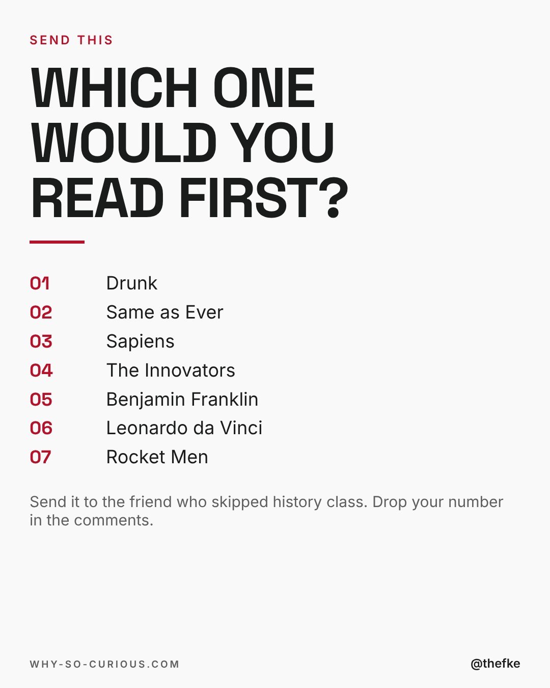

# Mo 21.12. · “History has nothing to do with my job.” Seven books

Früh-Slot, wird automatisch gepostet (ohne Musik). Nicht von Hand posten. Karussell, 9 Slides. Beim Hochladen 4:5 wählen.

## Caption

```
“History has nothing to do with my job.”
Seven books that say otherwise.

Beer. Punch cards. A printer. A Moon flight.
Every one has a lesson for your next meeting.

Morgan Housel set himself a goal to read more history and fewer forecasts.
In Same as Ever he writes:
“the more history I read, the more comfortable I became with the future.”

All from my shelf.

Send this to the friend who skipped history class.

Which one would you read first?

Books from this post: link in bio.

#bookstagram #bookrecommendations #books
```

## Slides










