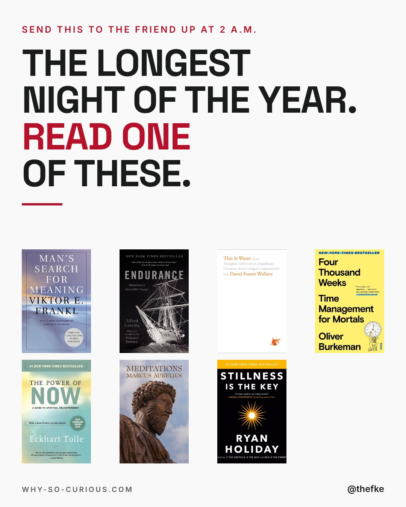
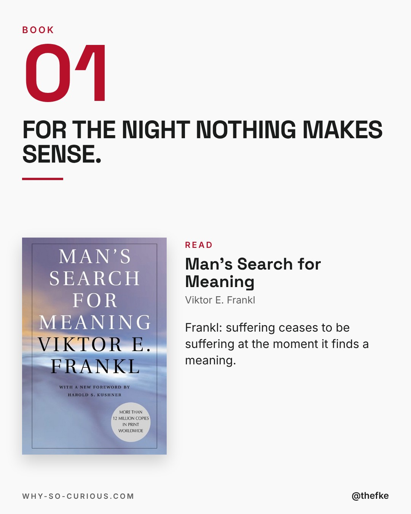
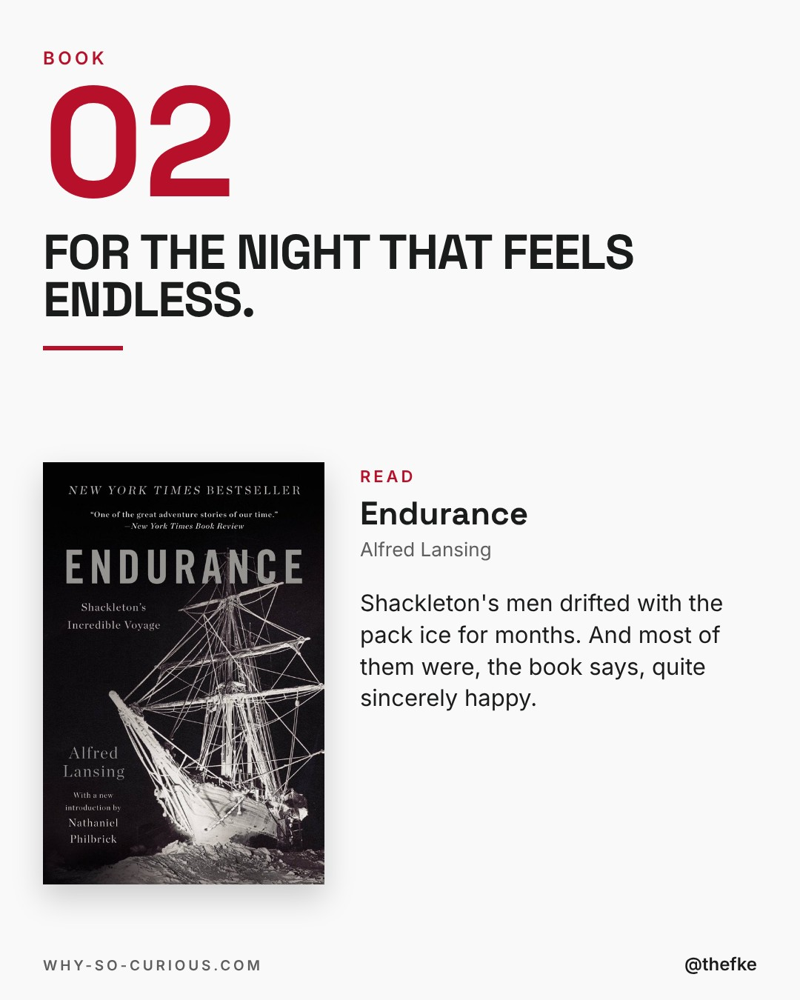
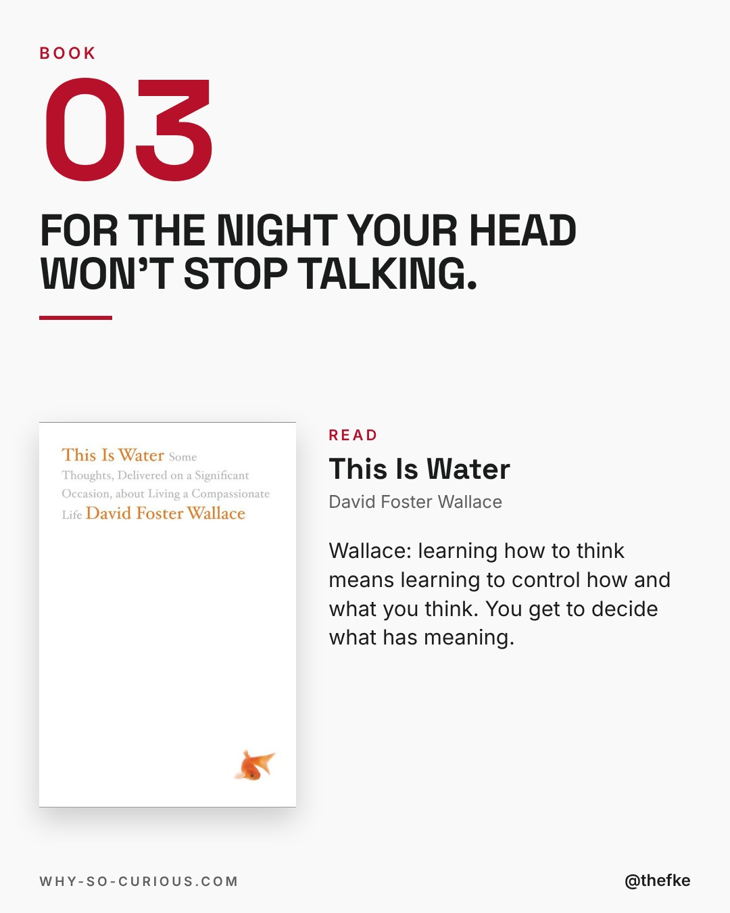
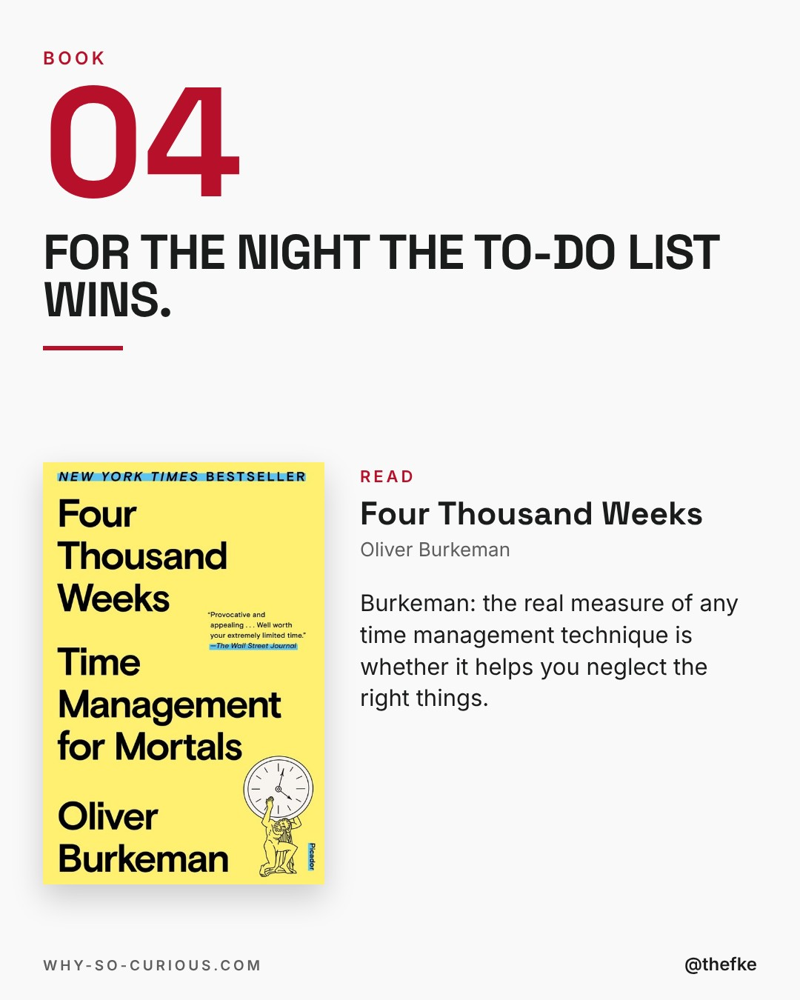
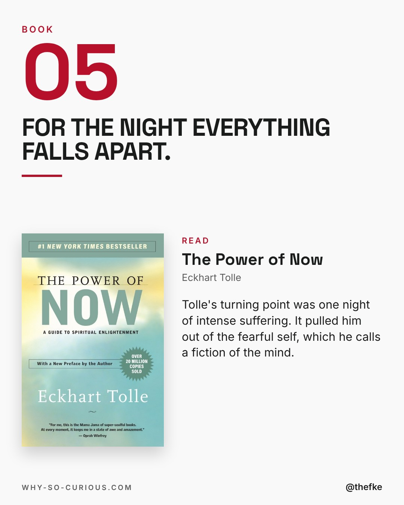
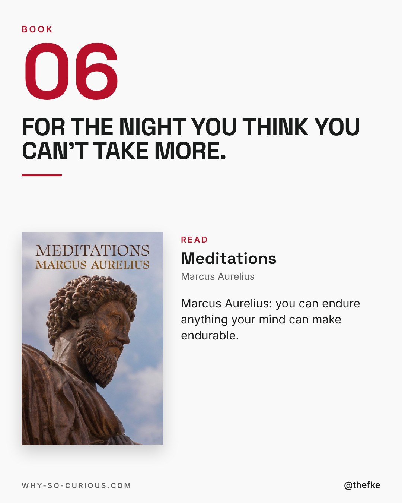
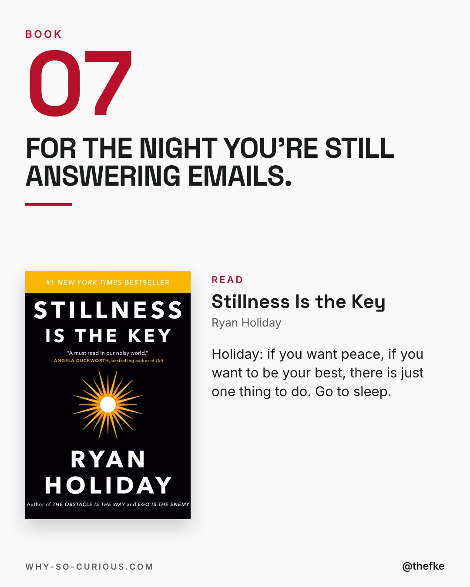
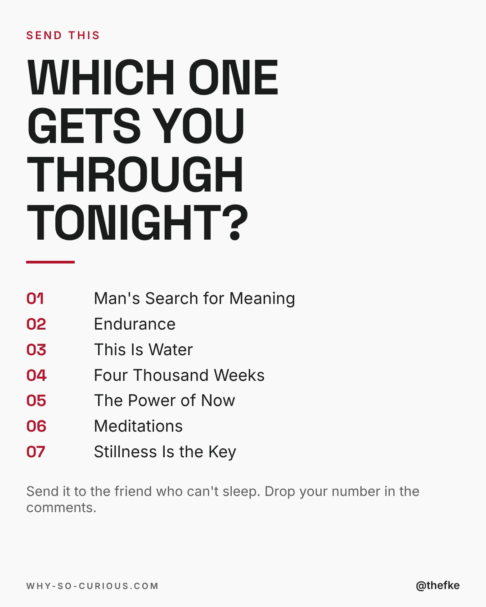

# Mo 21.12. · The longest night of the year. Read one of these

Abend-Slot. Karussell, 9 Slides. Beim Hochladen 4:5 wählen.

## Caption

```
The longest night of the year.
Some nights feel longer than that.

Seven books for the dark hours.
Meaning, stillness, endurance.
And one that just tells you to go to sleep.

Marcus Aurelius, in Meditations:
“you can endure anything your mind can make endurable, by treating it as in your interest to do so.”

All from my shelf.

Send this to the friend who is up at 2 a.m.

Which one gets you through tonight?

Books from this post: link in bio.

#bookstagram #bookrecommendations #books
```

## Slides










