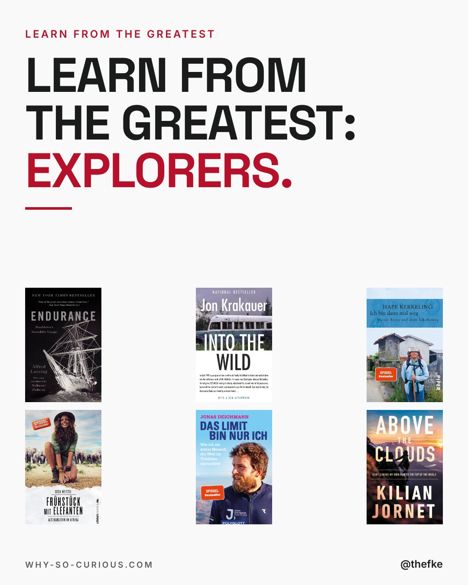
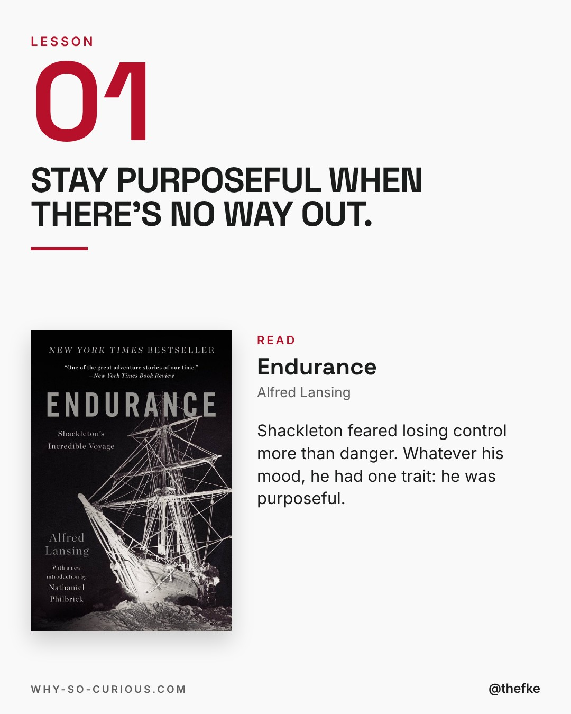
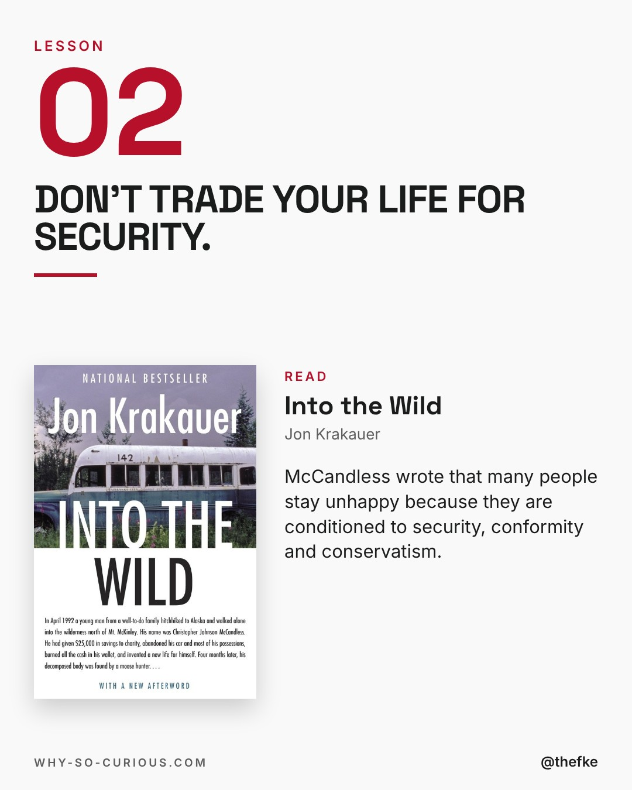
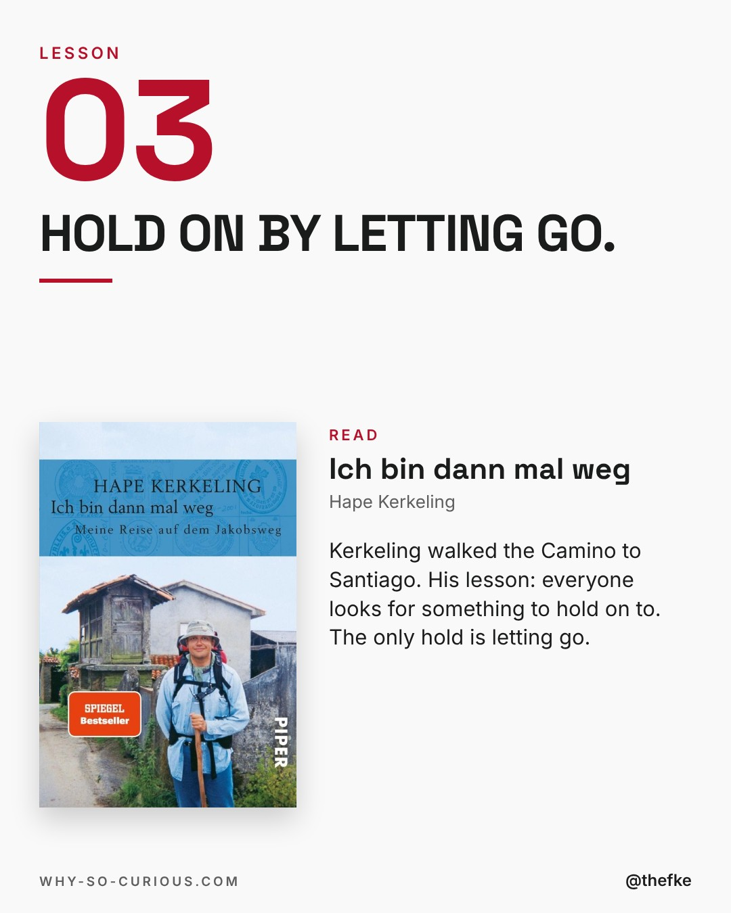
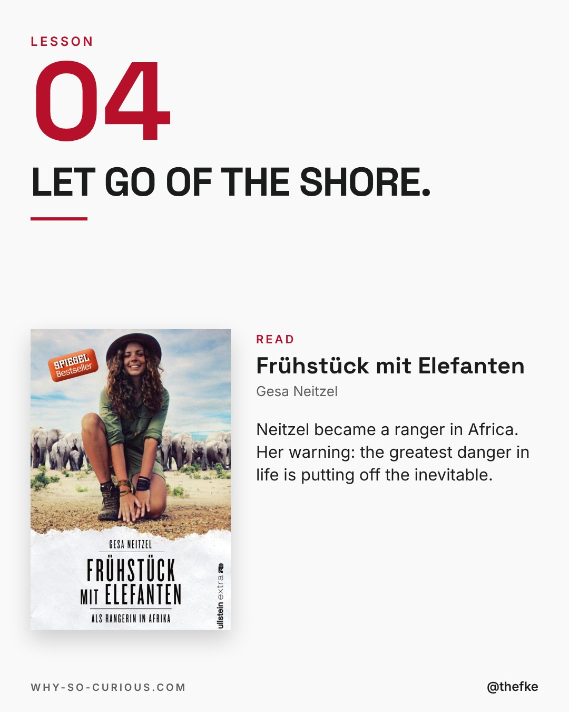
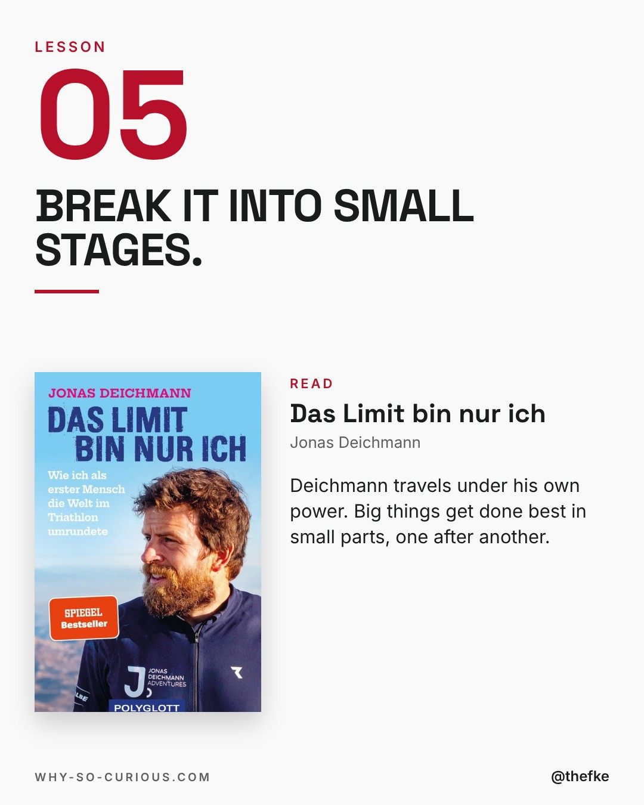
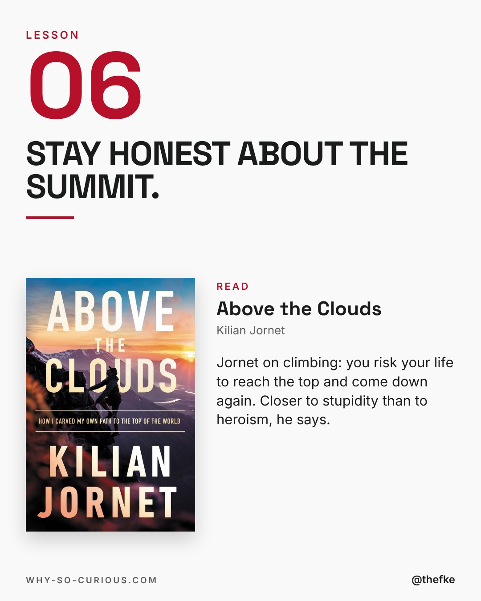
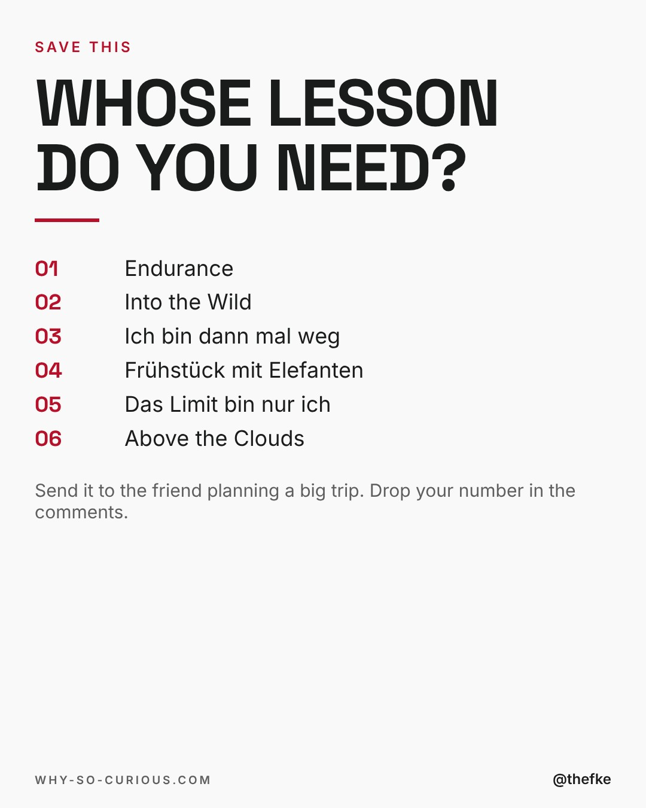

# Di 22.12. · Learn from the Greatest: Explorers

Karussell, 8 Slides. Beim Hochladen 4:5 wählen.

## Caption

```
6 lessons from people who left the map behind.

The Antarctic. The Camino. A ranger job in Africa.
And a climber who calls it closer to stupidity than to heroism.

Hape Kerkeling on the Camino:
“Jeder Mensch sucht nach Halt. Dabei liegt der einzige Halt im Loslassen.”
Everyone looks for something to hold on to. The only hold is letting go.

All from books on my shelf.

Send this to the friend planning a big trip.

Whose lesson do you need?

Books from this post: link in bio.

#bookstagram #bookrecommendations #books
```

## Slides









