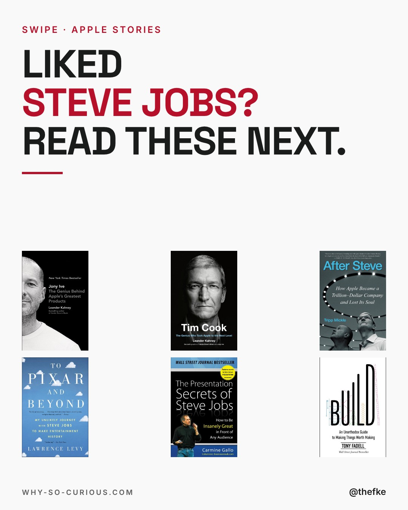
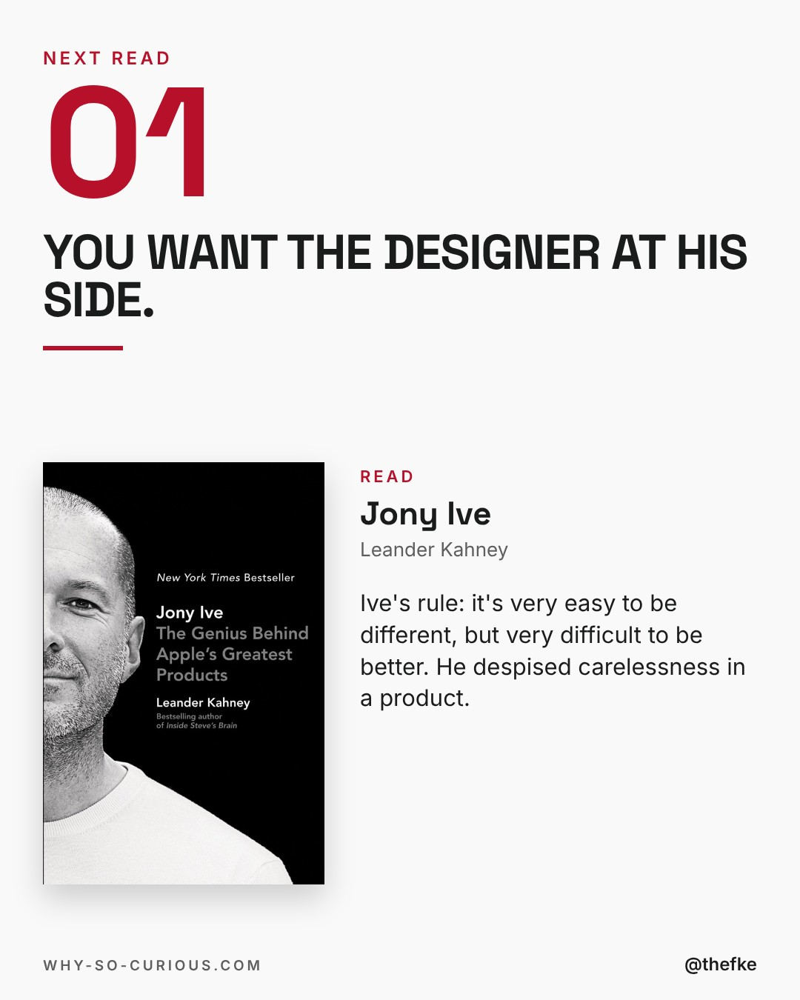
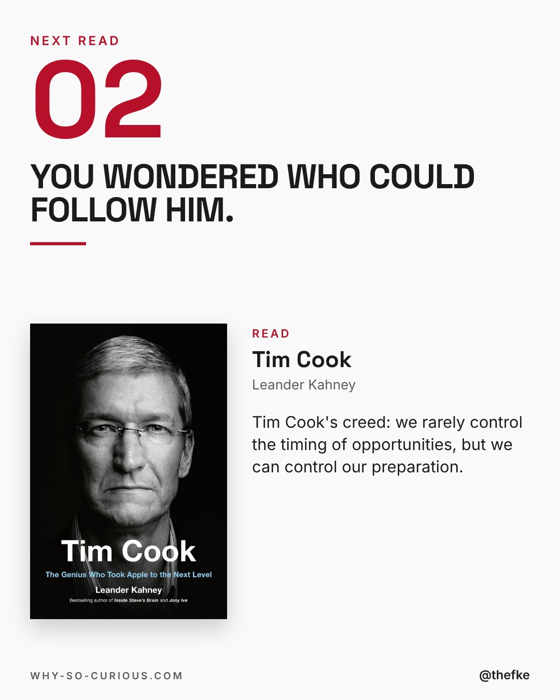
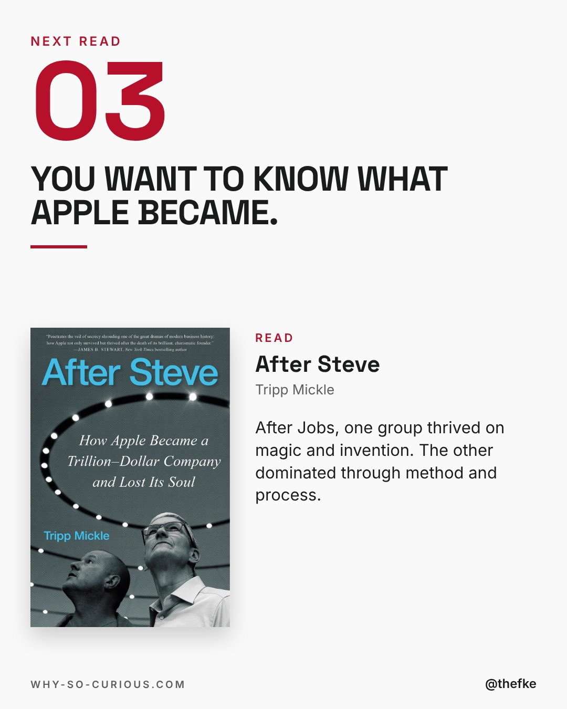
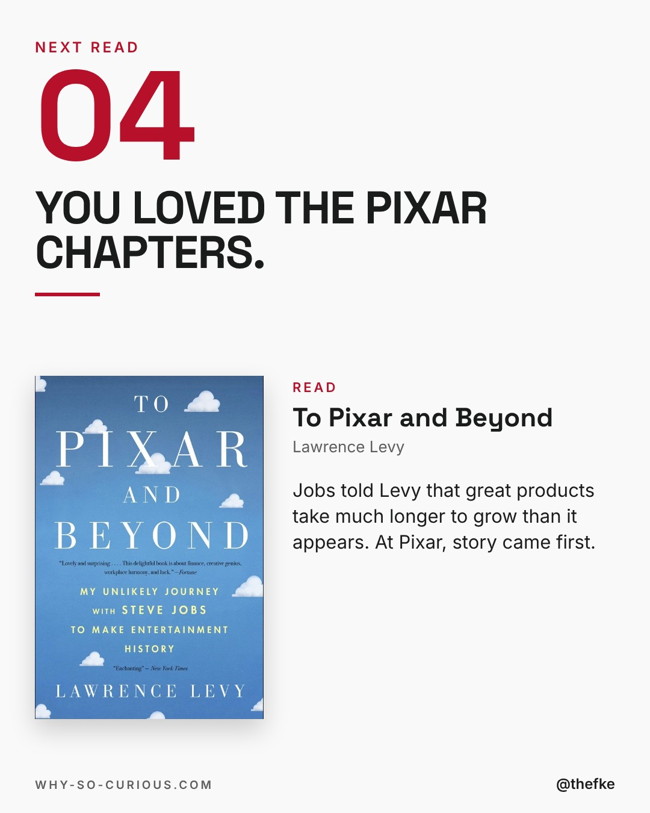
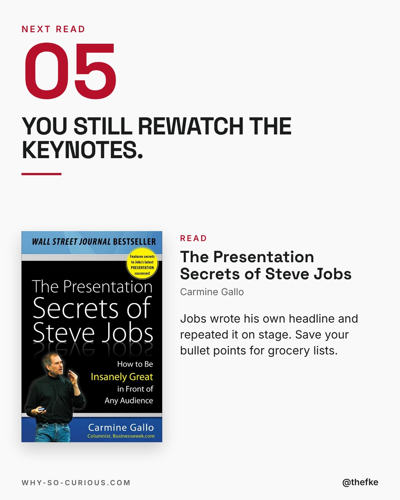
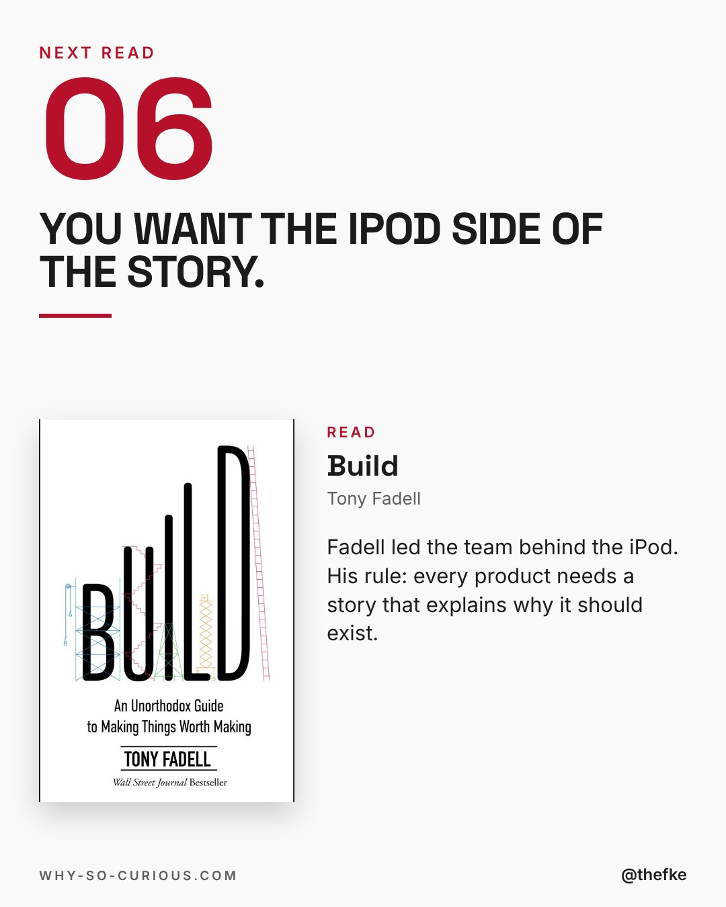
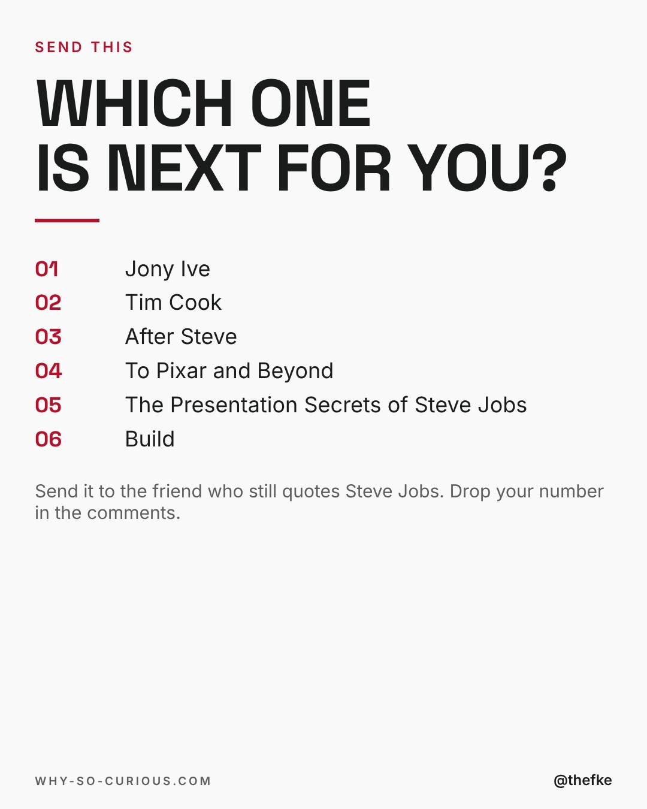

# Mi 23.12. · Liked Steve Jobs? Read these next

Karussell, 8 Slides. Beim Hochladen 4:5 wählen.

## Caption

```
You finished Steve Jobs.
Now you want the rest of the story.

Six books from the people around him.
The designer. The successor. The Pixar years.
The keynotes. The iPod. And what Apple became.

One detail from Tim Cook by Leander Kahney.
A colleague on working for Cook:
“He’ll ask you ten questions. […] If you answer them right, he’ll ask you ten more.”

All from my shelf.

Send this to the friend who still quotes Steve Jobs.

Which one is next for you?

Books from this post: link in bio.

#bookstagram #bookrecommendations #books
```

## Slides









