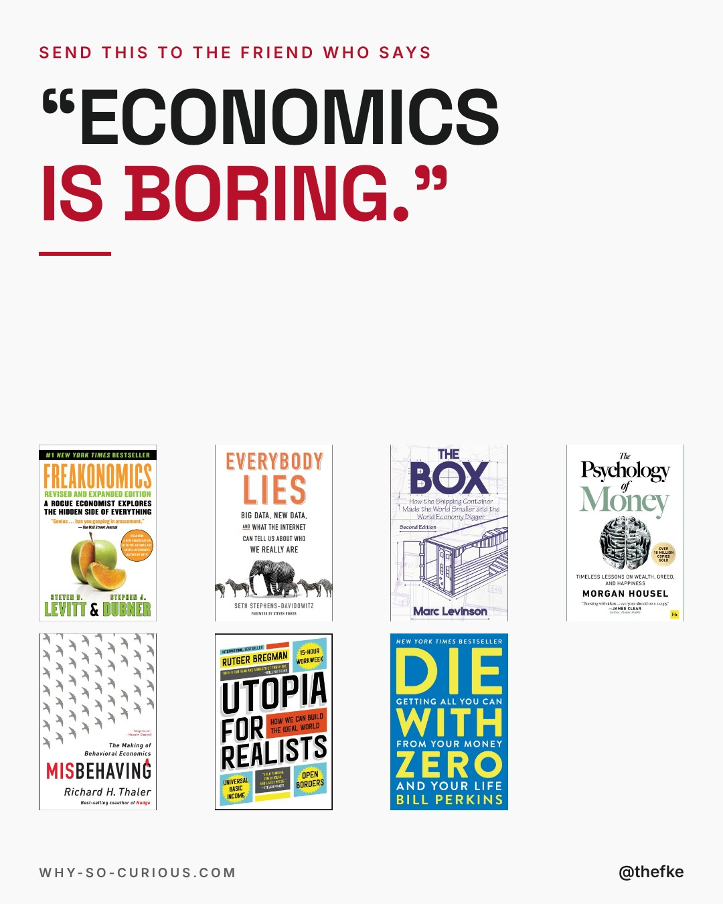
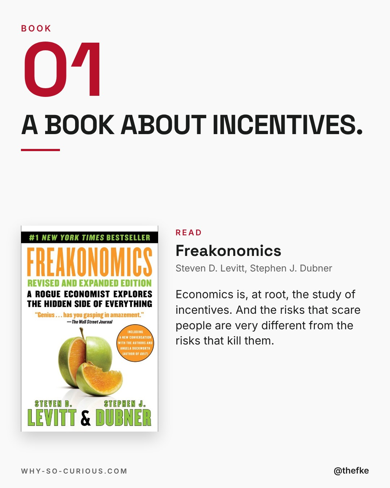
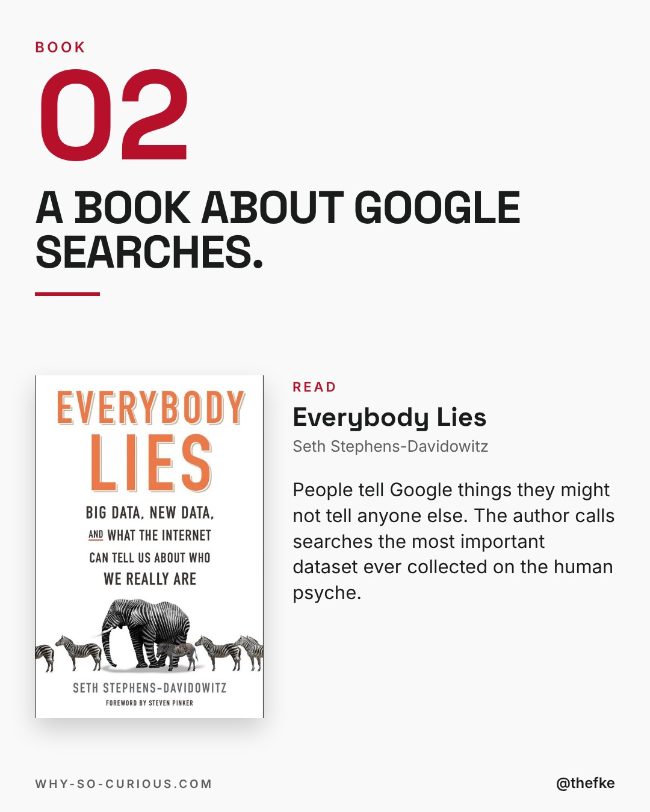
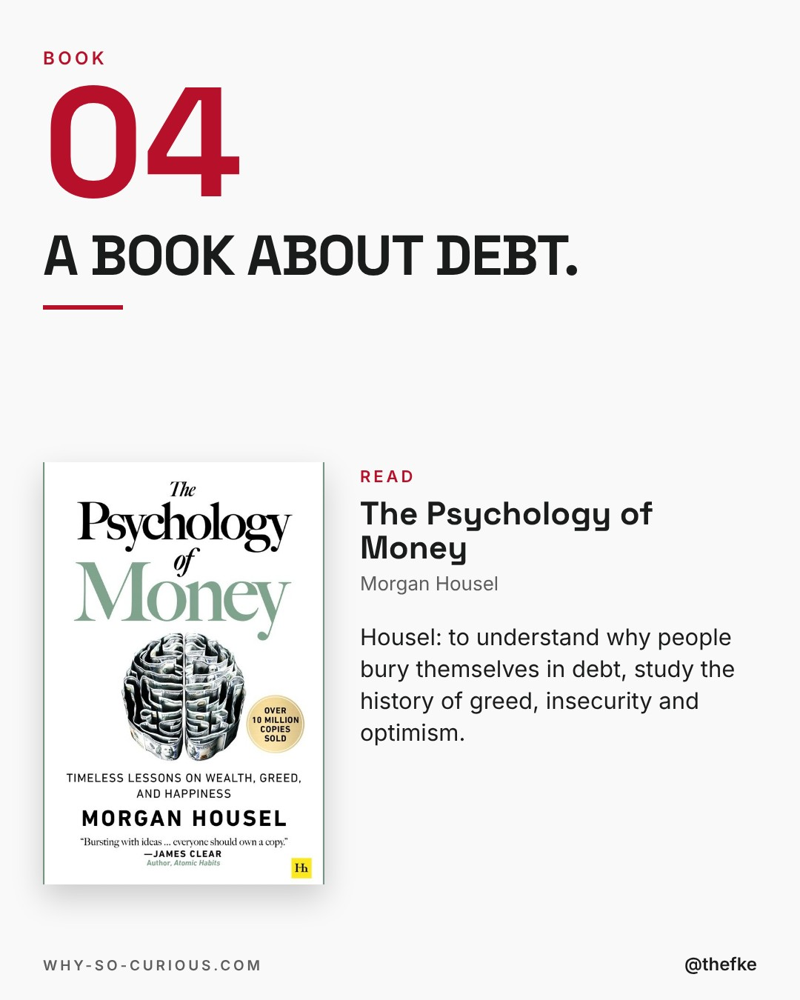
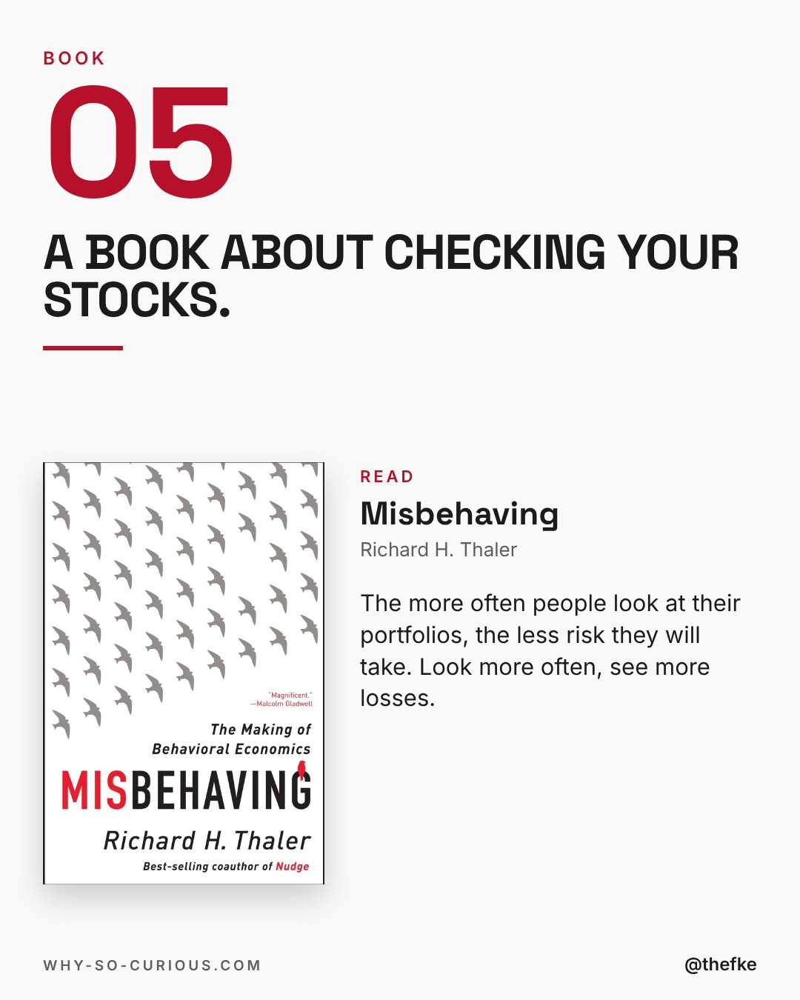
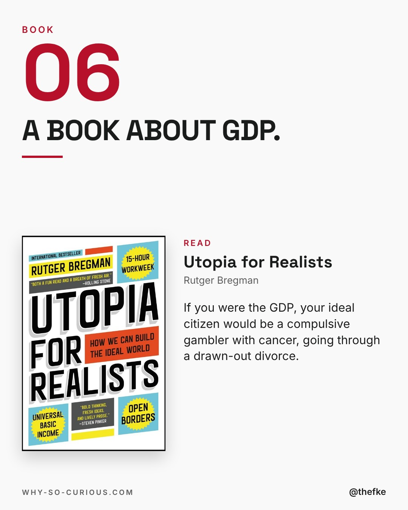
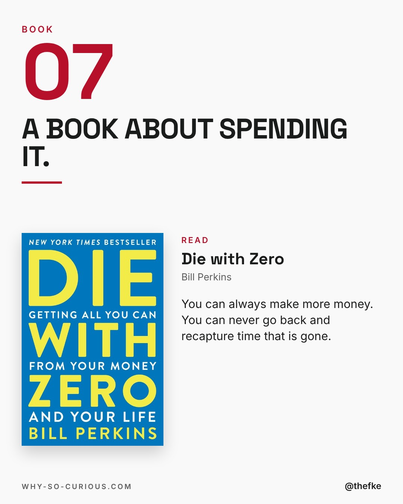
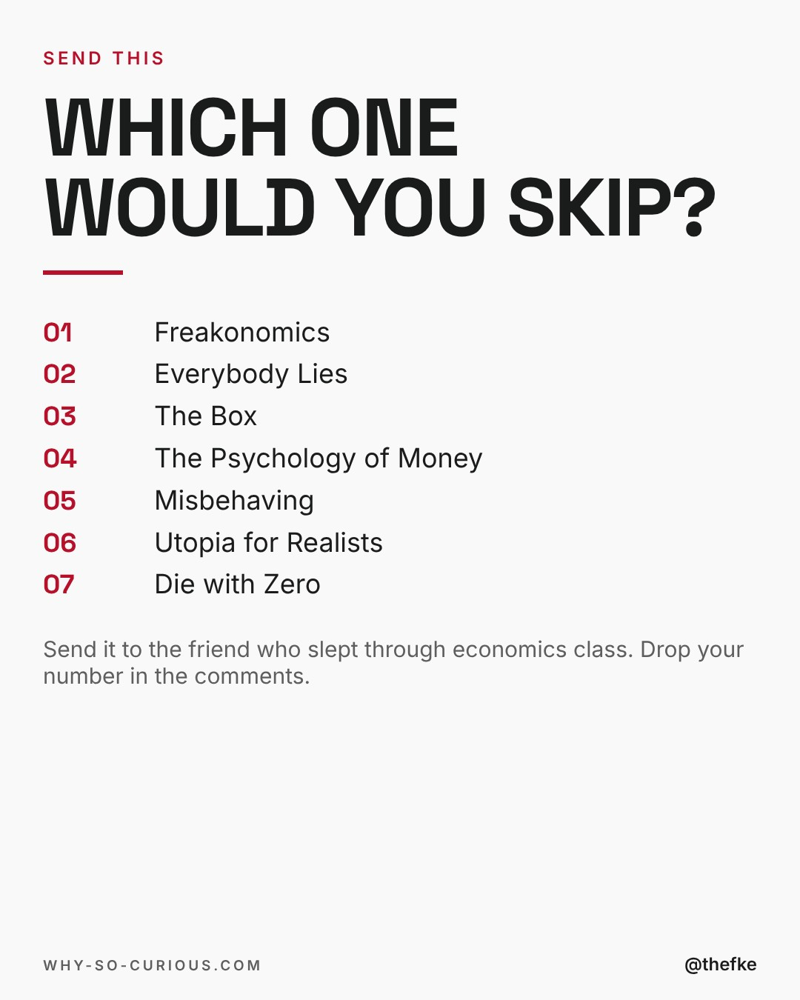

# Mi 23.12. · “Economics is boring.” Seven books that disagree

Früh-Slot, wird automatisch gepostet (ohne Musik). Nicht von Hand posten. Karussell, 9 Slides. Beim Hochladen 4:5 wählen.

## Caption

```
“Economics is boring.”
Seven books that prove the opposite.

Google searches. A metal box. Debt. Your stock app.
Open them and every one has a detail you'll repeat at dinner.

The wildest one is in Utopia for Realists by Rutger Bregman.
If you were the GDP, your ideal citizen would be a compulsive gambler with cancer, going through a drawn-out divorce.

Steven D. Levitt and Stephen J. Dubner in Freakonomics:
“Economics is, at root, the study of incentives: how people get what they want, or need, especially when other people want or need the same thing.”

All from my shelf.

Send this to the friend who slept through economics class.

Which one would you skip?

Books from this post: link in bio.

#bookstagram #bookrecommendations #books
```

## Slides










