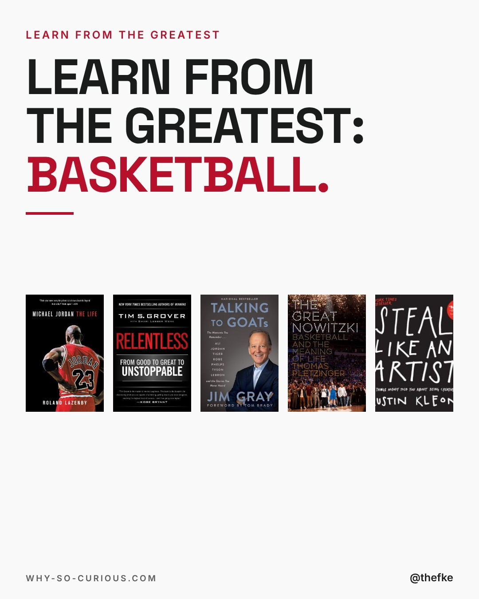
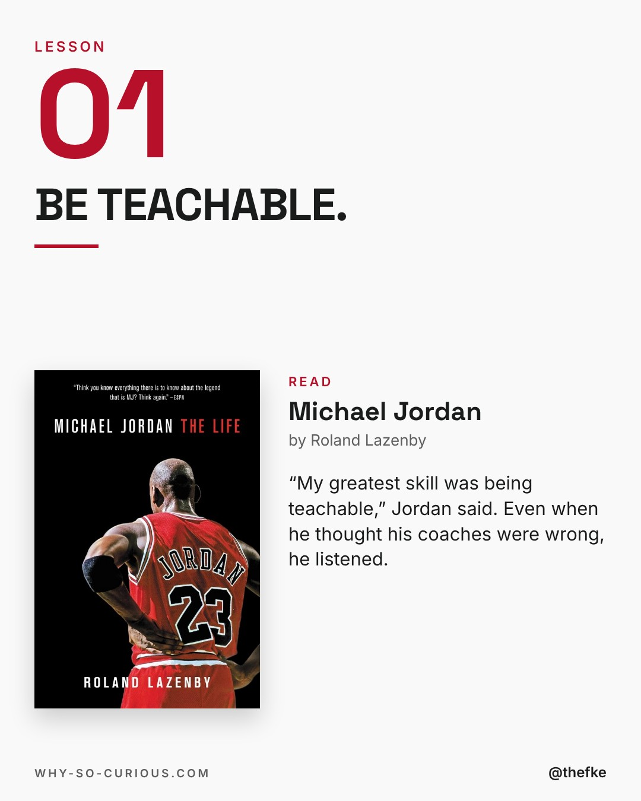
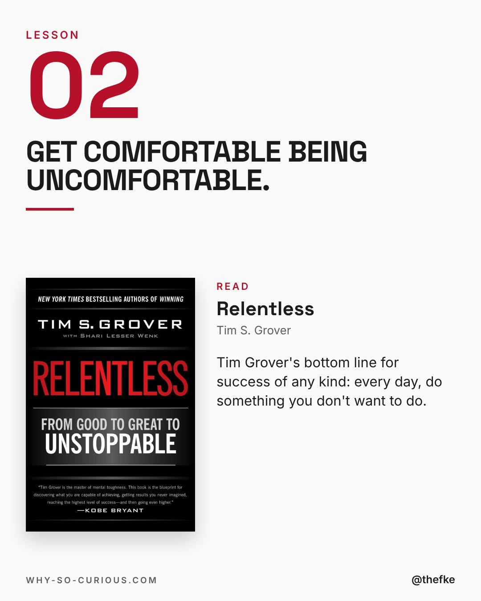
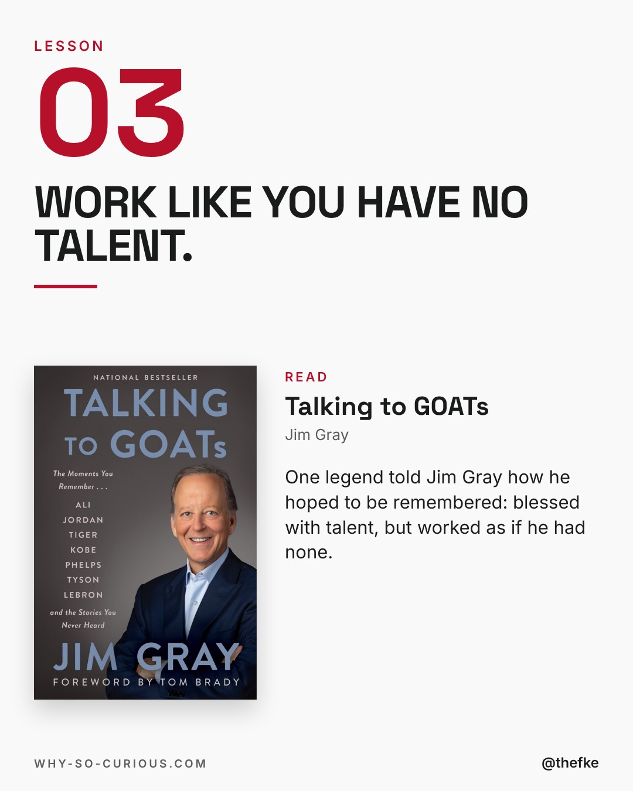
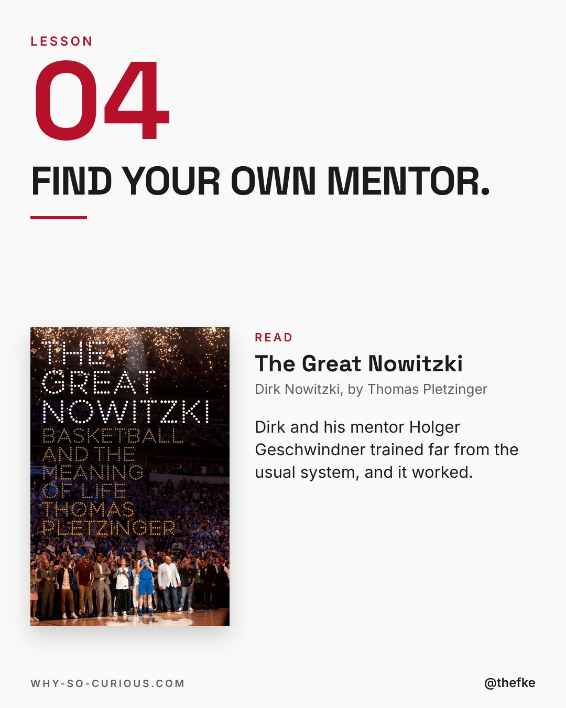
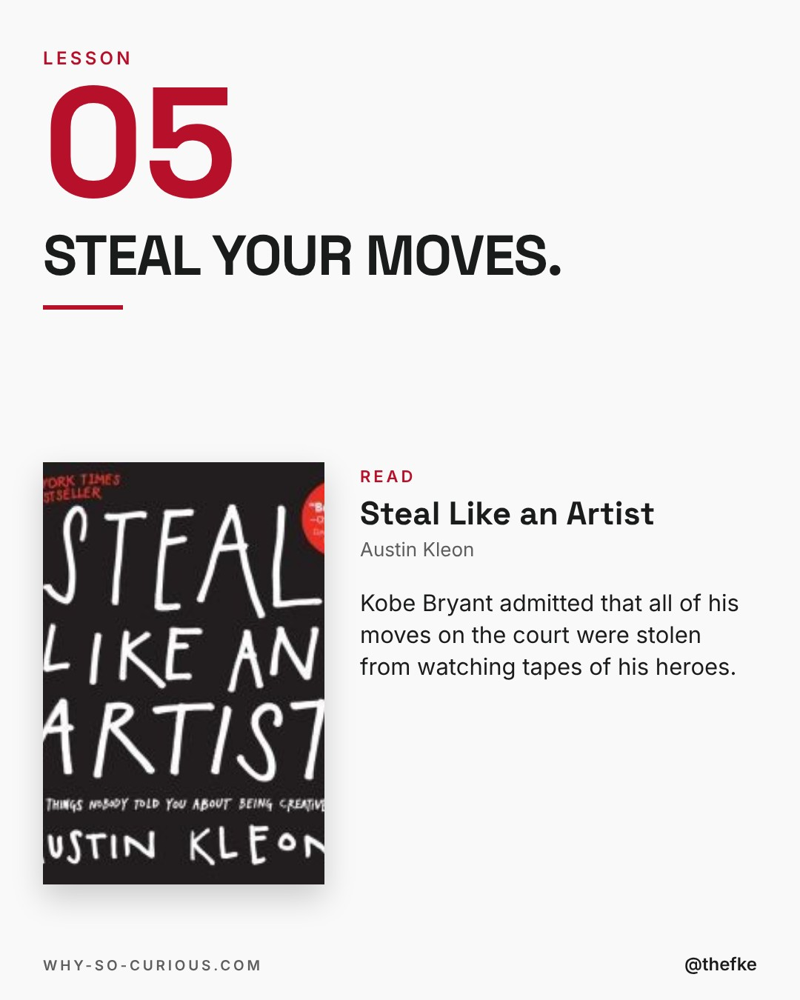
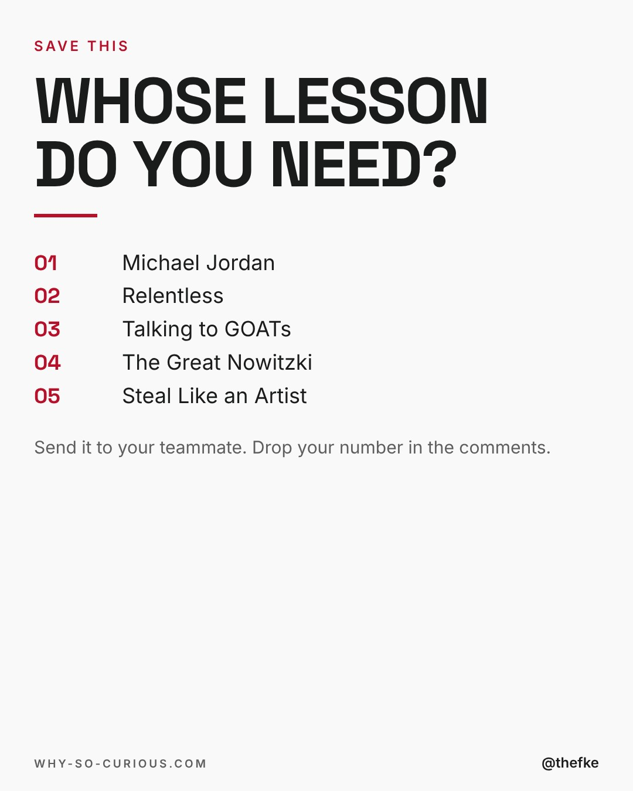

# Mi 23.12. · Learn from the Greatest: Basketball

Abend-Slot. Karussell, 7 Slides. Beim Hochladen 4:5 wählen.

## Caption

```
5 lessons from basketball.

Jordan. Kobe. Dirk.
And Tim Grover on what relentless means.

Michael Jordan in Roland Lazenby's biography:
“My greatest skill was being teachable. I was like a sponge. Even if I thought my coaches were wrong, I tried to listen and learn something.”

All from books on my shelf.

Send this to your teammate.

Whose lesson do you need?

Books from this post: link in bio.

#bookstagram #bookrecommendations #books
```

## Slides








