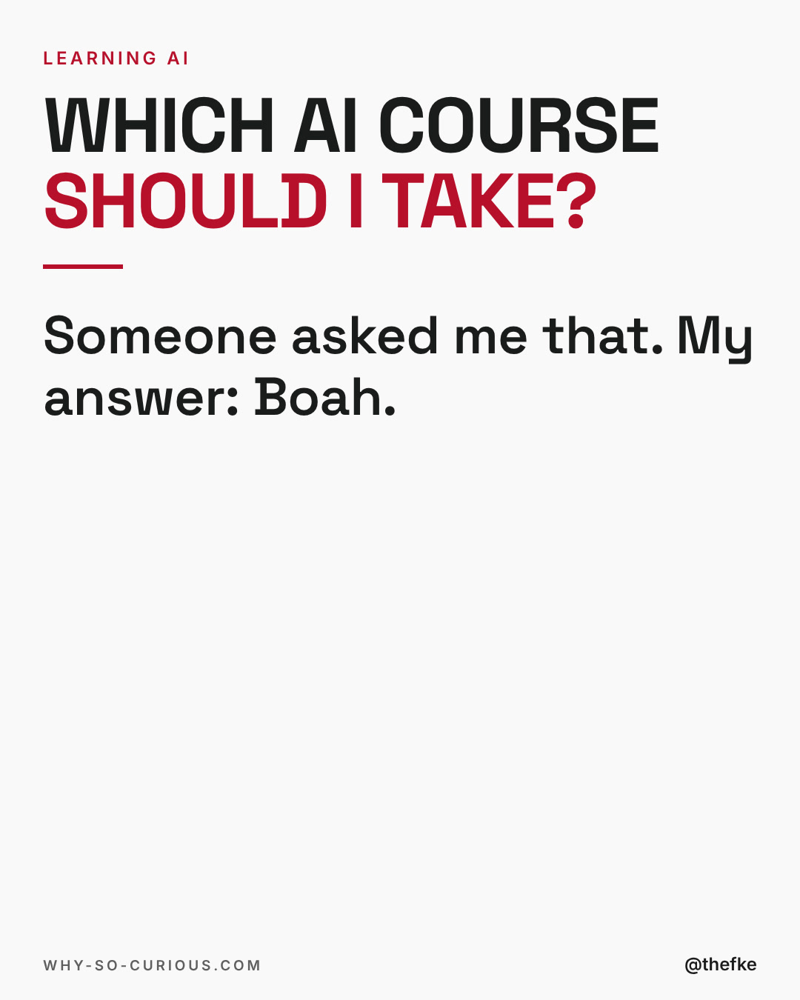
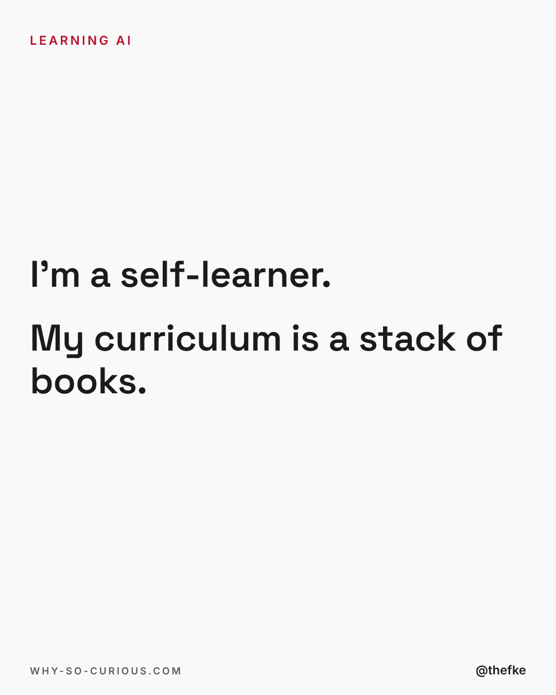
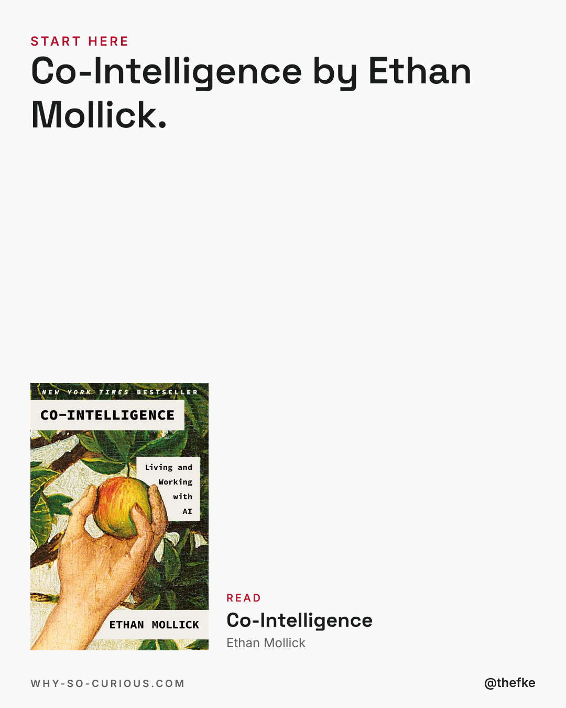
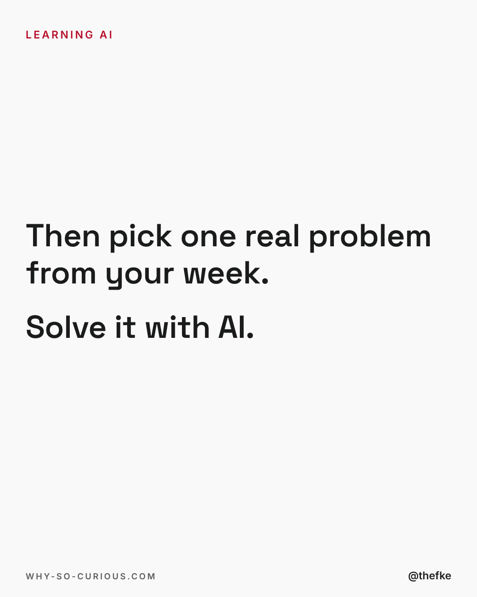
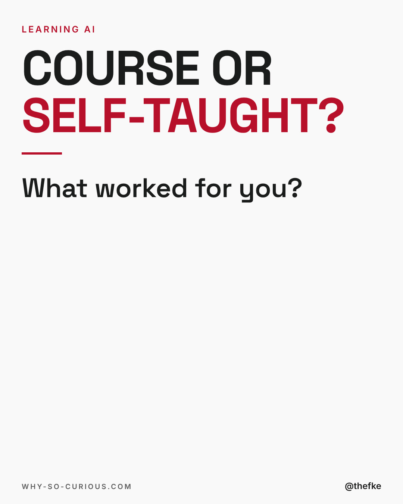

# Mi 23.12. · Which AI course should I take?

Karussell, 5 Slides. Beim Hochladen 4:5 wählen.

Abend-Slot 19 bis 20 Uhr MEZ, Format-Test Story-Karussell: Text-Slides statt Bücherraster, mittwochs bis 23.12. Mo und Fr bleiben für die Formate aus dem Hotel-Dreh.

Quelle: `thomas-hefke-os/knowledge/06-content/posts/`, gebaut mit `wsc-web/tools/social/story.mjs`.

## Caption

```
After my dmexco talk, a DM came in:
“Which AI course would you recommend?”

My first answer: Boah.
I’m a self-learner.

My curriculum is a stack of books.
Start with Co-Intelligence by Ethan Mollick.
Then take one real problem from your week and solve it with AI.

Course or self-taught: what actually worked for you?

#books #bookstagram #bookrecommendations #reading #thefke #booklover #whysocurious
```

## Slides






