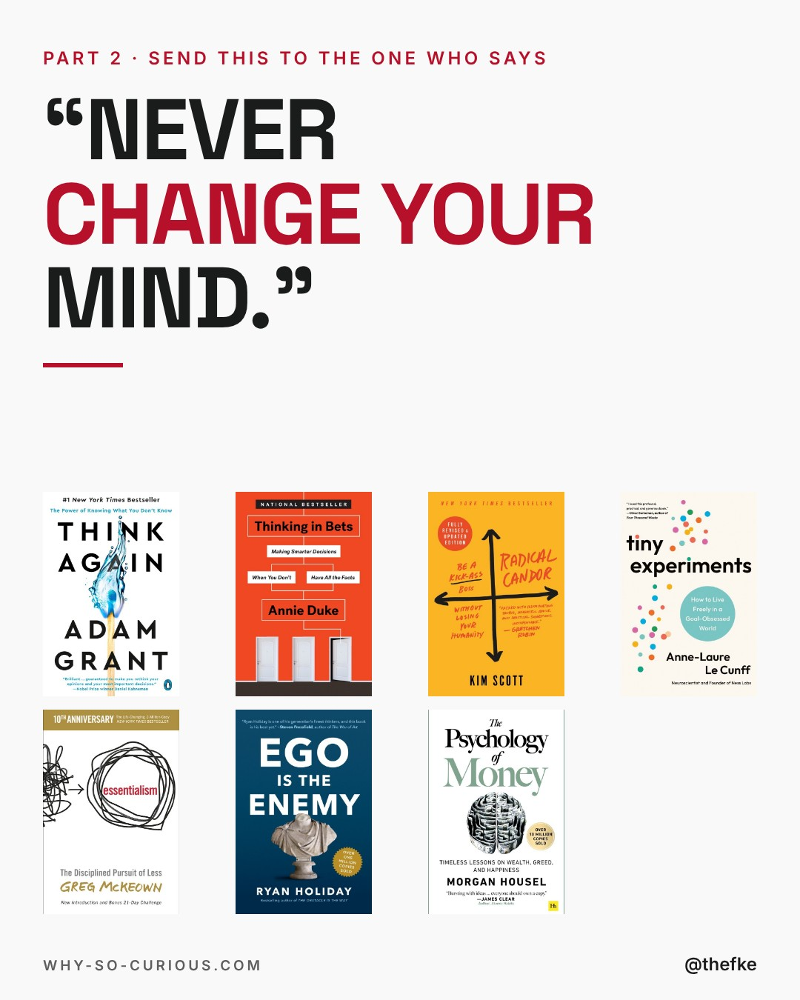
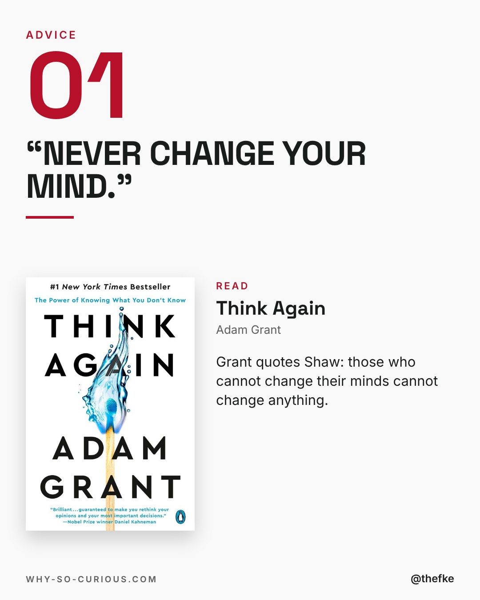
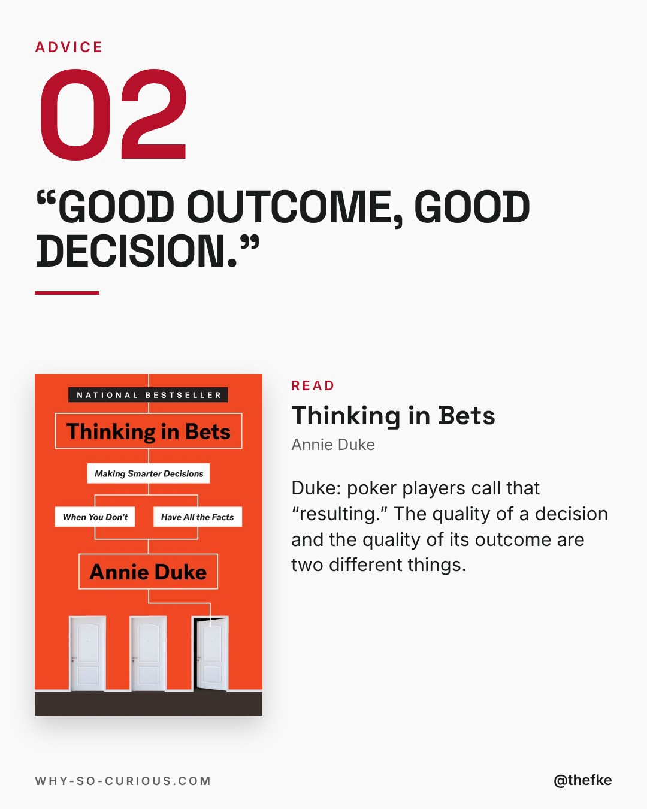
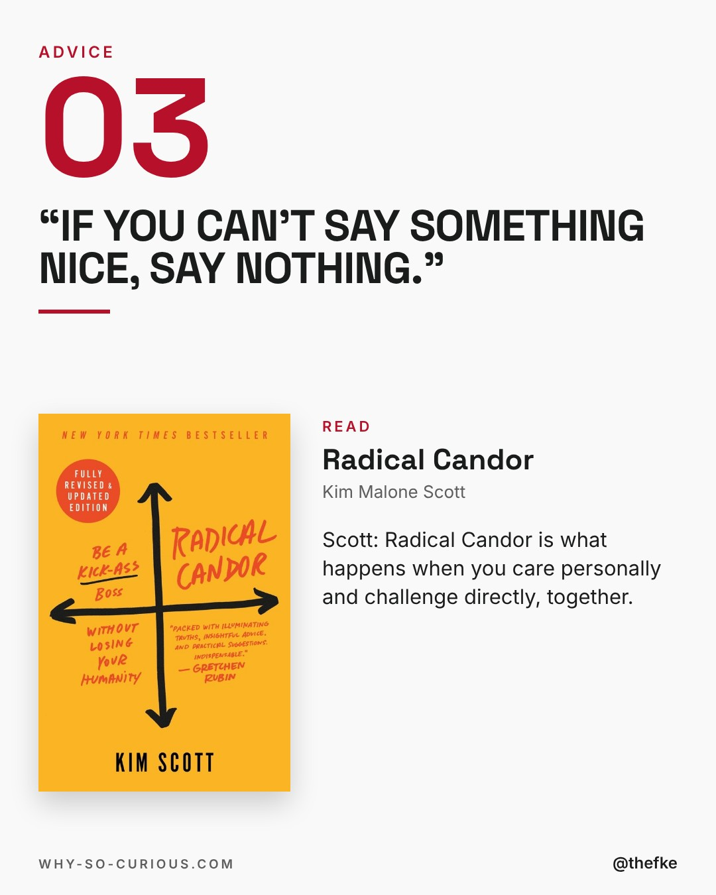
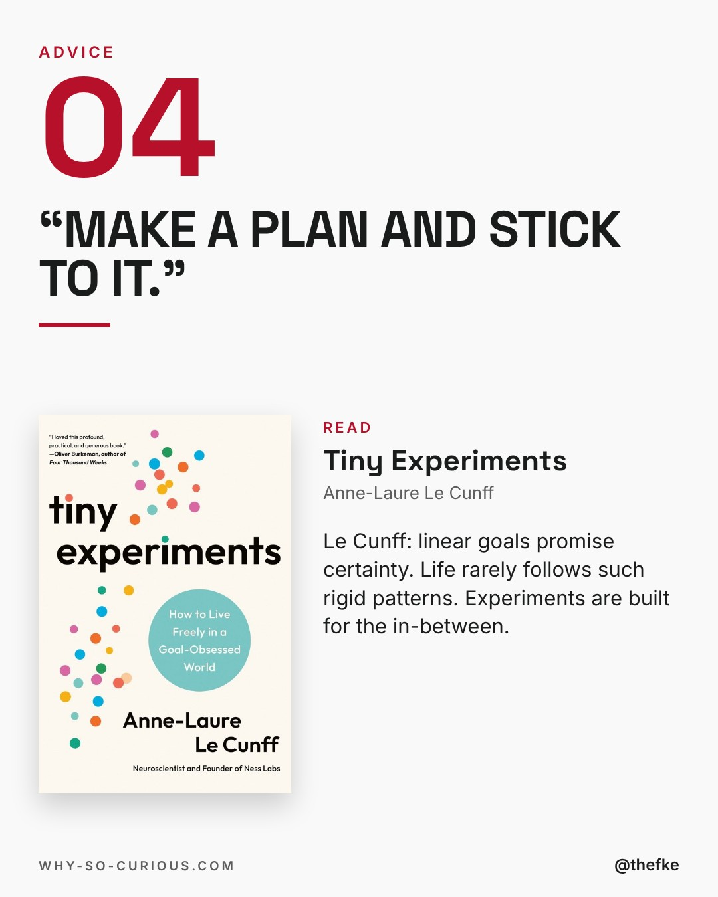
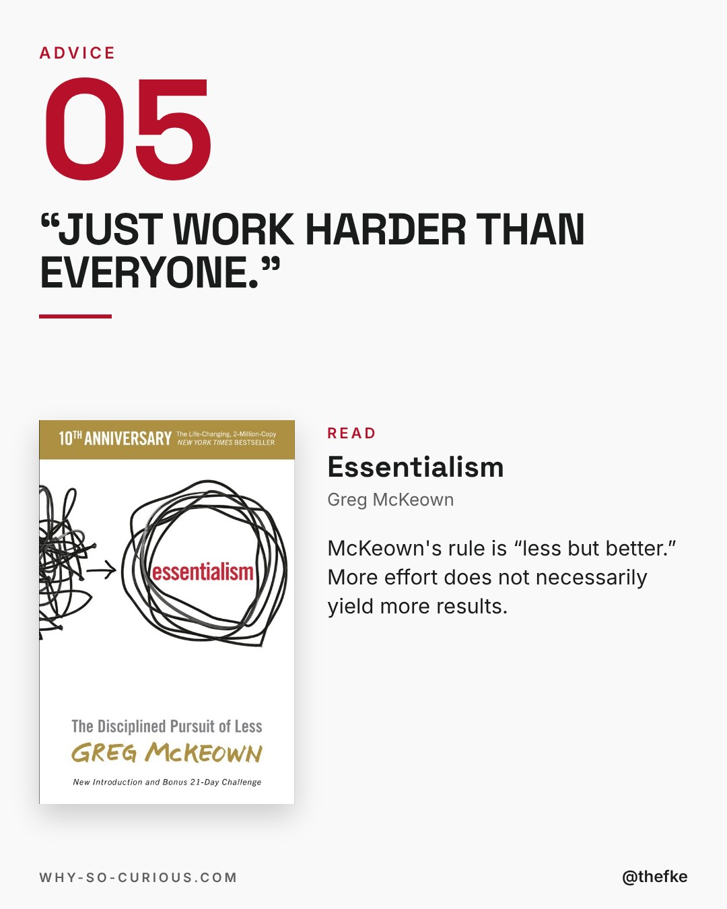
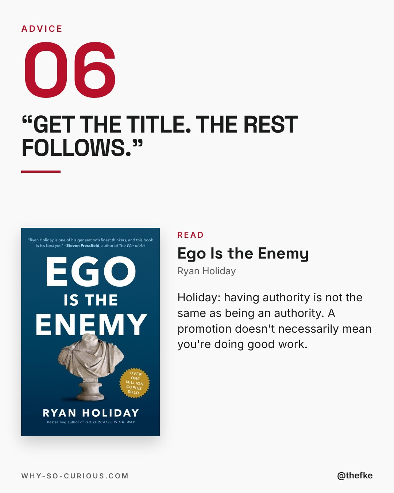
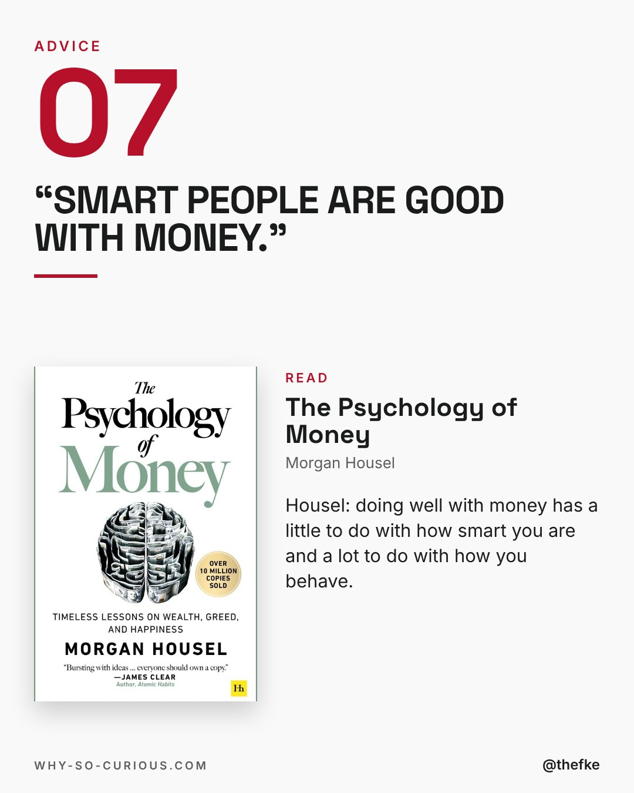
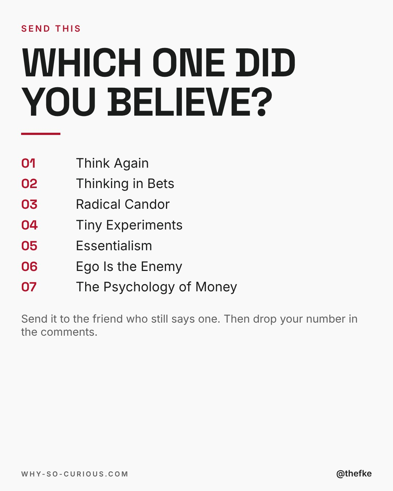

# Do 24.12. · Advice that sounds smart. And isn't, Part 2

Abend-Slot. Karussell, 9 Slides. Beim Hochladen 4:5 wählen.

## Caption

```
“Never change your mind.”
Sounds strong. Ages badly.

Seven more pieces of advice everyone repeats.
And the books that take them apart.

Annie Duke has a word for judging a decision by how it turned out.
Poker players call it “resulting.”
A good decision can still lose. A bad one can still win.

All from my shelf.

Send this to the friend who still says one of these.

Which one did you believe?

Books from this post: link in bio.

#bookstagram #bookrecommendations #books
```

## Slides










