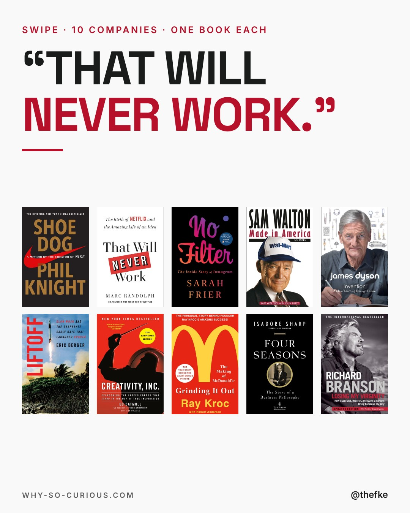
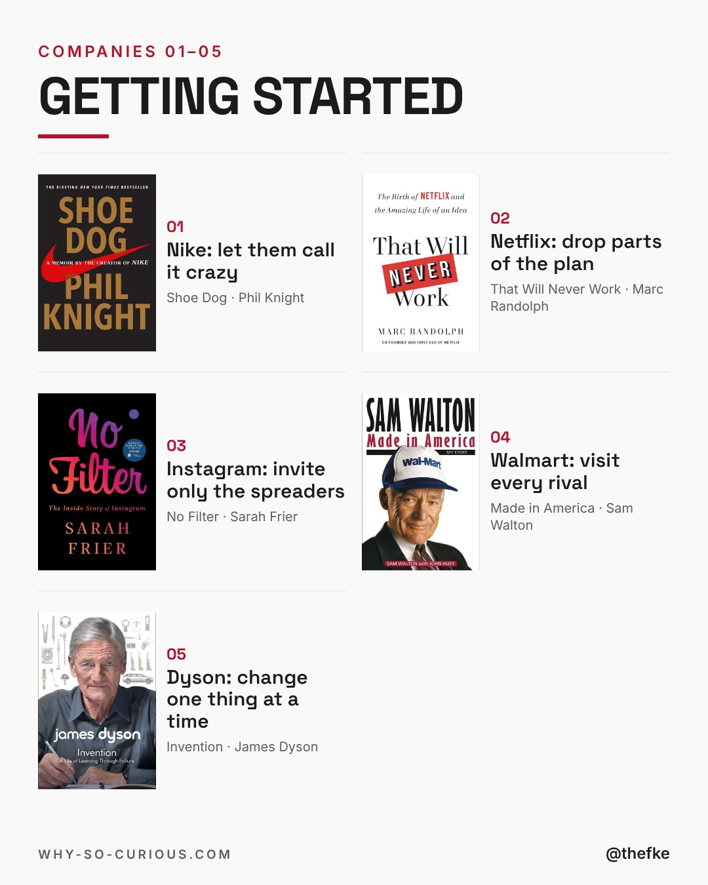
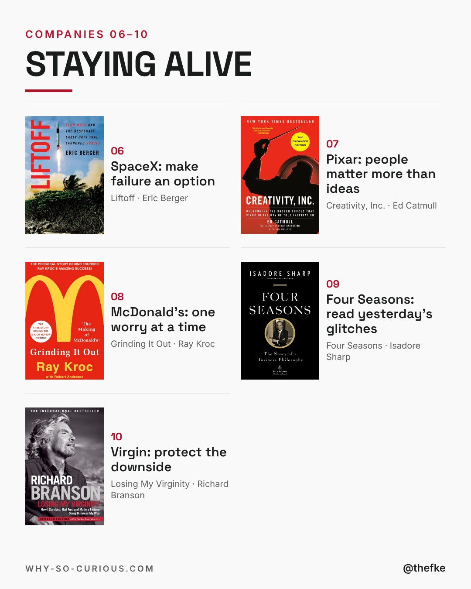
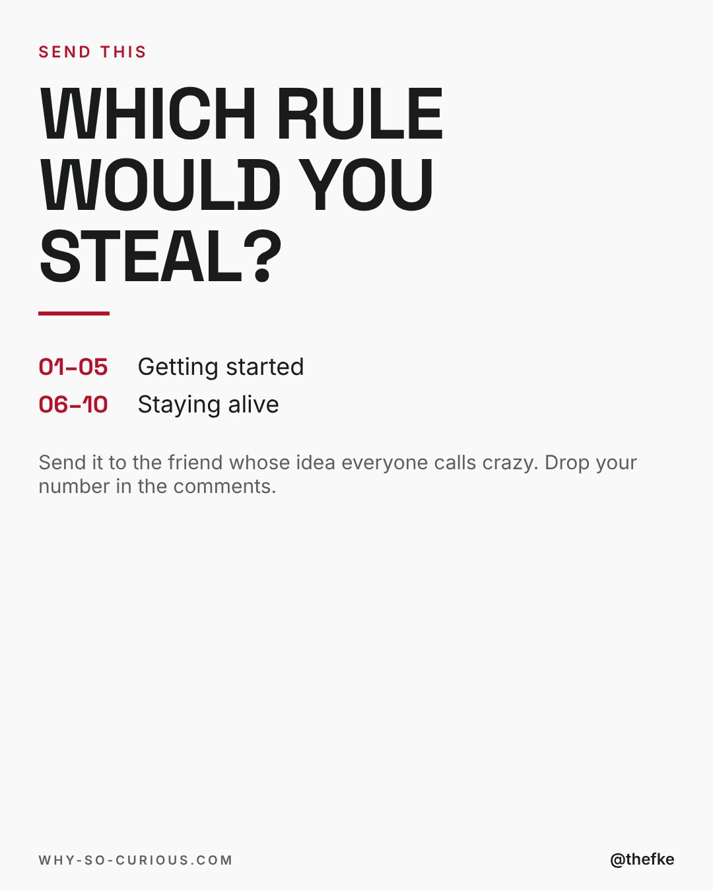

# Do 24.12. · “That will never work.” 10 companies did it anyway

Früh-Slot, wird automatisch gepostet (ohne Musik). Nicht von Hand posten. Karussell, 4 Slides. Beim Hochladen 4:5 wählen.

## Caption

```
Every one of these companies started as a long shot.
Then they found a rule that kept them going.

Sam Walton visited more rival headquarters than anybody.
Musk met every SpaceX hire through the first 3,000 employees.
Four Seasons starts each day with a report on yesterday's glitches.

10 companies. 10 books from my shelf.
5 about getting started, 5 about staying alive.

Phil Knight in Shoe Dog, on a morning in 1962:
“Let everyone else call your idea crazy . . . just keep going. Don’t stop. Don’t even think about stopping until you get there, and don’t give much thought to where “there” is. Whatever comes, just don’t stop.”

Send this to the friend whose idea everyone calls crazy.

Which rule would you steal?

Books from this post: link in bio.

#bookstagram #bookrecommendations #books
```

## Slides





